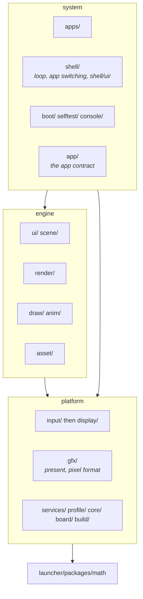
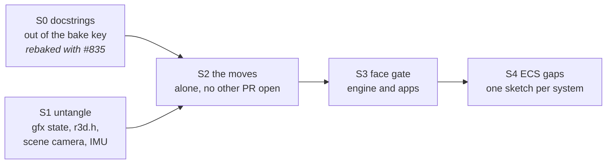

# Engine layer: design sketch

**Status:** every section approved; a final read before it merges.
The scene transform and animator calls in section 2 exist and the scene camera is in `scene/camera/`; the rest has not moved. `[M]` marks the maintainer's decision or constraint.

The firmware becomes three bands over the shared packages: the **platform**
(board, panel, input, present, core), the **engine** (scene, render, anim,
asset, 2D drawing, UI toolkit) and the **system** (apps, shell, boot, self
test, console, app contract). Apps use the engine and the platform's face,
and may not include the rest of the system band.



---

## 1. Shell UI apart from engine and game UI

Today one folder, `ui/`, holds both the toolkit (microui integration,
widgets, pointer, scroll) and the shell's screens (launcher, ridge backdrop).
The editor compiles all of it, links the app list and previews the launcher.
The editor has no authored document.

| | Option | Editor | Shell UI | Cost |
|---|---|---|---|---|
| A | one editor with an internal-only shell mode | knows firmware screens | edited in the editor | `[M]` concern: the public editor would carry an internal-only mode |
| B | shell UI stays code, editor is games-only | names no firmware | hand-written C, as the launcher is today | shell screens never get the editor |
| **C** | **the shell is one more project on the public toolkit, a privileged client** | **opens a project folder, names no firmware** | **a project at `shell/ui/`, opened internally** | **the toolkit must cover what the shell needs** |

**Decision: C, with B until the editor is mature** `[M]`, and every item in this section is approved.

### What C separates that today's tree does not

| Today | Under C |
|---|---|
| `ui/` mixes the toolkit and the shell's screens | `ui/` is the toolkit only; the shell's screens live in `shell/ui/` |
| `ui_launcher.c` includes `app/app.h`, so the toolkit folder knows the app list | the toolkit includes no system header; the tier gate fails it |
| the editor's runtime includes `app/app.h`, registers apps by name, links `app/app_registry.c`, and previews the launcher | the editor opens a project: a folder of `<screen>_layout.json` plus one registered draw entry per screen; it links no system file |
| layouts live in `ui/` | each project keeps its layouts: `shell/ui/`, `apps/<game>/ui/` |

### What the shell needs that the toolkit lacks

| Need | Becomes | Why |
|---|---|---|
| a scrim behind a panel over a paused screen | toolkit feature `ui_scrim_*` `[M]` | a game's pause menu needs the same |
| scroll with snap and momentum | toolkit (already `ui_scroll`, `ui_snap`) | an app already uses it |
| `ui_invalidate()` | toolkit (already) | any client whose screen another drawer overwrote calls it |
| baked layout tables | toolkit (already `ui_layout.h`) | the editor's output, the same for every project |
| the app list, its icons and the launch tap | shell code | only the shell knows the registry |
| the ridge backdrop and its tuning | shell code | the shell's own art |
| system gestures (home swipe, edges) | shell code over `input/gesture.h` | a game must not own the way home |

### The privileged hooks, kept out of the public SDK

| Hook | Where it lives | Who may call it |
|---|---|---|
| overlay: a system draw after the app's `frame()` | a new phase after `frame()` in `shell/shell_system.h` `[M]` | system band only |
| boot handoff: the home painter under boot's last frames | `boot_anim_set_ending_backdrop()` (exists) | system band only |
| app switching, exit | `shell/`; apps reach it only through `app/app.h` callbacks and `shell_request_exit()` | as today |

They stay out of the SDK by one tier rule, no list `[M]`: an app may include
the engine, the app contract and the platform's face, never `shell/`,
`boot/`, `selftest/` or `console/`.

### What UI-Editor-Plan.md becomes, and what the shell keeps

- **The plan** is retitled "UI editor: authoring a project's screens" `[M]`.
  Its first document becomes a game screen (the brush screen, already its
  phase 5); the editor links `ui/` and `gfx/` and no shell or app file, so the
  launcher preview leaves it until the shell opens as a project.
- **The shell keeps** (B, the interim): the launcher and the ridge backdrop
  as hand-written C under `shell/ui/`, drawn with the public toolkit like
  any app.

---

## 2. The ECS surface rule

`[M]` Apps and games talk to the game loop in ECS: each engine system's
public face is scene components plus calls on entities; its per-frame work
runs as systems over packed component arrays; its internals stay private.
Every item in this section is approved.

### Today and the rule, per system

| System | Public face today | As the rule wants it | Gap |
|---|---|---|---|
| scene | `scene_load(id)`, `scene_find(name)`, `scene_set_transform()`, `scene_entity_set_enabled()`, `scene_animator_*()`, `scene_renderer_set_skin()`, `scene_activate(scene, "camera name")`; packed per scene (`locals[]`, `flags[]`, `renderers[]`, `cameras[]`, `animators[]`, `skinned_renderers[]`), private in `scene_internal.h` | components `transform`, `renderer`, `camera`, `animator`, get/set on an entity; the camera activated by entity | the camera is named by string |
| render | apps call `raster_draw()`, `render_view_make()`, `r3d_pipeline_*` directly | no app call: a `renderer` component draws, an active `camera` entity views; render settings (resolution) are a scene-level component `[M]` | a bench app's tests drive the raster directly: they move to render's own tests |
| anim | the animator component and `scene_animator_*()`; sampler, binding, pose and layer stay behind `scene/scene.h`; boot calls `anim_tracks_*` and samples its tracks directly | `animator` component and `scene_animator_play()` (the animation sketch's face); sampler and binding private | boot's animation is not a scene |
| asset | apps call `asset_store_pack()`, `asset_pack_find()` | no per-frame system: a component names content by asset id `[M]`, resolved when the scene loads or the component attaches; pack format and store private | direct store calls from apps |

### Private headers apps include today

| Include in an app | Call | Moves to |
|---|---|---|
| `gfx/present/gfx_mode.h` | `gfx_mode_enter()`, `gfx_mode_exit()` | the platform's gfx face; an app that runs in one mode declares it on `app_t` and the shell enters it `[M]` |
| `gfx/present/gfx_present.h` | `gfx_request_full_redraw()` | the gfx face |
| `gfx/present/gfx_present.h` | `gfx_present_begin()`, `gfx_present_wait()` in bench scenes | the scene system, which already overlaps the present |
| `gfx/present/gfx_indexed.h` | `gfx_indexed_*` (index image mode) | the gfx face |
| `gfx/present/gfx_debug.h` | `gfx_debug_overlay()` in diagnostics | system band, with diagnostics (below) |
| `input/imu.h`, `imu_rotation.h` | `imu_init()`, `imu_read()`, `imu_gravity_screen()` | `input_start()` (the shell's), `input_read_gravity()` and the frame's `input_t` |
| `scene/scene_shell.h` ("Apps never include this") in a host tool | `scene_shell_render()`, `scene_shell_compose()` | one public host-frame call on the scene's face |
| `render/r3d_pipeline.h` in perf suites | `r3d_pipeline_*` | render's own tests |
| `selftest/*` in diagnostics | self-test results | diagnostics becomes a system app under `shell/apps/` `[M]` |

Shape that enforces it `[M]`: each engine folder keeps a public `include/`
and a private `src/`, as `launcher/packages/math` does; a header in `src/` is
reachable only from its own folder. The gate then needs no list.

### The face, as types and functions `[M]`

A component that names content (a mesh, a skin, a clip) holds its asset id
`[M]`. The engine resolves the id to the pack entry when the scene loads or
the component attaches at run time, so content can be rebuilt or repacked
without touching what refers to it; animators already attach this way.

The id is stored, not derived `[M]`: the import step assigns a 32-bit id
once and keeps it in the asset's import file, so a rename or a move keeps
every reference. The bake fails on a collision, and that one id is re-rolled.
The pack indexes entries by id, and the runtime compares one `uint32_t`.
Hashing a name is separate: it only finds an asset by name in tools, debug
views and the console.

```c
/* content is named by a stable asset id, never a path or a pointer [M];
 * assigned once at import and stored in the asset's import file [M] */
typedef uint32_t asset_id_t;

/* components: one value type each */
typedef transformf_t scene_transform_t;                            /* position, rotation, scale */
typedef struct { asset_id_t mesh; } scene_renderer_t;
typedef struct { float half_fov_short_tan, near_z; uint16_t clear; } scene_camera_t;
typedef struct { uint8_t clip; uint16_t blend_ms; } scene_animator_t;

/* calls on entities */
const scene_transform_t* scene_entity_transform(const scene_t* scene, scene_entity_t entity);
void scene_set_transform(scene_t* scene, scene_entity_t entity, const scene_transform_t* transform);
bool scene_camera_activate(scene_t* scene, scene_entity_t camera);
bool scene_animator_play(scene_t* scene, scene_entity_t entity, int clip, uint32_t blend_ms);

/* systems: engine-private, run in order from one table over the packed arrays */
typedef struct { const char* name; void (*run)(scene_t* scene, uint32_t dt_ms); } scene_system_t;
/* animate -> placements from dirty transforms -> camera view -> census and draw */
```

Decided `[M]`:

| Question | Decision | Condition |
|---|---|---|
| game-defined components and systems | later: game logic stays in the app's `update()` and talks through engine components and entity calls | engine systems run from a table, not a hard-coded call chain, so registration can be added without rework; it comes with the first game that needs behaviour over many entities |
| immediate-mode 2D drawing and the UI toolkit | outside the rule: a per-frame API called from `frame()` | UI attached to something in the 3D world (a health bar, a name tag) is a scene component the scene draws; it comes with the first game that needs it |

The toolkit's direction is a reactive layer over baked layouts, to be
sketched; immediate mode stays the drawing layer beneath it `[M]`. Not
everything fits the ECS paradigm, so a translation layer sits between them
`[M]`.

---

## 3. Folder layout and moves

| | Layout | Cost |
|---|---|---|
| **L1** | **bands named in the tier table; folders stay under `launcher/main/`; only the splits move (UI, draw)** | **the include path stays one root; bake keys unchanged after S0** |
| L2 | a new root `launcher/engine/` with its own include root | about fifteen build scripts, gates and the editor spell `launcher/main` as the include path; the bake closure resolves headers through it, so the move re-keys; done once more when the platform splits into components |

**Decision: L1 now** `[M]`. The physical move to separate roots
happens once, when the platform and engine become their own ESP-IDF
components, after one function owns the include path that every build
script calls.

### The tree after S2 (L1)

```
launcher/
├── packages/math/        shared base [M]
└── main/
    ├── main.c  app/  apps/  shell/ (+ ui/, apps/)  boot/  selftest/  console/     system
    ├── ui/  scene/ (+ camera/)  render/  draw/  anim/  asset/                      engine
    └── input/  display/  gfx/  services/  profile/  core/  board/  build/         platform
```

`launcher/main/engine/` today is the engine standard pack (`engine.pack.toml`,
system icons), not code; it keeps its place under L1.

### Each file moves once

| Today | Destination | Slice |
|---|---|---|
| `ui_launcher*`, `ui_ridge*`, `ridge_*` | `shell/ui/` | S2 |
| `ui/` toolkit files | stay | |
| `apps/diagnostics/` | `shell/apps/diagnostics/` | S2 |
| `gfx/draw/*`, `gfx/image/*` | `draw/` | S2 |
| `gfx/draw/gfx_color.h`, `gfx_target.h`, `gfx_box.h` | `gfx/` (present's face: pixel format, target) | S2 |
| `render/viewport.h` | `display/` | S2 |
| `render/r3d_project.h`, `r3d_project_x.h` | stay in `render/` for now `[M]`: they include `render/render_view.h`, so the maths package cannot take them until they take plain values | |
| `render/r3d.h` | deleted, its six includers name what they use | S1 |

### Untangling gfx first (S1)

Present owns the framebuffer, band target and clip. Draw reads them through
`gfx/present/gfx_present.h`:

```c
gfx_target_t gfx_present_target(void);
bool gfx_present_in_band(void);
gfx_box_t gfx_clip_save(void);
void gfx_clip_restore(gfx_box_t clip);
```

`gfx_rgb()` is inline in `gfx_color.h`. Only `gfx/present/` sources include
`gfx_internal.h`.

### Include tiers in `check_style_audit.py`

The tier key stays the first path part; each row group gets a band label.

| Band | Rows, top first |
|---|---|
| system | `apps` · `shell` · `boot selftest console` · `app` |
| engine | `ui scene` · `render` · `draw anim` · `asset` |
| platform | `input` · `display` · `gfx` · `services` · `profile` · `core` · `board` · `build` |
| packages | `math` (PACKAGE-INCLUDE, unchanged) |

`input` sits above `display` `[M]`: once `viewport.h` is in `display/`,
`input/orbit_motion_touch.h` includes it, and two folders in one row cannot.
With today's includes and these moves, only the three present-to-draw edges
S1 removes go upward.

### What the engine may include from the platform

`[M]` a narrow face, never drivers; apps never reach drivers either. The
rule names only what is refused, derived from the source `[M]`:

| Never, from the engine or an app |
|---|
| `board/` |
| any `*_internal.h` outside its own folder |
| a header whose module's non-device `.c` includes `driver/…`, `bsp/…` or `esp_lcd…` (today `input/touch.h`, `input/imu.h`, `input/buttons.h`) |

Everything else in the platform is its face.

---

## 4. Slices and merge order



| Slice | What | Proof |
|---|---|---|
| S0 | the bake key stops hashing docstrings (`code_tokens()` in `launcher/tools/bake/bake.py`) | mesh, reference and fit re-key once; S0 rides the same Sponza refit as [#835](https://github.com/jose-villegas/autana/pull/835), so one GPU run rebakes both `[M]` |
| S1 | gfx untangle above; `r3d.h` gone; scene camera component; apps read motion through `input/` | suites green, boot pixels byte-identical |
| S2 | every move above, CMake, the tier table, the editor's CMake, doc paths, UI-Editor-Plan.md rewrite `[M]` | all variants build, host suites, boot pixels byte-identical, `bake.py check` keys unchanged, perf same |
| S3 | the face rule and "apps never include the system band" over app sources `[M]`; app tests on the board follow | the gate fails a scratch copy that breaks it |
| S4 | the section 2 gaps | per system |

### The bake closure

Bake keys hash the code of the mesh, reference and fit stages' Python
closure; a C file counts without its `#include` lines, and comments never
count. Docstrings do, and closure docstrings under `launcher/tools/` name
firmware paths (`device/gfx_color.py` names `main/gfx/draw/gfx_color.h`),
so S2 would re-key all three stages. S0 drops docstrings from the key once
`[M]`; after it no doc-path edit re-keys. L1 changes no include root and no
path in closure code, so S2 keys the same.

### Merge order

Scene camera component → S0 → S1 → no other PR open → S2 alone → S3.
The `render_view_t` work is independent and may land any time before S2.

## Related

- [Firmware-Architecture.md](../Firmware-Architecture.md): today's layers
- [UI-Editor-Plan.md](UI-Editor-Plan.md): rewritten in S2
- [Animation-System-Design-Sketch.md](Animation-System-Design-Sketch.md): the animator component
