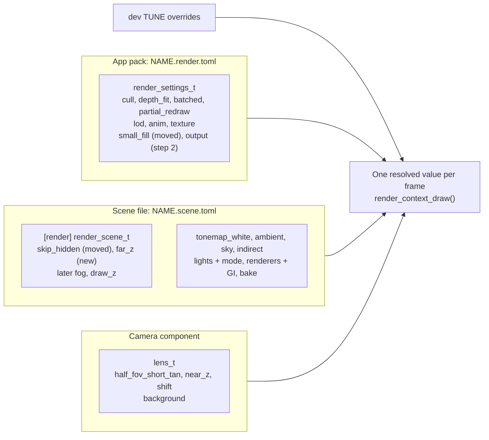

# Render settings layout (design draft, for approval)

Draft. Nothing here is built yet. It covers where each render-related setting lives, the one rule that decides it,
and the types and functions that follow.

## The rule

Ask of each setting:

| Question | If yes, it lives in | Unity's counterpart |
|---|---|---|
| Is it per view: would two cameras on the same scene want different values? | the **camera** (`lens_t`) | Camera component |
| Is it in scene units (metres, scene colours), or does its right value depend on what the scene holds? | the **scene** (scene file, SCNE) | Lighting / Environment / Fog, per scene |
| Otherwise it costs pixels, frames or counts and means the same thing in any scene | **render settings** (`render_settings_t`, the app's pack) | Quality settings / pipeline asset |

Light and renderer modes are component fields (a light's mode, a renderer's GI), so they sit on that component
in the scene file, as in Unity.

## Who owns what



## What moves

Settings missing from this table stay where they are today. The full list is the inventory at the end.

| Setting | Today | By the rule | Why |
|---|---|---|---|
| `small_fill` ceiling, gate, style | camera (`lens_t`, `camera_set_small_fill`), set only by render_lab's TUNE knobs | render settings `[small_fill]` | pixels and a colour kernel: cost and look, the same in any scene |
| `small_fill.far_ceiling` (far-band) | render settings on its branch | render settings `[small_fill]` | pixels |
| `far_z` (far-band) | render settings on its branch | scene `[render] far_z` | metres: right for Bistro is wrong for Sponza |
| `skip_hidden` | render_lab C table `scene_baked_t` → `camera_set_skip_hidden` | scene `[render] skip_hidden` | pays only where much of the scene hides behind nearer geometry |
| fog band, draw distance (k3qt) | not built | scene `[render]` (`fog_*`, `draw_z`) | metres and the scene's colours; fog must reach full at the draw distance, so they sit together |
| light mode realtime/baked (bb3uy) | not built | scene `objects.light.mode` | a property of that light |
| renderer receives/contributes (2u9br) | not built | scene `objects.mesh_renderer.*` | a property of that renderer |
| `present`, `scale`, `upscale_filter`, `frame_generation` | camera / `render_context_set_*`, set by render_lab | render settings `[output]` (**step 2**) | cost choices for the whole picture |

These stay:

| Setting | Stays in | Note |
|---|---|---|
| `cull`, `depth_fit`, `batched`, `partial_redraw`, `lod.*`, `anim.*`, `texture.*` | render settings | already right |
| `half_fov_short_tan`, `near_z`, `shift`, `background` | camera | per view |
| `tonemap_white`, `ambient`, `sky`, `indirect.*`, lights | scene file → SCNE | already scene-owned |
| `bake.*`, camera `region` / `path` | scene file, bake inputs | build time; not drawn values |
| `dynamic_resolution` | `render_context_set_dynamic_resolution()` | a controller with a model, not a value |
| `debug_view`, `budget` | dev only | not settings |
| `scene_set_probes`, `scene_set_contact_blob` | scene API | runtime data, not settings |

## Sketch

### Scene values: a `[render]` table in the scene file, not a scene pack's render file

The scene file already owns the scene's drawn values: `tonemap_white` and `ambient` reach the device in SCNE's
settings row (`scene_asset_settings_t`). The scene's render keys join that row. This is a better owner than
far-band's proposal B (a scene pack's `.render.toml` applied over the app's), for three reasons:

- The values sit beside the lights and camera they belong with.
- A scene's keys and the app's keys are two disjoint structs. Nothing is overlaid on anything else, so no
  precedence rule is needed.
- A folder pack can hold several scenes (capybara and herd), and a pack-wide render entry cannot tell them
  apart.

```toml
# demo/bistro/bistro.scene.toml
[render]            # render_scene_t's fields; absent keys keep their defaults
skip_hidden = true
far_z = 1000.0
```

```c fragment
/* render/settings/render_settings.h. A scene's drawn values: what its content
 * and scale decide. Its keys are the scene file's [render] table. */
typedef struct {
    bool skip_hidden; /* scene: skip clusters behind drawn depth; pays where much of it hides */
    float far_z;      /* scene: metres past which small_fill.far_ceiling applies; 0 is off */
    /* k3qt later: draw_z, fog_start_z, fog_rgb */
} render_scene_t;
#define RENDER_SCENE_DEFAULT ((render_scene_t){0}) /* generated, like RENDER_SETTINGS_DEFAULT */

typedef struct {
    uint8_t ceiling, gate;    /* basic: was lens_t.small_fill */
    small_fill_style_t style; /* basic */
    uint8_t far_ceiling;      /* advanced: far-band; the ceiling past render_scene_t.far_z */
} render_small_fill_settings_t;
/* render_settings_t gains: render_small_fill_settings_t small_fill; */

/* scene_asset.h: the SCNE settings row gains the scene's values (SCNE version + 1). */
typedef struct {
    vec3f_t ambient_color;
    float ambient_intensity, tonemap_white;
    render_scene_t render;
} scene_asset_settings_t;

/* render_view.h: render_view_t drops small_fill and skip_hidden and gains
 *     render_scene_t scene;   RENDER_SCENE_DEFAULT from render_view_make(); the scene's from lens_view() */
render_view_t lens_view(const lens_t* lens, const transformf_t* pose, viewport_t viewport,
                        const render_scene_t* scene);
```

- `lens_t` drops `small_fill` and `skip_hidden`. `camera_set_small_fill()`, `camera_set_skip_hidden()` and
  `scene_baked_t.skip_hidden` go.
- render_lab's small-fill picker writes `render_settings_t.small_fill` through `render_context_set_settings()`.
  Its three `TUNE_SETTING`s become `TUNE_OVERRIDE(render, small_fill_*)` beside the others.

### Which keys a scene may set: the struct it is declared in

There is no list. `render_asset.fields()` already reads `render_settings_t` from the header, and it would read
`render_scene_t` the same way. A key is an app key because it is declared in `render_settings_t`, and a scene key
because it is declared in `render_scene_t`. `import_settings.load_scene()` checks `[render]` against
`render_asset.fields("render_scene_t")`, so an app key in a scene file fails the build with "not a scene
setting". The rule decides which struct a new field goes in, and the struct enforces it.

### One resolved value per frame

```c fragment
/* render_context.c, once a frame (render_settings_tuned() is called here already) */
typedef struct {
    render_settings_t settings; /* the app's, under TUNE */
    render_scene_t scene;       /* view->scene, under TUNE (far_z sweeps) */
} render_resolved_t;
render_scene_t render_scene_tuned(const render_scene_t* scene); /* render_settings.c, beside render_settings_tuned() */
```

A draw, the selector and the kernels read plain fields of `render_resolved_t`. Partial redraw compares
`view->scene` byte for byte, where it compares `skip_hidden` today.

### `[ranges]`: derived from the header

The 41-line `[ranges]` table in `default.render.toml` repeats bounds that are already named constants in
`render_settings.h`. Each field's tier comment would carry its interval instead, in standard notation, and the
generator reads it. That removes the table, `field_ranges()` and the string-constant lookup.

```c fragment
int divide_px; /* basic [0, RENDER_TEXTURE_DIVIDE_PX_MAX]: fewest pixels between divides ... */
float blend_px; /* advanced (0, RENDER_LOD_BLEND_PX_MAX]: the error past a switch ... */
int blend; /* basic [0, RENDER_LOD_BLEND_COUNT): 0 switches at once ... */
```

`render_scene_t` gets the same bounds for free. The generated docs table in Render-Settings.md gains a scene
table from the same reader.

### Line count (estimate from today's files, not measured)

| Change | Lines |
|---|---|
| `[ranges]` table + `field_ranges()`/`range_predicate()` → interval parse | −71 / +12 |
| `camera_set_small_fill/skip_hidden`, `lens_t`/`render_view_t` fields, render_lab table and calls, 3 TUNE_SETTINGs | −45 |
| `render_small_fill_settings_t` + its TOML and TUNE overrides | +17 |
| `render_scene_t`, generated default, `render_scene_tuned()` | +18 |
| `[render]` in `load_scene()`, SCNE row packer and reader | +14 |
| **Net (code and TOML; docs not counted)** | **about −55** |

### Costs to state

- SCNE version bump: every scene pack rebuilds.
- `load_scene()` is in the bake tools' closure, so this probably re-keys every scene's bakes once.
  `bake.py check` measures it in the PR, and the rebake runs there. Changing `far_z` later re-keys nothing, since
  no bake recipe reads it.
- Step 2 (`[output]`: present, scale, upscale, frame generation) is a separate PR after this one.

## Pending settings, checked with their owners

| Setting | Owner session | Fits? |
|---|---|---|
| far_z, far_ceiling | far-band | asked; reply pending |
| light mode realtime/baked | demo M4 | asked; reply pending |
| fog, draw distance | k3qt (parked) | scene `[render]`, as above |
| renderer GI | 2u9br (not started) | renderer component fields |

## Inventory

<details><summary>Every render-related setting today (60 rows), generated by
<code>python launcher/tools/render/settings/settings_inventory.py</code></summary>

| Kind | Setting | Type | Declared in | Set by | Docs naming it |
|---|---|---|---|---|---|
| render settings | `cull` | bool | render_settings_t | app pack (basic), TUNE | Render-Settings, Culling |
| render settings | `depth_fit` | bool | render_settings_t | app pack (advanced), TUNE | Render-Settings, Attachments |
| render settings | `batched` | bool | render_settings_t | app pack (advanced), TUNE | Render-Settings |
| render settings | `partial_redraw` | bool | render_settings_t | app pack (basic), TUNE | Render-Settings, Partial-Redraw |
| render settings | `lod.tolerance_px` | float | render_settings_t | app pack (basic) | Render-Settings, Levels-of-Detail, Mesh-Import |
| render settings | `lod.hysteresis_px` | float | render_settings_t | app pack (advanced), TUNE | Render-Settings |
| render settings | `lod.coverage_permille` | int | render_settings_t | app pack (basic), TUNE | Render-Settings |
| render settings | `lod.pick_every` | int | render_settings_t | app pack (advanced), TUNE | Render-Settings, Levels-of-Detail, Partial-Redraw |
| render settings | `lod.triangle_budget` | int | render_settings_t | app pack (basic), TUNE | Render-Settings, Levels-of-Detail |
| render settings | `lod.blend` | int | render_settings_t | app pack (basic), TUNE | Render-Settings, Levels-of-Detail |
| render settings | `lod.blend_px` | float | render_settings_t | app pack (advanced) | Render-Settings, Levels-of-Detail |
| render settings | `anim.mid_px` | float | render_settings_t | app pack (basic), TUNE | Render-Settings, Skinned-Meshes |
| render settings | `anim.far_px` | float | render_settings_t | app pack (basic), TUNE | Render-Settings, Skinned-Meshes |
| render settings | `anim.mid_every` | int | render_settings_t | app pack (basic), TUNE | Render-Settings, Skinned-Meshes |
| render settings | `anim.far_every` | int | render_settings_t | app pack (basic), TUNE | Render-Settings, Skinned-Meshes |
| render settings | `anim.hysteresis_px` | float | render_settings_t | app pack (advanced), TUNE | Render-Settings, Skinned-Meshes |
| render settings | `texture.divide_px` | int | render_settings_t | app pack (basic), TUNE | Render-Settings, Texture-Mapping |
| render settings | `texture.affine_bend` | float | render_settings_t | app pack (advanced) | Render-Settings, Texture-Mapping |
| render settings | `texture.affine_level` | int | render_settings_t | app pack (advanced), TUNE | Render-Settings, Texture-Mapping |
| camera | `lens.half_fov_short_tan` | float | lens_t | scene file camera | SCNE, TRCK, Animation-Bindings-Design-Sketch + |
| camera | `lens.near_z` | float | lens_t | scene file camera | SCNE, TRCK, Projection + |
| camera | `lens.present` | camera_present_t | lens_t | render_lab_view | Camera, Frame-Cost |
| camera | `lens.small_fill` | small_fill_t | lens_t | render_lab_view | Coverage, Camera |
| camera | `lens.skip_hidden` | bool | lens_t | scene_capybara_sponza, scene_baked | none |
| camera | `lens.shift` | vec2f_t | lens_t | scene_water | Camera |
| scene file | `scene.indirect.intensity` |  | SCNE settings row | scene.toml | Bake-Quality, Scene-Files |
| scene file | `scene.indirect.albedo_boost` |  | SCNE settings row | scene.toml | Bake-Quality, Scene-Files |
| scene file | `scene.bake.ray_offset` |  | bake input (baked colours) | scene.toml | Scene-Files |
| scene file | `scene.bake.colour_merge_step` |  | bake input (baked colours) | scene.toml | Scene-Files |
| scene file | `scene.bake.ao` |  | bake input (baked colours) | scene.toml | Bake-Method, Scene-Files |
| scene file | `scene.tonemap_white` |  | SCNE settings row | scene.toml | SCNE, Building-a-Scene, README + |
| scene file | `objects.camera.half_fov_short_tan` |  | SCNE camera row | scene.toml | SCNE, TRCK, Animation-Bindings-Design-Sketch + |
| scene file | `objects.camera.near_z` |  | SCNE camera row | scene.toml | SCNE, TRCK, Projection + |
| scene file | `objects.camera.region` |  | SCNE camera row | scene.toml | Building-a-Scene, Scene-Files |
| scene file | `objects.camera.path` |  | SCNE camera row | scene.toml | SCNE, SKEL, TRCK + |
| scene file | `objects.camera.background` |  | SCNE camera row | scene.toml | Scene-Files |
| scene file | `objects.light.direction` |  | SCNE light row | scene.toml | Scene-Files, Frame-Cost |
| scene file | `objects.light.color` |  | SCNE light row | scene.toml | Scene-Files, Frame-Cost |
| scene file | `objects.light.intensity` |  | SCNE light row | scene.toml | Scene-Files, Frame-Cost |
| scene file | `scene.sky.color` |  | SCNE light row | scene.toml | README, Scene-Files |
| scene file | `scene.sky.intensity` |  | SCNE light row | scene.toml | README, Scene-Files |
| scene file | `scene.sky.rays` |  | SCNE light row | scene.toml | README, Scene-Files |
| scene file | `scene.ambient.color` |  | SCNE light row | scene.toml | README, Scene-Files |
| scene file | `scene.ambient.intensity` |  | SCNE light row | scene.toml | README, Scene-Files |
| render context | `scale` |  | render_context | render_lab_view | Mesh-Rendering, Rendering-Options, Scene-Components |
| render context | `raster_size` |  | render_context | none | none |
| render context | `frame_generation` |  | render_context | app_render_lab | Frame-Generation |
| render context | `dynamic_resolution` |  | render_context | render_lab_dynres, render_lab_render_host | Rendering-Options, Dynamic-Resolution |
| render context | `debug_view` |  | render_context | scene_capybara_sponza, scene_herd, scene_baked, scene_capybara, scene_water, scene_stress | Mesh-Rendering, Rendering-Options, View-Modes |
| render context | `upscale_filter` |  | render_context | render_lab_view | Dynamic-Resolution |
| scene runtime | `paused` |  | scene | lab, scene_draw | Scene-Components |
| scene runtime | `probes` |  | scene | scene_stress, light | Skinned-Meshes |
| scene runtime | `contact_blob` |  | scene | scene_capybara_sponza, scene_stress, scene_draw | none |
| app C table | `scene_baked_t.skip_hidden` | bool | render_lab | baked_families.c | none |
| dev TUNE | `render_lab.small_fill_ceiling` |  | render_lab_view | TUNE only | none |
| dev TUNE | `render_lab.small_fill_gate` |  | render_lab_view | TUNE only | none |
| dev TUNE | `render_lab.small_fill_style` |  | render_lab_view | TUNE only | none |
| dev TUNE | `render_lab.budget` |  | render_lab_view | TUNE only | Appearance-Fit, Mesh-Import, Scene-Files |
| dev TUNE | `render_lab.upscale` |  | render_lab_view | TUNE only | none |
| dev TUNE | `render_lab.framegen` |  | render_lab_view | TUNE only | none |

</details>
