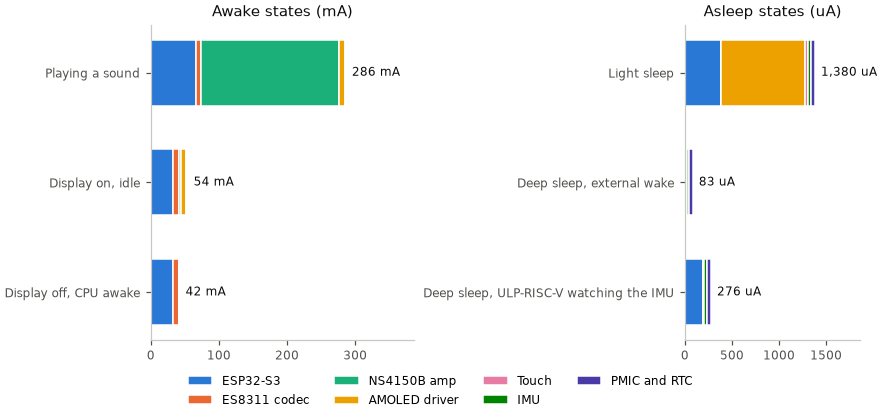
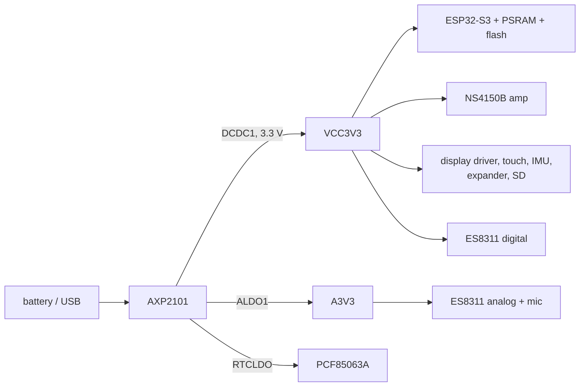

# Power budget

What each block of the board draws in each power state, worked out from the datasheets and the
speaker rating on the schematic. **Every number on this page comes from a datasheet or is derived from one; none is
measured.** The board has no current sensor, and the PMIC reports battery voltage only. A row is a
datasheet's typical or maximum figure under that datasheet's own test conditions, which differ from
the board's (the **Condition** column says how). Read the totals as ratios between states and as
bounds, not as predictions of battery life.

<!-- generated: power-summary sha256=d448b913004ca5a5bb635705f286b6bee799137109c1c65cd1a6c118a8c13cf5 -->
> Generated by: `python launcher/tools/power/power_budget_doc.py --write`

<picture>
  <source media="(prefers-color-scheme: dark)" srcset="../images/power/power_budget_states-dark.png">
  <source media="(prefers-color-scheme: light)" srcset="../images/power/power_budget_states.png">
  
</picture>

| State | Typ mA | Max mA | Amplifier in this state |
|---|---|---|---|
| Playing a sound | 277.882 | 462.887 | Driving 0.6 W |
| Display on, idle | 45.582 | 69.587 | Enabled, no load |
| Display off, CPU awake | 41.112 | 56.722 | Shut down (CTRL low) |
| Light sleep | 0.480 | 1.390 | Shut down (CTRL low) |
| Deep sleep, external wake | 0.077 | 0.093 | Shut down (CTRL low) |
| Deep sleep, ULP-RISC-V watching the IMU | 0.270 | 0.286 | Shut down (CTRL low) |
<!-- /generated: power-summary -->

## How the budget is built

One 3.3 V converter feeds almost everything, so the figures add up at that rail.
[Board-and-Memory](../notes/Board-and-Memory.md) and the schematic's power tree show where each
part connects. Two limits follow from the datasheets:

- Currents are at each part's supply, before the PMIC's converter loss. The AXP2101 datasheet gives
  no converter efficiency or quiescent current, so battery current is the sum **plus a loss that
  is not in any datasheet**.
- A row with a typical figure adds to **Typ**; a row with only a maximum (the display driver)
  adds to **Max** alone. The **Sum** row says how many rows lack a typical.

## The states

States follow what the firmware does. The mixer keeps writing silence to the codec while the
amplifier is off ([Mixer-Internals](../audio/Mixer-Internals.md#amplifier)), so the codec runs
in every awake state. A sleep state assumes the codec is powered down first.

<!-- generated: power-states sha256=a07d3b0fbd1661ea6fc447488d21a2d4d7718dda328296a9277f357e6b97c61e -->
> Generated by: `python launcher/tools/power/power_budget_doc.py --write`

### Playing a sound

Display on, both cores busy, codec running, amplifier driving the speaker.

| Block | Figure | Typ mA | Max mA | Source | Condition |
|---|---|---|---|---|---|
| ESP32-S3 | CPU 240 MHz, both cores busy | 66.2 | 107.9 | [[66]](../Citations.md#espressif-esp32-s3-datasheet) p. 67-68, Table 5-9 | typ: 32-bit data access, peripheral clocks off; max: 128-bit access, all clocks on; Wi-Fi gated; no PSRAM |
| ES8311 codec | Normal operation | 8 | - | [[103]](../Citations.md#everest-es8311) p. 12, DC characteristics | tested at DVDD/PVDD 1.8 V, AVDD 3.3 V; the board runs DVDD/PVDD at 3.3 V; ADC and DAC split not given |
| NS4150B amp | Driving 0.6 W (derived) | 202 | 337 | [[104]](../Citations.md#nsiway-ns4150b) p. 3, electrical characteristics | derived: output power / 90 % efficiency / 3.3 V; 0.6 W is the efficiency test condition; max is the speaker's 1 W rating (schematic H2) at the same efficiency |
| AMOLED driver | SH8601 driver, display running (V1) | - | 8.305 | [[105]](../Citations.md#shenghe-sh8601a) p. 19, Table 8 | IVDDI 2.805 + IVCI 5.5 mA max, 60 Hz, DSI, no load; the panel's own emission is not included; the board's interface is QSPI |
| Touch | FT3168, normal operation (V1) | 1.5 | - | [[107]](../Citations.md#focaltech-ft3168) p. 9, Table 3-2 | AVDD 2.8 V |
| IMU | QMI8658C, accelerometer only, 250 Hz | 0.142 | - | [[76]](../Citations.md#qst-qmi8658c) p. 19, Table 14 | VDD 1.8 V; gyroscope off; 250 Hz is the listed rate nearest the firmware's 200 Hz |
| PMIC and RTC | AXP2101, battery only, RTCLDO on | 0.04 | - | [[102]](../Citations.md#x-powers-axp2101) p. 10, Table 5-5 | BATFET disabled, no VBUS: a floor, since DCDC1 and ALDO1 quiescent current is not given |
| PMIC and RTC | PCF85063A RTC | 0.0002 | - | [[108]](../Citations.md#nxp-pcf85063a) p. 1, features | typical, 3.3 V, 25 C |
| **Sum** | rows listed above (1 row without a typ) | **277.882** | **462.887** |  | max sum uses typ where a row has no max |

### Display on, idle

Display on, CPU waiting, codec running, amplifier kept enabled and silent while the screen is on.

| Block | Figure | Typ mA | Max mA | Source | Condition |
|---|---|---|---|---|---|
| ESP32-S3 | CPU 240 MHz, WAITI (idle) | 32.9 | 47.6 | [[66]](../Citations.md#espressif-esp32-s3-datasheet) p. 67, Table 5-9 | max: all peripheral clocks on; no PSRAM |
| ES8311 codec | Normal operation | 8 | - | [[103]](../Citations.md#everest-es8311) p. 12, DC characteristics | tested at DVDD/PVDD 1.8 V, AVDD 3.3 V; the board runs DVDD/PVDD at 3.3 V; ADC and DAC split not given |
| NS4150B amp | Enabled, no load | 3 | 4 | [[104]](../Citations.md#nsiway-ns4150b) p. 3, 1, electrical characteristics | typ: IDD at 3.6 V supply (p. 3); max: the 4 mA of the feature list (p. 1), the table has no max |
| AMOLED driver | SH8601 driver, display running (V1) | - | 8.305 | [[105]](../Citations.md#shenghe-sh8601a) p. 19, Table 8 | IVDDI 2.805 + IVCI 5.5 mA max, 60 Hz, DSI, no load; the panel's own emission is not included; the board's interface is QSPI |
| Touch | FT3168, normal operation (V1) | 1.5 | - | [[107]](../Citations.md#focaltech-ft3168) p. 9, Table 3-2 | AVDD 2.8 V |
| IMU | QMI8658C, accelerometer only, 250 Hz | 0.142 | - | [[76]](../Citations.md#qst-qmi8658c) p. 19, Table 14 | VDD 1.8 V; gyroscope off; 250 Hz is the listed rate nearest the firmware's 200 Hz |
| PMIC and RTC | AXP2101, battery only, RTCLDO on | 0.04 | - | [[102]](../Citations.md#x-powers-axp2101) p. 10, Table 5-5 | BATFET disabled, no VBUS: a floor, since DCDC1 and ALDO1 quiescent current is not given |
| PMIC and RTC | PCF85063A RTC | 0.0002 | - | [[108]](../Citations.md#nxp-pcf85063a) p. 1, features | typical, 3.3 V, 25 C |
| **Sum** | rows listed above (1 row without a typ) | **45.582** | **69.587** |  | max sum uses typ where a row has no max |

### Display off, CPU awake

Panel asleep, CPU waiting, codec still clocked, amplifier shut down.

| Block | Figure | Typ mA | Max mA | Source | Condition |
|---|---|---|---|---|---|
| ESP32-S3 | CPU 240 MHz, WAITI (idle) | 32.9 | 47.6 | [[66]](../Citations.md#espressif-esp32-s3-datasheet) p. 67, Table 5-9 | max: all peripheral clocks on; no PSRAM |
| ES8311 codec | Normal operation | 8 | - | [[103]](../Citations.md#everest-es8311) p. 12, DC characteristics | tested at DVDD/PVDD 1.8 V, AVDD 3.3 V; the board runs DVDD/PVDD at 3.3 V; ADC and DAC split not given |
| NS4150B amp | Shut down (CTRL low) | 0.0001 | 0.01 | [[104]](../Citations.md#nsiway-ns4150b) p. 3, electrical characteristics | ISD 0.1 uA typ, 10 uA max |
| AMOLED driver | SH8601 driver, sleep (LP11) | - | 0.9 | [[105]](../Citations.md#shenghe-sh8601a) p. 19, Table 8 | IVDDI 850 + IVCI 50 uA max |
| Touch | FT3168, monitor mode (V1) | 0.03 | - | [[107]](../Citations.md#focaltech-ft3168) p. 9, Table 3-2 | AVDD 2.8 V |
| IMU | QMI8658C, accelerometer only, 250 Hz | 0.142 | - | [[76]](../Citations.md#qst-qmi8658c) p. 19, Table 14 | VDD 1.8 V; gyroscope off; 250 Hz is the listed rate nearest the firmware's 200 Hz |
| PMIC and RTC | AXP2101, battery only, RTCLDO on | 0.04 | - | [[102]](../Citations.md#x-powers-axp2101) p. 10, Table 5-5 | BATFET disabled, no VBUS: a floor, since DCDC1 and ALDO1 quiescent current is not given |
| PMIC and RTC | PCF85063A RTC | 0.0002 | - | [[108]](../Citations.md#nxp-pcf85063a) p. 1, features | typical, 3.3 V, 25 C |
| **Sum** | rows listed above (1 row without a typ) | **41.112** | **56.722** |  | max sum uses typ where a row has no max |

### Light sleep

CPU in light sleep, codec powered down, amplifier shut down, panel asleep, touch in monitor mode, IMU in low-power mode.

| Block | Figure | Typ mA | Max mA | Source | Condition |
|---|---|---|---|---|---|
| ESP32-S3 | Light sleep | 0.24 | - | [[66]](../Citations.md#espressif-esp32-s3-datasheet) p. 68, Table 5-10 | VDD_SPI and Wi-Fi off |
| ESP32-S3 | 8 MB octal PSRAM in light sleep | 0.14 | - | [[66]](../Citations.md#espressif-esp32-s3-datasheet) p. 68, Table 5-10, note 1 | 3.3 V octal PSRAM (S3R8, Table 1-1, p. 14) |
| ES8311 codec | Power-down mode | 0 | - | [[103]](../Citations.md#everest-es8311) p. 12, DC characteristics | printed as 0 uA, a rounded figure |
| NS4150B amp | Shut down (CTRL low) | 0.0001 | 0.01 | [[104]](../Citations.md#nsiway-ns4150b) p. 3, electrical characteristics | ISD 0.1 uA typ, 10 uA max |
| AMOLED driver | SH8601 driver, sleep (LP11) | - | 0.9 | [[105]](../Citations.md#shenghe-sh8601a) p. 19, Table 8 | IVDDI 850 + IVCI 50 uA max |
| Touch | FT3168, monitor mode (V1) | 0.03 | - | [[107]](../Citations.md#focaltech-ft3168) p. 9, Table 3-2 | AVDD 2.8 V |
| IMU | QMI8658C, low-power accelerometer, 3 Hz | 0.03 | - | [[76]](../Citations.md#qst-qmi8658c) p. 19, Table 14 | VDD 1.8 V; the nearest listed figure to a wake-on-motion watch, whose own current is not given |
| PMIC and RTC | AXP2101, battery only, RTCLDO on | 0.04 | - | [[102]](../Citations.md#x-powers-axp2101) p. 10, Table 5-5 | BATFET disabled, no VBUS: a floor, since DCDC1 and ALDO1 quiescent current is not given |
| PMIC and RTC | PCF85063A RTC | 0.0002 | - | [[108]](../Citations.md#nxp-pcf85063a) p. 1, features | typical, 3.3 V, 25 C |
| **Sum** | rows listed above (1 row without a typ) | **0.480** | **1.390** |  | max sum uses typ where a row has no max |

### Deep sleep, external wake

Only RTC memory powered; the touch interrupt wakes it. The datasheet gives no PSRAM figure for deep sleep.

| Block | Figure | Typ mA | Max mA | Source | Condition |
|---|---|---|---|---|---|
| ESP32-S3 | Deep sleep, RTC memory only | 0.007 | - | [[66]](../Citations.md#espressif-esp32-s3-datasheet) p. 68, Table 5-10 | no PSRAM figure is given for deep sleep |
| ES8311 codec | Power-down mode | 0 | - | [[103]](../Citations.md#everest-es8311) p. 12, DC characteristics | printed as 0 uA, a rounded figure |
| NS4150B amp | Shut down (CTRL low) | 0.0001 | 0.01 | [[104]](../Citations.md#nsiway-ns4150b) p. 3, electrical characteristics | ISD 0.1 uA typ, 10 uA max |
| AMOLED driver | SH8601 driver, deep standby | - | 0.006 | [[105]](../Citations.md#shenghe-sh8601a) p. 19, Table 8 | IVDDI 4 + IVCI 2 uA max |
| Touch | FT3168, sleep (V1) | 0.01 | - | [[107]](../Citations.md#focaltech-ft3168) p. 9, Table 3-2 | AVDD 2.8 V |
| IMU | QMI8658C, power-down | 0.02 | - | [[76]](../Citations.md#qst-qmi8658c) p. 42, Table 31 | registers kept; sensorDisable = 1 |
| PMIC and RTC | AXP2101, battery only, RTCLDO on | 0.04 | - | [[102]](../Citations.md#x-powers-axp2101) p. 10, Table 5-5 | BATFET disabled, no VBUS: a floor, since DCDC1 and ALDO1 quiescent current is not given |
| PMIC and RTC | PCF85063A RTC | 0.0002 | - | [[108]](../Citations.md#nxp-pcf85063a) p. 1, features | typical, 3.3 V, 25 C |
| **Sum** | rows listed above (1 row without a typ) | **0.077** | **0.093** |  | max sum uses typ where a row has no max |

### Deep sleep, ULP-RISC-V watching the IMU

As deep sleep, with the ULP-RISC-V powered and the IMU in its low-power mode.

| Block | Figure | Typ mA | Max mA | Source | Condition |
|---|---|---|---|---|---|
| ESP32-S3 | Deep sleep, ULP-RISC-V powered | 0.19 | - | [[66]](../Citations.md#espressif-esp32-s3-datasheet) p. 68, Table 5-10 | replaces the 7 uA figure, not added to it |
| ES8311 codec | Power-down mode | 0 | - | [[103]](../Citations.md#everest-es8311) p. 12, DC characteristics | printed as 0 uA, a rounded figure |
| NS4150B amp | Shut down (CTRL low) | 0.0001 | 0.01 | [[104]](../Citations.md#nsiway-ns4150b) p. 3, electrical characteristics | ISD 0.1 uA typ, 10 uA max |
| AMOLED driver | SH8601 driver, deep standby | - | 0.006 | [[105]](../Citations.md#shenghe-sh8601a) p. 19, Table 8 | IVDDI 4 + IVCI 2 uA max |
| Touch | FT3168, sleep (V1) | 0.01 | - | [[107]](../Citations.md#focaltech-ft3168) p. 9, Table 3-2 | AVDD 2.8 V |
| IMU | QMI8658C, low-power accelerometer, 3 Hz | 0.03 | - | [[76]](../Citations.md#qst-qmi8658c) p. 19, Table 14 | VDD 1.8 V; the nearest listed figure to a wake-on-motion watch, whose own current is not given |
| PMIC and RTC | AXP2101, battery only, RTCLDO on | 0.04 | - | [[102]](../Citations.md#x-powers-axp2101) p. 10, Table 5-5 | BATFET disabled, no VBUS: a floor, since DCDC1 and ALDO1 quiescent current is not given |
| PMIC and RTC | PCF85063A RTC | 0.0002 | - | [[108]](../Citations.md#nxp-pcf85063a) p. 1, features | typical, 3.3 V, 25 C |
| **Sum** | rows listed above (1 row without a typ) | **0.270** | **0.286** |  | max sum uses typ where a row has no max |
<!-- /generated: power-states -->

### The other driver revision

The state tables use the SH8601 driver and FT3168 touch controller of the original revision. The V2
revision's CO5300 driver gives only sleep figures:

<!-- generated: power-v2-driver sha256=86e2f85dfddcc0d961d96542b7a2aa3a8e0cf998847f28abb1b0070d9907ff51 -->
> Generated by: `python launcher/tools/power/power_budget_doc.py --write`

| V2 driver figure | Typ mA | Source |
|---|---|---|
| CO5300 driver, sleep (V2) | 0.135 | [[106]](../Citations.md#chipone-co5300) p. 103, DC characteristics |
| CO5300 driver, ultra-low-power sleep (V2) | 0.11 | [[106]](../Citations.md#chipone-co5300) p. 103, DC characteristics |
<!-- /generated: power-v2-driver -->

## Not in any datasheet

These rows are missing from every sum above.

<!-- generated: power-unknown sha256=bd55568438e7596ccfff9155205c9881431cb71df4699b826f644a9287edb143 -->
> Generated by: `python launcher/tools/power/power_budget_doc.py --write`

| Not budgeted | Why |
|---|---|
| AMOLED panel emission | Neither driver datasheet covers the panel itself (SH8601A p. 19 says the table shows only the driver IC's power), and no panel datasheet is held. |
| AXP2101 DCDC1 and ALDO1 quiescent current, converter efficiency | The datasheet gives the 40 uA off-state figure and no converter or LDO quiescent current or efficiency. |
| Flash, IO expander, microSD card, microphone | Their datasheets are not held. The ESP32-S3 datasheet adds about 10 mA while flash is read in 2-line mode (Table 5-9 note 3, p. 68). |
| V2 touch controller (CST820) | No datasheet is held. |
<!-- /generated: power-unknown -->

## What the budget says

All figures here are datasheet-derived. Bar lengths in the figure use a row's typical figure, else its
maximum, so the light-sleep bar is dominated by the display driver's 0.9 mA **maximum**; with the V2
driver's 0.135 mA typical the state would total about 0.6 mA, not 1.4 mA.

| Question | Answer from the datasheets |
|---|---|
| Does keeping the amplifier enabled while the screen is on matter against display-on current? | Little. Its 3 mA (4 mA at most) is about 7 % of the 45.6 mA idle sum, and the panel's emission, missing from that sum, only lowers the share. The codec's 8 mA and the idle CPU's 33 mA are larger. |
| Would the same amplifier current matter asleep? | Yes: 3 mA is six times the 0.48 mA light-sleep sum. The amplifier must be shut down (CTRL low, 0.1 uA typ) before any sleep state. |
| What does one sound cost beside the idle current? | Driving 0.6 W takes about 202 mA, 67 times the 3 mA idle. The mixer's 2 s idle timeout adds about 6 mC after each sound, small against the sound itself. |
| Does power-gating ALDO1 save anything the datasheets can show? | No. Register power-down already takes the codec to 0 uA (rounded). ALDO1 would add only the microphone, the codec's analog-supply leakage and the LDO's own quiescent current, none of which any datasheet gives. The 8 mA is not split between ALDO1 (analog) and the 3.3 V digital side. |
| What is the larger lever for the codec? | Its 8 mA runs in every awake state because the mixer keeps clocking it. Powering it down by register while idle is the saving the datasheets support: 18 % of the 45.6 mA display-on idle sum. |
| What does a pick-up wake cost in deep sleep? | Keeping the ULP-RISC-V powered replaces the 7 uA deep-sleep figure with 190 uA. The deep-sleep sum goes from 77 uA (touch wake only) to 270 uA, 3.5 times. |
| How trustworthy are the sleep sums? | They are lower bounds. The PMIC's converter and LDO quiescent current is not in the AXP2101 datasheet, and the 40 uA row is its off-state figure; that missing current can exceed every listed row. |

A measurement of battery voltage drain over a long idle run is the only cross-check that needs no
meter; it can bound what these tables cannot, the PMIC and panel rows.

## Related

- [Board-and-Memory](../notes/Board-and-Memory.md): the board's parts and rails.
- [Audio-Path](../audio/Audio-Path.md) and [Mixer-Internals](../audio/Mixer-Internals.md): the codec and amplifier lifetime.
