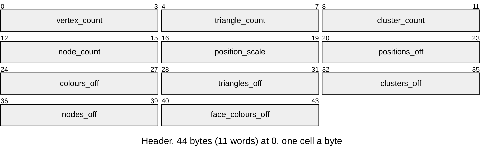
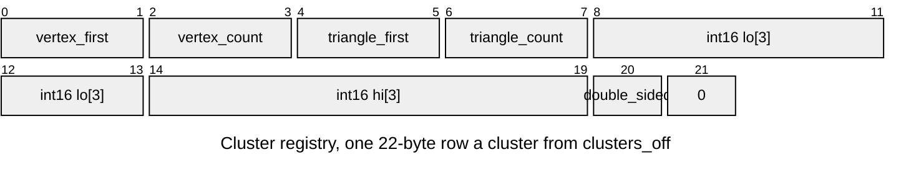
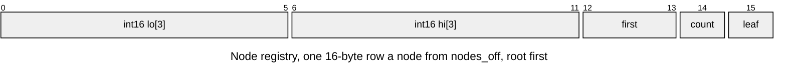
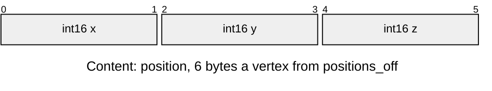
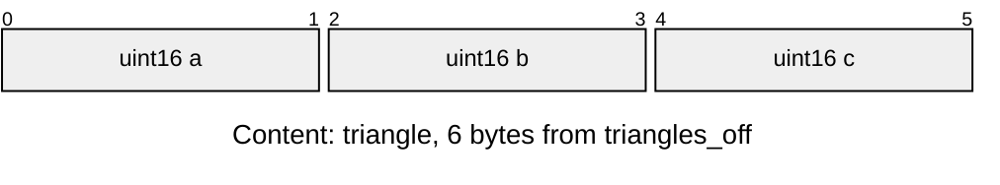
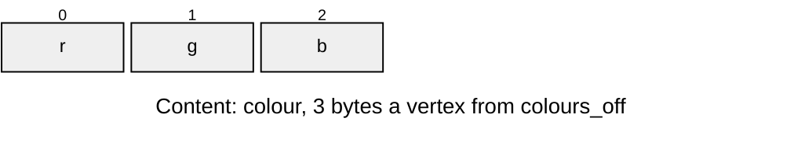
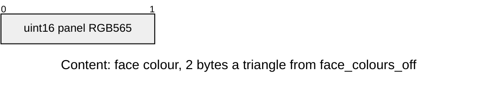

# Baked Mesh

The mesh a bake writes and a renderer reads: its clusters and tree, the
`LMSH` entry layout, and the meshlets the clusters are. How a mesh is made is
[Mesh-Import.md](Mesh-Import.md); drawing it is [Mesh-Rendering.md](Mesh-Rendering.md).

## Clusters and the tree

A vertex carries one sRGB colour: the baked light times the albedo, or, with no
bake, the albedo alone. A renderer with `shading = { flat = ... }` is flat instead,
with one RGB565 colour per triangle (`light.face_colours()`): the light and
albedo averaged over the points of the face that `shading.flat` sets, a fixed count
or one chosen per face, every face sharing one set
of sun and sky directions so neighbours on one surface agree unless something
really shades one of them. Vertices weld by position alone since colour no
longer splits them, and a flat mesh draws with no colour gradients. The
triangles are grouped into
**clusters**. Each cluster
owns a contiguous range of vertices and triangles, and its triangles index
only its own vertices. The clusters are the leaves of a tree rooted at
`nodes[0]`, so one box test culls a whole subtree. Positions are `int16`
ticks, `position_scale` ticks per model unit.

## LMSH

A baked mesh is an entry of type `LMSH` in the [asset pack](../assets/README.md).
`r3d_lit_mesh_from_asset()` fills an `r3d_lit_mesh_t` with pointers into the
entry, once, and nothing is allocated or copied; the rasterizer reads that
struct.

| Format | Version | Writer (Python) | Reader (C) |
|---|---|---|---|
| LMSH | none: the header has no version | `r3d/lit_mesh.py`, layout in `r3d/mesh_asset.py` | `render/r3d_lit_mesh.c` |

Little-endian; an array's offset counts from the entry's first byte.

| Part | At | Size |
|---|---|---|
| Header | 0 | 44 bytes |
| Content: positions | `positions_off` | 6 bytes a vertex |
| Content: colours | `colours_off`, or 0 for a flat mesh | 3 bytes a vertex |
| Content: triangles | `triangles_off` | 6 bytes each |
| Cluster registry | `clusters_off` | 22 bytes a cluster, the layout of `r3d_lit_cluster_t` |
| Node registry | `nodes_off` | 16 bytes a node, the layout of `r3d_lit_node_t`; `nodes[0]` is the root |
| Content: face colours | `face_colours_off`, or 0 for a vertex-coloured mesh | 2 bytes a triangle |

| Rule | Detail |
|---|---|
| Owners | the header's word order is the `enum` in `r3d_lit_mesh.c`; `VERTEX_LIMIT` (65535) there caps the four counts (`ASSET_ERR_BOUNDS`); `r3d_lit_cluster_t` and `r3d_lit_node_t` are `_Static_assert`ed to 22 and 16 bytes with the field offsets above, and `lit_mesh.py`'s `CLUSTER` and `NODE` write the same bytes |
| Arrays | each offset a multiple of 4 and at least 44, the array inside the entry; the writer pads each array to 4 bytes and sets the offset of an empty one to 0 (`ASSET_ERR_BOUNDS`, also for a header shorter than 44 bytes); only colours and face colours may be 0 |
| Colour source | exactly one of colours and face colours, never both (`ASSET_ERR_FORMAT`) |
| Scale | `position_scale` is ticks per model unit, in 1..`INT_MAX` (`ASSET_ERR_FORMAT`); positions are int16 ticks |
| Counts | at least one cluster and one node (`ASSET_ERR_FORMAT`) |
| Clusters | vertex ranges tile every vertex once and in order: the first starts at 0, each starts at the previous end, the last ends at `vertex_count` (`ASSET_ERR_FORMAT`); each cluster's vertex and triangle ranges lie inside the mesh and its triangles index only its own vertices (`ASSET_ERR_BOUNDS`); the writer also tiles the triangle ranges in order |
| Nodes | a leaf's children are clusters, an inner node's are nodes, `first + count` inside that array; an inner node's children come after it, so a walk down the tree ends (`ASSET_ERR_BOUNDS`); the writer limits `count` to `MAX_NODE_CHILDREN` and hangs every cluster off exactly one leaf |
| Order | header, then the arrays in the order of the Part table, each padded to 4; padding zero |

## Meshlets

The clusters are **meshlets**: compact runs bounded by `geometry.meshlet_triangles`
(4 through 256, default 32), from
meshoptimizer's clusterizer[[11]](../Citations.md#11), each of one sidedness and owning the vertices its
triangles use. The octree above them is built over the meshlets' centres, and
its leaves hold a few hundred triangles' worth.

Meshlets share more vertices than clusters cut as leaves of an octree of the
triangles, so a frame transforms fewer. Bigger ones span looser boxes and
submit more triangles for the same view, and smaller ones cost more clusters
to walk. The [measured size table](Render-Pipeline.md#meshlets) shows this trade.
Import and `rebake.py --import PATH` read the same meshlet size setting.

Meshlets also change the draw order of the finest level. Where two triangles
reach the same depth the first drawn wins, so a redrawn frame differs from the
clusterizer's order in a fraction of a percent of its pixels, from ties alone:
the triangles are the same.

Levels of detail built on the meshlets, and what they would save, are in
[plans/Cluster-LOD.md](../plans/Cluster-LOD.md).
