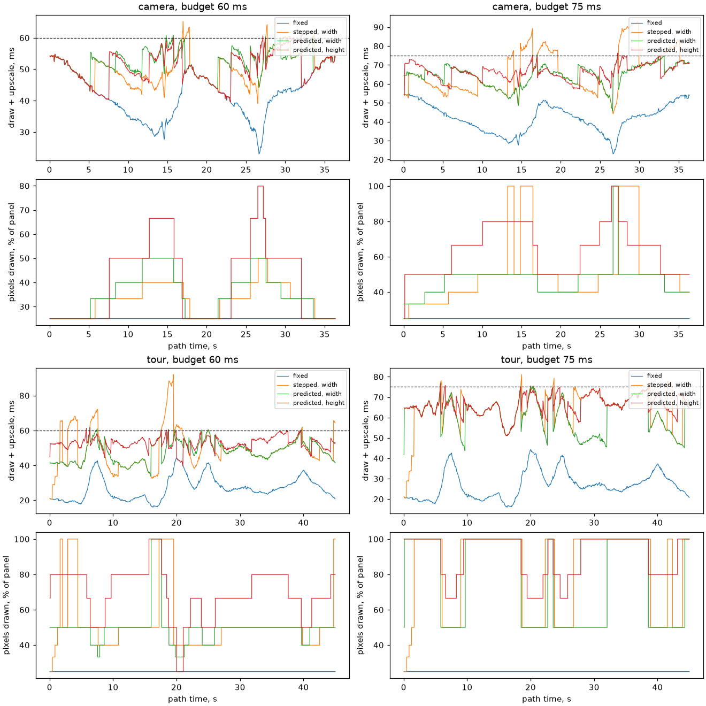
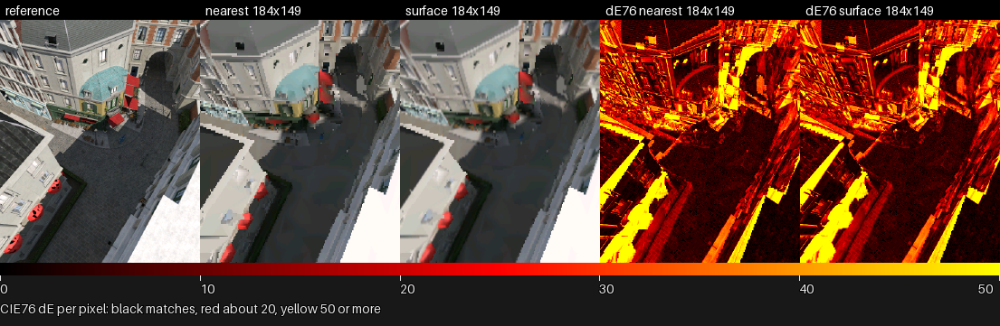
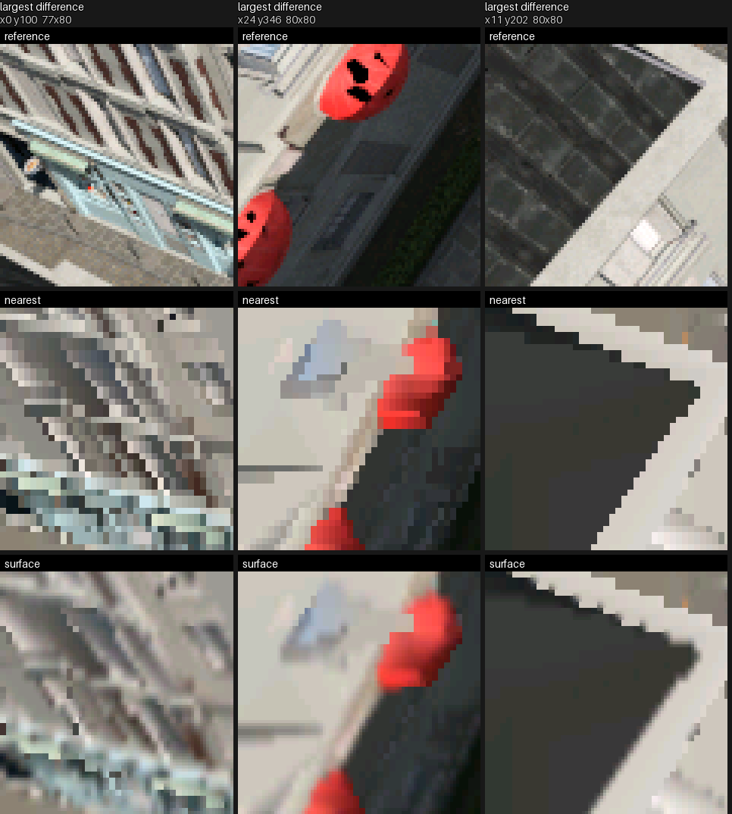
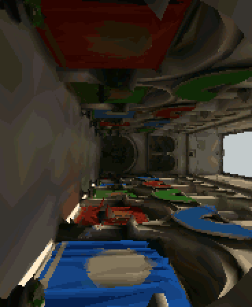
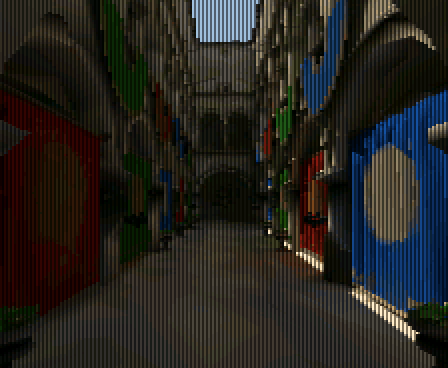
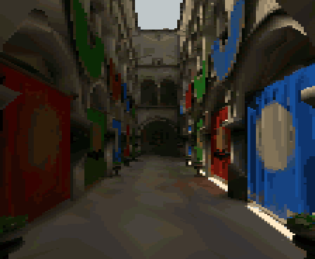

# Dynamic resolution

A scene's camera can draw each frame at a render size picked to hold a frame
budget, instead of one fixed scale. The sizes are a ladder of steps, finest
first.

`render_context_compose()` expands a draw into the half picture when its width is
exactly half and its height is at most the half height; an uneven height spreads
through the row map, its row edges on even panel rows. Otherwise it upscales to
the panel size with `render/upscale.h`, which takes any ratio in either axis.

The caller's chosen size is the top step, and neither policy draws finer:
a frame under budget keeps its speed rather than buying pixels, and only a
frame over budget steps down.

The code is `launcher/main/render/resolution/`. Resolution selection is a
setting of the render context rather than of a scene or a camera.

An app opts in with `render_context_set_dynamic_resolution()`
([Mesh-Rendering.md](Mesh-Rendering.md#the-render-context)). With no call every
frame draws at the context's fixed scale.

| Policy | Chooses | From | Guards against flapping |
|---|---|---|---|
| Stepped controller | one step at a time, after the cost, never above the top | the mean of a window of measured frames against an up and a down threshold | a cooldown after each step that doubles when a step reverses the last one; a panic drop for one frame far over budget |
| Predictor | down any number of steps, up one, before the cost, never above the top | a linear model of the frame, priced at every step from the triangles culling kept this frame, then scaled and offset by what recent frames cost | going finer needs the next step to fit with a margin under the budget for a hold in time, which doubles when a step reverses the last one |

The predictor's model is fitted on the board on every mesh scene at every
step ([below](#the-ladder-on-every-mesh-scene)). Live frames refit it: a two-state Kalman filter<sup>[[22]](../Citations.md#kalman-1960)</sup> learns a scale and an offset on
the fitted price from each frame's measured cost, leans back to the plain fit
when frames stop disagreeing with it, and clips a single hitch frame. A scale
and an offset can be learnt from frames at any one step, which four separate
weights cannot, so the fit's shape across steps carries over to steps the
predictor has not drawn lately. The scene's second path, which the fit never
sees, measures how well the refit tracks a view the fit did not cover.

The cost a policy holds is the part that scales: the draw and the compose
each step pays. Calibration uses the render context's compose decision,
including expansion into the half picture for steps that fit it.
The present and whatever an app draws over the scene are not in it. The
predictor culls once with the picture's unfitted lens, before it chooses a
size, and draws from the scratch block's census list with a fitted lens. The
list's offset is independent of render size, so the context reserves only
the finest step's raster block. Fixed and stepped draws share one fitted lens
per instance between culling and drawing.

## Where a frame's time goes at each size

The raster brackets its stages for [frame cost](../tools/Frame-Cost.md):
`r3d.cull`, `r3d.transform`, `r3d.draw` and `r3d.upscale`; through the
predictor the cull is the census, `r3d.census`. The suite behind
these tables draws the test scene's path at every size, both cores, and then
once more on one core with the span rasterizer stopped after each stage.

<!-- generated: dynres-stages sha256=e0c8ed5500c2d7cc59aca851d3ba8b17987c7a01e5e93a673c2497cf9698fe27 -->
| Render size | Divisor | Pixels | Frame mean | p50 | max | cull | transform | draw | upscale | 1 core: setup | edges | carry | fill |
|---|---|---|---|---|---|---|---|---|---|---|---|---|---|
| 368x448 | 1.00 | 100% | 94.1 | 92.8 | 113.2 | 0.6 | 3.0 | 80.1 | 10.3 | 29.0 | 10.9 | 26.5 | 59.2 |
| 184x448 | 2.00 x 1.00 | 50% | 69.2 | 69.2 | 82.2 | 0.7 | 3.1 | 58.1 | 7.3 | 27.0 | 10.1 | 25.5 | 31.6 |
| 184x358 | 2.00 x 1.25 | 40% | 59.0 | 59.4 | 70.8 | 0.7 | 3.1 | 48.6 | 6.6 | 26.2 | 9.1 | 20.8 | 23.3 |
| 184x298 | 2.00 x 1.50 | 33% | 52.8 | 53.6 | 64.0 | 0.7 | 3.1 | 42.8 | 6.3 | 25.7 | 8.3 | 17.6 | 18.3 |
| 184x224 | 2.00 | 25% | 45.4 | 46.4 | 57.2 | 0.7 | 3.1 | 35.9 | 5.8 | 24.8 | 7.3 | 13.7 | 12.8 |
| 184x179 | 2.00 x 2.50 | 20% | 40.5 | 40.7 | 49.9 | 0.7 | 3.1 | 31.2 | 5.5 | 24.1 | 6.7 | 11.2 | 9.1 |
| 184x149 | 2.00 x 3.01 | 17% | 37.6 | 38.9 | 47.4 | 0.7 | 3.1 | 28.4 | 5.4 | 23.5 | 6.2 | 9.6 | 6.9 |
| 368x358 | 1.00 x 1.25 | 80% | 79.2 | 78.7 | 95.6 | 0.7 | 3.0 | 66.3 | 9.2 | 28.3 | 9.9 | 21.7 | 45.3 |
| 368x298 | 1.00 x 1.50 | 67% | 69.5 | 68.6 | 84.4 | 0.7 | 3.1 | 57.6 | 8.2 | 27.8 | 9.1 | 18.5 | 36.2 |
| 368x224 | 1.00 x 2.00 | 50% | 58.0 | 57.9 | 71.3 | 0.6 | 3.1 | 47.1 | 7.2 | 27.1 | 8.2 | 14.5 | 25.3 |
| 294x358 | 1.25 | 64% | 72.7 | 72.5 | 87.2 | 0.7 | 3.0 | 59.6 | 9.4 | 27.5 | 9.6 | 21.4 | 36.4 |
| 276x336 | 1.33 | 56% | 68.2 | 68.3 | 82.2 | 0.7 | 3.1 | 55.2 | 9.2 | 27.2 | 9.2 | 20.2 | 32.3 |
| 245x298 | 1.50 | 44% | 60.3 | 60.5 | 73.1 | 0.7 | 3.1 | 48.0 | 8.5 | 26.5 | 8.7 | 18.0 | 24.3 |
| 210x256 | 1.75 | 33% | 54.1 | 55.3 | 64.8 | 0.6 | 3.1 | 42.2 | 8.2 | 25.6 | 7.9 | 15.6 | 18.9 |
| 245x224 | 1.50 x 2.00 | 33% | 51.9 | 52.6 | 63.4 | 0.7 | 3.1 | 39.9 | 8.3 | 25.7 | 7.7 | 14.0 | 17.1 |
| 147x179 | 2.50 | 16% | 40.1 | 40.2 | 49.6 | 0.7 | 3.1 | 29.0 | 7.3 | 23.4 | 6.4 | 11.0 | 7.1 |
| 122x149 | 3.02 | 11% | 35.8 | 36.6 | 43.8 | 0.7 | 3.1 | 24.9 | 7.2 | 22.1 | 5.7 | 9.1 | 4.2 |

Milliseconds; both cores unless marked one core.
<!-- /generated: dynres-stages -->

The questions the split answers, as differences between two sizes. A size
that keeps the panel's width or halves it upscales whole rows or pixel pairs;
any other width pays the mapped upscale on top, so both ladders keep to those
two widths. Halving the height saves far more than halving the width, since
edges and attribute carry follow the height, so a ladder cuts the height first.
184x179 costs about what isotropic 2.5x (147x179) does, and 184x149 what 3x
(122x149) does: the upscale they save pays for the pixels they keep. The
one-core setup stage barely moves with size; no step goes under it.

The split times a full upscale at every size. A live frame half as wide and
at most half as tall composes into the half picture instead, and the
policies below are priced and flown with that compose.

<!-- generated: dynres-findings sha256=b6de6dd789bc75a2c9130251f7476144a2fa7cda1be7bffcd06b4e5a721203f0 -->
| Question | Compared | Frame | draw | upscale | 1 core: edges | carry | fill |
|---|---|---|---|---|---|---|---|
| half width, more height over half | 184x298 minus 184x224 | 7.4 | 6.9 | 0.5 | 1.0 | 3.9 | 5.6 |
| half over a fifth less height | 184x224 minus 184x179 | 4.9 | 4.7 | 0.3 | 0.7 | 2.4 | 3.6 |
| half width over 2.5x, same height | 184x179 minus 147x179 | 0.4 | 2.2 | -1.8 | 0.3 | 0.3 | 2.1 |
| half width over 3x, same height | 184x149 minus 122x149 | 1.7 | 3.5 | -1.8 | 0.5 | 0.5 | 2.7 |
| full height over half | 368x448 minus 368x224 | 36.1 | 33.1 | 3.1 | 2.7 | 12.1 | 33.9 |
| full width over half | 368x448 minus 184x448 | 24.9 | 22.0 | 3.0 | 0.8 | 1.0 | 27.6 |
<!-- /generated: dynres-findings -->

## The ladder on every mesh scene

A height-first ladder on every mesh scene. Each scene's camera path
is drawn once per ladder step, holding that step and stepping the clock a
fixed amount each frame, so frame i shows the same pose at every step. The
model is fitted on all of these frames. Every scene also pays about 10 ms per
frame outside the draw and the compose. That is why a 33 ms frame target
leaves a 23 ms budget for the part that scales.

<!-- generated: dynres-steps sha256=909696f662928a495763d13f4ca67148a6c0b2d8cdf0f69662b24c105bf67e67 -->
| Scenario | 368x448 | 368x358 | 368x298 | 368x224 | 184x224 | 184x179 | 184x149 | 184x112 |
|---|---|---|---|---|---|---|---|---|
| bistro-fitted-full | 79.0 | 68.9 | 62.2 | 54.0 | 41.3 | 38.1 | 35.9 | 33.1 |
| sponza | 98.5 | 84.6 | 75.5 | 64.6 | 49.2 | 44.9 | 41.9 | 38.2 |
| sponza-lite | 89.3 | 75.9 | 67.0 | 56.6 | 41.9 | 37.8 | 35.1 | 32.0 |
| sponza-flat | 82.2 | 70.6 | 63.2 | 54.4 | 41.6 | 38.2 | 36.0 | 33.4 |
| sponza-fitted | 83.7 | 71.4 | 63.4 | 54.0 | 40.5 | 36.6 | 34.0 | 30.9 |
| sponza-fitted-full | 94.3 | 81.6 | 73.3 | 63.4 | 49.3 | 45.0 | 42.0 | 38.2 |
| sponza-flat-fitted | 76.7 | 66.5 | 60.0 | 52.4 | 40.7 | 37.7 | 35.5 | 32.8 |
| capybara | 41.6 | 36.7 | 33.7 | 29.8 | 20.9 | 19.4 | 18.6 | 17.7 |
| compose, every scenario | 10.2 | 9.1 | 8.2 | 7.3 | 2.6 | 2.3 | 2.0 | 1.8 |

Mean whole frame in milliseconds; compose is the upscale into the panel's picture.
<!-- /generated: dynres-steps -->

The heights between the half size and the floor compose into the half
picture through the row map. That costs about what the half size's compose
does, so they keep their draw saving. The predictor flown over the same
frames, against the fixed half scale: it starts at the top, the half size,
and holds the 23 ms budget.

<!-- generated: dynres-flight sha256=a807b60d24b42e41426d856cb4c0a5e6574f3653a650b4eb399e7cc1781922e4 -->
| Scenario | Fixed mean | p95 | sd | Dynamic mean | p95 | sd | max | Switches | Time at each size |
|---|---|---|---|---|---|---|---|---|---|
| bistro-fitted-full | 41.3 | 60.3 | 11.3 | 34.6 | 47.8 | 7.6 | 49.6 | 17 | 184x224 23%, 184x179 5%, 184x149 6%, 184x112 67% |
| sponza | 49.2 | 58.6 | 6.5 | 38.2 | 45.8 | 5.2 | 46.7 | 3 | 184x149 0%, 184x112 100% |
| sponza-lite | 41.9 | 47.5 | 4.0 | 32.7 | 36.4 | 2.5 | 37.6 | 9 | 184x179 5%, 184x149 15%, 184x112 80% |
| sponza-flat | 41.6 | 49.8 | 5.4 | 34.0 | 40.1 | 3.9 | 40.8 | 9 | 184x179 7%, 184x149 14%, 184x112 80% |
| sponza-fitted | 40.5 | 47.2 | 4.8 | 32.0 | 36.1 | 2.5 | 37.2 | 11 | 184x224 2%, 184x179 12%, 184x149 13%, 184x112 72% |
| sponza-fitted-full | 49.3 | 60.1 | 7.6 | 38.4 | 46.4 | 5.6 | 47.7 | 5 | 184x179 1%, 184x149 5%, 184x112 94% |
| sponza-flat-fitted | 40.7 | 50.0 | 6.1 | 33.7 | 40.4 | 3.9 | 41.3 | 11 | 184x224 5%, 184x179 10%, 184x149 8%, 184x112 76% |
| capybara | 20.9 | 21.5 | 0.2 | 20.9 | 21.5 | 0.2 | 21.5 | 0 | 184x224 100% |

Whole frame in milliseconds.
<!-- /generated: dynres-flight -->

A scene under budget at the top stays there at its fixed speed. On a scene
over budget the predictor spends most frames at the floor. That cuts the
mean, and even more so the p95 and the spread. Its heaviest frames still
run over the target: those are bound by triangle count, which the render
size cannot reduce.

## The policies on the board

Each policy flew each camera's whole path at a fixed frame step through the scene
manager, at two budgets; the fixed row is the camera's half scale. The quality
columns score every frame's size against the reference render of the same
pose at full size ([Render-Harness.md](../tools/Render-Harness.md)).

<!-- generated: dynres-policies sha256=3c509205db4b36d7c8bf200a21e925368b99f8414ae2238b2dc9d3679fb76667 -->
| Path | Budget | Policy | Ladder | p50 | p95 | max | Over budget | Switches | Time at each size | Mean dE | SSIM |
|---|---|---|---|---|---|---|---|---|---|---|---|
| camera | 60.0 | fixed | half | 42.5 | 53.6 | 54.7 | 0.0% | 0 | 184x224 100% | 9.53 | 0.5581 |
| camera | 60.0 | stepped | width | 50.2 | 60.1 | 65.2 | 5.6% | 10 | 184x448 3%, 184x358 25%, 184x298 38%, 184x224 34% | 9.53 | 0.5584 |
| camera | 60.0 | predicted | width | 53.0 | 58.2 | 60.8 | 0.8% | 12 | 184x448 17%, 184x358 24%, 184x298 26%, 184x224 34% | 9.52 | 0.5587 |
| camera | 60.0 | predicted | height | 51.2 | 58.9 | 60.9 | 0.4% | 10 | 368x358 2%, 368x298 12%, 368x224 36%, 184x224 50% | 9.51 | 0.5604 |
| camera | 75.0 | fixed | half | 42.5 | 53.6 | 54.7 | 0.0% | 0 | 184x224 100% | 9.53 | 0.5581 |
| camera | 75.0 | stepped | width | 62.4 | 88.9 | 93.0 | 25.0% | 12 | 368x448 14%, 184x448 43%, 184x358 28%, 184x298 14%, 184x224 2% | 9.50 | 0.5608 |
| camera | 75.0 | predicted | width | 65.8 | 72.0 | 76.2 | 0.4% | 7 | 368x448 2%, 184x448 61%, 184x358 30%, 184x298 7% | 9.51 | 0.5601 |
| camera | 75.0 | predicted | height | 66.6 | 72.8 | 76.3 | 0.4% | 11 | 368x448 2%, 368x358 25%, 368x298 31%, 368x224 41%, 184x224 0% | 9.46 | 0.5640 |
| tour | 60.0 | fixed | half | 26.1 | 40.8 | 44.2 | 0.0% | 0 | 184x224 100% | 12.05 | 0.4968 |
| tour | 60.0 | stepped | width | 47.4 | 67.9 | 92.1 | 15.9% | 15 | 368x448 10%, 184x448 57%, 184x358 31%, 184x298 1%, 184x224 1% | 12.04 | 0.4981 |
| tour | 60.0 | predicted | width | 48.5 | 57.7 | 61.8 | 1.6% | 14 | 368x448 4%, 184x448 77%, 184x358 15%, 184x298 4% | 12.04 | 0.4981 |
| tour | 60.0 | predicted | height | 52.8 | 58.5 | 61.6 | 0.9% | 19 | 368x448 4%, 368x358 42%, 368x298 32%, 368x224 19%, 184x224 2% | 12.03 | 0.4987 |
| tour | 75.0 | fixed | half | 26.1 | 40.8 | 44.2 | 0.0% | 0 | 184x224 100% | 12.05 | 0.4968 |
| tour | 75.0 | stepped | width | 65.8 | 74.5 | 81.1 | 4.3% | 14 | 368x448 66%, 184x448 32%, 184x358 1%, 184x298 1%, 184x224 1% | 12.03 | 0.4989 |
| tour | 75.0 | predicted | width | 63.1 | 73.0 | 76.7 | 0.8% | 9 | 368x448 50%, 184x448 50% | 12.03 | 0.4988 |
| tour | 75.0 | predicted | height | 66.0 | 73.3 | 76.7 | 0.6% | 14 | 368x448 63%, 368x358 25%, 368x298 12% | 12.02 | 0.4997 |

Frame time is the scaled part, draw plus upscale, in milliseconds; dE and SSIM are against the reference at full size, lower dE and higher SSIM being closer.
<!-- /generated: dynres-policies -->

Prediction error compares each predicted frame's corrected price with its
measured cost, grouped by path, ladder and budget.

<!-- generated: dynres-prediction sha256=d1879a5ff699a7511f4d77f8afb5764e679c3329cdb81f515bf562ced67794a6 -->
| Path | Ladder | Budget | Frames | Median error | p95 error | Over budget |
|---|---|---|---|---|---|---|
| camera | height | 60.0 | 727 | 0.5% | 2.4% | 0.4% |
| camera | width | 60.0 | 727 | 0.5% | 2.2% | 0.8% |
| camera | height | 75.0 | 727 | 0.4% | 2.1% | 0.4% |
| camera | width | 75.0 | 727 | 0.4% | 2.3% | 0.4% |
| tour | height | 60.0 | 900 | 0.5% | 2.1% | 0.9% |
| tour | width | 60.0 | 900 | 0.7% | 2.4% | 1.6% |
| tour | height | 75.0 | 900 | 0.6% | 2.2% | 0.6% |
| tour | width | 75.0 | 900 | 0.6% | 2.4% | 0.8% |

Online refit: 1000 calls, mean 3.730 us, max 27 us per call.
<!-- /generated: dynres-prediction -->

What the table shows:

- **Over budget.** At the tight budget the half scale itself is often over,
  and both policies step down to the floor and stop there: a frame a
  little over budget costs less than a harsh drop in picture. The predictor
  steps on the frame the load arrives, the controller a window later.
- **Switches.** Neither flaps: the cooldown spaces the controller's steps,
  and the finer-step margin keeps the predictor from returning to a step it
  just left.
- **Quality.** The scorer's dE is mostly the bake against the reference, a
  floor every size shares, so the differences are small; the order is what
  counts. Cutting the height first keeps the full width longer and scores
  closer to the reference than cutting the width first at the same budget,
  so the height-first ladder buys more picture for the same milliseconds.



## Upscaling within a surface

Off by default: `UPSCALE_FILTER_SURFACE` in `render/upscale.h`, set with
`render_context_set_upscale_filter()`. It applies to the steps that compose into the
half picture, and is joint bilateral upsampling<sup>[[97]](../Citations.md#kopf-2007)</sup> with a yes-or-no range weight.

| Stage | Nearest | Surface |
|---|---|---|
| Compose, rows to the half height | each row its nearest source row | blends the two source rows around it when their depths are one surface, else takes the nearer |
| Compose, same loop | - | writes a seam bit per half-picture pixel: another surface right of it or below it |
| Present, 2x expand | each pixel to a 2x2 block | centre-aligned 2x bilinear, a quarter of each neighbour, except across a seam |

Two depths are one surface when they differ by at most the nearer's
1/2^`UPSCALE_SURFACE_STEP_SHIFT`. Clear against drawn is always a seam.

<!-- generated: dynres-upscale sha256=649d14f264560cb96f309433d69be7e04cf51716516358d14477fc0ce3336af5 -->
| Scene | Size | mean dE | p95 dE | SSIM | edge dE | interior dE |
|---|---|---|---|---|---|---|
| bistro-fitted-full | 184x224 | 7.40 → 7.37 | 23.2 → 22.6 | 0.551 → 0.556 | 11.24 → 11.18 | 4.96 → 4.95 |
| bistro-fitted-full | 184x149 | 7.54 → 7.48 | 23.8 → 22.9 | 0.538 → 0.546 | 11.57 → 11.44 | 5.00 → 4.99 |
| bistro-fitted-full | 184x112 | 7.58 → 7.56 | 24.0 → 23.2 | 0.534 → 0.539 | 11.67 → 11.60 | 5.00 → 5.02 |
| sponza-fitted-full | 184x224 | 5.96 → 5.93 | 16.4 → 15.9 | 0.703 → 0.710 | 10.27 → 10.18 | 4.60 → 4.60 |
| sponza-fitted-full | 184x149 | 6.13 → 6.06 | 17.2 → 16.4 | 0.688 → 0.700 | 10.79 → 10.57 | 4.65 → 4.64 |
| sponza-fitted-full | 184x112 | 6.17 → 6.16 | 17.5 → 16.7 | 0.683 → 0.692 | 10.94 → 10.82 | 4.67 → 4.68 |
| sponza-fitted | 184x224 | 6.61 → 6.57 | 18.9 → 18.4 | 0.657 → 0.664 | 11.55 → 11.43 | 5.06 → 5.05 |
| sponza-fitted | 184x149 | 6.74 → 6.67 | 19.5 → 18.7 | 0.646 → 0.657 | 11.95 → 11.73 | 5.10 → 5.08 |
| sponza-fitted | 184x112 | 6.77 → 6.73 | 19.6 → 18.8 | 0.643 → 0.652 | 12.03 → 11.89 | 5.11 → 5.11 |
| sponza-flat-fitted | 184x224 | 5.82 → 5.75 | 16.8 → 16.0 | 0.694 → 0.708 | 10.31 → 10.08 | 4.41 → 4.38 |
| sponza-flat-fitted | 184x149 | 6.00 → 5.89 | 17.7 → 16.5 | 0.678 → 0.700 | 10.86 → 10.50 | 4.46 → 4.43 |
| sponza-flat-fitted | 184x112 | 6.04 → 5.99 | 17.9 → 16.9 | 0.675 → 0.692 | 10.98 → 10.78 | 4.48 → 4.48 |
| sponza | 184x224 | 9.76 → 9.66 | 28.7 → 28.0 | 0.550 → 0.559 | 15.85 → 15.59 | 7.84 → 7.80 |
| sponza | 184x149 | 9.82 → 9.70 | 28.9 → 28.0 | 0.544 → 0.556 | 16.03 → 15.70 | 7.87 → 7.81 |
| sponza | 184x112 | 9.84 → 9.70 | 28.9 → 28.0 | 0.541 → 0.554 | 16.09 → 15.73 | 7.87 → 7.81 |
| sponza-flat | 184x224 | 12.96 → 12.73 | 44.3 → 43.1 | 0.408 → 0.430 | 20.67 → 20.06 | 10.53 → 10.42 |
| sponza-flat | 184x149 | 13.03 → 12.72 | 44.6 → 42.9 | 0.404 → 0.433 | 20.90 → 20.06 | 10.55 → 10.41 |
| sponza-flat | 184x112 | 13.02 → 12.71 | 44.5 → 42.8 | 0.405 → 0.434 | 20.85 → 20.05 | 10.55 → 10.39 |
| sponza-lite | 184x224 | 11.51 → 11.44 | 34.1 → 33.6 | 0.491 → 0.497 | 18.51 → 18.33 | 9.33 → 9.30 |
| sponza-lite | 184x149 | 11.55 → 11.45 | 34.2 → 33.5 | 0.488 → 0.496 | 18.64 → 18.37 | 9.35 → 9.30 |
| sponza-lite | 184x112 | 11.56 → 11.46 | 34.2 → 33.5 | 0.486 → 0.496 | 18.64 → 18.39 | 9.35 → 9.29 |

Each cell is nearest → surface, the mean over the path's frames against the reference at full size; lower dE and higher SSIM are closer.
<!-- /generated: dynres-upscale -->

Surface lowers p95 dE and raises SSIM at every step of every scored scene;
mean dE moves less. The interiors blend, while depth edges keep their stairs,
which is most of the edge error left.





## Camera presentation

A camera can draw half the rows and let the present fill the rest.
`CAMERA_PRESENT_SCANLINE` darkens every second row, `CAMERA_PRESENT_DOUBLE`
repeats it, and `CAMERA_PRESENT_NEAREST` (the default) draws the full height.

One call turns it on; there are no other settings:

<!-- generated: scene-present-example check: python launcher/tools/gen/examples_doc.py --check -->
```c
/* Presentation: choose how the camera's rendered rows reach the panel. */
#include "scene/scene.h"

static bool
present_example(scene_t* scene, scene_entity_t cam) {
    return scene_camera_set_present(scene, cam, CAMERA_PRESENT_SCANLINE);
}
```
<!-- /generated: scene-present-example -->

| Mode | Rows drawn | Look |
|---|---|---|
| `CAMERA_PRESENT_NEAREST` | The chosen render height | The default picture |
| `CAMERA_PRESENT_SCANLINE` | Half that height | Each row twice, the second dimmed to `UPSCALE_SCANLINE_KEEP` |
| `CAMERA_PRESENT_DOUBLE` | Half that height | Each row twice, unchanged |

The halved draw expands into the half picture, as in `render_context_compose()`
above. When its row map is uneven, such as a dynamic-resolution step whose
height does not divide the half height, the rows are copied without the dimmed
line.

The saving comes from the halved draw: fewer rows, spans and edge steps. SCANLINE
adds a darkened copy of every second row; DOUBLE costs a little less. On a dense
benchmark scene SCANLINE cut the frame by about a quarter; the measured tables
are in the test app's tools README.

The GIFs show the same flythrough in each mode. The dark lines run along the
panel's rows, which is vertical in this orientation.

| NEAREST | SCANLINE | DOUBLE |
|---|---|---|
|  |  |  |

## Refreshing

The tables and the chart are made by the docs generator,
`launcher/tools/render/render_doc_images.sh`, like every other measured page,
from the board capture and per-path quality CSVs in `data/`:
`dynamic-resolution-quality-camera.csv` and
`dynamic-resolution-quality-tour.csv`, and the upscale filter's scores,
`upscale-filter-quality.csv`.
The capture is the suite's `scale_split`, `scale_spans`, `dynres_step` and
`dynres_frames` lines; each CSV is made by the test scene's quality script, which
renders the path at each size on a host and scores it. A new board run
replaces the capture, and the generator does the rest:

```sh
autana suite run_raster_scale_perf_suite --flash --out docs/render/data/dynamic-resolution-board.log
sh launcher/tools/render/render_doc_images.sh
```

The upscale filter's scores and figures come from the test app's upscale
quality script, one host run per scene and filter; its tools README has the command.

For the pipeline captures and GPU-stage tables, see
[Render-Pipeline.md](Render-Pipeline.md#refreshing).

The raster-scale perf suite forces portrait and landscape for every timed
window. Its rows carry `quarter=portrait` or `quarter=landscape`, including
calibration, policy flights, span splits and refit costs. Render sizes are
physical panel sizes; the viewport quarter determines their upright axes.
`dynres_report.py --quarter portrait` selects one quarter for its tables and
chart; `--quarter landscape` selects the other. The default is portrait.
