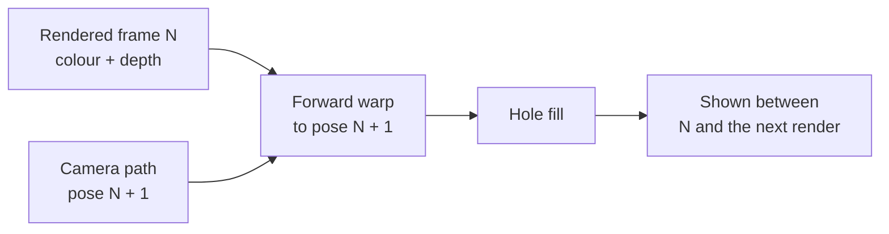

# Frame generation by depth reprojection

An experiment: show a warped copy of the last rendered frame between
rendered frames, to raise the displayed rate without drawing more triangles.
This page is its host step: picture quality and a cost estimate, no board code.

The rendered frame's colour and depth are forward-warped to a later camera
pose[[97]](../Citations.md#mark-1997), extrapolated rather than
interpolated so no frame of latency is added[[98]](../Citations.md#meta-asw-2016).
The pose comes from the camera path, so no per-pixel motion vectors are needed.

## Method

| Step | What it does |
|---|---|
| Warp | Each pixel goes back to the world through its depth and the pose it was drawn at, then into the later pose; the nearest point wins a pixel. The sky has no depth and turns with the camera |
| Holes | Pixels nothing lands on: pinholes where the warp stretches the picture, uncovered background behind a near edge, and the screen edge |
| Row fill | A hole takes the farther of its nearest neighbours left and right, since an uncovered gap shows background[[99]](../Citations.md#didyk-2010) |
| Previous fill | A hole keeps the rendered frame's colour at the same pixel |
| Repeat | What the panel shows today between renders, scored as the baseline |

Lighting is baked, so a surface's colour does not change with the view and
a warped pixel is the right colour. Depth-based warps for head motion work
the same way[[100]](../Citations.md#meta-asw2-2019).

## Picture

Every scene's camera path is drawn on the host at each half-picture size of
the [dynamic-resolution](Dynamic-Resolution.md) ladder, one frame per 33 ms
display step. Every 20th frame is warped one and two steps ahead and scored
against the frame really drawn there with the reference scorer
([Bake-Method.md](Bake-Method.md)): mean CIE76 dE and luma SSIM.
The worst frames matter more than the mean, so the 95th percentile of the per-frame mean dE is listed too.

Every scene and size

<!-- generated: framegen-scores sha256=b808a4569176a36f097ac3f071e186177338f358b2ddaab5936e3cf3b65320c0 -->
| Scene | Size | Ahead | Holes % (pinholes) | dE warp, row fill | dE warp, previous fill | dE repeat | p95 frame dE warp / repeat | SSIM warp / repeat |
|---|---|---|---|---|---|---|---|---|
| bistro-fitted-full | 184x224 | 1 | 2.8 (2.2) | 1.67 | 1.63 | 2.36 | 2.83 / 5.06 | 0.918 / 0.878 |
| bistro-fitted-full | 184x224 | 2 | 5.5 (4.0) | 2.12 | 2.07 | 3.69 | 3.19 / 7.88 | 0.892 / 0.798 |
| bistro-fitted-full | 184x149 | 1 | 2.7 (2.1) | 1.76 | 1.71 | 2.36 | 2.93 / 5.11 | 0.917 / 0.882 |
| bistro-fitted-full | 184x149 | 2 | 5.4 (4.0) | 2.27 | 2.21 | 3.69 | 3.52 / 7.86 | 0.887 / 0.803 |
| bistro-fitted-full | 184x112 | 1 | 2.8 (2.2) | 1.82 | 1.77 | 2.36 | 3.12 / 5.10 | 0.915 / 0.885 |
| bistro-fitted-full | 184x112 | 2 | 5.3 (3.9) | 2.40 | 2.33 | 3.68 | 3.94 / 7.84 | 0.879 / 0.807 |
| sponza-fitted-full | 184x224 | 1 | 2.2 (1.3) | 2.13 | 2.01 | 2.95 | 4.00 / 6.02 | 0.921 / 0.887 |
| sponza-fitted-full | 184x224 | 2 | 4.4 (2.7) | 2.52 | 2.35 | 4.59 | 4.29 / 9.20 | 0.902 / 0.807 |
| sponza-fitted-full | 184x149 | 1 | 2.1 (1.3) | 2.28 | 2.15 | 2.94 | 4.18 / 6.06 | 0.917 / 0.890 |
| sponza-fitted-full | 184x149 | 2 | 4.4 (2.7) | 2.73 | 2.54 | 4.58 | 4.48 / 9.21 | 0.897 / 0.808 |
| sponza-fitted-full | 184x112 | 1 | 2.0 (1.3) | 2.38 | 2.25 | 2.94 | 4.44 / 6.03 | 0.916 / 0.892 |
| sponza-fitted-full | 184x112 | 2 | 4.3 (2.6) | 2.90 | 2.71 | 4.57 | 4.74 / 9.21 | 0.893 / 0.811 |
| sponza | 184x224 | 1 | 2.2 (1.4) | 1.99 | 1.88 | 2.74 | 3.59 / 5.84 | 0.915 / 0.883 |
| sponza | 184x224 | 2 | 4.4 (2.8) | 2.35 | 2.19 | 4.25 | 3.91 / 8.78 | 0.897 / 0.802 |
| sponza | 184x149 | 1 | 2.2 (1.3) | 2.12 | 2.01 | 2.74 | 3.87 / 5.83 | 0.911 / 0.884 |
| sponza | 184x149 | 2 | 4.4 (2.8) | 2.55 | 2.37 | 4.25 | 4.04 / 8.76 | 0.889 / 0.803 |
| sponza | 184x112 | 1 | 2.1 (1.3) | 2.21 | 2.10 | 2.74 | 4.05 / 5.84 | 0.909 / 0.887 |
| sponza | 184x112 | 2 | 4.3 (2.7) | 2.70 | 2.53 | 4.25 | 4.25 / 8.77 | 0.885 / 0.805 |
| sponza-flat | 184x224 | 1 | 2.2 (1.4) | 1.44 | 1.33 | 2.37 | 2.14 / 5.68 | 0.877 / 0.811 |
| sponza-flat | 184x224 | 2 | 4.4 (2.8) | 1.77 | 1.62 | 3.96 | 2.65 / 8.84 | 0.855 / 0.704 |
| sponza-flat | 184x149 | 1 | 2.2 (1.3) | 1.56 | 1.44 | 2.38 | 2.33 / 5.69 | 0.872 / 0.815 |
| sponza-flat | 184x149 | 2 | 4.4 (2.8) | 1.95 | 1.79 | 3.97 | 2.85 / 8.83 | 0.845 / 0.708 |
| sponza-flat | 184x112 | 1 | 2.1 (1.3) | 1.62 | 1.53 | 2.39 | 2.57 / 5.70 | 0.869 / 0.821 |
| sponza-flat | 184x112 | 2 | 4.3 (2.7) | 2.12 | 1.95 | 3.98 | 3.07 / 8.83 | 0.839 / 0.713 |
| sponza-lite | 184x224 | 1 | 2.2 (1.4) | 1.69 | 1.58 | 2.30 | 3.20 / 4.69 | 0.925 / 0.894 |
| sponza-lite | 184x224 | 2 | 4.5 (2.8) | 2.05 | 1.88 | 3.61 | 3.71 / 7.15 | 0.905 / 0.824 |
| sponza-lite | 184x149 | 1 | 2.2 (1.4) | 1.80 | 1.69 | 2.30 | 3.44 / 4.68 | 0.922 / 0.896 |
| sponza-lite | 184x149 | 2 | 4.5 (2.8) | 2.20 | 2.02 | 3.61 | 3.81 / 7.16 | 0.899 / 0.824 |
| sponza-lite | 184x112 | 1 | 2.1 (1.4) | 1.87 | 1.77 | 2.31 | 3.67 / 4.67 | 0.919 / 0.898 |
| sponza-lite | 184x112 | 2 | 4.4 (2.7) | 2.33 | 2.16 | 3.61 | 4.02 / 7.15 | 0.896 / 0.825 |
| sponza-fitted | 184x224 | 1 | 2.2 (1.4) | 1.90 | 1.77 | 2.63 | 3.37 / 5.34 | 0.925 / 0.893 |
| sponza-fitted | 184x224 | 2 | 4.4 (2.7) | 2.25 | 2.08 | 4.13 | 3.72 / 8.26 | 0.908 / 0.820 |
| sponza-fitted | 184x149 | 1 | 2.2 (1.3) | 2.01 | 1.90 | 2.64 | 3.54 / 5.34 | 0.922 / 0.895 |
| sponza-fitted | 184x149 | 2 | 4.4 (2.7) | 2.44 | 2.25 | 4.13 | 3.87 / 8.25 | 0.902 / 0.821 |
| sponza-fitted | 184x112 | 1 | 2.1 (1.3) | 2.12 | 1.99 | 2.63 | 3.76 / 5.33 | 0.920 / 0.898 |
| sponza-fitted | 184x112 | 2 | 4.3 (2.7) | 2.61 | 2.41 | 4.13 | 4.07 / 8.22 | 0.898 / 0.824 |
| sponza-flat-fitted | 184x224 | 1 | 2.2 (1.3) | 1.61 | 1.49 | 2.43 | 3.19 / 5.60 | 0.897 / 0.854 |
| sponza-flat-fitted | 184x224 | 2 | 4.4 (2.7) | 1.99 | 1.82 | 4.04 | 3.60 / 8.99 | 0.876 / 0.766 |
| sponza-flat-fitted | 184x149 | 1 | 2.1 (1.3) | 1.75 | 1.62 | 2.44 | 3.35 / 5.61 | 0.893 / 0.858 |
| sponza-flat-fitted | 184x149 | 2 | 4.4 (2.7) | 2.19 | 2.00 | 4.05 | 3.86 / 8.98 | 0.869 / 0.768 |
| sponza-flat-fitted | 184x112 | 1 | 2.0 (1.3) | 1.84 | 1.72 | 2.44 | 3.61 / 5.57 | 0.890 / 0.862 |
| sponza-flat-fitted | 184x112 | 2 | 4.3 (2.6) | 2.35 | 2.16 | 4.06 | 4.01 / 8.95 | 0.865 / 0.773 |
<!-- /generated: framegen-scores -->

What the table shows:

- The warp beats repeating the frame on every scene and size: the mean dE
  drops by a quarter to a half, and the worst frames' dE about halves.
- One step ahead leaves 2-3% holes, three quarters of them pinholes the row
  fill closes; two steps ahead doubles both.
- The previous-frame fill scores slightly better than the row fill, at no cost.
- Smaller render heights keep the gain; the warp's error grows a little with the coarser grid.

Bistro along its whole path at 184x224: the warp's error stays near the
level of a still camera where repeating the frame jumps (turns and fast passes).

The frame on each path where the warp opens the most holes that are not
pinholes: the true frame, the warp of the frame before with its holes
filled, and the holes in red.

The screen edge opens most holes on a turn: a guard band, drawing a few
pixels past each edge, would remove them. Uncovered background behind thin
near objects (a lamp post, chair legs) is what is left.

## Cost on the board, estimated

Not measured. The motion-vector attachment's resolve does the same
per-pixel maths as the warp, and the board measured it:
14.2 ms per frame at 184x224 on both cores against 1.1 ms with nothing to resolve.

| Part | Basis | 184x224 | 184x112 |
|---|---|---|---|
| Warp maths | the motion resolve, measured: 13.1 ms over 41,216 pixels | 13.1 ms | 6.6 ms |
| Splat | a depth test and a colour write per pixel, 6 more bytes of PSRAM | 1-2 ms | 0.5-1 ms |
| Row fill | about 8 cycles per pixel on both cores | 0.7 ms | 0.4 ms |
| Present | the half-picture expand, measured; the send overlaps | 2.6 ms | 1.7 ms |
| Generated frame | | 17-18 ms | 9-10 ms |

The resolve is about 150 cycles per pixel per core, three times the 50 a
tuned warp should need. At 50 the generated frame drops to about 8 ms at
184x224.

| Bistro | Rendered frame | Generated | Displayed rate |
|---|---|---|---|
| 184x224, render only | 41.3 ms | | 24 fps |
| 184x224, one rendered and one generated, at the resolve's speed | 41.3 ms | 17.5 ms | 34 fps |
| 184x224, the same at 50 cycles per pixel | 41.3 ms | 8 ms | 41 fps |

Held at a 30 fps display, one generated frame per rendered frame leaves 49
to 59 ms to render, so Bistro could hold 184x224 where dynamic resolution
now drops to 184x112 most of the time.

A generated frame has to reach the panel halfway through the next render,
while both cores are drawing: the board step must find that slot.

## Moving objects

The warp moves everything with the camera, so an object moving on its own
(the capybara) lands where it was. What it would need, not built:

- A rigid object: one map per moved instance, which the motion-vector
  attachment already builds from the previous transform, taking only its own pixels.
- A skinned one: a map per bone. Each triangle writes its dominant bone to
  a tag plane; each pixel moves by that bone's change over the step, read from the clip at the later time.
- Tags written only for the moving instances keep the cost to the object's
  pixels, not the whole frame's.

## Verdict

Go for a board cost measurement: the warp alone, at 184x224 and 184x112,
against the 9 ms the estimate assumed. The picture is better than repeating
the frame everywhere; whether it pays depends on that one number.

## Reproducing

`launcher/tools/r3d/framegen/` holds the experiment, removable in one pass
with the render harness's `--dump` option:

| File | Role |
|---|---|
| `warp.py` | The warp and the two fills, on a raster dump |
| `framegen_score.py` | One scene and size: render, warp, score; stills, clip and video |
| `framegen_report.py` | The table and the plot from the scores |
| `framegen_docs.sh` | Regenerates this page's table and images |
