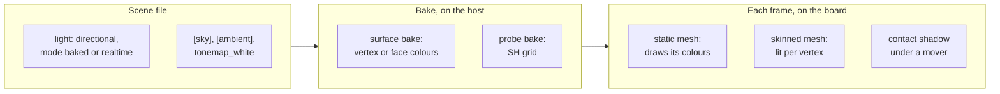
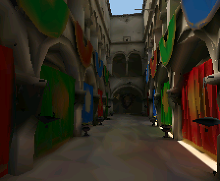
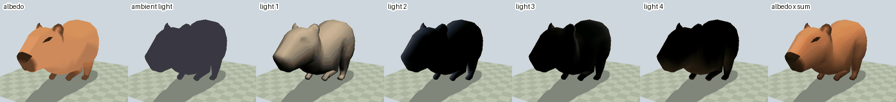
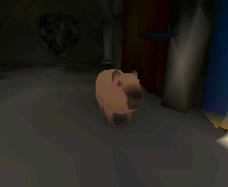

# Lighting and Shadows

Where light and shadow come from in a scene. Most of it is baked on the host
into vertex colours; moving and skinned meshes are lit on the board. This
page is the map: each section links the page that holds the detail.



| Light | Static (baked) mesh | Skinned mesh |
|---|---|---|
| directional, `mode = "baked"` | in its vertex colours, with shadows | through the probes; direct only when the scene has no probes |
| directional, `mode = "realtime"` | no | $n \cdot l$ per vertex, no shadow |
| `[sky]` | in its vertex colours, occluded | through the probes |
| `[ambient]` | in its vertex colours, times the occlusion factor when `ao` is set | flat, or replaced by the probes |
| bounced light (`[bake].indirect`) | in its vertex colours | through the probes |

## The light component

A light is an object with a `light` component. There is one kind today: a
directional light, a sun, whose direction is the object's +Y axis turned by
its rotation. Keys and rules: [Scene-Files.md](scene/Scene-Files.md#light).

| Key | Meaning |
|---|---|
| `type` | `"directional"`; `point` and `spot` are reserved |
| `color` | linear RGB |
| `intensity` | at least 0 |
| `mode` | `"realtime"` (default) or `"baked"`: which of the two paths below it takes |

Scene settings that act like lights: `[sky]` (hemisphere light, bakes only),
`[ambient]` (constant light) and `tonemap_white` (the shared tone map).
Their keys are in [Scene-Files.md](scene/Scene-Files.md#scene-settings).

At run time `light_set_color()` and `light_set_intensity()`
([`scene/light/light.h`](../../launcher/main/scene/light/light.h)) change a
light, and rotating its entity turns it; see
[Scene-Components.md](scene/Scene-Components.md).

## Baked meshes

The bake gives each smooth vertex, or each flat face sample, one colour. The
board draws that colour unlit, so baked light costs nothing per frame; the
light is fixed where the mesh was baked.



For a point $x$ with normal $n$ and albedo $a(x)$, the bake sums the lights
`light.py` `light()` gathers, then tone maps and encodes the result:

```math
L(x) = a(x)\Bigl( c_s I_s \max(0,\, n \cdot \omega_s)\, V(x, \omega_s)
     + c_k I_k \tfrac{1}{R} \textstyle\sum_{i=1}^{R} V(x, \omega_i)
     + f(x)\, c_a I_a
     + f_b(x)\, E_{\mathrm{ind}}(x) \Bigr)
```

$V$ is 1 when a ray from $x$ escapes, $f$ the local-occlusion factor, and
$`E_{\mathrm{ind}}`$ the bounced light. $`f_b`$ is $f$ when `ao.indirect` is
set, else 1.

| Term | Function in [`light.py`](../../launcher/tools/r3d/light.py) | Shadow it gives | Detail |
|---|---|---|---|
| sun $`c_s I_s`$, direction $`\omega_s`$ | `bake_directional()`: one shadow ray | hard, from a point source | [Bake-Method.md](offline/Bake-Method.md) |
| sky $`c_k I_k`$ | `bake_sky()`: the share of $R$ fixed cosine-weighted rays that escape | soft, under overhangs | [Scene-Files.md](scene/Scene-Files.md#sky) |
| ambient $`c_a I_a`$ | `bake_ambient()`, times $f$ | none, except through $f$ | [Scene-Files.md](scene/Scene-Files.md#ambient) |
| occlusion $f$ | `local_occlusion()`, a distance-limited obscurance<sup>[[14]](../Citations.md#zhukov-1998)</sup> | darkens corners and wall feet | [Bake-Method.md](offline/Bake-Method.md#local-occlusion-implementation) |
| bounce $`E_{\mathrm{ind}}`$ | `bounced_light()`: Mitsuba<sup>[[15]](../Citations.md#mitsuba3)</sup> paths<sup>[[16]](../Citations.md#kajiya-1986)</sup>, up to $K$ bounces | light from lit surfaces into shade | [Bake-Method.md](offline/Bake-Method.md#bounced-light-implementation) |

`baked_lights()` keeps only the lights with `mode = "baked"`. A mesh's rays
hit only its own source, so one baked object does not shadow another.
How close a bake comes to a per-pixel reference is
[Bake-Quality.md](offline/Bake-Quality.md).

## Moving and skinned meshes

A skinned mesh is lit on the CPU, one colour per vertex, whenever its pose or
a light changes. Its light is the ambient term plus each realtime light's
$n \cdot l$:

```math
E(n) = E_{\mathrm{amb}}(n) + \sum_{j} c_j I_j \max(0,\, n \cdot l_j)
```



$`E_{\mathrm{amb}}`$ is the flat `[ambient]`, or, when the scene has a probe
grid, an L1 spherical-harmonic sample at the mover's centre: a constant plus a
gradient in $n$.<sup>[[128]](../Citations.md#ramamoorthi-hanrahan-2001)</sup><sup>[[129]](../Citations.md#sloan-2008)</sup>
The grid carries the baked sun, sky and bounce, so a mover darkens in a
baked shadow at the grid's resolution.

| Piece | Where | Detail |
|---|---|---|
| Lighting modes: direct, renormalised, table | import `[skin].lighting`, `skin_set_light_mode()` | [Skinned-Lighting.md](animation/Skinned-Lighting.md#lighting-modes) |
| Probe bake | `bake.py --kind sh_probes`, a sibling `<scene>.probes.toml` | [SH-Probes.md](offline/SH-Probes.md) |
| Probe sampling | `scene_set_probes()` | [Light-Probes.md](frame/Light-Probes.md) |
| Per-vertex cost | about 23 cycles per light, direct mode | [Skinned-Lighting.md](animation/Skinned-Lighting.md#lighting-modes) |

## Shadows

| Kind | Cast by, onto | Made | Frame cost |
|---|---|---|---|
| Sun shadow | static onto static | bake, one ray per point | none |
| Sky occlusion | static onto static | bake, $R$ rays per point | none |
| Local occlusion (`ao`) | static onto static | bake, $R$ short rays | none |
| Probe shade | static onto a mover | probe bake; sampled per mover | one grid sample per mover |
| Contact blob | a mover onto the ground | board, after the geometry | inside `r3d.draw`, not timed apart |

### Contact shadows

A mover casts no baked shadow and the probes do not see it, so a dithered
dark disc on the ground under it stands in. Placing and drawing it:
[Contact-Shadows.md](frame/Contact-Shadows.md).



## Not supported

| Missing | Today |
|---|---|
| Point and spot lights | `type = "point"` or `"spot"` is reserved and rejected |
| A light baked into static meshes and live on movers | a light is baked or realtime, not both |
| A realtime light shadowed on a mover | realtime light reaches a mover unshadowed |
| Switching a baked light on and off | baked light is fixed in the vertex colours |
| Realtime light on static meshes | static meshes draw their baked colours only |
| More than four realtime lights | `R3D_SKIN_LIGHT_MAX` |
| One baked object shadowing another | each mesh's rays see only its own source |
| A contact shadow shaped like the mover | a round disc whatever the mover's shape |
| A projected planar contact shadow | none |
| A static mesh that moves and keeps correct light | it keeps the light of where it was baked |
| Time of day | one baked light state |
