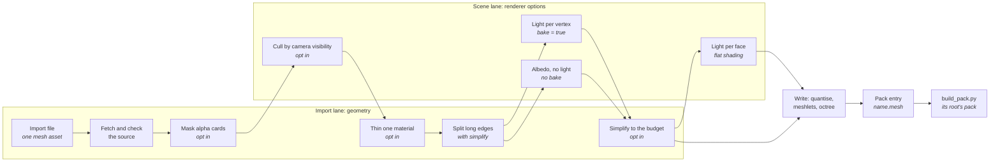
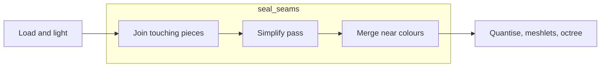

# Mesh Import

How a source mesh becomes a baked lit-mesh: the offline tools and the bake
stages. The entry a renderer consumes is [Baked-Mesh.md](Baked-Mesh.md), how
its light is computed and scored is [Bake-Method.md](Bake-Method.md), and
drawing it is [Mesh-Rendering.md](Mesh-Rendering.md).



## Import options

Keys before `;` are required; after it, optional.

### Source, output and materials

| Option | Keys | What it does | Default | Cost (bake / frame) | Option link |
|---|---|---|---|---|---|
| `[source]` | `path`, `credit` | Locates the local source file; `credit` records its attribution. | Required. | Local file / none. | [source](#source) |
| `[output]` | ; `name`, `position_scale` | Names the single mesh and position scale; bakes go to the cache. | `name` required without `[[variants]]`, rejected with them; `position_scale` 8. | Write / none. | [output](#output) |
| `[materials]` | ; `double_sided` | Draws listed material faces from both sides. | `[]`. | None / more faces drawn. | [materials](#materials) |

#### source

`[source].path` names a local file relative to the import file:

| Extension | Reads | Colour |
|---|---|---|
| `.obj` | its sibling `.mtl` and the textures the MTL names | the material's `Kd` and texture |
| `.glb` | every mesh node's triangles, placed by the node; a skinned node's in its bind pose | per vertex: `COLOR_0` times the material's base colour |
| `.fbx` | converted once to a `.glb` (`launcher/tools/fbx/fbx_to_glb.py`, cached by content), then read as one | as `.glb` |
| `.blend` | exported to a `.glb` inside Blender by `launcher/tools/bake/bake.py` (`[source] clips` names the actions), a cached bake like a mesh, then read as one | as `.glb` |

`credit` records the source attribution. Source files sit in
`launcher/demo/*/source/`, which uses Git LFS (MTL and attribution files stay
text) and which firmware clones exclude through `.lfsconfig`. Before a source
bake or reference render, run this from the repository root:

```sh
git lfs pull --exclude=""
```

The empty exclude clears the clone's default exclusion for this pull.

A model too large to commit or to trace is first reduced to an OBJ by
[`source/reduce_source.py`](../../launcher/tools/r3d/source/reduce_source.py),
which keeps its objects and textures; the import's `simplify` then starts
from that OBJ.

#### output

`[output]` names the mesh entry. Baked meshes are stored in the bake cache. `position_scale` is the
number of quantisation ticks per model unit.

#### materials

`[materials].double_sided` lists materials whose faces draw from both sides.

### Skin lighting

| Option | Keys | What it does | Default | Constraint | Option link |
|---|---|---|---|---|---|
| `[skin]` | ; `lighting` | Selects the skinned renderer's runtime lighting mode, stored in SKIN. | `"direct"`. | None / none. | [skin](#skin) |

#### skin

```toml
[skin]
lighting = "direct"
```

`lighting` is stored in SKIN v2 and selects the runtime kernel on attachment.
Unknown values fail naming the import file and allowed modes.

- `direct` (default): shades the blended normal without normalising it.
- `renormalised`: normalises the blended normal before direct shading.
- `table`: samples bilinear irradiance from the scene's normal-direction table.

[Lighting modes](Skinned-Lighting.md#lighting-modes) includes the comparison
sheet. This quality/cost table is generated from the committed board capture;
cycles per vertex are grouped by light count, errors are 8-bit channel steps.

<!-- generated: skin-light-import check: python launcher/tools/r3d/skin_light/report_skin_light_board.py docs/render/data/skin-light-board.txt docs/render/Skinned-Lighting.md --check -->
Build `8d0d33ecbdb9-diag`.

| Mode | Lights | Cycles / vertex | Worst byte error | Mean byte error | Table build cycles / light change | Normal-palette build cycles / frame | Renderer internal bytes | Scene internal bytes | Scene PSRAM bytes |
|---|---:|---:|---:|---:|---:|---:|---:|---:|---:|
| direct | 1 | 640.495 | 8 | 0.246612 | — | 5104.000 | 3744 | 1024 | 124 |
| direct | 2 | 663.714 | 9 | 0.264905 | — | 5104.000 | 3744 | 1024 | 124 |
| direct | 4 | 708.679 | 13 | 0.353997 | — | 5104.000 | 3744 | 1024 | 124 |
| renormalised | 1 | 680.045 | 1 | 0.184282 | — | 5104.000 | 3744 | 1024 | 124 |
| renormalised | 2 | 702.716 | 1 | 0.185637 | — | 5104.000 | 3744 | 1024 | 124 |
| renormalised | 4 | 748.143 | 2 | 0.180217 | — | 5104.000 | 3744 | 1024 | 124 |
| table | 1 | 865.099 | 7 | 0.455623 | 32224.000 | 5104.000 | 3744 | 2048 | 124 |
| table | 2 | 861.271 | 4 | 0.360095 | 44202.000 | 5104.000 | 3744 | 2048 | 124 |
| table | 4 | 861.167 | 4 | 0.380420 | 67278.000 | 5104.000 | 3744 | 2048 | 124 |
<!-- /generated: skin-light-import -->

### Process options

| Option | Keys | What it does | Default | Cost (bake / frame) | Option link |
|---|---|---|---|---|---|
| `[process]` | ; `seed` | Seeds thin's random choice. | `0`; only with thin. | None / none. | [process](#process) |

#### process

`[process].seed` makes `thin` choose the same triangles on every import.

### Geometry

Every Geometry table opts its step in; without it the step does not run.

| Option | Keys | What it does | Default | Cost (bake / frame) | Option link |
|---|---|---|---|---|---|
| `geometry.alpha_mask` | `keep_alpha` | Drops alpha-tested triangles that are mostly transparent. | Off. | Seconds / fewer triangles. | [alpha_mask](#alpha_mask) |
| `geometry.thin` | `material`, `keep` | Keeps a share of one material's triangles. | Off. | None / fewer triangles. | [thin](#thin) |
| `geometry.simplify` | `dense_edge`, `props`, `props_share`, `seal_seams`, `colour_deviation` | Splits long edges and simplifies each variant to its budget, colour steering the collapses; reserves `props` and can seal seams. | Off. | Seconds / set by the budget. | [simplify](#simplify) |

#### alpha_mask

`geometry.alpha_mask` removes mostly transparent cut-out cards because the
rasterizer does not alpha-test them. Off is above on; this step also changes
what the simplifier keeps elsewhere, so not every difference is a card.


#### thin

`geometry.thin` retains a selected share of one material's triangles. It is
for material whose geometry occupies more of the budget than it shows. The
share is random, so `process.seed` makes it repeatable.


#### simplify

`geometry.simplify` splits long edges and simplifies each variant to its
budget with meshoptimizer's<sup>[[11]](../Citations.md#11)</sup> quadric error simplifier<sup>[[12]](../Citations.md#12)</sup>,
with the baked colour as an appearance attribute<sup>[[13]](../Citations.md#13)</sup>.
`dense_edge` is the longest unsplit edge, `props` names materials that
reserve the `props_share` part of the budget, and `seal_seams` is described
under [seal_seams](#seal_seams). The baked colour steers which edges collapse:
`colour_deviation`, in source units, prices one panel colour step: losing it
costs the simplifier as much as moving a surface that far, the same for the
reserved `props` as for the rest, and at every budget. A smaller value keeps
surfaces nearer their source planes and keeps less colour detail. It is a
trade, not a limit.

#### seal_seams

`seal_seams = true` joins touching pieces before simplification, reducing gaps
at their borders.



| Step | What it does |
|---|---|
| Join | Welds border vertices within one quantisation step and splits border edges at the vertices lying on them, so a shared edge is one edge. |
| Pass | Runs meshoptimizer with light regularizing instead of regularizing. |
| Merge | Gives vertices at one quantised position one colour when they differ by at most one and a half RGB565 steps. |

It cuts the empty spots but does not remove them, and costs frame time for the
triangles it keeps.

The same import with `seal_seams` off against on, at a pose where it shows,
off above on: a pixel-sized hole that shows the sky is sealed.


### Geometry variants

| Option | Keys | What it does | Default | Cost (bake / frame) | Option link |
|---|---|---|---|---|---|
| `[[variants]]` | `name`; `triangles` | Names a geometry budget. | Required with `geometry.simplify`; otherwise optional (one mesh named by `output.name`). | Seconds each / set by the budget. | [variants](#variants) |
| `[[variants]].triangles` | — | Sets a simplified mesh's triangle budget. | Required with `geometry.simplify`. | Seconds / set by the budget. | [variants triangles](#variants-triangles) |

#### variants

`[[variants]]` gives a geometry output its name and, with `simplify`, its
triangle budget. Without variants, `output.name` names the single output.

#### variants triangles

`[[variants]].triangles` is the triangle budget `simplify` brings a variant to;
a `fit` budget may not exceed it.

## Objects and instances

Each colour below is one repeated shape, boxed at every copy in view. The
view is the camera-path pose where those boxes show the most visible edge;
`render_doc_images.sh` regenerates it.


An OBJ object is an `o` or `g` group; an ungrouped file uses its stem.
A glTF object is a mesh node, placed by its world transform. A nameless
node uses its index. Only vertices referenced by triangles belong to an object.

[`objects/objects_report.py`](../../launcher/tools/r3d/objects/objects_report.py)
reports shared shapes after the import's alpha mask. Matching is rigid:
scaled copies remain separate shapes. Reflections are recorded per instance.

| Test | Requirement |
|---|---|
| Candidate bucket | Equal vertex and triangle counts, and material multiset |
| Correspondence | Matching topology uses Kabsch<sup>[[86]](../Citations.md#86)</sup>; reordered vertices use signed PCA frames and bijective nearest neighbours, then Kabsch |
| Acceptance | Largest vertex residual within `MATCH_TOLERANCE` times the object's bounds diagonal; mapped triangle winding and materials agree as multisets |

The report writes counts, residuals and a camera-path estimate to an external
`--out` directory. Single-instance shapes keep their full share.

Pixels per triangle is relative by construction: picture area divided by
the path's own mean in-view budget.

A repeated shape drops to a quarter-triangle level while its share exceeds
what its projected area allows. `LOD_TRIANGLE_RATIO` and `LOD_LEVELS` in
`objects_report.py` define the levels and cap.

A sphere's disk overstates the footprint of tall thin props, so their
saving is probably understated. Culling uses placed world bounds;
the footprint estimate uses the enclosing sphere.

The table, CSV and plot show the whole budget, in-view triangles, in-view
triangles with repeated-shape LOD, and triangles LOD frees.
The bake does not use objects or instances.

## The offline tools

Source assets, scene TOMLs, cached bakes and bake-time tools use the
right-handed source frame: +x right, +y up, a camera looking down -z.
`build_pack.py` mirrors entries once into the
[engine frame](../math/Conventions.md#conventions), through
[`asset/engine_frame.py`](../../launcher/tools/asset/engine_frame.py).
The mirror negates position z; a placement's matrix `M` becomes `S M S`,
where `S = diag(1, 1, -1)`, and quaternions `(x, y, z, w)` become
`(-x, -y, z, w)`. Clips' translation and rotation tracks, including cubic
tangents, are mirrored; other tracks, key times and interpolation stay as
authored. Bounds swap their mirrored z endpoints; triangle order and baked
colours stay intact. A z coordinate equal to the int16 minimum is rejected
because its negation cannot fit. Cached meshes carry no normals: shading is
already baked.

A poses file is in the source frame.
[`track_host.py`](../../launcher/tools/anim/track_host.py) writes one with
`--poses` from a `.anim.toml`, baked into an unmirrored scratch pack;
`triangle_sizes` mirrors each pose as it reads it. A built pack's clips are
in the engine frame, so `--poses` on a `--pack` gives wrong poses.

A cached `<name>.mesh` bake supplies an entry of the
[asset pack](../assets/README.md). It is made into the bake cache
([`launcher/tools/bake/bake.py`](../../launcher/tools/bake/bake.py)) by
[`launcher/tools/r3d/mesh_import.py`](../../launcher/tools/r3d/mesh_import.py)
using the offline tools in
[`launcher/tools/r3d/`](../../launcher/tools/r3d/README.md). Two kinds of file
drive it: an **import file** beside a source asset describes that one
mesh asset, and a **scene file** describes a scenario that
places meshes ([Scene-Files.md](Scene-Files.md)). Anything specific to one mesh is in its import file; anything
about the scenario (lights, camera region, tone map) is in the scene file.
[`launcher/tools/r3d/import_settings.py`](../../launcher/tools/r3d/import_settings.py)
reads and checks both with the standard library alone, and every table is
closed: an unknown key is an error.

Run `python launcher/tools/r3d/mesh_import.py PATH` from the repository root,
with `--mesh NAME` for one mesh. `PATH` is either kind of file. An import file
writes the authored albedo mesh. A scene file writes each renderer's mesh: a
renderer with `bake = true` is traced against its own source with that scene's
lights, camera visibility and tone map; an albedo renderer writes its import's
shared mesh. `build_pack.py -o DIR` then writes one
[pack](../assets/README.md#packs) per root from the `.mesh` entries it
names, baking each scene's [entry](Scene-Files.md#scne-v2) on the way,
and `rebake.py` rewrites one `.mesh`'s clusters only.

### Import file

**Rule: an import brings geometry in as authored, and each geometry table
present turns its step on.** Visibility and lighting belong to the renderer in
its scene ([Scene-Files.md](Scene-Files.md)).

With only `[source]` and `[output]` the importer keeps the source's triangles,
cuts nothing, simplifies nothing and lights nothing. Its vertex colour is the
material's albedo (the `Kd` colour times the texture), encoded to 8 bits with a
1/2.2 gamma, not the piecewise sRGB curve, and with no tone map; the source's
own vertex colours are not read.

Two variants of one import differ in what `simplify` keeps: the same pose
at the full budget and at about half of it, the full render above the lite.


Scene-owned bake, visibility, shading and fit settings are described in
[Scene-Files.md](Scene-Files.md#option-reference).

Each tool and its module, `rebake.py` and when to rebake rather than bake in
full, and the triangle-size report are in
[`launcher/tools/r3d/README.md`](../../launcher/tools/r3d/README.md).
