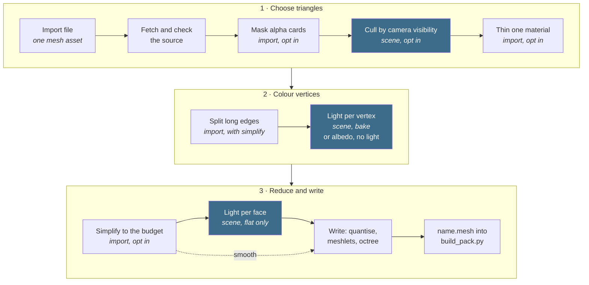
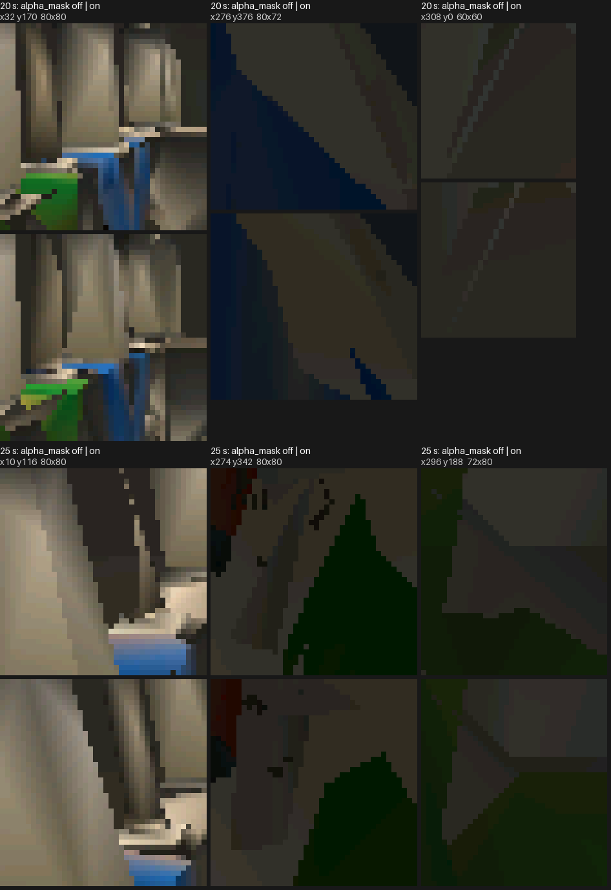
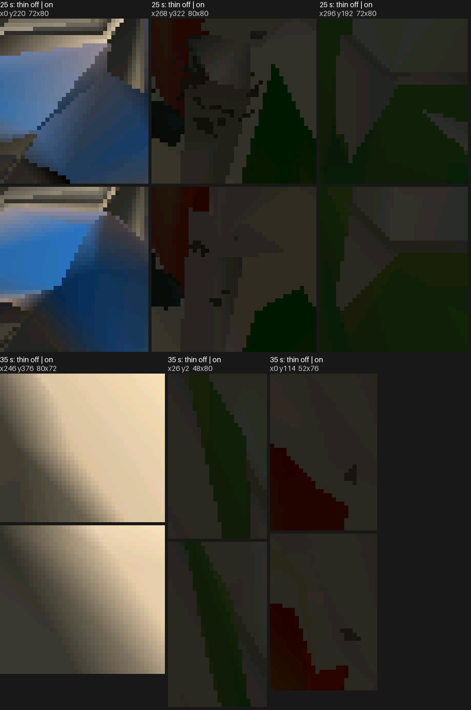
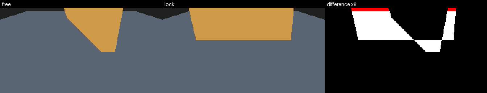
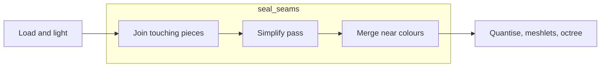
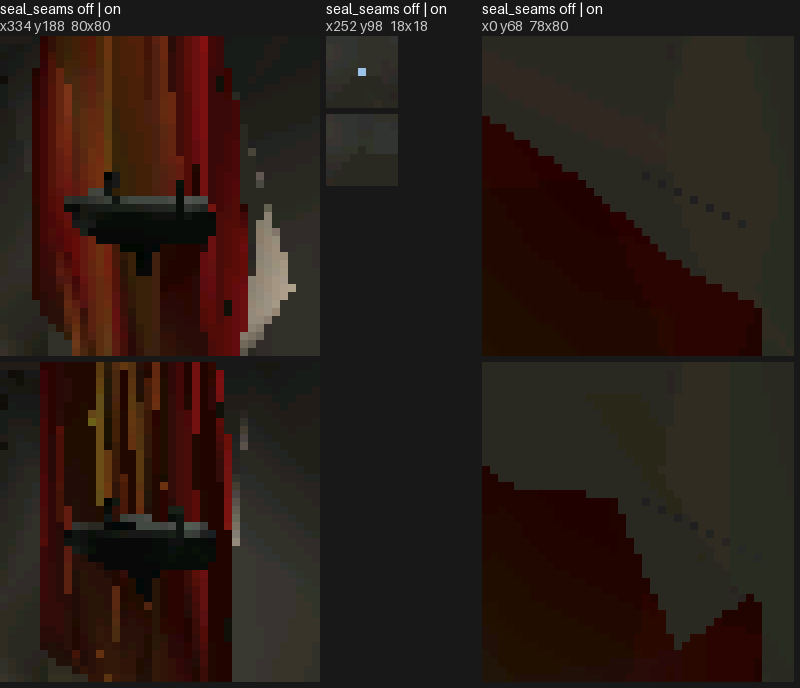
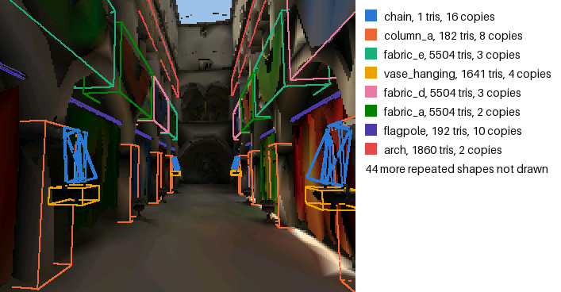
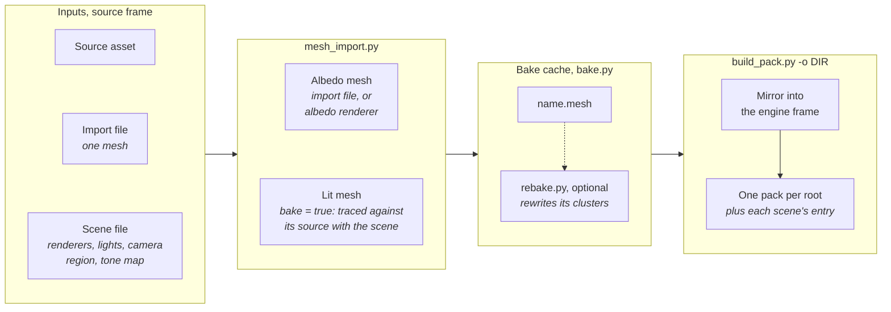
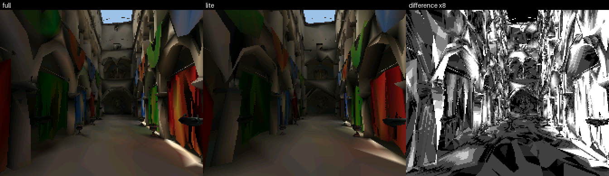
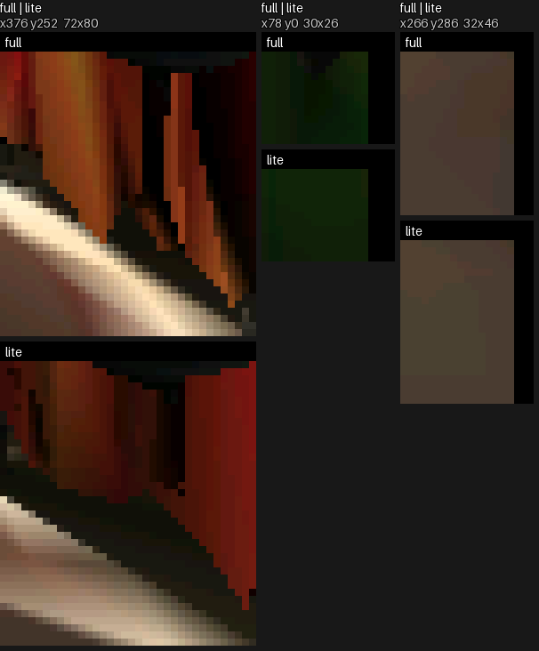

# Mesh Import

How a source mesh becomes a baked lit-mesh: the offline tools and the bake
stages. The entry a renderer consumes is [Baked-Mesh.md](Baked-Mesh.md), how
its light is computed and scored is [Bake-Method.md](Bake-Method.md), and
drawing it is [Mesh-Rendering.md](Mesh-Rendering.md).



Blue steps are the scene's renderer options; the rest are the import file's.

## Import options

Keys before `;` are required; after it, optional.

### Source, output and materials

| Option | Keys | What it does | Default | Cost (bake / frame) | Option link |
|---|---|---|---|---|---|
| `[source]` | `path`, `credit` | Locates the local source file; `credit` records its attribution. | Required. | Local file / none. | [source](#source) |
| `[output]` | ; `name`, `position_scale` | Names the single mesh and position scale; bakes go to the cache. | `name` required without `[[variants]]`, rejected with them; `position_scale` 8. | Write / none. | [output](#output) |
| `[materials]` | ; `double_sided` | Draws listed material faces from both sides. | `[]`. | None / more faces drawn. | [materials](#materials) |

#### source

`[source].path` names a local file relative to the import file:

| Extension | Reads | Colour |
|---|---|---|
| `.obj` | its sibling `.mtl` and the textures the MTL names | the material's `Kd` and texture |
| `.glb` | every mesh node's triangles, placed by the node; a skinned node's in its bind pose | per vertex: `COLOR_0` times the material's base colour |
| `.fbx` | converted once to a `.glb` (`launcher/tools/fbx/fbx_to_glb.py`, cached by content), then read as one | as `.glb` |
| `.blend` | exported to a `.glb` inside Blender by `launcher/tools/bake/bake.py` (`[source] clips` names the actions), a cached bake like a mesh, then read as one | as `.glb` |

`credit` records the source attribution. Source files sit in
`launcher/demo/*/source/`, which uses Git LFS (MTL and attribution files stay
text) and which firmware clones exclude through `.lfsconfig`. Before a source
bake or reference render, run this from the repository root:

```sh
git lfs pull --exclude=""
```

The empty exclude clears the clone's default exclusion for this pull.

A model too large to commit or to trace is first reduced to an OBJ by
[`source/reduce_source.py`](../../launcher/tools/r3d/source/reduce_source.py),
which keeps its objects and textures; the import's `simplify` then starts
from that OBJ.

#### output

`[output]` names the mesh entry. Baked meshes are stored in the bake cache. `position_scale` is the
number of quantisation ticks per model unit.

#### materials

`[materials].double_sided` lists materials whose faces draw from both sides.

### Skin lighting

| Option | Keys | What it does | Default | Constraint | Option link |
|---|---|---|---|---|---|
| `[skin]` | ; `lighting` | Selects the skinned renderer's runtime lighting mode, stored in SKIN. | `"direct"`. | None / none. | [skin](#skin) |

#### skin

```toml
[skin]
lighting = "direct"
```

`lighting` is stored in SKIN v2 and selects the runtime kernel on attachment.
Unknown values fail naming the import file and allowed modes.

- `direct` (default): shades the blended normal without normalising it.
- `renormalised`: normalises the blended normal before direct shading.
- `table`: samples bilinear irradiance from the scene's normal-direction table.

[Lighting modes](Skinned-Lighting.md#lighting-modes) has the comparison sheet and the
cost and error of each mode on the board.

### Process options

| Option | Keys | What it does | Default | Cost (bake / frame) | Option link |
|---|---|---|---|---|---|
| `[process]` | ; `seed` | Seeds thin's random choice. | `0`; only with thin. | None / none. | [process](#process) |

#### process

`[process].seed` makes `thin` choose the same triangles on every import.

### Geometry

Every Geometry table opts its step in; without it the step does not run.

| Option | Keys | What it does | Default | Cost (bake / frame) | Option link |
|---|---|---|---|---|---|
| `geometry.alpha_mask` | `keep_alpha` | Drops alpha-tested triangles that are mostly transparent. | Off. | Seconds / fewer triangles. | [alpha_mask](#alpha_mask) |
| `geometry.thin` | `material`, `keep` | Keeps a share of one material's triangles. | Off. | None / fewer triangles. | [thin](#thin) |
| `geometry.simplify` | `dense_edge`, `seal_seams`, `colour_deviation` | Splits long edges and simplifies each variant to its budget, colour steering the collapses; can seal seams. | Off. | Seconds / set by the budget. | [simplify](#simplify) |

#### alpha_mask

`geometry.alpha_mask` removes mostly transparent cut-out cards because the
rasterizer does not alpha-test them. Off is above on; this step also changes
what the simplifier keeps elsewhere, so not every difference is a card.



#### thin

`geometry.thin` retains a selected share of one material's triangles. It is
for material whose geometry occupies more of the budget than it shows. The
share is random, so `process.seed` makes it repeatable.



#### simplify

`geometry.simplify` splits long edges and simplifies each variant to its
budget with meshoptimizer's<sup>[[11]](../Citations.md#meshoptimizer)</sup> quadric error simplifier<sup>[[12]](../Citations.md#garland-1997)</sup>,
with the baked colour as an appearance attribute<sup>[[13]](../Citations.md#hoppe-1999)</sup>.

| Key | Meaning |
|---|---|
| `dense_edge` | The longest unsplit edge. |
| `props`, `props_share` | Materials that reserve the `props_share` part of the budget. |
| `seal_seams` | See [seal_seams](#seal_seams). |
| `colour_deviation` | Source units that price one panel colour step. |

The baked colour steers which edges collapse: losing one colour step costs as
much as moving a surface `colour_deviation` away, for `props` and the rest
alike, at every budget. A smaller value keeps surfaces nearer their source
planes and less colour detail: a trade, not a limit.

Each `[[objects.meshes]]` rule carves out matching source objects:

| Key | Meaning |
|---|---|
| `match` | Exactly `{ object = "glob" }` or `{ material = "glob" }`; must match. |
| `triangles` | Mesh budget per copy, separate from the variant's rest budget. |
| `variants` | Optional `{ variant = triangles }`: a variant's own per-copy budget. |
| `min_triangles` | Optional floor on the scaled budget, at most `triangles`. Default 1. |
| `seam` | Optional policy; touching defaults to `lock`, otherwise `free`. |

A variant draws each copy with its entry in `variants`, or else
round(`triangles` x its `objects_scale`), never below `min_triangles`;
`import_settings.variant_meshes()` owns this rule. The variant's `triangles`
budgets the rest, retaining `props` shares and the global pass. Its optional `ceiling` caps emitted
triangles, including copies, and is at least `triangles`. Carved meshes are paid first, at what they emit;
the rest shares what is left. `simplify.check_ceiling` raises when the copies alone leave no room.
Overlapping rules are rejected.

Objects touch when a vertex lies within `repair.seal_tolerance` of the other's
surface. `objects/contact.py` owns the graph and both sides' border vertices.
The tolerance is the reciprocal of `output.position_scale`.

| Policy | Simplification | Seam |
|---|---|---|
| `weld` | Join touched passes and sum budgets; shared vertices collapse together, touching unshared contacts are pinned. | Closed |
| `lock` | Own pass; fix contact vertices on both sides. | Closed |
| `free` | Own pass; only the rest's side of a contact is fixed. | May open on the mesh's side; the rest stays closed |



Free shifts the contact footprint; lock retains the base vertices.

Rigid copies share local simplification and their union of locks. Each copy
is lit against the full source.

A shape writes a colourless LMSH and an LCOL with one set per copy: RGB888
vertices for smooth shading, RGB565 faces for flat. Mirrored copies own a
shape with reversed winding and a positive-determinant placement.

A carved renderer's cache `.bundle` holds the coloured rest, shapes, LCOL
entries and a versioned copy manifest. Pack building unpacks assets and
discards the manifest; SCNE holds the rest renderer and placed copies.

Shape ids use the scene name and a stable name hash; the manifest retains
the rule, source object and copy names.

Rules match the alpha-masked source. Carved meshes skip per-triangle visibility;
`thin` runs once per shared shape with the import seed. The rest keeps its
visibility and thinning steps.

`objects/seams_report.py` accepts a scene renderer, scratch import settings and
a host viewer. Its JSON reports contacts, budgets, copies and locked input
vertices. Lock cost is emitted triangles above the pass target; locks can keep
more than the target. Each affected contact gets a `free`/`lock` comparison
and crops where pixels differ.

#### seal_seams

`seal_seams = true` joins touching pieces before simplification, reducing gaps
at their borders.



| Step | What it does |
|---|---|
| Join | Welds border vertices within one quantisation step and splits border edges at the vertices lying on them, so a shared edge is one edge. |
| Pass | Runs meshoptimizer with light regularizing instead of regularizing. |
| Merge | Gives vertices at one quantised position one colour when they differ by at most one and a half RGB565 steps. |

It cuts the empty spots but does not remove them, and costs frame time for the
triangles it keeps.

The same import with `seal_seams` off against on, at a pose where it shows,
off above on: a pixel-sized hole that shows the sky is sealed.



### Geometry variants

| Option | Keys | What it does | Default | Cost (bake / frame) | Option link |
|---|---|---|---|---|---|
| `[[variants]]` | `name`; `triangles` | Names a geometry budget. | Required with `geometry.simplify`; otherwise optional (one mesh named by `output.name`). | Seconds each / set by the budget. | [variants](#variants) |
| `[[variants]].triangles` | — | Sets a simplified mesh's triangle budget. | Required with `geometry.simplify`. | Seconds / set by the budget. | [variants triangles](#variants-triangles) |
| `[[variants]].objects_scale` | — | Scales each `[[objects.meshes]]` copy budget. | 1. | — / set by the budgets. | [variants objects_scale](#variants-objects_scale) |

#### variants

`[[variants]]` gives a geometry output its name and, with `simplify`, its
triangle budget. Without variants, `output.name` names the single output.

#### variants triangles

`[[variants]].triangles` is the triangle budget `simplify` brings a variant to;
a `fit` budget may not exceed it.

#### variants objects_scale

`[[variants]].objects_scale` multiplies each `[[objects.meshes]]` copy budget
for this variant, so one set of rules serves every tier; a rule's `variants`
entry or `min_triangles` overrides or floors the result.

## Objects and instances

An OBJ object is an `o` or `g` group; an ungrouped file uses its stem.
A glTF object is a mesh node, placed by its world transform. A nameless
node uses its index. Only vertices referenced by triangles belong to an object.

[`objects/objects_report.py`](../../launcher/tools/r3d/objects/objects_report.py)
reports shared shapes after the import's alpha mask. Matching is rigid:
scaled copies remain separate shapes. Reflections are recorded per instance.

| Test | Requirement |
|---|---|
| Candidate bucket | Equal vertex and triangle counts, and material multiset |
| Correspondence | Matching topology uses Kabsch<sup>[[86]](../Citations.md#kabsch-1976)</sup>; reordered vertices use signed PCA frames and bijective nearest neighbours, then Kabsch |
| Acceptance | Largest vertex residual within `MATCH_TOLERANCE` times the object's bounds diagonal; mapped triangle winding and materials agree as multisets |

Each colour below is one repeated shape, boxed at every copy in view. The
view is the camera-path pose where those boxes show the most visible edge;
`render_doc_images.sh` regenerates it.



| Report output (`--out` directory) | What it shows |
|---|---|
| objects.md / objects.json | Shapes, copies, triangles saved, match residuals |
| poses.csv, lod.png | Per camera-path pose: whole and in-view budgets, repeated-shape LOD budget, and triangles LOD frees |

- Repeated shapes step down while their triangle share exceeds what projected area allows; `LOD_TRIANGLE_RATIO` and `LOD_LEVELS` in `objects_report.py` set the quarter-triangle levels and cap.
- This is an estimate: pixels per triangle is calibrated from the path; enclosing-sphere footprints overstate tall, thin props.

## The offline tools

Two kinds of file drive the mesh tools in
[`launcher/tools/r3d/`](../../launcher/tools/r3d/README.md). An **import
file** beside a source asset describes that one mesh. A **scene file** places
meshes and owns lights, camera region and tone map
([Scene-Files.md](Scene-Files.md)).



[`import_settings.py`](../../launcher/tools/r3d/import_settings.py) reads and
checks both files with the standard library alone. Every table is closed: an
unknown key is an error.

| Command, from the repository root | What it writes |
|---|---|
| `python launcher/tools/r3d/mesh_import.py IMPORT` | The import's authored albedo mesh into the bake cache. |
| `python launcher/tools/r3d/mesh_import.py SCENE` | Each renderer's mesh: a `bake = true` renderer traced with the scene's lights, camera visibility and tone map; an albedo renderer its import's shared mesh. |
| `python launcher/tools/r3d/mesh_import.py PATH --mesh NAME` | That one mesh only. |
| `python launcher/tools/r3d/build_pack.py -o DIR` | One [pack](../assets/Building-Packs.md#packs) per root from the `.mesh` entries it names, baking each scene's [entry](../assets/formats/SCNE.md) on the way. |
| `python launcher/tools/r3d/rebake.py MESH.mesh` | That cached `.mesh` in place, its clusters and octree only; rerun `build_pack.py` to pack it. |

A cached `<name>.mesh` is an entry of the [asset pack](../assets/README.md),
held in the bake cache
([`launcher/tools/bake/bake.py`](../../launcher/tools/bake/bake.py)). It
carries no normals: shading is already baked.

### Frames

| Frame | Axes | Used by |
|---|---|---|
| Source | Right-handed: +x right, +y up, camera looking down -z. | Source assets, scene TOMLs, cached bakes, bake-time tools, poses files. |
| [Engine](../math/Conventions.md#conventions) | Source with z negated. | Built packs. |

`build_pack.py` mirrors each entry once, through
[`asset/engine_frame.py`](../../launcher/tools/asset/engine_frame.py):

| Mirrored | Kept as authored |
|---|---|
| Position z is negated. | Triangle order. |
| A placement's matrix `M` becomes `S M S`, `S = diag(1, 1, -1)`. | Baked colours. |
| Quaternion `(x, y, z, w)` becomes `(-x, -y, z, w)`. | Key times and interpolation. |
| Clips' translation and rotation tracks, cubic tangents included. | Every other track. |
| Bounds swap their mirrored z endpoints. | |

A z equal to the int16 minimum is rejected: its negation cannot fit.

[`track_host.py`](../../launcher/tools/anim/track_host.py) `--poses` writes a
poses file from a `.anim.toml`, baked into an unmirrored scratch pack, and
`triangle_sizes` mirrors each pose as it reads it. A built pack's clips are
already mirrored, so `--poses` on a `--pack` gives wrong poses.

### Import file

**Rule: an import brings geometry in as authored, and each geometry table
present turns its step on.** Visibility and lighting belong to the renderer in
its scene ([Scene-Files.md](Scene-Files.md)).

With only `[source]` and `[output]`:

| Aspect | Result |
|---|---|
| Triangles | The source's, kept: nothing cut, simplified or lit. |
| Vertex colour | Material albedo: the `Kd` colour times the texture. |
| Encoding | 8 bits with a 1/2.2 gamma, not the piecewise sRGB curve; no tone map. |
| Source vertex colours | Not read. |

Two variants of one import differ in what `simplify` keeps. Below, one
pose at the full budget (top) and at about half of it, the lite (bottom).




Scene-owned bake, visibility, shading and fit settings are described in
[Scene-Files.md](Scene-Files.md#option-reference).

Each tool and its module, `rebake.py` and when to rebake rather than bake in
full, and the triangle-size report are in
[`launcher/tools/r3d/README.md`](../../launcher/tools/r3d/README.md).
