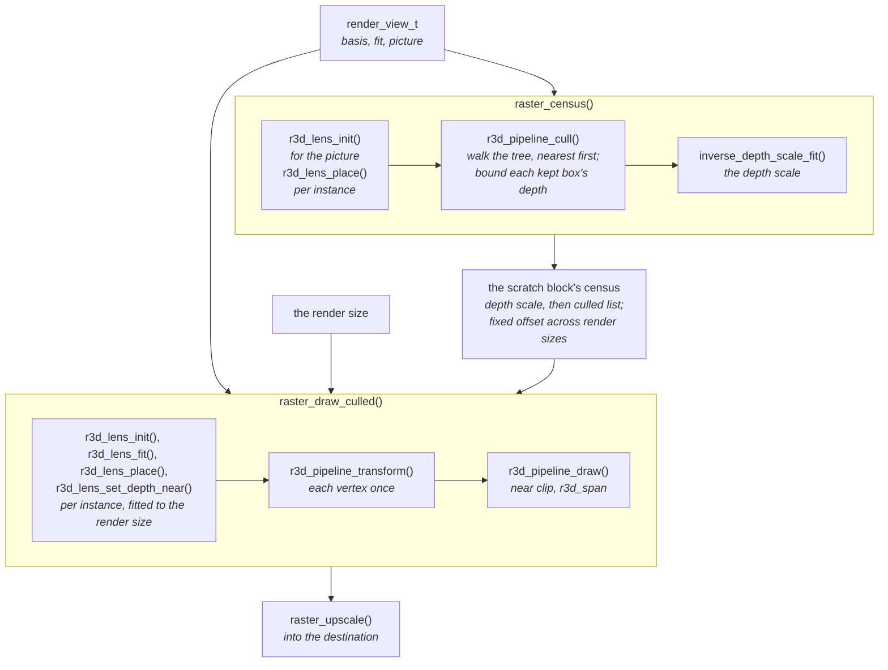
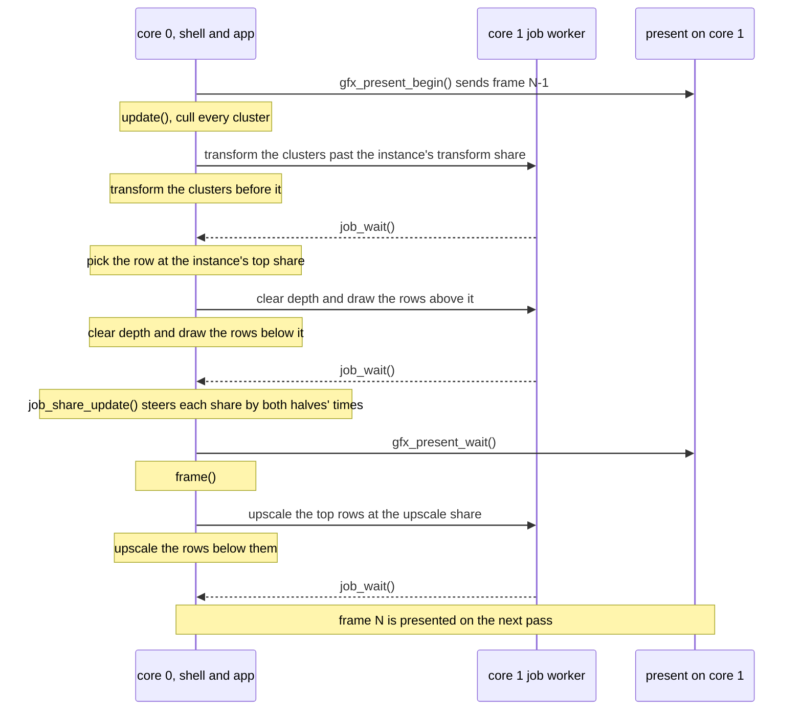
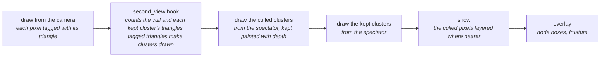

# Mesh Rendering

How the runtime draws a baked lit-mesh: the frame view, culling, the rasterizer
and the two-core frame. Which pixels a triangle fills is in
[Coverage.md](frame/Coverage.md), depth and attachments in
[Attachments.md](frame/Attachments.md), the debug views in
[View-Modes.md](frame/View-Modes.md).

The mesh's format is [Baked-Mesh.md](offline/Baked-Mesh.md); how it is made is
[Mesh-Import.md](offline/Mesh-Import.md).

`launcher/main/render/` is the engine's 3D layer: the frame view, projection, a
span rasterizer, and a pipeline that draws a mesh whose light was baked
offline. Boot and apps both call it.

It sits above `gfx/`, whose render targets it draws into, and otherwise
includes `core/`, `math/` and `asset/` (`r3d_lit_mesh.h` reads its mesh from
a pack). The layers are in [firmware/README.md](../firmware/README.md).

It draws into buffers its caller hands it, and a framebuffer is only one of
them.

## What a scene uses

A scene that draws a baked mesh includes `render/r3d_lit_mesh.h`,
`render/raster.h` and `display/viewport.h`; one that projects points and
segments, `render/r3d_project_x.h`. Both take each frame's perspective fit
and picture basis from `render_view_t`.

| Noun | What it is |
|---|---|
| `r3d_lit_mesh_t` | A mesh whose light is baked into its colours, made offline ([Mesh-Import.md](offline/Mesh-Import.md)); a view of arrays that stay in the asset pack ([Baked-Mesh.md](offline/Baked-Mesh.md#clusters-and-the-tree)) |
| `render_view_t` | One frame: eye, picture axes and forward in world units, pixels per unit depth, centre, near plane and picture size |
| `viewport_t` | The picture's size and the quarter turn the panel is read at; `render_view_make()` and `render_view_refit()` take one |
| `r3d_instance_t` | One mesh and, optionally, its baked placement: a 3x3 (rotation times a positive scale) and a position. No placement draws the mesh as it is |
| `raster_t` | The `r3d_instance_t` array it draws (one mesh is a count of one), at one size, into a scratch block the caller hands it. Its options are fields the caller sets: `clear`, and `upscaled` with a destination picture at least as large |
| `raster_draw()` | Takes a `const render_view_t*` and draws every instance through that frame view |
| `raster_census()` | `raster_draw()`'s cull alone, into the scratch block's list: on an upscaled raster with unchanged destination dimensions it holds at any render size, so a caller can price sizes first ([Dynamic-Resolution.md](frame/Dynamic-Resolution.md)) |
| `raster_draw_culled()` | `raster_draw()` from that list at the raster's size now, without culling again |
| `raster_upscale()` | Nearest-neighbour scales what was drawn up into `destination`; its retained maps change only when either size changes |
| `raster_upscale_picture()` | The same through the upscale filter, of another colour and depth picture at the drawn size when given one, marking the seams it blends |
| `r3d_span_triangle()` | A scene that projects its own triangles fills them with this, into a window of rows of a render target holding colour and depth, from `render/r3d_span.h` |
| `raster_attachment_t` | A per-pixel map the raster draws beside colour and depth ([Attachments](frame/Attachments.md#attachments)) |
| `raster_show()` | Development builds: the attached [view](frame/View-Modes.md) paints the colour before the upscale |

Flat or smooth shading is the mesh's own, not an option: a mesh baked flat
carries a colour per face and the raster draws what the mesh carries.

`render_view_make()` builds the frame view from a pose and a lens: it folds
in the panel's quarter turn, fits the lens to the shorter picture side,
ignores the pose's scale and keeps its roll. Poses follow
[math/linear's conventions](../math/Conventions.md#conventions).

Several meshes share one picture: the raster draws each instance in turn
without clearing between, and the depth buffer decides what covers what, so
the order does not matter.

`r3d_lens_place()` composes an instance's model matrix with the lens
`r3d_lens_init()` built, so culling, the vertex transform and near clipping
all see the mesh where it sits. With no model, an instance is the unplaced
lens exactly.

The importer bakes the placement from a position, a rotation and a scale
([Scene-Files.md](scene/Scene-Files.md)), so the device does no trigonometry.

## The files

| File | What it is |
|---|---|
| `render_view.h` | The frame view and its pose-and-lens builder |
| `r3d_instance.h` | A mesh and its optional baked placement: what the raster draws |
| `raster.h` | An array of instances drawn on both cores, optionally upscaled into a destination picture |
| `raster_show.h` | Development views paint colour from the raster maps |
| `raster_attachment.h` | What a further attachment declares: its size per pixel, its clear, and the hooks it takes part in a picture with |
| `raster_motion.h` | The motion-vector attachment: where each pixel's point was in the previous picture |
| `context/render_context.h` | The render context: the size and quality a frame is drawn at, apart from what is drawn and from where |
| `resolution/resolution.h` | Dynamic resolution: the steps, the stepped controller and the predictor a render context can opt into |
| `viewport.h` | The viewport, and where a physical pixel lands in the upright picture |
| `r3d_lit_mesh.h` | The baked mesh format: per-vertex or per-face colour, meshlet clusters, a node tree, and the view built from a pack entry |
| `dynamic/r3d_dynamic_mesh.h` | A lit mesh rebuilt from caller triangles each frame: clusters of `R3D_DYNAMIC_CLUSTER_TRIANGLES` in source order, a tree with at most `R3D_LIT_NODE_CHILDREN_MAX` children per inner node, and vertex and cluster counts held at their capacities so the raster sizes its scratch once |
| `r3d_pipeline.h` | Internal: the raster's stages, lens, cull, transform, draw, and its scratch layout |
| `r3d_span.h` | One depth-tested triangle filled into a window of rows, Gouraud-shaded or face-coloured, its coverage exact on 1/16-pixel positions, and the span writer a further attachment fills through |
| `r3d_project.h` | Float pixel snapping through a `projectf_t` lens and math near clipping |
| `r3d_project_x.h` | Camera-space model matrix and fixed-point pixel projection, with math near clipping |

Only `r3d_pipeline.h`, `raster_internal.h` and `r3d_span_internal.h` are
internal: render/ and any suite or host tool include them.

## The maths

Line projection, the animation tracks and the raster all take their types
from `math/linear/`, documented in [linear maths](../math/Linear.md) and
[projection](../math/Projection.md).

| Owner | What it holds |
|---|---|
| `math/projection/projectf.h` | The pinhole lens value, continuous float projection and float near clipping |
| `projectx_t` | A Q16.16 lens; fixed near clipping accepts any common camera-space scale |
| `render_view_t.lens` | The view's square-pixel pinhole |
| `mat4f_t` | The raster's lens and motion maps: composed with `mat4f_mul_affine()`, inverted with `mat4f_invert_affine()`, applied to each vertex with `mat4f_apply()` |
| render | Pixel snapping and fixed line units: its 32-bit quotient truncates toward zero before the pixel-scale multiply |
| `render/r3d_project.h` | The float reference: biases pixel offsets slightly away from zero before truncating toward zero |

## One frame

A caller builds a frame view and passes its `const render_view_t*`:

| Caller | Calls |
|---|---|
| Draws at a set size | `raster_draw()`, which culls every instance, fits the [depth scale](frame/Attachments.md#depth) to what it kept, then draws each in turn with the fitted lens culling used, then `raster_upscale()` with the destination width and height |
| Picks the render size from what culling kept, as the render context does | `raster_census()`, sets the size, then `raster_draw_culled()` with the same view, then `raster_upscale()` |
| A suite or tool that schedules the stages itself | `r3d_pipeline.h`'s stages |

Culling and clipping use caller-owned workspace sized by
`r3d_pipeline_work_bytes()`:

- The raster's arena, sized by `raster_scratch_bytes()`, holds one workspace
  per row slice; culling reuses the first before drawing starts.
- Direct pipeline callers supply the workspace explicitly; simultaneous draws
  need distinct blocks.

The stages are split so two cores can share them:

- Transforming disjoint cluster lists writes disjoint vertex ranges.
- Drawing touches only the rows of its own target.
  `r3d_pipeline_transform()` records the screen rows each cluster spans, so a
  core drawing half the rows skips a cluster wholly outside them.

The raster draws at the caller's width and height and can upscale into a
destination picture: rendering at half the panel's size quarters the pixels
and halves the rows and spans.

The lens frames the destination's shape, and `r3d_lens_fit()` scales each
axis to the render size on its own, so a render may cut its height more than
its width and still show the same view.

### The render context

A frame view is perspective only. What a frame is drawn at belongs to the
render context (`context/render_context.h`): it owns the raster and its
scratch block, the render size and the debug view.

A caller hands it instances, a frame view and a clear colour, then a
destination to upscale into. The scene manager draws the active camera
through the engine's one context, `render_context_main()`, released when an
app exits.

| Call | Meaning |
|---|---|
| `render_context_set_scale()` | the share of the destination each axis draws at; half until set |
| `render_context_set_dynamic_resolution(config, model, step)` | opt-in: each frame draws at a step of `config` to hold its budget ([Dynamic-Resolution.md](frame/Dynamic-Resolution.md)); NULL returns to the fixed scale |
| `render_context_set_frame_generation(on)` | a drawn frame may be followed by one warped from it instead of drawn; when, and what draws instead: [Frame-Generation.md](frame/Frame-Generation.md#for-an-app) |
| `render_context_set_debug_view()` | a [view mode](frame/View-Modes.md), development builds only |
| `render_context_frame()` | the last frame: its step, size, what culling kept, and what its draw and upscale cost |

### On both cores

The work before the framebuffer runs in the app's `update()`, overlapped
with sending the previous frame. Each stage is split between the two cores:

- Core 1's half is dispatched through `core/job.h`. It runs inline when
  core 1 is busy, and always on a host.
- Present shares core 1, so `job_run_steered()` times both halves of every
  stage and moves work toward the faster core.

`raster_split_t` holds every raster share: caller-owned, NULL = even,
forget after a cut. Core 1's time counts from dispatch, so a wait behind
present counts against it.

## The cull, seen

The cull view ([raster_cull_view.h](../../launcher/main/render/view/raster_cull_view.h))
paints every cluster in the colour of its fate this frame. Seen from the camera
only drawn clusters show, so it redraws from a spectator.

| Fate | Colour | The cluster |
|---|---|---|
| culled | grey | its box, or a box above it, is outside the frustum |
| not set up | blue | kept, but every triangle is behind the camera, misses every pixel centre or faces away |
| hidden | red | triangles were set up and filled, but each lost its depth test |
| drawn | green | owns at least one pixel |

| Tunable | Values |
|---|---|
| `cullview.from` | 0 the camera, 1 above the instances' bounds looking down, 2 behind and above the camera |
| `cullview.paint` | 0 the baked colours, culled clusters as a sparse screen door with a dashed grey border, each kept cluster's border solid in its fate's colour; 1 each cluster flat in its fate's colour; 2 each cluster in the hue of its node at `cullview.level`, darker the earlier it was dropped |
| `cullview.level` | the tree depth whose node boxes the overlay draws; 0 none, 1 the root's children |

From a spectator the culled and the kept clusters are drawn apart, so culled
geometry never hides kept geometry behind it: the holes in its screen door
show what lies behind. The overlay also draws the camera's frustum.

- Where two triangles fill a pixel at the same depth, it goes to the later
  one, as with every [attachment](frame/Attachments.md#attachments).
- A triangle the near plane cuts counts as reaching the fill even when its
  clipped polygon then faces away or vanishes.

The frame's own cull and draw count nothing; `r3d_pipeline_cull_counted()` and
`r3d_pipeline_count_triangles()` count beside them. `scene_viewer.sh --view cull
--counts FILE` writes the counts per frame.

Bistro along its camera path:

<!-- generated: cull-bistro sha256=c8ab3c5c527ead3520e2b7fdb145fecf73a3df5be49e08e26952397ff5fe8552 -->
| Per frame, path mean | Bistro |
|---|---|
| Nodes visited / cut | 145 / 32 |
| Clusters tested / kept | 458 / 376 |
| Kept clusters: nothing set up / hidden / drawn | 44 / 151 / 181 |
| Triangles submitted | 7736 |
| Submitted triangles behind the near plane | 67 (1 %) |
| Submitted triangles clipped | 61 (1 %) |
| Submitted triangles miss every pixel centre | 2371 (31 %) |
| Submitted triangles facing away | 1648 (21 %) |
| Submitted triangles set up | 3589 (46 %) |
| Submitted triangles covering pixels | 1574 (20 %) |
<!-- /generated: cull-bistro -->

Sponza's fitted full bake along its flythrough:

<!-- generated: cull-sponza sha256=464a55906b51d0a10196a6c861853fce41a28670d872dd60dba95156104b226e -->
| Per frame, path mean | Sponza |
|---|---|
| Nodes visited / cut | 175 / 49 |
| Clusters tested / kept | 371 / 300 |
| Kept clusters: nothing set up / hidden / drawn | 11 / 43 / 246 |
| Triangles submitted | 8369 |
| Submitted triangles behind the near plane | 67 (1 %) |
| Submitted triangles clipped | 77 (1 %) |
| Submitted triangles miss every pixel centre | 2291 (27 %) |
| Submitted triangles facing away | 704 (8 %) |
| Submitted triangles set up | 5230 (62 %) |
| Submitted triangles covering pixels | 2692 (32 %) |
<!-- /generated: cull-sponza -->

### What a cluster and a triangle cost

The board's cull-cost suite (`run_cull_cost_suite`) times one core's cull,
transform and draw, stopped once each triangle is set up, along both paths.
Each pose is drawn three ways, so the counts move apart:

- as baked;
- with each cluster's triangles halved: same clusters and vertices, half the
  triangles submitted;
- through a mirrored lens: same clusters and triangles, the other faces set up.

[cull_cost.py](../../launcher/tools/render/cull_cost.py) fits each stage by
non-negative least squares:

- cull = a + b × nodes visited + c × clusters tested
- transform = a + b × clusters kept + c × vertices transformed
- set-up = a + b × clusters kept + c × triangles submitted + d × triangles set up

<!-- generated: cull-cost sha256=3e63a002a74d986120fc5c3578f0b9f5a2ea8fae728b4a9ac1af670c39892d47 -->
| Stage | Term | One core |
|---|---|---|
| cull | per node visited | 2158 ns |
| cull | per cluster tested | 0 ns |
| cull | constant | 58 µs |
| cull | worst error over the poses | 222 µs |
| transform | per cluster kept | 223 ns |
| transform | per vertex transformed | 582 ns |
| transform | constant | 0 µs |
| transform | worst error over the poses | 214 µs |
| set-up | per cluster kept | 3476 ns |
| set-up | per triangle submitted | 460 ns |
| set-up | per triangle set up | 3345 ns |
| set-up | constant | 1238 µs |
| set-up | worst error over the poses | 3340 µs |
<!-- /generated: cull-cost -->

## Memory

The layer allocates nothing. Raster draw work owns the resolved camera
settings and per-side spread table, shared read-only by the row workers.

Per-vertex and per-cluster buffers, the census list, picture
[attachments](frame/Attachments.md#attachments) and upscale maps share one block. The census comes first, its depth scale then
its list, at an offset independent of render size; storage is padded for
picture attachments.

`raster_carve()` in `raster_internal.h` states the layout once, and
`raster_scratch_bytes()` sizes the block from it.

The caller obtains the block once and sets `scratch`; each call carves it.
The caller decides where it lives, so it need not consume internal RAM.

## Rules the layer keeps

- **Single precision only.** The FPU has no double, and one stray promotion
  costs an order of magnitude. The firmware build turns
  `-Wdouble-promotion` and `-Wfloat-conversion` into errors for the whole
  `main` component (see [Build-Variants.md](../tools/Build-Variants.md)).
- **Host-testable.** The headers are ESP-IDF-free, and the portable
  `test/suites/suite_r3d_*.c` suites check them on a laptop.
  `suite_r3d_lit.c` builds its meshes inside the test, never a baked one.
- **The caller owns the environment.** Viewport, panel quarter, units and
  timeline are passed in. No code path reads the panel's size.

## Related

- [firmware/README.md](../firmware/README.md): the layers and the frame loop
- [gfx/Present.md](../gfx/Present.md#present-who-runs-it): the split present `update()` overlaps
- [Building-an-App.md](../firmware/Building-an-App.md#app-memory): the app arena, one place a frame's scratch block can come from
