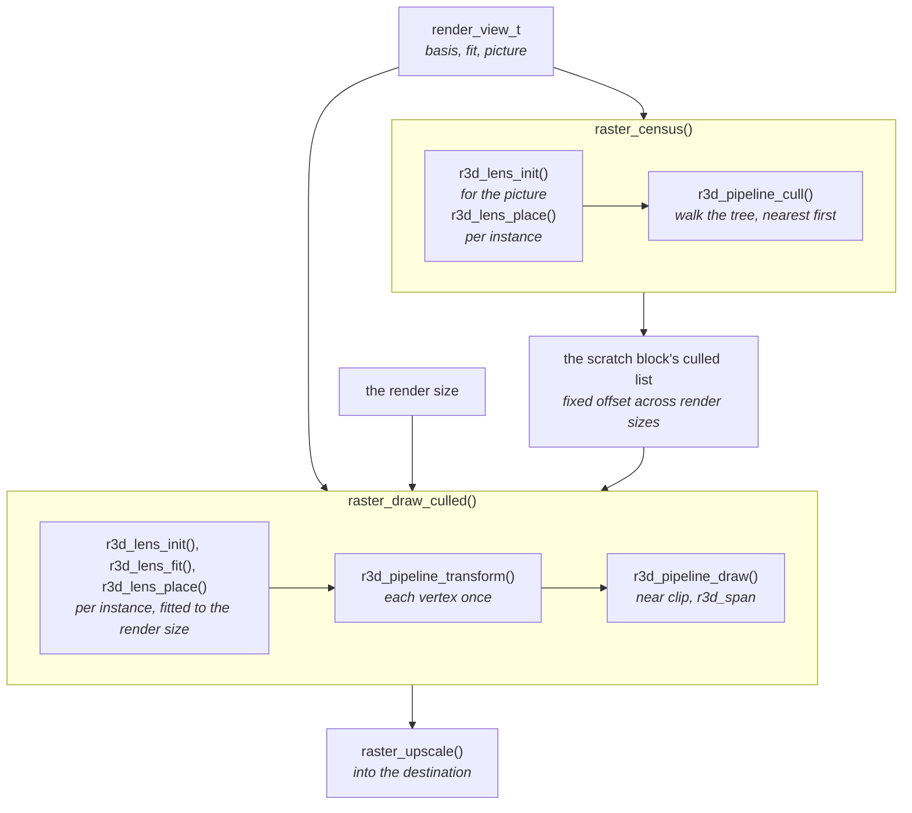
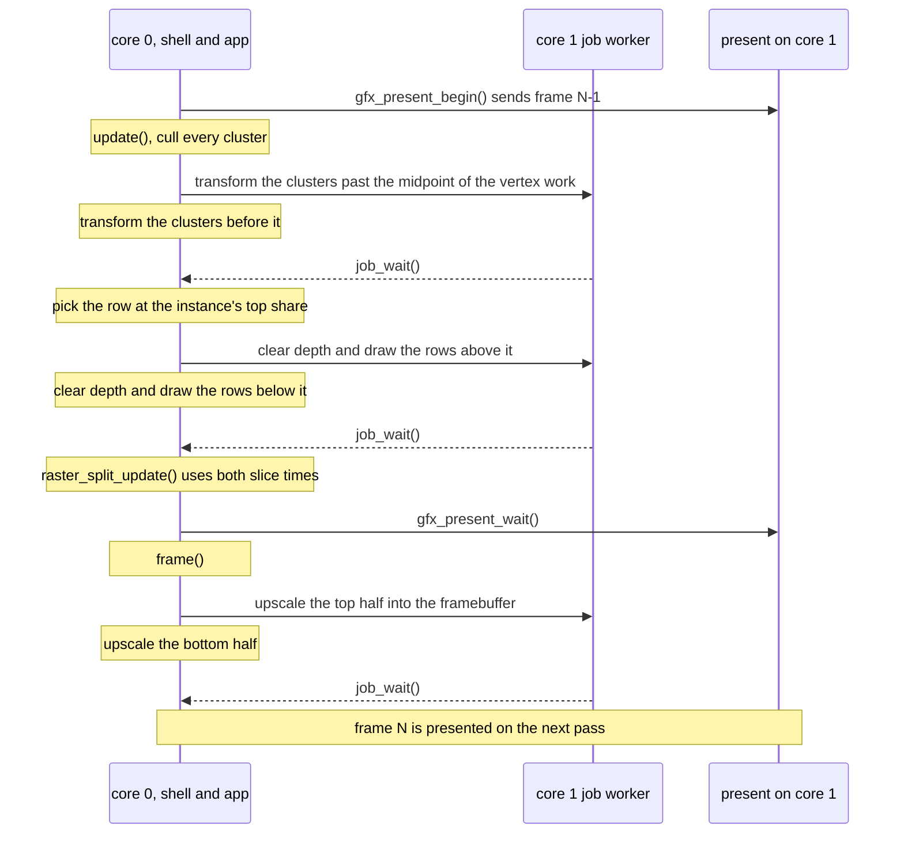
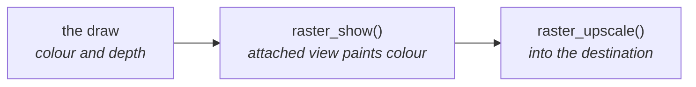
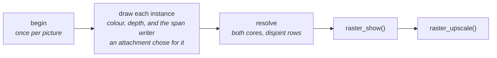

# Mesh Rendering

How the runtime draws a baked lit-mesh: the frame view, culling, the rasterizer, the
two-core frame and the view modes. The mesh's format is [Baked-Mesh.md](Baked-Mesh.md); how it is made is
[Mesh-Import.md](Mesh-Import.md).

`launcher/main/render/` is the engine's 3D layer: the frame view, projection, a
span rasterizer, and a pipeline that draws a mesh whose light was baked
offline. It sits above `gfx/`, whose render targets it draws into, and
otherwise includes `core/`, `math/` and `asset/` (`r3d_lit_mesh.h` reads its
mesh from a pack), so boot and apps both call it. It
draws into buffers its caller hands it, and a framebuffer is only one of
them. The layers are in [Firmware-Architecture.md](../Firmware-Architecture.md).

## What a scene uses

A scene that draws a baked mesh includes `render/r3d_lit_mesh.h`,
`render/raster.h` and `display/viewport.h`;
one that projects points and segments takes `render/r3d_project_x.h`.
Both use `render_view_t` for the per-frame perspective fit and picture basis.

| Noun | What it is |
|---|---|
| `r3d_lit_mesh_t` | A mesh whose light is baked into its colours, made offline ([Mesh-Import.md](Mesh-Import.md)); a view of arrays that stay in the asset pack ([Baked-Mesh.md](Baked-Mesh.md#clusters-and-the-tree)) |
| `render_view_t` | One frame: eye, picture axes and forward in world units, pixels per unit depth, centre, near plane and picture size |
| `viewport_t` | The picture's size and the quarter turn the panel is read at; `render_view_make()` and `render_view_refit()` take one |
| `r3d_instance_t` | One mesh and, optionally, its baked placement: a 3x3 (rotation times a positive scale) and a position. No placement draws the mesh as it is |
| `raster_t` | The `r3d_instance_t` array it draws (one mesh is a count of one), at one size, into a scratch block the caller hands it. Its options are fields the caller sets: `clear`, and `upscaled` with a destination picture at least as large |
| `raster_draw()` | Takes a `const render_view_t*` and draws every instance through that frame view |
| `raster_census()` | `raster_draw()`'s cull alone, into the scratch block's list: on an upscaled raster with unchanged destination dimensions it holds at any render size, so a caller can price sizes first ([Dynamic-Resolution.md](Dynamic-Resolution.md)) |
| `raster_draw_culled()` | `raster_draw()` from that list at the raster's size now, without culling again |
| `raster_upscale()` | Nearest-neighbour scales what was drawn up into `destination`; its retained maps change only when either size changes |
| `r3d_span_triangle()` | A scene that projects its own triangles fills them with this, into a window of rows of a render target holding colour and depth, from `render/r3d_span.h` |
| `raster_attachment_t` | A per-pixel map the raster draws beside colour and depth ([Attachments](#attachments)) |
| `raster_show()` | Development builds: the attached [view](#view-modes) paints the colour before the upscale |

Flat or smooth shading is the mesh's own, not an option: a mesh baked flat
carries a colour per face and the raster draws what the mesh carries.

`render_view_make()` builds the frame view from a pose and a lens: it folds
in the panel's quarter turn, fits the lens to the shorter picture side,
ignores the pose's scale and keeps its roll.
Poses follow [math/linear's conventions](../math/Conventions.md#conventions).

Several meshes share one picture: the raster draws each instance in turn
without clearing between, and the depth buffer decides what covers what, so
the order does not matter. An instance's model matrix goes into the lens matrix:
`r3d_lens_place()` composes it with the lens `r3d_lens_init()` built, so
culling, the vertex transform and near clipping all see the mesh where it
sits. The importer bakes the placement from a position, a rotation and a scale
([Scene-Files.md](Scene-Files.md)), so the device does no trigonometry, and an
instance with no model skips the composition and is the unplaced lens
exactly.

## The files

| File | What it is |
|---|---|
| `render_view.h` | The frame view and its pose-and-lens builder |
| `r3d_instance.h` | A mesh and its optional baked placement: what the raster draws |
| `raster.h` | An array of instances drawn on both cores, optionally upscaled into a destination picture |
| `raster_show.h` | Development views paint colour from the raster maps |
| `raster_attachment.h` | What a further attachment declares: its size per pixel, its clear, and the hooks it takes part in a picture with |
| `raster_motion.h` | The motion-vector attachment: where each pixel's point was in the previous picture |
| `context/render_context.h` | The render context: the size and quality a frame is drawn at, apart from what is drawn and from where |
| `resolution/resolution.h` | Dynamic resolution: the steps, the stepped controller and the predictor a render context can opt into |
| `viewport.h` | The viewport, and where a physical pixel lands in the upright picture |
| `r3d_lit_mesh.h` | The baked mesh format: per-vertex or per-face colour, meshlet clusters, a node tree, and the view built from a pack entry |
| `r3d_pipeline.h` | Internal: the raster's stages, lens, cull, transform, draw, and its scratch layout |
| `r3d_span.h` | One depth-tested triangle filled into a window of rows, Gouraud-shaded or face-coloured, its coverage exact on 1/16-pixel positions, and the span writer a further attachment fills through |
| `r3d_project.h` | Float pixel snapping through a `projectf_t` lens and math near clipping |
| `r3d_project_x.h` | Camera-space model matrix and fixed-point pixel projection, with math near clipping |

Only
`r3d_pipeline.h` and `r3d_span_internal.h` are internal: render/ and any
suite or host tool include them.

## The maths

`math/linear/projectf.h` owns the pinhole lens value, continuous float
projection and float near clipping; `projectx_t` holds a Q16.16 lens.
`render_view_t.lens` holds the view's square-pixel pinhole.

Fixed near clipping accepts any common camera-space scale. Render owns
pixel snapping and fixed line units; its 32-bit quotient truncates toward
zero before the pixel-scale multiply.

The float reference in `render/r3d_project.h` biases pixel offsets slightly
away from zero before truncating toward zero.

Line projection, the animation tracks and the raster all
take their types from `math/linear/`, documented in
[linear maths](../math/Linear.md) and [projection](../math/Projection.md): the raster's lens and motion maps are
`mat4f_t`, composed with `mat4f_mul_affine()`, inverted with
`mat4f_invert_affine()` and applied to each vertex with `mat4f_apply()`.

## One frame



A caller builds a frame view and passes its `const render_view_t*` to
`raster_draw()`, which culls and draws each instance in turn with one fitted lens shared by culling and drawing,
and `raster_upscale()` with the destination width and height to compose
that picture. A caller that picks the render size from what culling kept, as the render
context does, calls `raster_census()`, sets the size, then
`raster_draw_culled()` with the same `const render_view_t*`. The stages inside
are `r3d_pipeline.h`'s, for a suite or tool that schedules them itself.

Culling and clipping use caller-owned workspace sized by
`r3d_pipeline_work_bytes()`. The raster's arena, sized by
`raster_scratch_bytes()`, holds one workspace per row slice. Culling reuses
the first workspace before drawing starts. Direct pipeline callers supply
the workspace explicitly; simultaneous draws need distinct blocks.

The stages are split so two cores can share them. Transforming disjoint
cluster lists writes disjoint vertex ranges, and drawing touches only the
rows of its own target. `r3d_pipeline_transform()` also records the screen rows
each cluster spans, so a core drawing half the rows skips a cluster wholly
outside them. The raster draws at the caller's width and height and can
upscale the result into a destination picture, so rendering at half the
panel's size quarters the pixels and halves the rows and spans. The lens
frames the destination's shape and `r3d_lens_fit()` then scales each axis to
the render size on its own, so a render may cut its height more than its
width and still show the same view.

### The render context

A frame view is perspective only. What a frame is drawn at belongs to the render
context (`context/render_context.h`): it owns the raster and its scratch
block, the render size and the debug view. A caller hands it instances, a
frame view and a clear colour, then a destination to upscale into. The scene
manager draws the active camera through the engine's one context,
`render_context_main()`, released when an app exits.

| Call | Meaning |
|---|---|
| `render_context_set_scale()` | the share of the destination each axis draws at; half until set |
| `render_context_set_dynamic_resolution(config, model, step)` | opt-in: each frame draws at a step of `config` to hold its budget ([Dynamic-Resolution.md](Dynamic-Resolution.md)); NULL returns to the fixed scale |
| `render_context_set_debug_view()` | a [view mode](#view-modes), development builds only |
| `render_context_frame()` | the last frame: its step, size, what culling kept, and what its draw and upscale cost |

### On both cores

The work before the framebuffer runs in the app's `update()`, overlapped
with sending the previous frame. Each stage is split between the two cores,
core 1's half dispatched through `core/job.h`. It runs inline when core 1
is busy, and always on a host.



`raster_split_t` is caller-owned, NULL = even, forget after a cut.

### View modes

Development builds select one row from the `render_debug_view_t` table in
`render/context/render_context.c`: depth, tiles, motion or meshlets.
`render_context_set_debug_view()` attaches that row and owns its zeroed PSRAM
state.
Switching frees the previous state; `RENDER_DEBUG_VIEW_SHADED` detaches it, and
`render_context_release()` frees it. `render_context_debug_view()` exposes the
row's name and constructor to tools.

`raster_show()` runs the attached view's `show` hook after drawing and before
`raster_upscale()`. It repaints colour while leaving depth intact.



| View | The colour buffer becomes |
|---|---|
| shaded | untouched: the baked colours as drawn |
| depth | the depth as a grey ramp, nearest white and farthest black |
| tiles | the same ramp, each `RASTER_SHOW_TILE` square at its farthest depth |
| motion | mid-grey for none, red for x and green for y |
| meshlets | a flat hue for each cluster, with disjoint IDs for each instance |

The ramp is stretched over the range this frame drew, so it shows the most
detail within a frame and is not comparable between frames. A pixel nothing
drew takes the raster's `clear`, the colour upscaling gives it, so it reads as empty
in every view; a tile holding one such pixel is empty. The views are at the
raster's own size, before upscaling. `r3d_span.h` defines the depth encoding
they read.

The depth and depth-tile views along a flythrough:


## Attachments

A raster's picture is a render target
([Gfx-and-Presentation.md](../Gfx-and-Presentation.md#render-targets)):
colour and depth, then any further attachment the caller lists in
`raster_t.attachments`. An attachment with pixels is carved from the scratch block at
the drawn size, so a picture drawn at a new size carves anew, and none keeps
pixels from one picture to the next. A view with `bytes_per_pixel == 0`
reserves no scratch pixels. It is not cleared when its `clear` hook is NULL;
depth and tiles have NULL clear hooks and use only colour and depth in their `show` hooks.



| Hook | When | What it may do |
|---|---|---|
| `clear` | the first instance of a picture, on its rows | start its pixels; the only hook colour and depth have |
| `begin` | once per `raster_draw()`, before anything is drawn | read the `const render_view_t*` and the instances, keep its own state |
| `writer` | once per instance | return a span writer, or none. The fill calls every writer after each span's colour and depth, with the span's depth, so each writes where that triangle won. With none, the fill runs exactly as without attachments, and the writers' code sits apart from it |
| `resolve` | once every instance is drawn | turn what was written into the final map |
| `show` | `raster_show()` | paint the colour from it |

A writer finds the pixels its triangle won by their depth equalling the
triangle's, so where two instances meet at exactly the same depth the pixel
takes the later one's write. A writer sees depth and one value per instance, or its base plus the
mesh cluster index when `r3d_span_writer_t.per_cluster` is true; a map that needs more, such as normals, rebuilds it from depth in
its `resolve`.

### Motion vectors

`raster_motion.h`: for each pixel, the previous position of the point it
shows minus this one, two signed bytes in half pixels of this picture.
`RASTER_MOTION_UNKNOWN` marks a pixel nothing drew, the first picture, a
point behind the previous camera, and motion past the range.

The motion view along a flythrough, red for x and green for y:


- **The camera.** `begin` builds this picture's lens and the previous
  camera's lens at this picture's size. `resolve` takes each pixel back to
  the world through its depth and projects it through the previous lens. So
  a size change between pictures needs nothing special.
- **Moving instances.** An instance is known by its placement's address. One
  whose placement changed since the previous picture gets its own map, which
  carries the point to where the mesh was. From the first instance that
  moved on, every triangle writes its instance's tag (0 for anything still),
  and `resolve` picks the map by it; before it, pixels keep the 0 they were
  cleared to. On a picture where nothing moved, nothing is written while
  drawing. A raster with motion attached draws at most
  `RASTER_MOTION_INSTANCES_MAX` instances.
- **The caller** owns a zeroed `raster_motion_t`, attaches
  `raster_motion_view()`, and calls `raster_motion_forget()` after a
  cut. The render context attaches it while the motion view is selected.

### Meshlet IDs

`raster_meshlets_view()` clears a 16-bit map to zero and resets its next ID
to one before each draw. Its writer reserves each instance's cluster count
and writes the reserved base plus the mesh's cluster index. The `show` hook
maps IDs to hues through a multiplicative hash; zero takes the clear colour.
IDs are distinct per draw for up to 65535 clusters.
It needs no resolve pass.

The meshlets view along the same flythrough, one hue per cluster:


## Coverage and small triangles

A pixel belongs to a triangle when its centre is inside by the top-left
rule, decided in integers on positions snapped to 1/16 pixel. Two
triangles sharing an edge therefore never both fill a pixel, nor both miss
one, in any window of rows. `r3d_pipeline_transform()` snaps each vertex once,
into an 8-byte `r3d_pipeline_vertex_t`. Every position the rasterizer takes is
within 1024 pixels of the origin, which keeps its edge arithmetic in 32
bits: a triangle with a corner behind the near plane or farther off
screen is rebuilt from the mesh and clipped to a guard band inside that
reach, and the fast path stops short of the guard band, so a clip never
cuts an edge that a fast triangle shares.

A detailed mesh drawn small has many triangles covering a few pixel
centres or none, so the draw routes each by the centres its bounding box
holds:

| Bounding box holds | What the draw does |
|---|---|
| no centre | nothing: dropped before its colours are read |
| inside the camera ceiling and colour gate | tests each centre against its three edges, using the selected style |
| more | walks its rows, each edge's column found exactly by an integer step |

Both paths apply the same rule to the same integers, so a small triangle
and a walked one sharing an edge still meet without a gap or an overlap.
The per-centre path skips the walk's setup but loses the triangle's gradient.
[Small fill](#small-fill) controls that cost and look tradeoff.
`suite_r3d_lit.c` holds every triangle to a reference implementation of the
rule, and a mesh of mixed sizes to one fill per pixel.

A triangle to be walked works out its depth plane first. When every pixel
of its bounding box already holds depth at least as near as the plane's
nearest corner, it could write nothing, and it is dropped before its colour
planes and its rows. The test pays because clusters are drawn roughly
nearest first, so a triangle behind is usually drawn after what hides it.

A pixel centre just outside a triangle extrapolates its planes past the
vertex range, so each span clamps its ends. A kept triangle whose planes
stay inside their ranges at every centre of its bounding box, most of them,
fills its spans without those clamps, which would change nothing there.

### Small fill

Cameras start with `SMALL_FILL_SMOOTH` (4/0 FLAT), preserving the smooth rendering checksum.
Apps opt into `SMALL_FILL_FAST` (12/16 FLAT) for the measured frame-cost gains.
Eligible triangles skip plane setup and use one depth, with colour from the camera's style.
The camera owns the bounding-box ceiling, colour gate and style;
`render_view_t.small_fill` carries them to the frame's row workers.

<!-- generated: small-fill-levers sha256=46ed813c7858d86cdd5da15850ac97079edbfa75daf563de4d3405d5a429d84d -->
| Camera field | Range | Default | Effect |
|---|---|---|---|
| `ceiling` | 0..16 | 4 | Largest bounding-box side in pixel centres; 0 disables small fill |
| `gate` | 0..255 | 0 | Vertex RGB565 spread limit at the ceiling; 0 disables the colour gate |
| `style` | 0..2 | 0 | FLAT (0), GRAIN (1), DITHER (2) |
<!-- /generated: small-fill-levers -->

Both presets are defined in `render_view.h`. Opt in with the
[scene camera API](Scene-Manager.md#what-an-app-calls), or pass custom `small_fill_t` values:

```c
scene_camera_set_small_fill(scene, camera, SMALL_FILL_FAST);
```

One gate limit applies to all packed RGB565 per-channel spreads: green's
six bits get half the relative tolerance of red and blue. Above
`R3D_SPAN_SMALL_MAX_SIDE`, the limit tightens from `SMALL_SPREAD_OFF`
to `gate` at the ceiling.

If only one side is eligible, it uses `gate` directly. Face colours and sides
through `R3D_SPAN_SMALL_MAX_SIDE` bypass the gate and use FLAT.

FLAT writes the averaged colour. DITHER uses screen-anchored ordered picks
of the vertex colours. GRAIN alternates flat and one shade in a screen-anchored checker,
moving R/B by one step and G by two in the same direction.

GRAIN splits the colour range. A colour in its dark half gets the lighter
shade; one in its bright half gets the darker shade. On overflow, try the
other direction. If neither fits, use flat; channels never clamp independently.

<table>
<tr><th>Look</th><th>Picture</th><th>Amplified difference from SMOOTH</th></tr>
<tr><td>SMOOTH (4/0 FLAT)</td><td></td><td></td></tr>
<tr><td>FAST (12/16 FLAT)</td><td></td><td></td></tr>
<tr><td>12/16 GRAIN</td><td></td><td></td></tr>
<tr><td>12/16 DITHER</td><td></td><td></td></tr>
</table>

Clips show the same full renderer frames and camera window, one look per GIF.
The [temporal method](../tools/Render-Harness.md#temporal-video-columns)
measures triangle-scale pops; the difference clips also show spatial noise.

<!-- generated: small-fill-temporal sha256=348854d83f0b4c0a5dc518fade64b76bc25fe53a467917f162e3356f235f3b5c -->
| Look vs SMOOTH | Extra frame-to-frame change (levels of 255) | Blocks popping (>8/255) |
|---|---|---|
| SMOOTH (4/0 FLAT) | 0.000 | 0.0000% |
| FAST (12/16 FLAT) | 0.809 | 1.7679% |
| 12/16 GRAIN | 0.909 | 1.9629% |
| 12/16 DITHER | 1.048 | 3.0372% |
<!-- /generated: small-fill-temporal -->

#### Board frame-cost gains when opted in

The committed [ceiling-by-gate sweep](data/small-fill/ceiling-gate-sweep.json)
measures FLAT on board A308. Its [plan](data/small-fill/ceiling-gate-plan.json)
records build IDs, captures and layout seeds.

Times are seed means in landscape: the fitted-full mesh frame and the
animated skinned render. Each sweep's percentages compare with its first row.
The [camera-style sweep](data/small-fill/styles-sweep.json) compares the styles
with the baseline on the same build; its [plan](data/small-fill/styles-plan.json)
records both orientations. This table shows landscape.

<!-- generated: small-fill-board sha256=4dd180bc5fba2d920eaa745b8d3f165e67f1440759e319e72ac10d075d2bf5ae -->
| Ceiling | Gate | Style | Mesh frame ms | vs first row | Skinned render ms | vs first row | Capture |
|---|---|---|---|---|---|---|---|
| 4 | 0 | FLAT | 41.103 | +0.00% | 8.743 | +0.00% | ceiling-gate, point 0 |
| 4 | 8 | FLAT | 41.114 | +0.03% | 8.745 | +0.02% | ceiling-gate, point 1 |
| 4 | 16 | FLAT | 41.108 | +0.01% | 8.742 | -0.01% | ceiling-gate, point 2 |
| 4 | 24 | FLAT | 41.109 | +0.01% | 8.739 | -0.05% | ceiling-gate, point 3 |
| 12 | 0 | FLAT | 36.356 | -11.55% | 8.014 | -8.34% | ceiling-gate, point 4 |
| 12 | 8 | FLAT | 37.569 | -8.60% | 8.136 | -6.95% | ceiling-gate, point 5 |
| 12 | 16 | FLAT | 37.355 | -9.12% | 8.115 | -7.19% | ceiling-gate, point 6 |
| 12 | 24 | FLAT | 37.261 | -9.35% | 8.113 | -7.21% | ceiling-gate, point 7 |
| 14 | 0 | FLAT | 35.556 | -13.50% | 7.914 | -9.48% | ceiling-gate, point 8 |
| 14 | 8 | FLAT | 36.866 | -10.31% | 8.034 | -8.10% | ceiling-gate, point 9 |
| 14 | 16 | FLAT | 36.711 | -10.69% | 8.024 | -8.22% | ceiling-gate, point 10 |
| 14 | 24 | FLAT | 36.610 | -10.93% | 8.017 | -8.30% | ceiling-gate, point 11 |
| 16 | 0 | FLAT | 35.043 | -14.74% | 7.856 | -10.14% | ceiling-gate, point 12 |
| 16 | 8 | FLAT | 36.457 | -11.30% | 7.960 | -8.96% | ceiling-gate, point 13 |
| 16 | 16 | FLAT | 36.285 | -11.72% | 7.965 | -8.90% | ceiling-gate, point 14 |
| 16 | 24 | FLAT | 36.159 | -12.03% | 7.961 | -8.95% | ceiling-gate, point 15 |

| Ceiling | Gate | Style | Mesh frame ms | vs first row | Skinned render ms | vs first row | Capture |
|---|---|---|---|---|---|---|---|
| 4 | 16 | FLAT | 40.113 | +0.00% | 8.577 | +0.00% | styles, point 0 |
| 4 | 16 | GRAIN | 40.116 | +0.01% | 8.579 | +0.01% | styles, point 1 |
| 4 | 16 | DITHER | 40.119 | +0.02% | 8.575 | -0.02% | styles, point 2 |
| 12 | 16 | FLAT | 36.972 | -7.83% | 8.038 | -6.29% | styles, point 3 |
| 12 | 16 | GRAIN | 38.649 | -3.65% | 8.294 | -3.30% | styles, point 4 |
| 12 | 16 | DITHER | 38.985 | -2.81% | 8.351 | -2.63% | styles, point 5 |
<!-- /generated: small-fill-board -->

## Memory

The layer allocates nothing. Raster draw work owns the resolved camera
settings and per-side spread table, shared read-only by the row workers.

Per-vertex and per-cluster buffers, the census list, picture attachments and
upscale maps share one block. The list follows geometry at an offset
independent of render size; storage is padded for picture attachments.

`raster_scratch_bytes()` sizes the block. The caller obtains it once and sets
`scratch`; each call carves it. The caller decides where it lives,
so it need not consume internal RAM.

## Rules the layer keeps

- **Single precision only.** The FPU has no double, and one stray promotion
  costs an order of magnitude. The firmware build turns
  `-Wdouble-promotion` and `-Wfloat-conversion` into errors for the whole
  `main` component (see [Build-Variants.md](../Build-Variants.md)).
- **Host-testable.** The headers are ESP-IDF-free, and the portable
  `test/suites/suite_r3d_*.c` suites check them on a laptop.
  `suite_r3d_lit.c` builds its meshes inside the test, never a baked one.
- **The caller owns the environment.** Viewport, panel quarter, units and
  timeline are passed in. No code path reads the panel's size.

## Related

- [Firmware-Architecture.md](../Firmware-Architecture.md): the layers and the frame loop
- [Gfx-and-Presentation.md](../Gfx-and-Presentation.md#present-who-runs-it): the split present `update()` overlaps
- [Building-an-App.md](../Building-an-App.md#app-memory): the app arena, one place a frame's scratch block can come from
