# Mesh Rendering

How the runtime draws a baked lit-mesh: the frame view, culling, the rasterizer, the
two-core frame and the view modes. The mesh's format is [Baked-Mesh.md](offline/Baked-Mesh.md); how it is made is
[Mesh-Import.md](offline/Mesh-Import.md).

`launcher/main/render/` is the engine's 3D layer: the frame view, projection, a
span rasterizer, and a pipeline that draws a mesh whose light was baked
offline. Boot and apps both call it.

It sits above `gfx/`, whose render targets it draws into, and otherwise
includes `core/`, `math/` and `asset/` (`r3d_lit_mesh.h` reads its mesh from
a pack). The layers are in [firmware/README.md](../firmware/README.md).

It draws into buffers its caller hands it, and a framebuffer is only one of
them.

## What a scene uses

A scene that draws a baked mesh includes `render/r3d_lit_mesh.h`,
`render/raster.h` and `display/viewport.h`; one that projects points and
segments, `render/r3d_project_x.h`. Both take each frame's perspective fit
and picture basis from `render_view_t`.

| Noun | What it is |
|---|---|
| `r3d_lit_mesh_t` | A mesh whose light is baked into its colours, made offline ([Mesh-Import.md](offline/Mesh-Import.md)); a view of arrays that stay in the asset pack ([Baked-Mesh.md](offline/Baked-Mesh.md#clusters-and-the-tree)) |
| `render_view_t` | One frame: eye, picture axes and forward in world units, pixels per unit depth, centre, near plane and picture size |
| `viewport_t` | The picture's size and the quarter turn the panel is read at; `render_view_make()` and `render_view_refit()` take one |
| `r3d_instance_t` | One mesh and, optionally, its baked placement: a 3x3 (rotation times a positive scale) and a position. No placement draws the mesh as it is |
| `raster_t` | The `r3d_instance_t` array it draws (one mesh is a count of one), at one size, into a scratch block the caller hands it. Its options are fields the caller sets: `clear`, and `upscaled` with a destination picture at least as large |
| `raster_draw()` | Takes a `const render_view_t*` and draws every instance through that frame view |
| `raster_census()` | `raster_draw()`'s cull alone, into the scratch block's list: on an upscaled raster with unchanged destination dimensions it holds at any render size, so a caller can price sizes first ([Dynamic-Resolution.md](frame/Dynamic-Resolution.md)) |
| `raster_draw_culled()` | `raster_draw()` from that list at the raster's size now, without culling again |
| `raster_upscale()` | Nearest-neighbour scales what was drawn up into `destination`; its retained maps change only when either size changes |
| `r3d_span_triangle()` | A scene that projects its own triangles fills them with this, into a window of rows of a render target holding colour and depth, from `render/r3d_span.h` |
| `raster_attachment_t` | A per-pixel map the raster draws beside colour and depth ([Attachments](#attachments)) |
| `raster_show()` | Development builds: the attached [view](#view-modes) paints the colour before the upscale |

Flat or smooth shading is the mesh's own, not an option: a mesh baked flat
carries a colour per face and the raster draws what the mesh carries.

`render_view_make()` builds the frame view from a pose and a lens: it folds
in the panel's quarter turn, fits the lens to the shorter picture side,
ignores the pose's scale and keeps its roll. Poses follow
[math/linear's conventions](../math/Conventions.md#conventions).

Several meshes share one picture: the raster draws each instance in turn
without clearing between, and the depth buffer decides what covers what, so
the order does not matter.

`r3d_lens_place()` composes an instance's model matrix with the lens
`r3d_lens_init()` built, so culling, the vertex transform and near clipping
all see the mesh where it sits. With no model, an instance is the unplaced
lens exactly.

The importer bakes the placement from a position, a rotation and a scale
([Scene-Files.md](scene/Scene-Files.md)), so the device does no trigonometry.

## The files

| File | What it is |
|---|---|
| `render_view.h` | The frame view and its pose-and-lens builder |
| `r3d_instance.h` | A mesh and its optional baked placement: what the raster draws |
| `raster.h` | An array of instances drawn on both cores, optionally upscaled into a destination picture |
| `raster_show.h` | Development views paint colour from the raster maps |
| `raster_attachment.h` | What a further attachment declares: its size per pixel, its clear, and the hooks it takes part in a picture with |
| `raster_motion.h` | The motion-vector attachment: where each pixel's point was in the previous picture |
| `context/render_context.h` | The render context: the size and quality a frame is drawn at, apart from what is drawn and from where |
| `resolution/resolution.h` | Dynamic resolution: the steps, the stepped controller and the predictor a render context can opt into |
| `viewport.h` | The viewport, and where a physical pixel lands in the upright picture |
| `r3d_lit_mesh.h` | The baked mesh format: per-vertex or per-face colour, meshlet clusters, a node tree, and the view built from a pack entry |
| `dynamic/r3d_dynamic_mesh.h` | A lit mesh rebuilt from caller triangles each frame: clusters of `R3D_DYNAMIC_CLUSTER_TRIANGLES` in source order, a tree with at most `R3D_LIT_NODE_CHILDREN_MAX` children per inner node, and vertex and cluster counts held at their capacities so the raster sizes its scratch once |
| `r3d_pipeline.h` | Internal: the raster's stages, lens, cull, transform, draw, and its scratch layout |
| `r3d_span.h` | One depth-tested triangle filled into a window of rows, Gouraud-shaded or face-coloured, its coverage exact on 1/16-pixel positions, and the span writer a further attachment fills through |
| `r3d_project.h` | Float pixel snapping through a `projectf_t` lens and math near clipping |
| `r3d_project_x.h` | Camera-space model matrix and fixed-point pixel projection, with math near clipping |

Only `r3d_pipeline.h`, `raster_internal.h` and `r3d_span_internal.h` are
internal: render/ and any suite or host tool include them.

## The maths

Line projection, the animation tracks and the raster all take their types
from `math/linear/`, documented in [linear maths](../math/Linear.md) and
[projection](../math/Projection.md).

| Owner | What it holds |
|---|---|
| `math/projection/projectf.h` | The pinhole lens value, continuous float projection and float near clipping |
| `projectx_t` | A Q16.16 lens; fixed near clipping accepts any common camera-space scale |
| `render_view_t.lens` | The view's square-pixel pinhole |
| `mat4f_t` | The raster's lens and motion maps: composed with `mat4f_mul_affine()`, inverted with `mat4f_invert_affine()`, applied to each vertex with `mat4f_apply()` |
| render | Pixel snapping and fixed line units: its 32-bit quotient truncates toward zero before the pixel-scale multiply |
| `render/r3d_project.h` | The float reference: biases pixel offsets slightly away from zero before truncating toward zero |

## One frame

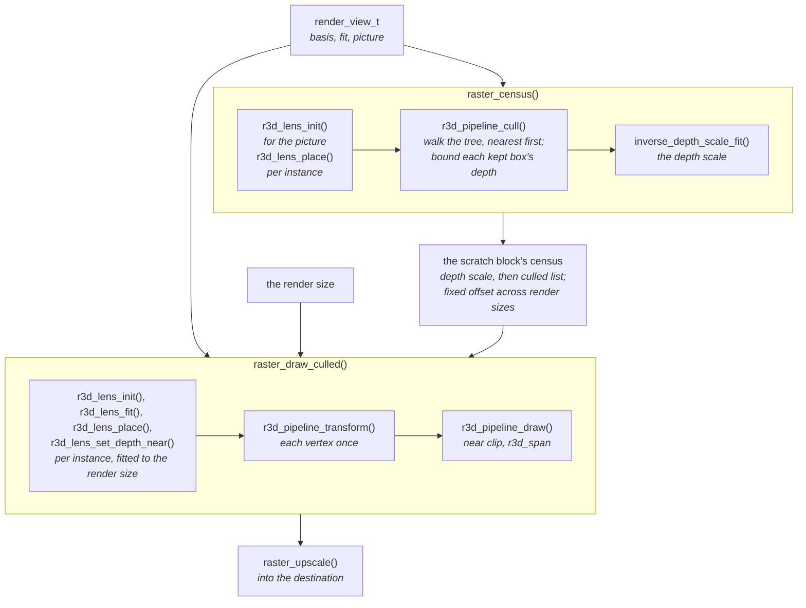

A caller builds a frame view and passes its `const render_view_t*`:

| Caller | Calls |
|---|---|
| Draws at a set size | `raster_draw()`, which culls every instance, fits the [depth scale](#depth) to what it kept, then draws each in turn with the fitted lens culling used, then `raster_upscale()` with the destination width and height |
| Picks the render size from what culling kept, as the render context does | `raster_census()`, sets the size, then `raster_draw_culled()` with the same view, then `raster_upscale()` |
| A suite or tool that schedules the stages itself | `r3d_pipeline.h`'s stages |

Culling and clipping use caller-owned workspace sized by
`r3d_pipeline_work_bytes()`:

- The raster's arena, sized by `raster_scratch_bytes()`, holds one workspace
  per row slice; culling reuses the first before drawing starts.
- Direct pipeline callers supply the workspace explicitly; simultaneous draws
  need distinct blocks.

The stages are split so two cores can share them:

- Transforming disjoint cluster lists writes disjoint vertex ranges.
- Drawing touches only the rows of its own target.
  `r3d_pipeline_transform()` records the screen rows each cluster spans, so a
  core drawing half the rows skips a cluster wholly outside them.

The raster draws at the caller's width and height and can upscale into a
destination picture: rendering at half the panel's size quarters the pixels
and halves the rows and spans.

The lens frames the destination's shape, and `r3d_lens_fit()` scales each
axis to the render size on its own, so a render may cut its height more than
its width and still show the same view.

### The render context

A frame view is perspective only. What a frame is drawn at belongs to the
render context (`context/render_context.h`): it owns the raster and its
scratch block, the render size and the debug view.

A caller hands it instances, a frame view and a clear colour, then a
destination to upscale into. The scene manager draws the active camera
through the engine's one context, `render_context_main()`, released when an
app exits.

| Call | Meaning |
|---|---|
| `render_context_set_scale()` | the share of the destination each axis draws at; half until set |
| `render_context_set_dynamic_resolution(config, model, step)` | opt-in: each frame draws at a step of `config` to hold its budget ([Dynamic-Resolution.md](frame/Dynamic-Resolution.md)); NULL returns to the fixed scale |
| `render_context_set_frame_generation(on)` | each drawn frame is followed by one warped from it to its own view instead of drawn ([Frame-Generation.md](frame/Frame-Generation.md)); a debug view, a cut or a new viewport draws |
| `render_context_set_debug_view()` | a [view mode](#view-modes), development builds only |
| `render_context_frame()` | the last frame: its step, size, what culling kept, and what its draw and upscale cost |

### On both cores

The work before the framebuffer runs in the app's `update()`, overlapped
with sending the previous frame. Each stage is split between the two cores:

- Core 1's half is dispatched through `core/job.h`. It runs inline when
  core 1 is busy, and always on a host.
- Present shares core 1, so `job_run_steered()` times both halves of every
  stage and moves work toward the faster core.

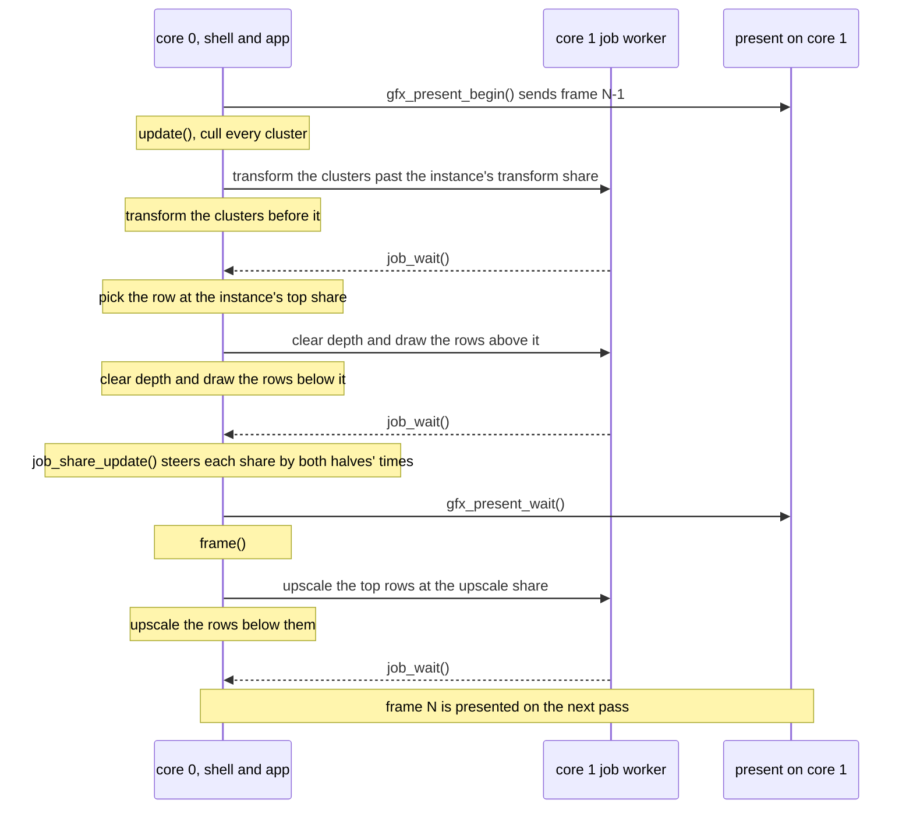

`raster_split_t` holds every raster share: caller-owned, NULL = even,
forget after a cut. Core 1's time counts from dispatch, so a wait behind
present counts against it.

### View modes

Development builds select one row from the `render_debug_view_t` table in
`render/context/render_context.c`: depth, tiles, motion, meshlets or cull.

| Call | What it does with the row |
|---|---|
| `render_context_set_debug_view()` | Attaches it and owns its zeroed PSRAM state; switching frees the previous state |
| `RENDER_DEBUG_VIEW_SHADED` | Detaches it |
| `render_context_release()` | Frees its state |
| `render_context_debug_view()` | Exposes its name and constructor to tools |

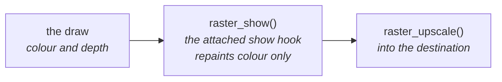

| View | The colour buffer becomes |
|---|---|
| shaded | untouched: the baked colours as drawn |
| depth | the depth as a grey ramp, nearest white and farthest black |
| tiles | the same ramp, each `RASTER_SHOW_TILE` square at its farthest depth |
| motion | mid-grey for none, red for x and green for y |
| meshlets | a flat hue for each cluster, with disjoint IDs for each instance |
| cull | each cluster in the colour of its fate this frame; see [The cull, seen](#the-cull-seen) |

A row may also carry two optional hooks:

| Row hook | What it does |
|---|---|
| `second_view` | After the frame's draw and after each draw it asks for, may name another view and fill the census list with the clusters to draw through it, and its depth scale; the frame's stats stay those of the first draw |
| `overlay` | Draws lines over the composed picture; the shell then composes at full size, not into a half picture |

- The ramp is stretched over the range this frame drew: the most detail
  within a frame, not comparable between frames.
- A pixel nothing drew takes the raster's `clear`, the colour upscaling gives
  it, so it reads as empty in every view; a tile holding one such pixel is
  empty.
- The views are at the raster's own size, before upscaling.
- `r3d_span.h` defines the depth encoding they read.

The depth and depth-tile views along a flythrough:

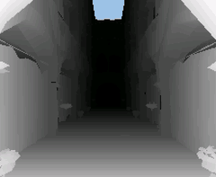
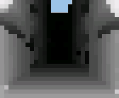

## Depth

The depth buffer holds 16-bit inverse depth: a point at view depth $`z`$
stores $`\mathrm{R3D\_DEPTH\_NEAREST}\cdot d_{near}/z`$, larger when nearer.
Inverse depth interpolates linearly across the screen, so a span steps it
with one add per pixel.

Two surfaces a gap $`h`$ apart, seen from height $`H`$ above them at view
depth $`z`$, are this many steps apart:

```math
N = \mathrm{R3D\_DEPTH\_NEAREST}\cdot\frac{d_{near}\,h}{H\,z}
```

Below one step they tie, and which one shows flips as the camera moves.

$`d_{near}`$ is fitted each frame, apart from the clip plane:

| Step | Owner | What it does |
|---|---|---|
| Cull every instance | `raster_draw()`, `raster_census()` | all lists first, so every instance draws with one scale |
| Bound each kept cluster | `r3d_pipeline_cull()` | the least view depth of its box inside each frustum plane it crosses, the best of them (`box3f_plane_distance_min_inside()`) |
| Fit | `raster.c` | the least bound, `inverse_depth_scale_fit()`: down to a power of two, never under `near_z` |
| Draw | `r3d_lens_set_depth_near()` | each instance's lens encodes with it; the clip plane stays `near_z` |
| Decode | `raster_depth_near()` | the scale the picture was drawn with, for readers such as motion vectors |

The bound looks only at the part of a box the frustum keeps. A cluster as
large as a ground square reaching behind the eye still bounds the nearest
ground the picture can see.

The scale is stored beside the census list, so a draw at another render
size encodes with the census's. Snapping to a power of two keeps it still
while the bound drifts, so ties do not flip from frame to frame.

Looking down from 26 m, the nearest roof is metres away while `near_z` is
6 cm. The fitted scale gives the street about a hundred times the steps. Below,
the same six frames have depth scaled by `near_z` (top) and by the fit
(bottom). On top, a ground square 2 to 7 cm under the street shows through
as dashes that come and go.

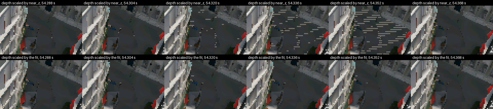

`render.depth_fit = 0` encodes with `near_z`, for comparisons.

## Attachments

A raster's picture is a render target
([gfx/Targets-and-Modes.md](../gfx/Targets-and-Modes.md#render-targets)):
colour and depth, then any further attachment the caller lists in
`raster_t.attachments`.

- An attachment with pixels is carved from the scratch block at the drawn
  size, so a picture drawn at a new size carves anew, and none keeps pixels
  from one picture to the next.
- A view with `format == 0` reserves no scratch pixels.
- One whose `clear` hook is NULL is not cleared. Depth and tiles have NULL
  clear hooks and use only colour and depth in their `show` hooks.

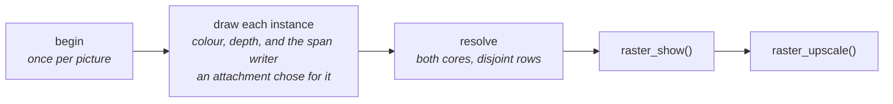

| Hook | When | What it may do |
|---|---|---|
| `clear` | the first instance of a picture, on its rows | start its pixels; the only hook colour and depth have |
| `begin` | once per `raster_draw()`, before anything is drawn | read the `const render_view_t*` and the instances, keep its own state |
| `writer` | once per instance | return a span writer, or none. The fill calls every writer after each span's colour and depth, with the span's depth, so each writes where that triangle won. With none, the fill runs exactly as without attachments, and the writers' code sits apart from it |
| `drawn` | once each instance is drawn | read the lens, the kept clusters and their transformed vertices |
| `resolve` | once every instance is drawn | turn what was written into the final map |
| `show` | `raster_show()` | paint the colour from it |

A writer finds the pixels its triangle won by their depth equalling the
triangle's, so where two instances meet at exactly the same depth the pixel
takes the later one's write.

A writer sees depth and one value per instance, or its base plus the mesh
cluster or triangle index, as its `r3d_span_writer_t.step` says. A map that needs
more, such as normals, rebuilds it from depth in its `resolve`.

### Motion vectors

`raster_motion.h`: for each pixel, the previous position of the point it
shows minus this one, two signed bytes in half pixels of this picture.

`RASTER_MOTION_UNKNOWN` marks a pixel nothing drew, the first picture, a
point behind the previous camera, and motion past the range.

The motion view along a flythrough, red for x and green for y:


An instance is known by its placement's address. One whose placement
changed since the previous picture gets its own map, carrying the point to
where the mesh was.

A raster with motion attached draws at most `RASTER_MOTION_INSTANCES_MAX`
instances.

| Hook | Motion |
|---|---|
| `begin` | Builds this picture's lens and the previous camera's lens at this picture's size, so a size change between pictures needs nothing special |
| `writer` | From the first instance that moved on, every triangle writes its instance's tag, 0 for anything still; before it, pixels keep the 0 they were cleared to. On a picture where nothing moved, nothing is written while drawing |
| `resolve` | Takes each pixel back to the world through its depth, through the map its tag picks, and projects it through the previous lens |

The caller owns a zeroed `raster_motion_t`, attaches `raster_motion_view()`,
and calls `raster_motion_forget()` after a cut. The render context attaches
it while the motion view is selected.

### Meshlet IDs

`raster_meshlets_view()` keeps a 16-bit map, its IDs distinct per draw for
up to 65535 clusters.

| Hook | Meshlets |
|---|---|
| `clear` | Zeroes the map |
| `begin` | Resets its next ID to one before each draw |
| `writer` | Reserves each instance's cluster count and writes the reserved base plus the mesh's cluster index |
| `resolve` | None: it needs no resolve pass |
| `show` | Maps IDs to hues through a multiplicative hash; zero takes the clear colour |

The meshlets view along the same flythrough, one hue per cluster:

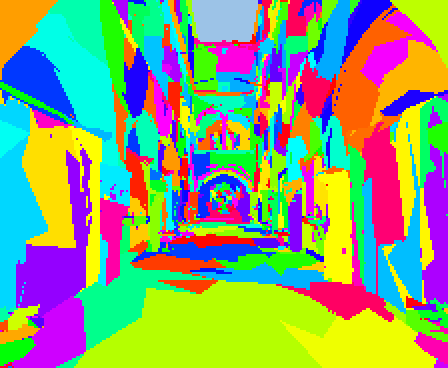

## The cull, seen

The cull view ([raster_cull_view.h](../../launcher/main/render/view/raster_cull_view.h))
paints every cluster in the colour of its fate this frame. Seen from the camera
only drawn clusters show, so it redraws from a spectator.

| Fate | Colour | The cluster |
|---|---|---|
| culled | grey | its box, or a box above it, is outside the frustum |
| not set up | blue | kept, but every triangle is behind the camera, misses every pixel centre or faces away |
| hidden | red | triangles were set up and filled, but each lost its depth test |
| drawn | green | owns at least one pixel |

| Tunable | Values |
|---|---|
| `cullview.from` | 0 the camera, 1 above the instances' bounds looking down, 2 behind and above the camera |
| `cullview.paint` | 0 the baked colours, culled clusters as a sparse screen door with a dashed grey border, each kept cluster's border solid in its fate's colour; 1 each cluster flat in its fate's colour; 2 each cluster in the hue of its node at `cullview.level`, darker the earlier it was dropped |
| `cullview.level` | the tree depth whose node boxes the overlay draws; 0 none, 1 the root's children |

From a spectator the culled and the kept clusters are drawn apart, so culled
geometry never hides kept geometry behind it: the holes in its screen door
show what lies behind. The overlay also draws the camera's frustum.

- Where two triangles fill a pixel at the same depth, it goes to the later
  one, as with every attachment.
- A triangle the near plane cuts counts as reaching the fill even when its
  clipped polygon then faces away or vanishes.

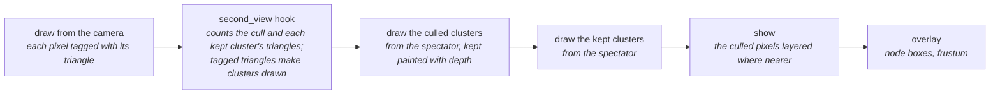

The frame's own cull and draw count nothing; `r3d_pipeline_cull_counted()` and
`r3d_pipeline_count_triangles()` count beside them. `scene_viewer.sh --view cull
--counts FILE` writes the counts per frame.

Bistro along its camera path:

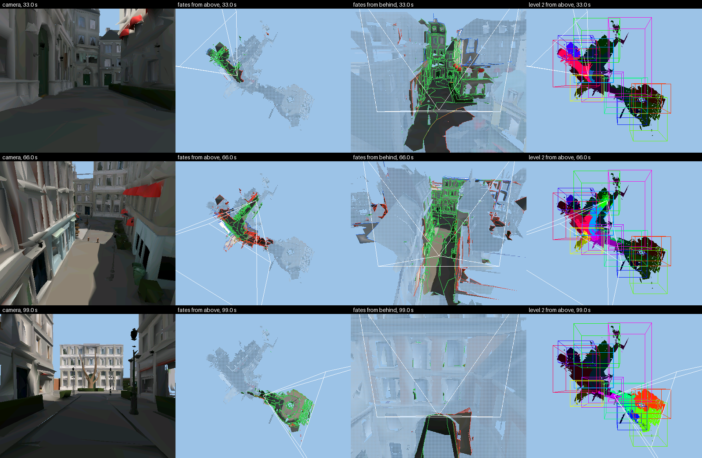

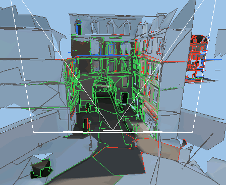

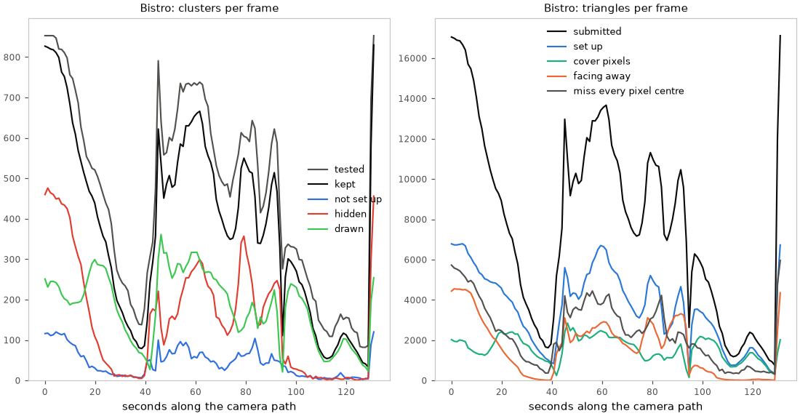

<!-- generated: cull-bistro sha256=c8ab3c5c527ead3520e2b7fdb145fecf73a3df5be49e08e26952397ff5fe8552 -->
| Per frame, path mean | Bistro |
|---|---|
| Nodes visited / cut | 145 / 32 |
| Clusters tested / kept | 458 / 376 |
| Kept clusters: nothing set up / hidden / drawn | 44 / 151 / 181 |
| Triangles submitted | 7736 |
| Submitted triangles behind the near plane | 67 (1 %) |
| Submitted triangles clipped | 61 (1 %) |
| Submitted triangles miss every pixel centre | 2371 (31 %) |
| Submitted triangles facing away | 1648 (21 %) |
| Submitted triangles set up | 3589 (46 %) |
| Submitted triangles covering pixels | 1574 (20 %) |
<!-- /generated: cull-bistro -->

Sponza's fitted full bake along its flythrough:

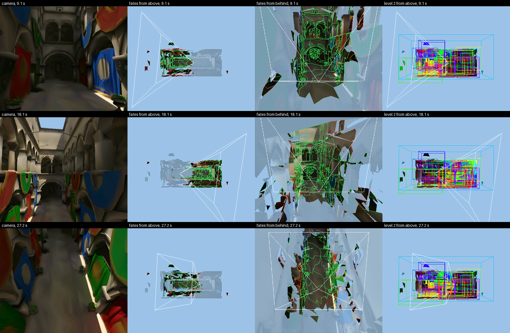

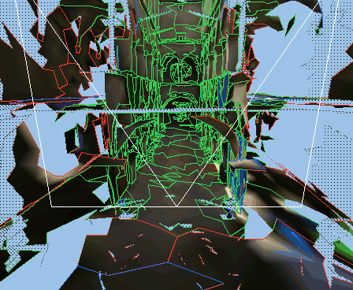

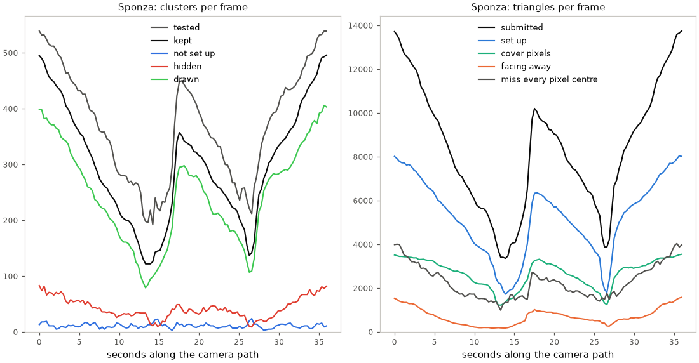

<!-- generated: cull-sponza sha256=464a55906b51d0a10196a6c861853fce41a28670d872dd60dba95156104b226e -->
| Per frame, path mean | Sponza |
|---|---|
| Nodes visited / cut | 175 / 49 |
| Clusters tested / kept | 371 / 300 |
| Kept clusters: nothing set up / hidden / drawn | 11 / 43 / 246 |
| Triangles submitted | 8369 |
| Submitted triangles behind the near plane | 67 (1 %) |
| Submitted triangles clipped | 77 (1 %) |
| Submitted triangles miss every pixel centre | 2291 (27 %) |
| Submitted triangles facing away | 704 (8 %) |
| Submitted triangles set up | 5230 (62 %) |
| Submitted triangles covering pixels | 2692 (32 %) |
<!-- /generated: cull-sponza -->

### What a cluster and a triangle cost

The board's cull-cost suite (`run_cull_cost_suite`) times one core's cull,
transform and draw, stopped once each triangle is set up, along both paths.
Each pose is drawn three ways, so the counts move apart:

- as baked;
- with each cluster's triangles halved: same clusters and vertices, half the
  triangles submitted;
- through a mirrored lens: same clusters and triangles, the other faces set up.

[cull_cost.py](../../launcher/tools/render/cull_cost.py) fits each stage by
non-negative least squares:

- cull = a + b × nodes visited + c × clusters tested
- transform = a + b × clusters kept + c × vertices transformed
- set-up = a + b × clusters kept + c × triangles submitted + d × triangles set up

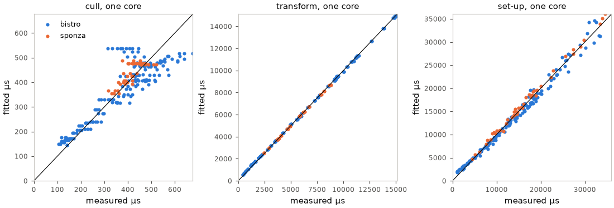

<!-- generated: cull-cost sha256=3e63a002a74d986120fc5c3578f0b9f5a2ea8fae728b4a9ac1af670c39892d47 -->
| Stage | Term | One core |
|---|---|---|
| cull | per node visited | 2158 ns |
| cull | per cluster tested | 0 ns |
| cull | constant | 58 µs |
| cull | worst error over the poses | 222 µs |
| transform | per cluster kept | 223 ns |
| transform | per vertex transformed | 582 ns |
| transform | constant | 0 µs |
| transform | worst error over the poses | 214 µs |
| set-up | per cluster kept | 3476 ns |
| set-up | per triangle submitted | 460 ns |
| set-up | per triangle set up | 3345 ns |
| set-up | constant | 1238 µs |
| set-up | worst error over the poses | 3340 µs |
<!-- /generated: cull-cost -->

## Coverage and small triangles

A pixel belongs to a triangle when its centre is inside by the top-left
rule, decided in integers on positions snapped to 1/16 pixel. Two triangles
sharing an edge therefore never both fill a pixel, nor both miss one, in any
window of rows.

`r3d_pipeline_transform()` snaps each vertex once, into an 8-byte
`r3d_pipeline_vertex_t`. Every position the rasterizer takes is within 1024
pixels of the origin, which keeps its edge arithmetic in 32 bits:

- A triangle with a corner behind the near plane or farther off screen is
  rebuilt from the mesh and clipped to a guard band inside that reach.
- The fast path stops short of the guard band, so a clip never cuts an edge
  that a fast triangle shares.

A detailed mesh drawn small has many triangles covering a few pixel centres
or none, so the draw routes each by the centres its bounding box holds:

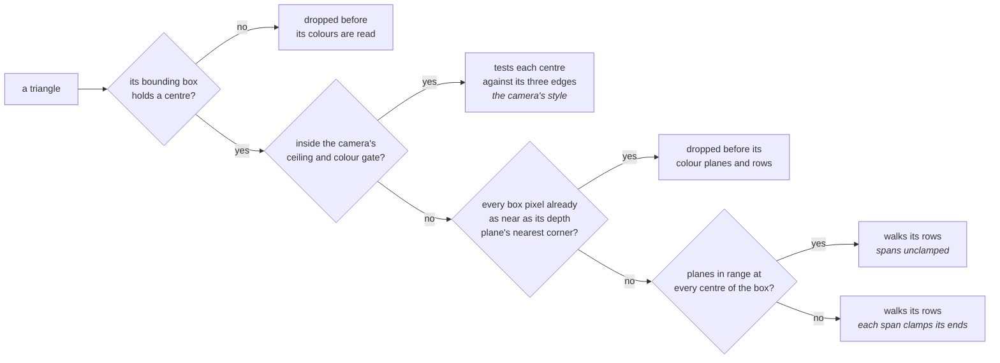

| Step | Why |
|---|---|
| Per-centre test | Skips the walk's setup but loses the triangle's gradient; [Small fill](#small-fill) controls that cost and look trade-off |
| Walk | Each edge's column is found exactly by an integer step |
| Depth plane | A triangle to be walked works it out first; a hidden one could write nothing. The test pays because clusters are drawn roughly nearest first, so a triangle behind is usually drawn after what hides it |
| Clamps | A centre just outside a triangle extrapolates its planes past the vertex range. Most kept triangles stay in range, where the clamps would change nothing |

Both fill paths apply the same rule to the same integers, so a small
triangle and a walked one sharing an edge still meet without a gap or an
overlap.

`suite_r3d_lit.c` holds every triangle to a reference implementation of the
rule, and a mesh of mixed sizes to one fill per pixel.

### Small fill

Eligible triangles skip plane setup and use one depth, with colour from the
camera's style.

The camera owns the bounding-box ceiling, colour gate and
style; `render_view_t.small_fill` carries them to the frame's row workers.

| Preset | Ceiling/gate, style | Use |
|---|---|---|
| `SMALL_FILL_SMOOTH` | 4/0 FLAT | Cameras start with it; it preserves the smooth rendering checksum |
| `SMALL_FILL_FAST` | 12/16 FLAT | Apps opt in for the measured frame-cost gains |
| `SMALL_FILL_FAST_DITHER` | 12/16 DITHER | FAST's ceiling and gate with the DITHER style |
| `SMALL_FILL_FAST_GRAIN` | 12/16 GRAIN | FAST's ceiling and gate with the GRAIN style |

<!-- generated: small-fill-levers sha256=46ed813c7858d86cdd5da15850ac97079edbfa75daf563de4d3405d5a429d84d -->
| Camera field | Range | Default | Effect |
|---|---|---|---|
| `ceiling` | 0..16 | 4 | Largest bounding-box side in pixel centres; 0 disables small fill |
| `gate` | 0..255 | 0 | Vertex RGB565 spread limit at the ceiling; 0 disables the colour gate |
| `style` | 0..2 | 0 | FLAT (0), GRAIN (1), DITHER (2) |
<!-- /generated: small-fill-levers -->

The presets are defined in `render_view.h`. Opt in with the
[scene camera API](scene/Scene-Manager.md#what-an-app-calls), or pass custom `small_fill_t` values:

<!-- generated: scene-small-fill-example check: python launcher/tools/gen/examples_doc.py --check -->
```c
/* Small fill: choose the fast policy for a scene camera. */
#include "scene/scene.h"

static bool
small_fill_example(scene_t* scene, scene_entity_t camera) {
    return scene_camera_set_small_fill(scene, camera, SMALL_FILL_FAST);
}
```
<!-- /generated: scene-small-fill-example -->

The gate:

- One limit applies to all packed RGB565 per-channel spreads: green's six
  bits get half the relative tolerance of red and blue.
- Above `R3D_SPAN_SMALL_MAX_SIDE`, the limit tightens from
  `SMALL_SPREAD_OFF` to `gate` at the ceiling. If only one side is eligible,
  it uses `gate` directly.
- Face colours and sides through `R3D_SPAN_SMALL_MAX_SIDE` bypass the gate
  and use FLAT.

| Style | What it writes |
|---|---|
| FLAT | The averaged colour |
| DITHER | Screen-anchored ordered picks of the vertex colours |
| GRAIN | Flat and one shade alternating in a screen-anchored checker, moving R/B by one step and G by two in the same direction |

GRAIN splits the colour range: a colour in its dark half gets the lighter
shade, one in its bright half the darker. On overflow it tries the other
direction; if neither fits it uses flat. Channels never clamp independently.

<table>
<tr><th>Look</th><th>Picture</th><th>Amplified difference from SMOOTH</th></tr>
<tr><td>SMOOTH (4/0 FLAT)</td><td></td><td></td></tr>
<tr><td>FAST (12/16 FLAT)</td><td>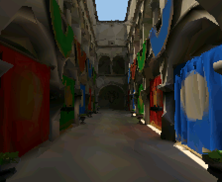</td><td>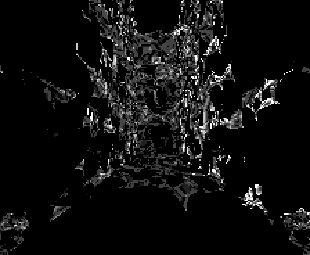</td></tr>
<tr><td>12/16 GRAIN</td><td></td><td>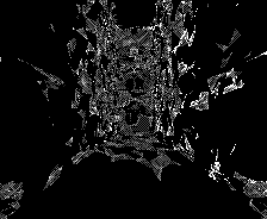</td></tr>
<tr><td>12/16 DITHER</td><td></td><td>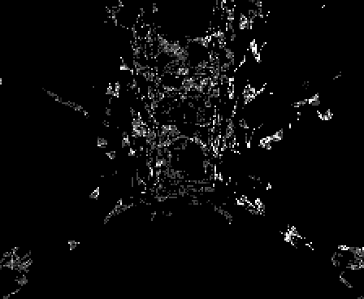</td></tr>
</table>

Clips show the same full renderer frames and camera window, one look per GIF.
The [temporal method](../tools/Render-Harness.md#temporal-video-columns)
measures triangle-scale pops; the difference clips also show spatial noise.

<!-- generated: small-fill-temporal sha256=348854d83f0b4c0a5dc518fade64b76bc25fe53a467917f162e3356f235f3b5c -->
| Look vs SMOOTH | Extra frame-to-frame change (levels of 255) | Blocks popping (>8/255) |
|---|---|---|
| SMOOTH (4/0 FLAT) | 0.000 | 0.0000% |
| FAST (12/16 FLAT) | 0.809 | 1.7679% |
| 12/16 GRAIN | 0.909 | 1.9629% |
| 12/16 DITHER | 1.048 | 3.0372% |
<!-- /generated: small-fill-temporal -->

#### Board frame-cost gains when opted in

Two committed sweeps time the fitted-full mesh frame and the animated
skinned render. Times are seed means in
landscape, and each sweep's percentages compare with its first row.

| Sweep | Measures | Its plan records |
|---|---|---|
| [Ceiling by gate](data/small-fill/ceiling-gate-sweep.json) | FLAT | [Build IDs, captures and layout seeds](data/small-fill/ceiling-gate-plan.json) |
| [Camera style](data/small-fill/styles-sweep.json) | The styles against the baseline on the same build | [Both orientations](data/small-fill/styles-plan.json); the tables show landscape |

<!-- generated: small-fill-board sha256=24330a668e20cf85bd5c6648faf10a09567b57eee4a1cdef496be94247e38184 -->
<details><summary>Ceiling by gate, FLAT, rows in the sweep's point order</summary>

| Ceiling | Gate | Style | Mesh frame ms | vs first row | Skinned render ms | vs first row |
|---|---|---|---|---|---|---|
| 4 | 0 | FLAT | 41.103 | +0.00% | 8.743 | +0.00% |
| 4 | 8 | FLAT | 41.114 | +0.03% | 8.745 | +0.02% |
| 4 | 16 | FLAT | 41.108 | +0.01% | 8.742 | -0.01% |
| 4 | 24 | FLAT | 41.109 | +0.01% | 8.739 | -0.05% |
| 12 | 0 | FLAT | 36.356 | -11.55% | 8.014 | -8.34% |
| 12 | 8 | FLAT | 37.569 | -8.60% | 8.136 | -6.95% |
| 12 | 16 | FLAT | 37.355 | -9.12% | 8.115 | -7.19% |
| 12 | 24 | FLAT | 37.261 | -9.35% | 8.113 | -7.21% |
| 14 | 0 | FLAT | 35.556 | -13.50% | 7.914 | -9.48% |
| 14 | 8 | FLAT | 36.866 | -10.31% | 8.034 | -8.10% |
| 14 | 16 | FLAT | 36.711 | -10.69% | 8.024 | -8.22% |
| 14 | 24 | FLAT | 36.610 | -10.93% | 8.017 | -8.30% |
| 16 | 0 | FLAT | 35.043 | -14.74% | 7.856 | -10.14% |
| 16 | 8 | FLAT | 36.457 | -11.30% | 7.960 | -8.96% |
| 16 | 16 | FLAT | 36.285 | -11.72% | 7.965 | -8.90% |
| 16 | 24 | FLAT | 36.159 | -12.03% | 7.961 | -8.95% |

</details>

<details><summary>Camera style, rows in the sweep's point order</summary>

| Ceiling | Gate | Style | Mesh frame ms | vs first row | Skinned render ms | vs first row |
|---|---|---|---|---|---|---|
| 4 | 16 | FLAT | 40.113 | +0.00% | 8.577 | +0.00% |
| 4 | 16 | GRAIN | 40.116 | +0.01% | 8.579 | +0.01% |
| 4 | 16 | DITHER | 40.119 | +0.02% | 8.575 | -0.02% |
| 12 | 16 | FLAT | 36.972 | -7.83% | 8.038 | -6.29% |
| 12 | 16 | GRAIN | 38.649 | -3.65% | 8.294 | -3.30% |
| 12 | 16 | DITHER | 38.985 | -2.81% | 8.351 | -2.63% |

</details>
<!-- /generated: small-fill-board -->

## Memory

The layer allocates nothing. Raster draw work owns the resolved camera
settings and per-side spread table, shared read-only by the row workers.

Per-vertex and per-cluster buffers, the census list, picture attachments and
upscale maps share one block. The census comes first, its depth scale then
its list, at an offset independent of render size; storage is padded for
picture attachments.

`raster_carve()` in `raster_internal.h` states the layout once, and
`raster_scratch_bytes()` sizes the block from it.

The caller obtains the block once and sets `scratch`; each call carves it.
The caller decides where it lives, so it need not consume internal RAM.

## Rules the layer keeps

- **Single precision only.** The FPU has no double, and one stray promotion
  costs an order of magnitude. The firmware build turns
  `-Wdouble-promotion` and `-Wfloat-conversion` into errors for the whole
  `main` component (see [Build-Variants.md](../tools/Build-Variants.md)).
- **Host-testable.** The headers are ESP-IDF-free, and the portable
  `test/suites/suite_r3d_*.c` suites check them on a laptop.
  `suite_r3d_lit.c` builds its meshes inside the test, never a baked one.
- **The caller owns the environment.** Viewport, panel quarter, units and
  timeline are passed in. No code path reads the panel's size.

## Related

- [firmware/README.md](../firmware/README.md): the layers and the frame loop
- [gfx/Present.md](../gfx/Present.md#present-who-runs-it): the split present `update()` overlaps
- [Building-an-App.md](../firmware/Building-an-App.md#app-memory): the app arena, one place a frame's scratch block can come from
