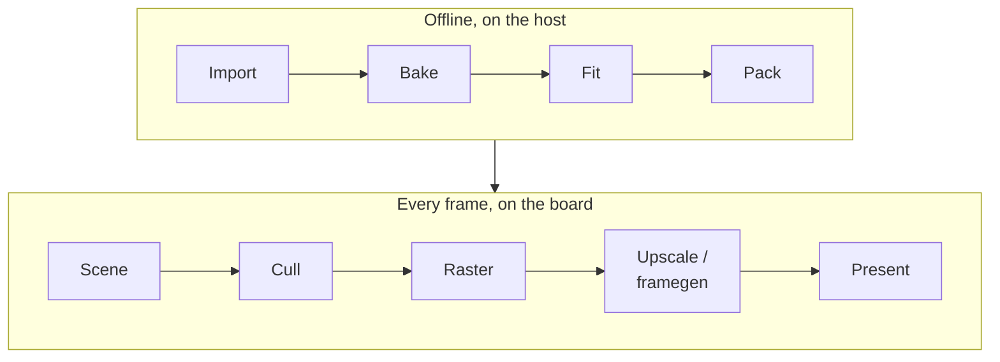

# 3D Rendering and Scenes

Everything about drawing 3D on the board: a model is baked on the host into
meshes the board draws without lighting them, and a scene places them. There is
no GPU and no display framework, only a span rasterizer on both cores. The
renderer is `launcher/main/render/`; the offline tools are `launcher/tools/r3d/`.

| Stage | Reads → writes | Owner |
|---|---|---|
| Import | source model + import file → triangles, masked, culled to what the camera sees | [offline/Mesh-Import.md](offline/Mesh-Import.md) |
| Bake | triangles + the scene's lights → a colour per vertex or face, simplified to budget | [offline/Bake-Method.md](offline/Bake-Method.md), results in [offline/Bake-Quality.md](offline/Bake-Quality.md) |
| Fit | a baked mesh + reference renders → the fitted mesh (optional, CUDA) | [offline/Appearance-Fit.md](offline/Appearance-Fit.md) |
| Pack | meshes, clips and a scene file → one pack per root | [offline/Baked-Mesh.md](offline/Baked-Mesh.md), [Building-Packs.md](../assets/Building-Packs.md#packs), entry bytes [LMSH](../assets/formats/LMSH.md) and [SCNE](../assets/formats/SCNE.md) |
| Scene | the pack → entities, components, the active camera | [scene/Scene-Files.md](scene/Scene-Files.md) (author), [scene/Scene-Manager.md](scene/Scene-Manager.md) (runtime) |
| Cull | cluster bounds + the camera → the clusters that may show | [Mesh-Rendering.md](Mesh-Rendering.md#the-cull-seen) |
| Raster | clusters → colour and depth, both cores | [Mesh-Rendering.md](Mesh-Rendering.md#one-frame) |
| Upscale / framegen | the render size → the panel size; frames warped between renders | [frame/Dynamic-Resolution.md](frame/Dynamic-Resolution.md), [frame/Frame-Generation.md](frame/Frame-Generation.md) |
| Present | the framebuffer → the panel over QSPI | [gfx/Present.md](../gfx/Present.md) |

Each half has its stage table, its cost per stage and its refresh recipe:
[offline/](offline/README.md) and [frame/](frame/README.md) (which core runs
each stage).

| To | Read |
|---|---|
| put a model on screen | [Building-a-Scene.md](Building-a-Scene.md), then [scene/Scene-Files.md](scene/Scene-Files.md) |
| import or fit a mesh | [offline/Mesh-Import.md](offline/Mesh-Import.md), [offline/Appearance-Fit.md](offline/Appearance-Fit.md) |
| follow one frame | [frame/](frame/README.md) |
| make a frame cheaper | [Rendering-Options.md](Rendering-Options.md), [frame/Dynamic-Resolution.md](frame/Dynamic-Resolution.md) |
| animate a skinned mesh | [animation/Skinned-Meshes.md](animation/Skinned-Meshes.md) |

| Folder | Pages |
|---|---|
| [offline/](offline/README.md) | [Mesh-Import](offline/Mesh-Import.md), [Bake-Method](offline/Bake-Method.md), [Appearance-Fit](offline/Appearance-Fit.md), [Bake-Quality](offline/Bake-Quality.md), [Baked-Mesh](offline/Baked-Mesh.md) |
| [scene/](scene/README.md) | [Scene-Files](scene/Scene-Files.md), [Scene-Manager](scene/Scene-Manager.md), [Camera](scene/Camera.md) |
| [frame/](frame/README.md) | [Dynamic-Resolution](frame/Dynamic-Resolution.md), [Frame-Generation](frame/Frame-Generation.md) |
| [animation/](animation/README.md) | [Skinned-Meshes](animation/Skinned-Meshes.md), [Animation-Tracks](animation/Animation-Tracks.md), [Skeleton-and-Skin](animation/Skeleton-and-Skin.md), [Skinned-Lighting](animation/Skinned-Lighting.md) |
| this folder | [Building-a-Scene](Building-a-Scene.md) (start here), [Mesh-Rendering](Mesh-Rendering.md) (the raster), [Rendering-Options](Rendering-Options.md) (every knob that trades work for speed or look) |

Reference content (a scene with its import, bakes and camera path) lives in
the [demo assets](../../launcher/demo/README.md). Related:
[Firmware](../firmware/README.md) for the layers, and the
[render harness](../tools/Render-Harness.md) to see a scene without a board.
