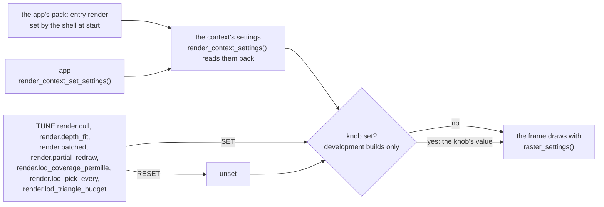
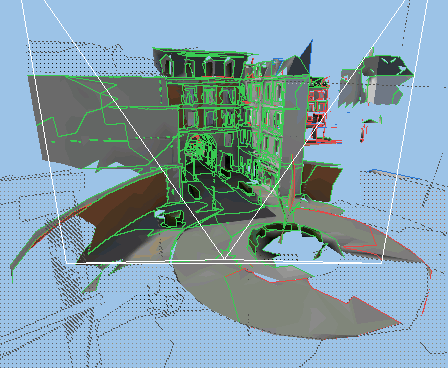
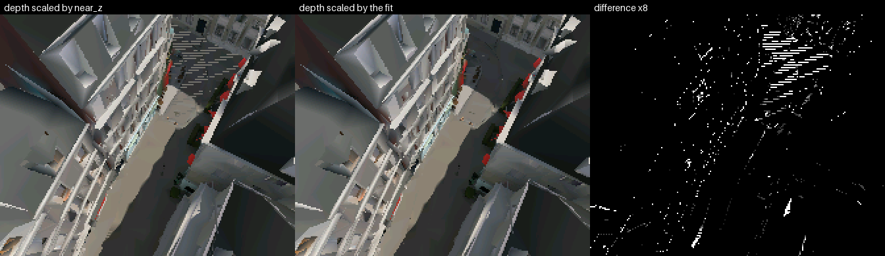
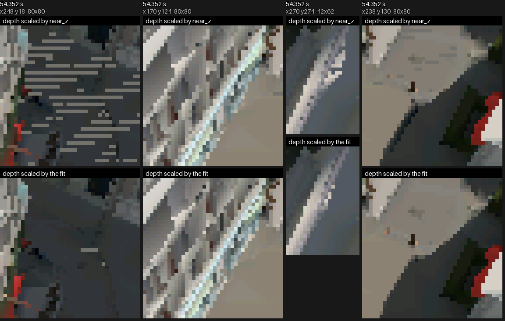
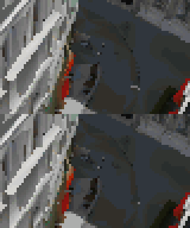
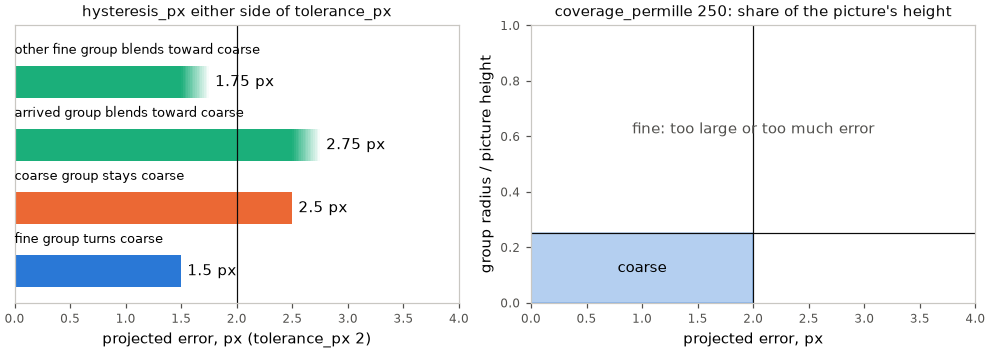
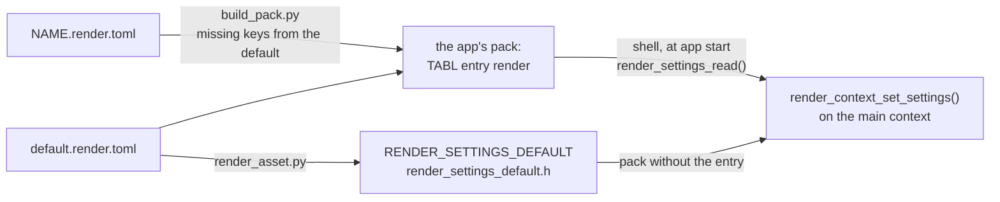
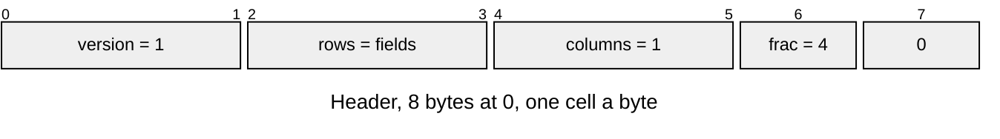
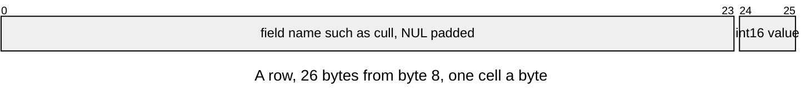

# Render Settings

A render context draws with one settings value, `render_settings_t`: the
renderer's quality and cost choices. An app authors it as a
[render asset](#the-render-asset) its pack holds, which the shell applies as
the app starts, and may set it with `render_context_set_settings()` on any
frame; the next frame draws with it.

In a development build each setting also has a `TUNE` knob
([Live-Tuning.md](../cli/Live-Tuning.md)). A knob that is set overrides the
app's value for every frame, without writing into it. `RESET` clears the
override, and the app's value comes back.



A release build has no knobs, so it draws with the app's settings only. A raster
drawn without a context uses `RENDER_SETTINGS_DEFAULT`.

## The settings

Basic settings are for any app to weigh. Advanced ones need the renderer's
workings to judge. A member of a struct field is named `field.member`, and its key sits under
that field's table in the asset.

<!-- generated: render-settings check: python launcher/tools/render/settings/settings_table.py --check -->
| Field | Default | Tier | What it trades |
|---|---|---|---|
| `cull` | `true` | basic | skips clusters and world boxes outside the picture |
| `depth_fit` | `true` | advanced | depth steps go where the kept scene is, not to near_z; needs cull |
| `batched` | `true` | advanced | one transform and one draw fork/join a batch, not an instance |
| `partial_redraw` | `true` | basic | a still camera redraws only the rows that moved; the picture is the same |
| `lod.tolerance_px` | `2.0` | basic | the projected error a group may have and still draw coarse; more saves, pops more |
| `lod.hysteresis_px` | `0.5` | advanced | how far past the tolerance a coarse group's error goes before it turns fine |
| `lod.coverage_permille` | `250` | basic | the thousandths of the picture's height a coarse group may span; smaller pops less |
| `lod.pick_every` | `4` | advanced | the frames the pick is spread over, a scene's first frame picking all; more saves, switches later |
| `lod.triangle_budget` | `0` | basic | the triangles a frame aims to draw, the tolerance rising past tolerance_px to keep within; 0 never rises |
| `lod.blend` | `0` | basic | 0 switches at once; 1 blends each switch, by morph where a mesh was imported with geometry.morph, else by dither |
| `lod.blend_px` | `0.25` | advanced | the error past a switch over which a blend fades out; longer is softer, moves more |
<!-- /generated: render-settings -->

## cull

Culling keeps only the clusters, and the instances, that can show in the
picture ([every stage](frame/Culling.md)). It changes no pixel, so the figure
is what it saves. The chase below marks each cluster's fate along Bistro's path:



Mean frame stages along Sponza's camera path on the board, culling on and off:

<!-- generated: render-settings-cull sha256=5d303133eed2f3851202b76f0e87e9bce6bc029ce57cb2cc3151f5e402ec8c34 -->
| Setting | Cull ms | Transform ms | Draw ms | Frame ms |
|---|---|---|---|---|
| `cull` on | 0.60 | 3.24 | 33.89 | 40.57 |
| `cull` off | 0.34 | 5.70 | 48.46 | 57.28 |
| off - on | -0.26 | 2.46 | 14.56 | 16.71 |
<!-- /generated: render-settings-cull -->

The cull stage itself costs more with culling on; the saving is in the
transform and the draw. Off is only for measuring.

## depth_fit

Depth is stored in 16 bits as `depth_near / z`. With `depth_fit` on, each
frame scales it to the nearest bound it kept, not the clip plane's `near_z`
([Attachments.md](frame/Attachments.md#depth)). Seen from high up, the scale
then gives distant surfaces many more steps.

With `depth_fit` off, a patch of ground just under Bistro's street shows through the road.
Below is one frame with each setting, and their difference:



The places they differ most, enlarged:



The artefact moves from frame to frame:



The fit adds no pass of its own: the cull's walk tracks the nearest bound it
keeps, and a mesh's curve boxes join it. So `depth_fit` has an effect only
with `cull` on.

## batched

Instances draw in batches of consecutive instances whose vertices and
clusters fit the scratch sized for the largest mesh, up to
`RASTER_BATCH_INSTANCES`. Each batch takes one transform fork/join and one
draw fork/join, where each instance took two. It changes no pixel.

Mean and p95 frame time along each camera path on the board, batching on and
off ([the captures](data/batched-board.log)):

<!-- generated: render-settings-batched check: python launcher/tools/render/settings/batched_cost.py --check -->
| Scene | Quarter | Mean ms, on | Mean ms, off | Off - on | p95 ms, on | p95 ms, off |
|---|---|---|---|---|---|---|
| bistro-fitted-full | landscape | 37.5 | 40.1 | 2.7 | 51.1 | 53.5 |
| bistro-fitted-full | portrait | 35.8 | 38.5 | 2.7 | 53.8 | 56.4 |
| sponza-fitted-full | landscape | 45.4 | 49.2 | 3.7 | 55.4 | 59.2 |
| sponza-fitted-full | portrait | 48.2 | 51.9 | 3.7 | 59.4 | 63.0 |
<!-- /generated: render-settings-batched -->

Off is only for measuring.

## partial_redraw

While the camera holds still, a frame redraws only the rows the changed
objects cover, and the picture is the one a full redraw gives
([how](frame/Partial-Redraw.md)). It applies at the fixed scale with frame
generation off, and costs nothing when it does not apply.

## lod

The [LOD pick](frame/Levels-of-Detail.md), once a frame per instance, draws a group's coarser
level when its projected error is within `tolerance_px` and its radius spans at most
`coverage_permille` thousandths of the picture's height.

A coarse group turns fine only once its error passes the tolerance by `hysteresis_px`, and a
fine one turns coarse only once it is that far under, so a still camera never flickers:



These change which clusters draw, so they change pixels. A larger tolerance saves triangles and
pops more; [Levels-of-Detail.md](frame/Levels-of-Detail.md) scores each coverage cap.

With `triangle_budget` set, the tolerance rises from `tolerance_px` until the frame fits
([the steer](frame/Levels-of-Detail.md#the-budget)). The budget is in triangles, at most 32767.
The coverage cap rises with it, in proportion: `coverage_permille` is the cap at
`tolerance_px`, so a budget can turn coarse the large groups the cap holds fine there.

**What the budget counts:** the triangles of every lit-mesh cluster the cull keeps, after the
level cut and before any triangle is drawn. That is `raster_stats_t.triangles`, which the frame
reports as its triangles.

| Triangles | Counted |
|---|---|
| A kept cluster's, at the level the cut draws | yes |
| A kept cluster's that face away or fall outside the picture | yes: the count comes before the span fill |
| Clusters of a level the cut does not draw | no |
| Clusters and instances the cull drops | no |
| Anything drawn that is not a lit-mesh cluster | no |
| The import's [`[[variants]].triangles`](offline/Mesh-Import.md#variants-triangles) | no: a ceiling on the detail a mesh holds, not a frame's cost |

## The render asset

Settings are authored in a `NAME.render.toml`, one key per field, a struct field's under its own table. The engine's
is [`default.render.toml`](../../launcher/main/render/settings/default.render.toml),
and `RENDER_SETTINGS_DEFAULT` is generated from it
([`render_asset.py`](../../launcher/tools/render/settings/render_asset.py)).
Any other file lists only the values it changes; the rest come from the
default. A key that is no field, or a value of another type, fails the build.

```toml
# fast.render.toml: the default, but drawn one instance at a time and a coarser LOD
batched = false

[lod]
tolerance_px = 3.0
```

An app's `.pack.toml` names one with `render = "PATH"`, relative to itself
([Building-Packs.md](../assets/Building-Packs.md#packs)), and the pack holds it
as entry `render`. The shell mounts the pack an app names in `app_t.pack`, and
before `enter()` its render system (`shell/render_system.c`) sets the main
context's settings from that entry, or to `RENDER_SETTINGS_DEFAULT` without one. So no app starts with the last app's
settings. Scenes never carry render settings.



The entry is a [TABL v1](../assets/formats/TABL.md) table with one row per
`render_settings_t` field, named by it, one column and `frac` `RENDER_SETTINGS_FRAC_BITS` (4): a `float` is held in 1/16 steps,
a `bool` as 0 or 1 and an `int` as itself:





| Part | At | Size |
|---|---|---|
| Header | 0 | 8 bytes |
| Rows | `8 + i * 26` | 26 bytes a row, one per field in struct order: `8 + 26 * fields` bytes in all |

| Rule | Detail |
|---|---|
| Owners | `RENDER_SETTINGS_ENTRY` and the fields in `render_settings.h`; the table layout in `asset_table_format.h` |
| Rows | exactly one per `render_settings_t` field, named `field` or `struct.member`; the reader takes any nonzero `bool` as true |
| Errors | `render_settings_read()`: `ASSET_ERR_NOT_FOUND` without the entry; `ASSET_ERR_FORMAT` for another row count, a missing field, more than one column or a `frac` other than 4; TABL's own errors. `out` is written only on `ASSET_OK` |
| Failure at start | a pack without the entry starts the app with `RENDER_SETTINGS_DEFAULT`; any other read failure is logged and does the same |
