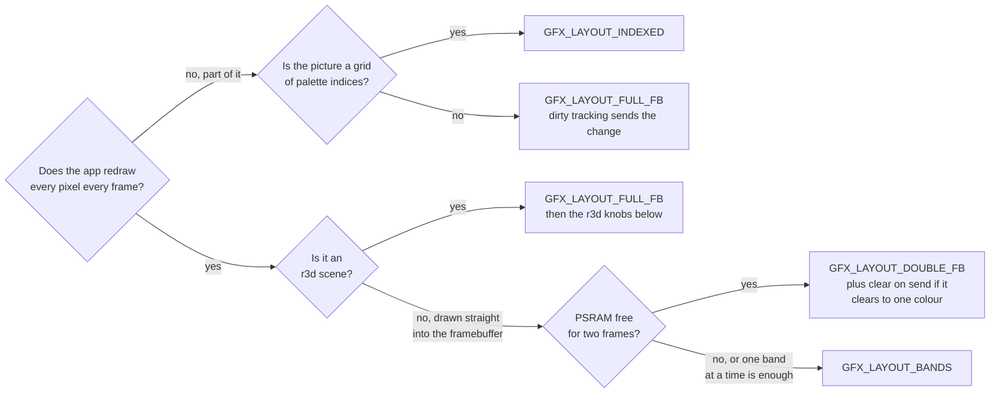
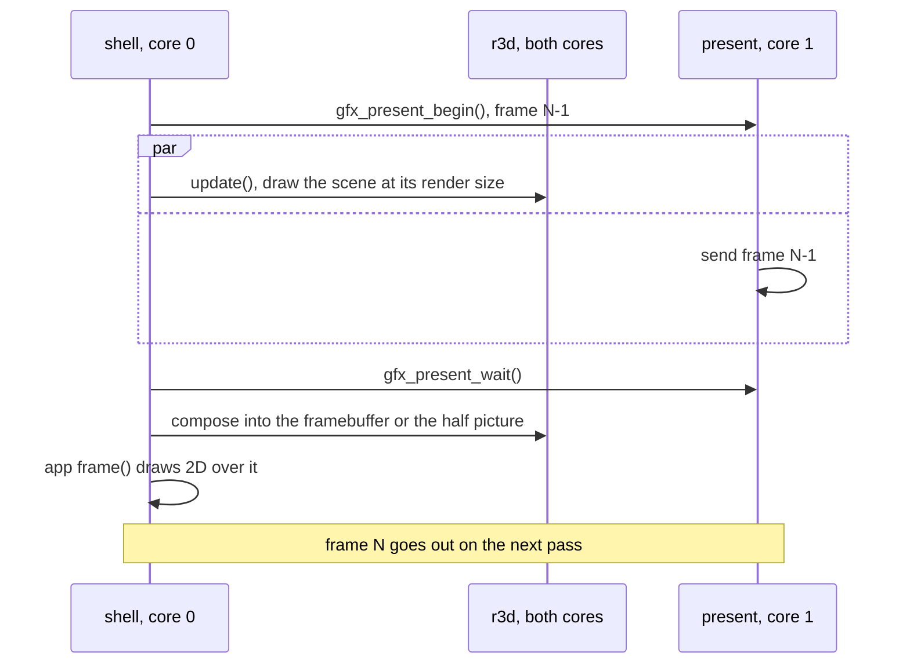

# Rendering Options

Every choice an app makes about how its pictures reach the panel, and when
each one pays. gfx owns the framebuffer and the send; r3d draws 3D into a
buffer gfx hands it; `draw/` paints 2D into the same target.

The panel is 368 x 448 RGB565, so one frame is 322 KiB, and sending a whole
frame is the largest single cost of a frame
([Panel clock](../gfx/Present.md#panel-clock)).
Two terms recur:

| Term | Meaning |
|---|---|
| half picture | a PSRAM picture at exactly half size that present doubles as it sends; an r3d scene at 50% scale composes into it instead of the framebuffer |
| clear on send | in the double layout, core 1 fills each frame with one colour once it is sent, so the next `draw_clear()` of that colour costs core 0 nothing |

This page picks options. How each one works is on the reference page it
links to: [gfx/README.md](../gfx/README.md) for gfx,
[Render-Pipeline.md](Render-Pipeline.md) and the pages it routes to for r3d.

## Choosing at a glance

The options fall into four groups. Choose a framebuffer layout first; the other
groups tune the send, the draw and the bake.

### Framebuffer layout

A framebuffer layout sets how gfx holds a frame and sends it to the panel. An
app sets one in `enter()`. The diagram below helps you choose a layout.



| Option | Trades | RAM | Default | Turn it on | Reference |
|---|---|---|---|---|---|
| [Full framebuffer](#framebuffer-layouts) | nothing: sends only what changed | one frame of PSRAM | on | nothing | [Modes](../gfx/Targets-and-Modes.md#modes) |
| [Double framebuffer](#framebuffer-layouts) | a second frame of PSRAM for drawing during the send | a second frame of PSRAM | off | `gfx_mode_enter()` with `GFX_LAYOUT_DOUBLE_FB` | [Modes](../gfx/Targets-and-Modes.md#modes) |
| [Clear on send](#framebuffer-layouts) | core 1's bus time for core 0's clear | none | off | `gfx_set_clear_on_send()` in `GFX_LAYOUT_DOUBLE_FB` | [Present](../gfx/Present.md#present-who-runs-it) |
| [Band ring](#framebuffer-layouts) | kept content for a freed framebuffer | 0 extra internal on the device; frees the PSRAM frame | off | `GFX_LAYOUT_BANDS` and a `draw_band` callback | [The band ring](../gfx/Band-Ring.md#the-band-ring) |
| [Indexed](#framebuffer-layouts) | colours for one byte a cell | grid bytes internal; frees the PSRAM frame | off | `GFX_LAYOUT_INDEXED` | [Indexed mode](../gfx/Targets-and-Modes.md#indexed-mode) |

### Present policy

These options change what is sent to the panel each frame, in the
full-framebuffer and indexed layouts. Use them when sending the frame, not
drawing it, is the slow part.

| Option | Trades | RAM | Default | Turn it on | Reference |
|---|---|---|---|---|---|
| [Interlace](#present-policy) | half the strips per present for a lagging half in motion | none | off | `gfx_set_interlace()` | [Repaint controls](../gfx/Dirty-Tracking.md#repaint-controls) |
| [Panel clock](#present-policy) | half the bus time; only full-width rows are sent at it | none | 80 MHz, or the saved system setting | `gfx_set_panel_clock_hz()` | [Panel clock](../gfx/Present.md#panel-clock) |

### r3d frame

These options change how many pixels an r3d scene draws and how it shades
them, and an app can change them while it runs. Most give up sharpness to save
draw time; view modes give up frame time to show a diagnostic picture.

| Option | Trades | RAM | Default | Turn it on | Reference |
|---|---|---|---|---|---|
| [Render scale](#render-scale-and-the-half-picture) | pixels drawn for sharpness | scratch at the drawn size | 50% | `render_context_set_scale()` | [Mesh-Rendering.md](Mesh-Rendering.md#the-render-context) |
| [Dynamic resolution](#dynamic-resolution) | sharpness for a held frame budget | scratch at the finest step | off | `render_context_set_dynamic_resolution()` | [Dynamic-Resolution.md](Dynamic-Resolution.md) |
| [Camera presentation](#camera-presentation) | half the rows drawn for a scanline or doubled look | none | `CAMERA_PRESENT_NEAREST` | `scene_camera_set_present()` | [Camera presentation](Dynamic-Resolution.md#camera-presentation) |
| [Small fill](#small-fill) | gradients on tiny triangles for draw time | none | `SMALL_FILL_SMOOTH` | `scene_camera_set_small_fill()` | [Small fill](Mesh-Rendering.md#small-fill) |
| [View modes](#view-modes) | frame time for a diagnostic picture | PSRAM per view | shaded | `render_context_set_debug_view()` | [View modes](Mesh-Rendering.md#view-modes) |

### Bake

These options change the mesh data itself. They are set in a mesh's import
settings and take effect when the mesh is baked.

| Option | Trades | RAM | Default | Turn it on | Reference |
|---|---|---|---|---|---|
| [Cluster size](#culling-and-clusters) | cull granularity | mesh size in flash | 32 triangles | `geometry.meshlet_triangles` | [Meshlets](Render-Pipeline.md#meshlets) |
| [Bake variant](#bake-variants) | triangles and smooth colour for draw time | mesh size in flash | per scene | the mesh entry a renderer names | [Bake-Quality.md](Bake-Quality.md) |
| [Skinned lighting](#skinned-lighting) | per-vertex cycles for shading accuracy | a table per light set | direct | `[skin].lighting` | [Lighting modes](Skinned-Lighting.md#lighting-modes) |

## Using the API

An app never presents: the shell runs one frame loop and calls the app's
callbacks. What the app writes, and where, is the whole choice.

| The app draws | It calls | gfx sends |
|---|---|---|
| 2D in `frame()` | `draw_*` ([`draw/draw.h`](../../launcher/main/draw/draw.h)) | what the calls marked dirty |
| raw pixels | `gfx_framebuffer()`, then `gfx_mark_dirty()` on the box it wrote | the marked box; an unmarked write never reaches the panel |
| a 3D scene | `scene_load()` and `scene_activate()` in `enter()` ([Building-a-Scene.md](Building-a-Scene.md#6-draw-it)) | the composed picture, then whatever `frame()` drew over it |

A scene's draw runs on both cores while core 1 still sends the last frame;
`frame()` runs after the send:



A layout other than the default is requested in `enter()` and released in
`exit()`. A refused allocation grants the full framebuffer, so check what
was granted:

<!-- generated: gfx-double-fb-example check: python launcher/tools/gen/examples_doc.py --check -->
```c
/* Double framebuffer: request the layout on entry and release it on exit. */
#include "gfx/present/gfx_mode.h"
#include "gfx/present/gfx_present.h"
#include "image/pixel/rgb565.h"

static bool doubled;

static void
effect_enter(void) {
    const gfx_mode_request_t request = {.layout = GFX_LAYOUT_DOUBLE_FB};
    doubled = gfx_mode_enter(&request)->layout == GFX_LAYOUT_DOUBLE_FB;
    if (doubled) {
        (void)gfx_set_clear_on_send(true, RGB565BE(0x000000)); /* frame() starts with draw_clear() of black */
    }
}

static void
effect_exit(void) {
    gfx_mode_exit(); /* also turns clear on send off */
}
```
<!-- /generated: gfx-double-fb-example -->

The full loop, with and without `update()`, is in
[Building-an-App.md](../firmware/Building-an-App.md#one-pass-of-the-frame-loop).

## Framebuffer layouts

An app requests a layout in `enter()` with `gfx_mode_enter()` and releases it
in `exit()`. A refused allocation grants `GFX_LAYOUT_FULL_FB`, so check the
granted `layout`.

| Layout | Keeps content | Who sends | Best for | Hurts when |
|---|---|---|---|---|
| `GFX_LAYOUT_FULL_FB` | yes | present task, dirty cells only | anything that redraws part of a frame; an r3d scene | a full-size full-frame redraw, whose send cannot overlap the next draw |
| `GFX_LAYOUT_DOUBLE_FB` | front only | present task, every strip | a full-frame redraw drawn straight into the framebuffer | an r3d scene: it loses the half picture, so compose upscales to full size |
| `+ gfx_set_clear_on_send()` | no: the sent frame is filled | present task, then a fill on core 1 | a double-layout frame that starts with `draw_clear()` of one colour | a draw that overwrites every pixel anyway: the fill only adds bus traffic |
| `GFX_LAYOUT_BANDS` | **no**: a band is gone once sent | gfx, from the shell loop | a full-redraw renderer that can draw one band at a time and needs the PSRAM | anything that redraws part of a frame: every dirty band is drawn whole |
| `GFX_LAYOUT_INDEXED` | yes | present task, through the LUT | a cell grid with a palette | true colour: 256 entries at most |

### When double buffering pays

The single framebuffer already overlaps the send with the next frame's
`update()`. Double buffering adds overlap only for drawing that happens after
the send would have had to finish, which is drawing straight into the
framebuffer.

| Picture | Pick | Why |
|---|---|---|
| a full-frame 2D animation drawn in `frame()` | double, with clear on send | its whole draw overlaps the send, and core 1 takes the clear off core 0 |
| an r3d scene | full | the draw already runs in `update()`, overlapped with the send; double drops the half picture, so compose writes four times the pixels |
| a partial redraw | full | double sends every strip every frame and turns dirty tracking off |

The [layout costs](../gfx/Targets-and-Modes.md#layout-costs) table measures
r3d scenes and the boot animation in each layout on one board.
Confirm the pick on the board in the app that ships it, comparing frame,
draw, compose and send times in each layout
([Flash-and-Captures.md](../cli/Flash-and-Captures.md) runs a suite).

## Present policy

What reaches the panel each frame, in the full-framebuffer and indexed
layouts. The send dominates a frame, so the cheapest pixel is the one not
sent.

| Option | Call | Gain | Cost |
|---|---|---|---|
| mark only what changed | the `draw_*` calls mark their box; `gfx_mark_dirty()` after raw writes | the send scales with the change | `draw_pixel()` marks whole rows; prefer a rect or a blit for areas |
| skip static overlays | `gfx_region_dirty()` before drawing one | no draw and no send while the region is clean | none |
| interlace | `gfx_set_interlace()` | half the strips per present | alternate strips lag a present in motion; RGB565 full framebuffer only |
| panel clock | `gfx_set_panel_clock_hz()`: `GFX_PANEL_CLOCK_FAST_HZ` (80 MHz, the build default) or `GFX_PANEL_CLOCK_SLOW_HZ` | 80 MHz halves the bus time of a full frame | 80 MHz is past the panel's rating: every send is full-width rows, never a narrower window; the shell restores its own choice on every app switch |

`gfx_set_present_async(false)` sends on the caller's core; it exists for A/B
timing, not for shipping. Double and band layouts ignore dirty tracking and
interlace.

### 2D draw costs

| Want | Call | Note |
|---|---|---|
| translucency | `draw_rect_dither()`, `draw_blit_dither()` | an ordered dither: writes only, cheap enough for a full-frame crossfade |
| a true blend | `draw_rect_blend()` | reads every destination pixel: text-sized areas only |
| bright crossing strokes | `draw_line_ex()` with `DRAW_LINE_ADD` | a read and a write per pixel |
| a line partly off screen | `draw_line()` | clipped before drawing, so the off-panel part is free |
| a clear to the colour already there | `draw_clear()` | returns at once while `gfx_framebuffer_holds()` that colour |

## 3D (r3d) options

The render context owns what a frame is drawn at; the scene camera owns how
it looks. The frame-stages chart in
[Render-Pipeline.md](Render-Pipeline.md#every-frame-on-the-board) shows where
the time goes: the span fill (`r3d.draw`) is most of it, so the knobs that
pay cut pixels or triangle setup.

### Render scale and the half picture

`render_context_set_scale(context, percent)` sets the share of the panel each
axis draws at; 50% until set. At exactly half width, with a height that
divides the half height, compose copies into the half picture. Any other size upscales to the full framebuffer.

- **Use** 50% unless the scene is sparse: it is the size the half picture serves.
- **Hurts** at any size that misses the half picture: compose writes the full
  framebuffer.
- **Cost by size**: the stage table in
  [Dynamic-Resolution.md](Dynamic-Resolution.md#where-a-frames-time-goes-at-each-size).

### Dynamic resolution

`render_context_set_dynamic_resolution(context, config, model, step)` draws
each frame at a step of a ladder chosen to hold `config->budget_us`; `NULL`
returns to the fixed scale.

| Policy | Pass | Use when |
|---|---|---|
| stepped controller | `model = NULL` | the cost changes slowly along the camera path |
| predictor | a fitted `resolution_model_t` | the cost jumps between frames: it prices every step from what culling kept |

The scratch block is sized for the finest step. The policies' flights on the
board are in
[Dynamic-Resolution.md](Dynamic-Resolution.md#the-policies-on-the-board).

### Camera presentation

`scene_camera_set_present(scene, camera, mode)` draws half the rows and lets
the present fill the rest. `CAMERA_PRESENT_SCANLINE` dims every second row;
`CAMERA_PRESENT_DOUBLE` repeats it.

- **Use** for a retro look or a frame that must get much cheaper at once.
- **Hurts** fine horizontal detail. A height that does not divide the half
  height draws as `CAMERA_PRESENT_NEAREST`.
- **Pictures and cost**: [Camera presentation](Dynamic-Resolution.md#camera-presentation).

### Small fill

`scene_camera_set_small_fill(scene, camera, SMALL_FILL_FAST)` fills
triangles a few pixels across with one depth and one colour instead of
walking their planes. `SMALL_FILL_SMOOTH`, the default, keeps the smooth
picture exact.

- **Use** `SMALL_FILL_FAST` on dense meshes seen from afar.
- **Hurts** gradients across tiny triangles: they pop slightly frame to frame.
  The GRAIN and DITHER styles hide the flat patches for part of the gain.
- **Gain and pop, per setting**:
  [the board sweep and the temporal table](Mesh-Rendering.md#small-fill).

### Culling and clusters

Culling is always on: the draw keeps only the clusters inside the frustum,
roughly nearest first. It drops a cluster, then a triangle, hidden behind what
was already drawn. The knob is offline: the bake's
`geometry.meshlet_triangles` sets the cluster size.

- **Use** the shipped 32: 16 ties it, and 64 lets more triangles through than
  its fewer culls save.
- **Measured**: [the meshlet-size table](Render-Pipeline.md#meshlets).

The two cores split each stage by measured cost on their own
([On both cores](Mesh-Rendering.md#on-both-cores)); a caller that cuts the
camera calls `raster_split_forget()` on its `raster_split_t`.

### Bake variants

A mesh can be baked smooth, flat, simplified or fitted to a reference, each a
separate mesh entry a renderer names. Flat and lite variants draw fewer
gradients or triangles; fitted keeps lite's triangle budget, moved onto what
the camera path draws.

- **Pick** with the fidelity tables and the
  [board measurements](Bake-Quality.md#board-measurements) in Bake-Quality.md.

### Skinned lighting

A skinned mesh is lit every frame; the import's `[skin].lighting` picks
direct, renormalised or table lighting.

- **Use** direct unless joints visibly darken (renormalised) or a scene has
  many lights (table).
- **Measured**: [Lighting modes](Skinned-Lighting.md#lighting-modes).

### View modes

Development builds only: `render_context_set_debug_view()` replaces the
colour with depth, depth tiles, motion vectors or cluster IDs. Each view
adds frame time and holds PSRAM state until switched off.

- **Use** to see why a frame costs what it does: overdraw, cull, motion.
- **Cost per view**: the view charts in
  [Render-Pipeline.md](Render-Pipeline.md#every-frame-on-the-board).

## Measuring a choice

Measure a choice on the board, in the scene that will ship it, before keeping
it. [Frame-Cost.md](../tools/Frame-Cost.md) names the stage timers every
frame reports, and the pages above say which suite produced each table and
how to refresh it.

## Related

- [gfx/README.md](../gfx/README.md): layouts, dirty tracking and the present path
- [Render-Pipeline.md](Render-Pipeline.md): every r3d stage, its settings and its cost
- [Building-an-App.md](../firmware/Building-an-App.md): the frame loop and app memory
- [Board-and-Memory.md](../notes/Board-and-Memory.md#psram-throughput): PSRAM against internal RAM
