# Scene Files

A scene file holds transformed objects, renderer, light and camera components,
optional animators, and ambient and tone-map settings. The offline importer bakes the lit meshes
the scene places ([Mesh-Import.md](Mesh-Import.md)); the pack build bakes the
[scene entry](#scne-v5) it reads at run time.

```toml
tonemap_white = 0.35             # larger is darker

[sky]                            # scene settings, not objects
color = [0.55, 0.68, 0.9]
intensity = 0.9
rays = 48

[ambient]
color = [1.0, 1.0, 1.0]
intensity = 0.06

[bake]
ray_offset = 0.5
colour_merge_step = 6
indirect = { bounces = 2, rays = 64 }

[[objects]]
name = "sun"
rotation = [18.4, -48.7, 0.0]    # pitch, yaw, roll in degrees

[objects.light]
type = "directional"
color = [1.0, 0.92, 0.78]
intensity = 3.0

[[objects]]
name = "camera"

[objects.camera]
half_fov_short_tan = 0.62
near_z = 6.0
background = 0x9CC0E6
region = { min = [-1400.0, 20.0, -620.0], max = [1270.0, 1250.0, 550.0] }
path = { animation = "../assets/flight.anim.toml", node = "camera" }

[[objects]]
name = "hall"

[objects.mesh_renderer]
mesh = "hall.import.toml"
variant = "hall"                 # only for an import with variants
bake = true
visibility = { source = "camera_region", rounds = 160 }

[[objects]]
name = "statue"
position = [0.0, 0.0, 300.0]
scale = [2.0, 2.0, 2.0]

[objects.mesh_renderer]
mesh = "statue.import.toml"
```

## Objects

Every object has a unique `name`, an optional transform and one primary
component table: `mesh_renderer`, `skinned_renderer`, `light` or `camera`.
A skinned renderer may also have an animator. A scene needs a mesh renderer
or skinned renderer.

| Key | Meaning |
|---|---|
| `parent` | The name of an object listed before this one, whose transform this one's is relative to. Default: none, a root. |
| `position` | Where the object is, in model units. Default `[0, 0, 0]`. |
| `rotation` | `[pitch, yaw, roll]` in degrees, right-handed: roll about z, then pitch about x, then yaw about y. Default `[0, 0, 0]`. |
| `scale` | Per-axis scale, positive on every axis. Default `[1, 1, 1]`. |

| Component | Fields | What it is |
|---|---|---|
| `mesh_renderer` | `mesh`, `variant`, `bake`, `shading`, `visibility`, `fit`, `indirect` | Draws a mesh asset. `mesh` names an import file beside the scene; `variant` chooses its geometry variant. |
| `skinned_renderer` | `mesh`, `variant` | Draws imported albedo with its skin and skeleton, lit at runtime. Takes no `bake`. |
| `animator` | `clips`, `default_clip`, `wrap` | Selects a skinned renderer's clips and playback. |
| `light` | `type`, `color`, `intensity` | A directional light; see [light](#light). |
| `camera` | `half_fov_short_tan`, `near_z`, `region`, `path`, `background` | The view; see [camera](#camera). Only the active camera renders. |

## Option reference

Keys before `;` are required; after it, optional. The import option reference
is in [Mesh-Import.md](Mesh-Import.md#import-options).

### Scene settings

| Option | Keys | What it does | Default | Option link |
|---|---|---|---|---|
| `[bake]` | `ray_offset`, `colour_merge_step`; `indirect = { bounces, rays }`, `ao = { distance, rays; strength, indirect }` | Scene-wide tracing settings. | Required by a baked renderer. | [bake](#bake) |
| `[indirect]` | `; intensity, albedo_boost` | Sets the appearance of the baked bounced light. | `1.0 each`; rejected unless a baked renderer uses [bake].indirect. | [indirect](#indirect) |
| `[sky]` | `color`, `intensity`, `rays` | Hemisphere light for bakes. | Rejected unless a renderer bakes. | [sky](#sky) |
| `[ambient]` | `color`, `intensity` | Constant linear light for bakes and skinned renderers. | Absent: zero intensity. | [ambient](#ambient) |
| `tonemap_white` | value | Tone-map white point for bakes and runtime lighting. | Runtime default `0` (identity); required by a baked renderer. | [tonemap_white](#tonemap_white) |

#### bake

`ray_offset` starts a tracing ray clear of its source surface and
`colour_merge_step` controls colour merging after the bake. The image compares
the renderer's `bake = true` result with albedo.

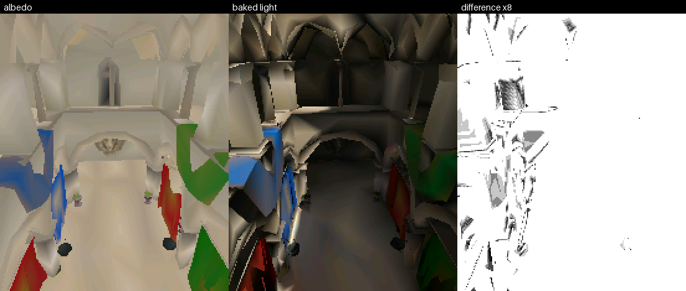

#### bake: indirect

`[bake].indirect = { bounces = K, rays = R }` adds the light that has bounced off
the source, path-traced against the full-detail mesh with the scene's
directional and sky lights as the emitters. Both fields are required when it
is present.

| Field | Meaning |
|---|---|
| `bounces` | How many times light bounces, at least 1. |
| `rays` | Cosine-weighted hemisphere rays for each point. |

`rays` is at least 1. The reference renderer reads
the same settings. A renderer can opt out with [indirect: off](#indirect-off).

#### bake: ao

`[bake].ao = { distance = D, rays = R }` darkens crevices, contact lines and
spots under overhangs. The sky light is blocked by an occluder at any
distance; this counts only hits within `D` model units. It scales the
[ambient](#ambient) light, and with `indirect = true` the bounced
light. The directional and sky lights are untouched. Every baked renderer gets it. How the factor is computed is in
[Bake-Method.md](Bake-Method.md#local-occlusion-implementation).

| Field | Meaning |
|---|---|
| `distance` | Reach of the occlusion rays in model units, greater than 0. |
| `rays` | Rays per point, at least 1. |
| `strength` | Optional, 0 to 1, default 1: the factor falls as low as 1 − `strength`. |
| `indirect` | Optional, default false: also scale the bounced light. |

Off unless given. A scene that sets it needs something to scale: an
`[ambient]` light, or `indirect = true` with [bounced light](#bake-indirect)
that a baked renderer uses. `reference_render.py`'s `bake` backend reads the same table;
its `mitsuba` backend ignores it.

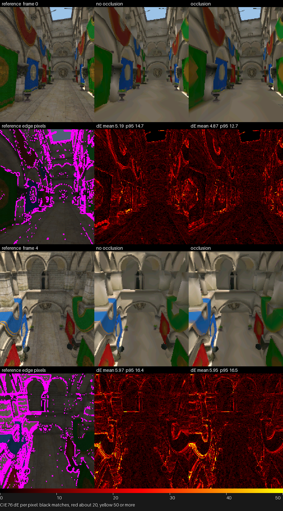

The reach should follow the mesh: a bake stores one colour per vertex, so a
reach much larger than the triangles darkens whole faces around a crease, where
the reference darkens a thin line. A smaller `distance` or a lower `strength`
keeps the darkening where the surfaces are close.

#### indirect

`intensity` is at least 0 and multiplies the bounced light.
`albedo_boost` is greater than 0 and replaces bounce reflectance with
$`\min(\beta a, \max(a, 0.99))`$. The bake stores the result in the same vertex
or face colours as direct light. The reference renderer reads the same table,
so a scene's reference carries its look; `intensity` or `albedo_boost` above 1
trades fidelity to a physical reference for look.

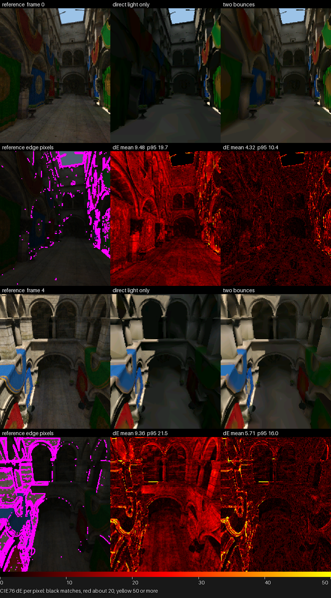

#### sky

`[sky]` supplies coloured hemisphere light; its `rays` are the fixed
cosine-weighted directions each point tests for sky visibility.

#### ambient

`[ambient]` adds constant linear coloured light to baked and runtime skinned shading.
Colour components are finite in 0..1; intensity is finite and nonnegative.

#### tonemap_white

`tonemap_white` $w$ sets the tone map applied to baked and runtime skinned light: radiance $L$
becomes $L / (1 + wL)$ before the gamma, Reinhard's global operator<sup>[[7]](../Citations.md#reinhard-2002)</sup>
at $w = 1$ and none at $w = 0$.

### skinned_renderer and animator

| Option | Keys | What it does | Default | Option link |
|---|---|---|---|---|
| `skinned_renderer` | `mesh`; `variant` | Draws imported albedo with its skin and skeleton, lit at runtime. | Takes no `bake`. | [skinned_renderer](#skinned_renderer) |
| `animator` | ; `clips`, `default_clip`, `wrap` | Selects a skinned renderer's clips and playback. | The import's `source.clips`; no default clip; `loop`. | [animator](#animator) |

#### skinned_renderer

```toml
[[objects]]
name = "subject"
[objects.skinned_renderer]
mesh = "subject.import.toml"

[objects.animator]
default_clip = "idle"
wrap = "loop"
# clips = ["idle", "walk"]
```

The mesh id is `<scene>.<object>`; the skin id appends `.skin` and the skeleton
id comes from the imported rig. The mesh holds unlit albedo. `bake` is refused.

#### animator

`clips` defaults to the import's `source.clips`; an explicit list selects the
animator's clips. `default_clip` names one of those clips; absent, nothing plays.
`wrap` is `loop` (default) or `clamp`. Without an animator the skin uses its
rest pose. Each component occurs once per entity.

### mesh_renderer

An appearance-fit recipe is grouped below its renderer's `fit` table.

```toml
[objects.mesh_renderer.fit.prune]
budget = 8672
coverage_every_ms = 100

[objects.mesh_renderer.fit.poses]
size = [184, 224]
train_every_ms = 1000
held_out_every_ms = 5000

[objects.mesh_renderer.fit.optimise]
steps = 2000
batch = 8
laplacian = 10.0
surface_weight = 10.0
surface_margin = 0.25
normal_weight = 1.0
```

| Option | Keys | What it does | Default | Option link |
|---|---|---|---|---|
| `bake: renderer` | `true` | Traces this renderer against its own source. | `false`. | [bake renderer](#bake-renderer) |
| `variant` | name | Chooses a named geometry variant. | Required when the import has variants. | [variant](#variant) |
| `colour_set` | nonnegative integer | Selects an external LCOL set on a colourless mesh. | Mesh-owned colours. | [colour_set](#colour_set) |
| `visibility: camera_region` | `source = "camera_region"`, `rounds` | Keeps triangles visible from any point in the camera's region. | Off. | [visibility: camera_region](#visibility-camera_region) |
| `visibility: camera_path` | `source = "camera_path"`, `every_ms`, `size`; `samples`, `margin` | Keeps triangles first seen from sampled camera-path views. | Off. | [visibility: camera_path](#visibility-camera_path) |
| `shading: smooth` | `"smooth"` | Stores baked colour at vertices. | `"smooth"`. | [shading: smooth](#shading-smooth) |
| `shading: flat` | `flat = { fixed = N }` / `flat = { auto = { min, max, area } }` | Stores one averaged RGB565 colour per face. | Off. | [shading: flat](#shading-flat) |
| `fit.prune` | `budget`, `coverage_every_ms` | Prunes the fitted mesh to the triangle budget. | Required in `fit`; the cost weight is `fitted_variant.py sweep --cost-weights`, not a scene key. | [fit.prune](#fitprune) |
| `fit.poses` | `size`, `train_every_ms`, `held_out_every_ms` | Selects training and held-out camera-path poses. | Required in `fit`. | [fit.poses](#fitposes) |
| `fit.optimise` | `steps`, `batch`, `laplacian`, `normal_weight`, `surface_weight`, `surface_margin` | Sets optimiser steps, batch size and loss weights. | Required in `fit`. | [fit.optimise](#fitoptimise) |
| `indirect: off` | `indirect = false` | Bakes this renderer without bounce light. | Bounce light on when the scene recipe is present. | [indirect: off](#indirect-off) |

#### bake renderer

`bake = true` writes this renderer's lit mesh; otherwise it draws the shared
imported albedo mesh. `shading`, `visibility`, `fit`, and `indirect` require
`bake = true`. A baked renderer's transform must be identity. Its output is
`<scene>.<object>.mesh`; an albedo renderer uses `<variant>.mesh`. An import is
packed only through the scenes that place it. The same import can have
independent bakes in several scenes; an albedo renderer's mesh is shared and
may be placed anywhere, by many scenes.

#### variant

`variant` selects a named geometry output from its import.

#### colour_set

`colour_set` is a uint16 index into `<mesh id>.colors`; the
`SCENE_ASSET_COLOUR_SET_OWN` sentinel selects mesh-owned colours. Pack
validation checks ownership, set range, encoding and element count.

#### visibility: camera_region

`source` defaults to `"camera_region"`. The region source casts from points in
the camera's `region`; use it when the camera may occupy the box without a
defined path. `rounds` is how many random tries each triangle gets. A try tests
one point of the triangle plus one for each whole multiple of the mean triangle area,
so a large face is kept by how much of it shows, not by where a single point
lands.

The image is the same import with the cull off above and on below, cropped
where they differ most: without the cull the budget goes to hidden surfaces.

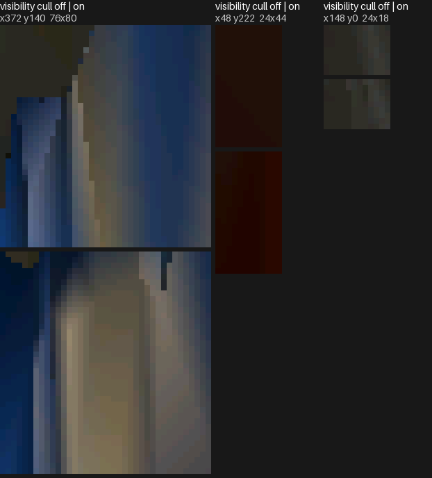

#### visibility: camera_path

The path source retains a triangle when a sampled camera view can draw it.
Poses $v$ are sampled along the path; $s^2$ rays are a pixel apart across the
view widened by $m$ pixels on each side from the near plane, and a triangle is
kept if the first face some ray would draw is it. Here $`d_r(u)`$ is ray $r$'s
distance to face $u$, `double(u)` says that face is double-sided, and
$`\hat r`$ is the ray direction:

```math
\mathrm{keep}(t) \iff \exists\, v,\ \exists\, r \in \mathrm{rays}(v, s, m):\;
t = \underset{u \in \mathrm{hits}(r),\ \mathrm{drawn}(u, r)}{\mathrm{arg\,min}}\ d_r(u)
\qquad
\mathrm{drawn}(u, r) \iff \mathrm{double}(u) \,\lor\, n_u \cdot \hat{r} < 0
```

A single-sided face seen from behind does not stop a ray; its twin wound the
other way is what the ray sees. Faces within a small distance of the first
drawn face are kept too, since the depth test picks among coincident faces.

The views are square, as wide as the longer side of `size`, so the panel held
either way up is covered; `margin` and the pose spacing cover geometry that
enters between samples.

#### shading: smooth

Smooth shading bakes one colour per vertex. It is the normal baked mesh form
described in [The baked mesh](Baked-Mesh.md#clusters-and-the-tree).

#### shading: flat

Flat shading stores one RGB565 colour per triangle. `fixed` uses that many
lighting points per face; `auto` chooses a count from face area. The sheets
label the smooth, flat, fixed and adaptive variants. One point lights a face
from one place, so a shadow edge lands on whole faces.

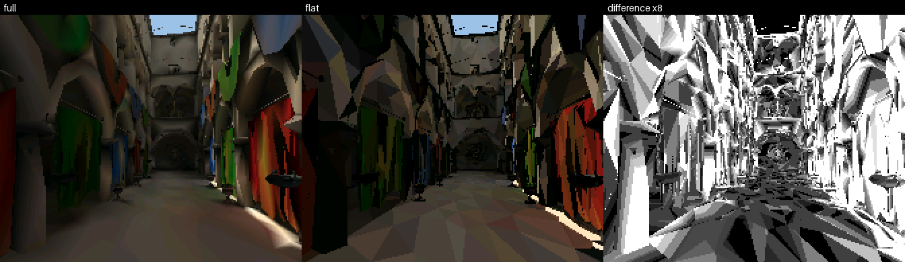
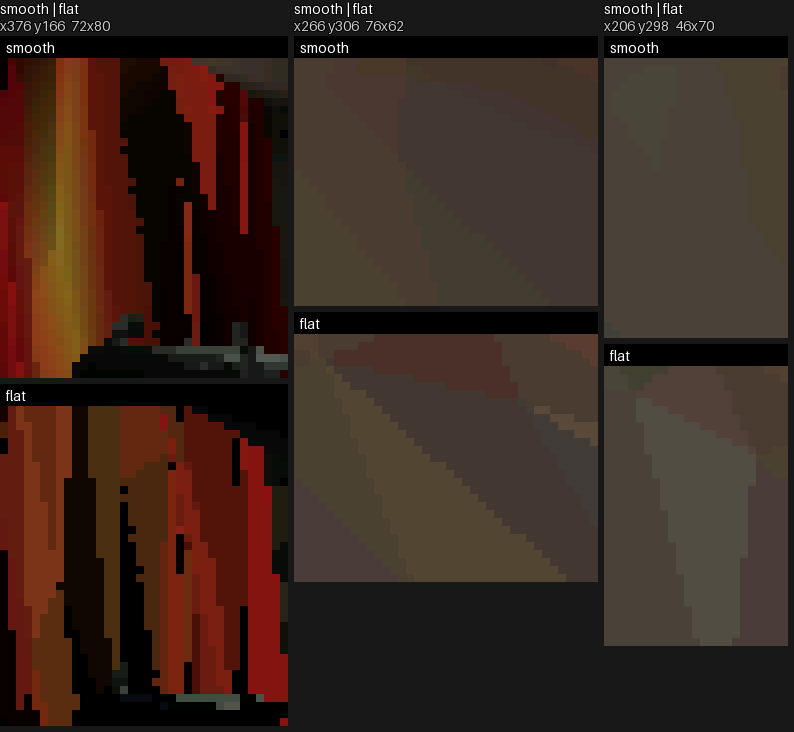
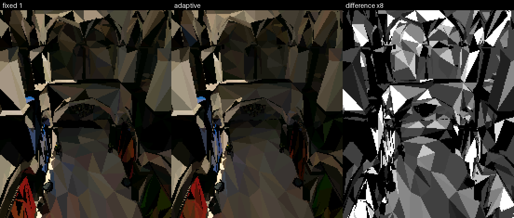

Face samples are the useful control; extra samples converge. A flat bake's sky
rays are the sky light's `rays`; the scene tools README's sweep shows how the
score moves with them. Stratified placement preserves soft boundaries. A face's
one colour leaves edge error that sampling cannot remove. Generated findings and sheets live in the scene tools
README. `bake_fidelity.py` re-lights a flat mesh's geometry with chosen
settings into a scratch directory and scores it against the reference, so
nothing tracked changes.

#### fit.prune

`budget` is the triangle count the fit keeps, at most the variant's `triangles`;
`coverage_every_ms` samples the camera path for the dense pose set that pruning
counts pixels over, at the coverage file's own size.

Source visibility is the renderer's [`visibility`](#visibility-camera_region)
(region by default). A region source keeps the backing surfaces that
simplification and fitting would otherwise expose. The stages are source
visibility, simplify above the target, optional warm start, fitting, then
coverage pruning to budget:

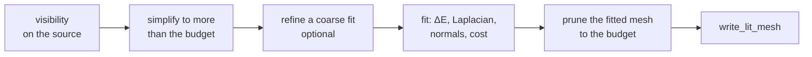

Each pose of a dense set counts the pixels $`a_t`$ each fitted triangle
shows; pruning removes zero-coverage triangles first, then the least-covered,
to the budget. Coverage uses fitted positions and fitted per-face colours for
flat meshes, so visibility is judged on the geometry that is drawn. A warm
start splits the worst fitted triangles along their longest edge, grows the
mesh to a larger budget, and fits it again. Generated tables compare the
current budget and cost settings.

The cost model predicts pose time $`\hat t_v`$ from a non-negative least-squares
fit<sup>[[6]](../Citations.md#lawson-1974)</sup> to board frame times: a constant; clusters in view $`N_{s,v}`$; drawn
triangles $`D_v`$; their screen rows $`\rho_t`$; pixels covered before the depth
test $`\alpha_t`$; and clusters in view $`N_{c,v}`$:

```math
\hat{t}_v = w_0 + w_s\,N_{s,v} + w_d\,|D_v| + w_\rho \sum_{t \in D_v} \rho_t + w_\alpha \sum_{t \in D_v} \alpha_t + w_c\,N_{c,v}
```

`cost_model.py` fits and applies the weights, retaining them and their source
frames beside the model. The generated board table records the frames used
to fit the model. The cost term $`\mathcal{E}_c`$ from
[fit.optimise](#fitoptimise) trades appearance for predicted time alongside
the triangle budget. Generated tables and findings live in the scene tools
README.

#### fit.poses

`size = [width, height]` is required: two positive integers setting the pose
resolution for training, held-out references and coverage. Coverage widens
this view to cover both panel orientations.
`train_every_ms` samples the camera path for fitting; of those samples, poses
at multiples of `held_out_every_ms` (time 0 aside) are held out of training and
used only for scoring.

#### fit.optimise

The appearance fit is appearance-driven simplification<sup>[[1]](../Citations.md#hasselgren-2021)</sup>.
It starts from the renderer's bake at its budget, smooth or
[flat](#a-flat-fit), and adjusts welded positions and colours against
reference renders from camera-path poses.
The triangles stay fixed, so the budget and frame cost hold. A `fit` table
records the budget, training, held-out and coverage poses, optimiser settings,
and output hashes. [`fitted_variant.py` remakes the mesh](../../launcher/tools/r3d/README.md#appearance-fit)
in its GPU environment. The reference, fitted-output, crop and heatmap sheets
live in the scene tools README. Use it for a mesh seen from known views
when the simplifier's colours or silhouettes visibly drift from the source. It
needs a CUDA GPU and minutes per mesh, with no run-time cost.

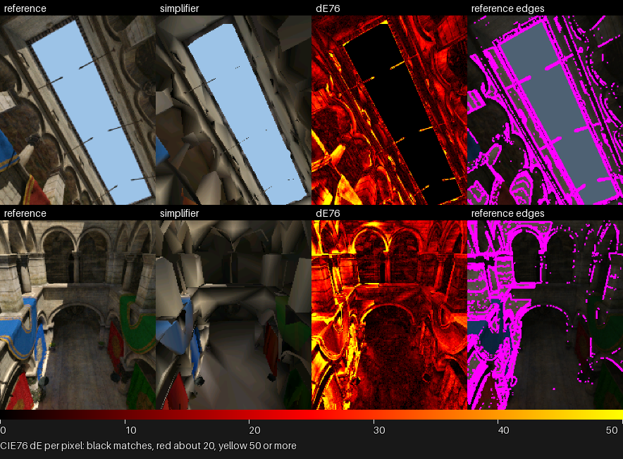
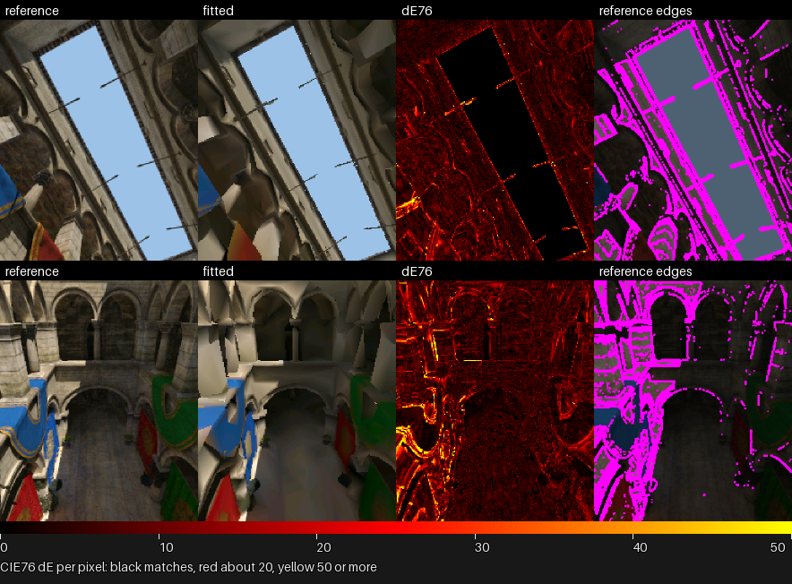
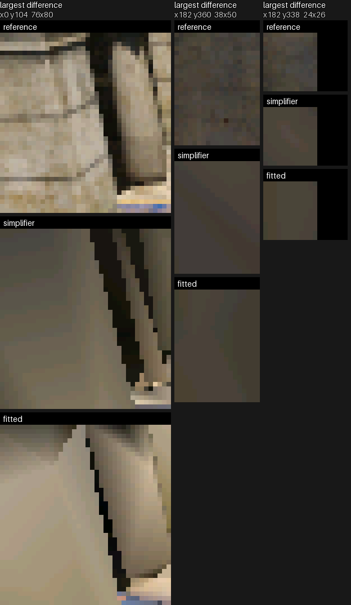

The fit draws welded positions $`P`$ and vertex colours $`C`$ with a
differentiable rasterizer $`\mathcal{R}`$, nvdiffrast<sup>[[2]](../Citations.md#laine-2020)</sup>, over a random batch $`B`$ of training
poses. $`\Omega`$ is the frame pixels, $`P^0`$ the start positions, $`N(i)`$
the positions sharing an edge with $`i`$, $`\bar e`$ the start mean edge
length, $`e_i`$ each vertex's mean start edge length capped at $`\bar e`$,
$`\hat n`$ the fitted normal, $`n^{\rm ref}`$ the reference normal, and
$`\hat t_v`$ the predicted frame time for pose $`v`$. It minimises the colour
term $`\mathcal{E}_{\Delta E}`$, the Laplacian term
$`\mathcal{E}_{\mathcal{L}}`$, the normal term $`\mathcal{E}_n`$, the cost
term $`\mathcal{E}_c`$, and the surface term $`\mathcal{E}_s`$:

```math
\min_{P,\,C}\; \mathcal{E}_{\Delta E}(P, C)
+ \lambda\,\mathcal{E}_{\mathcal{L}}(P)
+ \lambda_n\,\mathcal{E}_n(P)
+ \kappa\,\mathcal{E}_c(P)
+ w\,\mathcal{E}_s(P)
```

`steps` is $`K`$, `batch` is $`|B|`$, `laplacian` is $`\lambda`$ and
`normal_weight` is $`\lambda_n`$.

```math
\mathcal{L}(P)_i = P_i - \frac{1}{|N(i)|}\sum_{j \in N(i)} P_j
```

Here $`\mathcal{E}_{\Delta E}`$ is the mean $`\Delta E_{76}`$, the CIE 1976
$`\Delta E^*_{ab}`$<sup>[[4]](../Citations.md#iso-11664-4)</sup>, between
$`\mathcal{R}_v(P, C)_p`$ and reference $`T_{v,p}`$ over $`B`$ and $`\Omega`$;
$`\mathcal{E}_{\mathcal{L}}`$ is the mean squared, edge-length-normalised
change in the uniform Laplacian<sup>[[5]](../Citations.md#sorkine-2005)</sup>; and $`\lambda`$,
$`\lambda_n`$, and $`\kappa`$ weigh the Laplacian, normal, and cost terms:

```math
\mathcal{E}_{\Delta E}(P, C) =
\frac{1}{|B|}\sum_{v \in B}\frac{1}{|\Omega|}\sum_{p \in \Omega}
\Delta E_{76}\!\left(\mathcal{R}_v(P, C)_p,\; T_{v,p}\right)
```

```math
\mathcal{E}_{\mathcal{L}}(P) =
\frac{1}{|V|}\sum_{i \in V}
\left\lVert \frac{\mathcal{L}(P)_i - \mathcal{L}(P^0)_i}{e_i} \right\rVert^2
```

$`\mathcal{E}_n`$ is the mean L1 difference between $`\hat n_v(P)_p`$ and
$`n^{\rm ref}_{v,p}`$ over jointly covered pixels $`\Omega_v^{\cap}`$, and
$`\mathcal{E}_c`$ is the mean $`\hat t_v(P)`$ over $`B`$:

```math
\mathcal{E}_n(P) =
\frac{1}{|B|}\sum_{v \in B}\frac{1}{|\Omega_v^{\cap}|}
\sum_{p \in \Omega_v^{\cap}}
\left\lVert \hat n_v(P)_p - n^{\rm ref}_{v,p} \right\rVert_1
\qquad
\mathcal{E}_c(P) = \frac{1}{|B|}\sum_{v \in B}\hat t_v(P)
```

Adam<sup>[[3]](../Citations.md#kingma-2015)</sup> takes the steps, both learning rates decay as
$`\eta_k = \eta_0 \cdot 0.1^{k/K}`$ over $K$ steps, and colours are clamped to
$[0, 1]$ after each. Where nothing is drawn the renderer shows the scene's
clear colour, as the device and reference do. The fitted colours are a bake in
their own right, so the fitted mesh enters the import at its writer and is not
lit again. A fit is judged on held-out poses by the same scores and sheets as
any other bake; generated results live in the scene tools README. One mesh can
fit the whole path, or meshes can fit path segments and swap as the camera
moves; segment fits see fewer training poses.

The surface term anchors fixed barycentric samples of the fitted triangles to
area-weighted samples of the alpha-masked source used for the reference renders.
A seeded RNG fixes both sample sets; CPU nearest-neighbour queries refresh the
source correspondences at `SURFACE_QUERY_EVERY` steps. Sampling counts and the
small distance-pull weight live beside it in `appearance_simplify.py`.
`surface_weight` weighs the mean squared point-to-plane distance beyond
`surface_margin`, plus a small squared distance pull to the matched sample.
For a fitted sample $`x`$, its nearest source sample $`c`$ and that source
face's normal $`n`$, write $`d=(x-c)/e_x`$, where $`e_x`$ is the mean $`e_i`$ over the corners
of the triangle holding $`x`$. The surface contribution is
$`w\,\mathrm{mean}(\max(0,|n\cdot d|-\epsilon)^2+t\lVert d\rVert^2)`$,
where $`w`$ is `surface_weight`, $`\epsilon`$ is `surface_margin`, and $`t`$
is `SURFACE_TANGENTIAL_WEIGHT`. Both distances are measured in $`e_x`$.
The plane envelope is zero inside the margin; the small pull remains active there.

The fit also holds seams between parts. A start border point within
`SEAM_MARGIN` × its capped local start edge scale of another part's triangle
is moved onto that triangle.

It then follows the triangle at fixed start barycentrics, so parts that
overlapped in the start cannot pull apart into cracks. Nearest contacts win,
and a held point never anchors another hold.

Colour history, `loss.txt` and the printed mean ΔE76 exclude surface, normal,
Laplacian and cost penalties. The surface loss is reported beside drift.
Pruning counts shown pixels at the recipe's coverage spacing; this sampling is
part of the reference cache key.

Colour alone permits geometry that matches one view but differs from another.
`normal_weight` weighs $`\mathcal{E}_n`$: mean
L1 fitted/reference normal difference where both cover a pixel. The reference
and fit turn normals toward the eye, and the term needs a second drawing per
view. The error reported beside $`\Delta E`$ is the mean normal angle:

```math
\theta = \frac{1}{|\Omega^{\cap}|}\sum_{p \in \Omega^{\cap}} \arccos\!\left(\hat{n}_p \cdot n^{\mathrm{ref}}_p\right)
```

The generated normal-angle heatmaps and sweep findings live in the scene tools
README.

##### A flat fit

A renderer with both `shading = { flat = ... }` and a `fit` table is fitted
flat: its start is a flat bake of its variant, and $`C`$ holds one colour per triangle
instead of one per vertex. The positions are fitted as before, so a face's
edges move to where one colour reads best, along a shading change. Each pixel
takes its triangle's colour:

```math
\mathcal{R}_v(P, C)_p = C_{\tau_v(p)}
\qquad \tau_v(p) = \text{the triangle pixel } p \text{ shows in pose } v
```

A pixel inside a face does not depend on $`P`$, so the position gradient comes
only from the edges. The fit draws every triangle with three vertices of its
own, so every edge, not only a silhouette, is antialiased and passes a
gradient to the positions on both sides; those vertices still read one welded
position each, so faces cannot part. Pruning, the warm start and the writer
keep each colour with its triangle, and the device draws the result as any flat
mesh, at a flat mesh's cost.

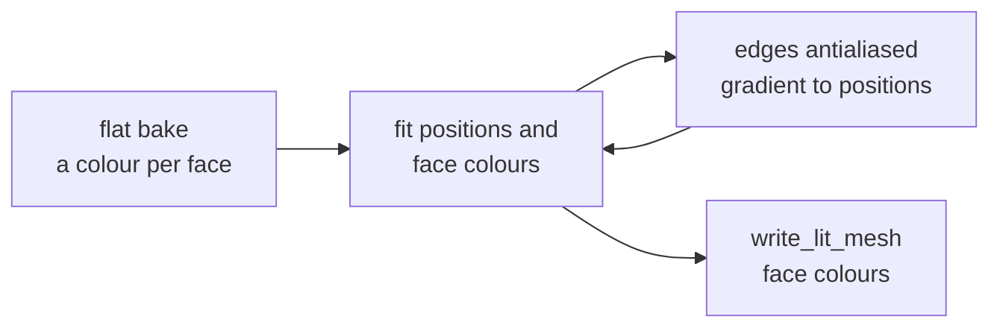

[Bake-Quality.md](Bake-Quality.md#the-sponza-variants) compares a flat bake
with its flat fit.

##### Against the paper

The fit keeps the paper's<sup>[[1]](../Citations.md#hasselgren-2021)</sup> method: a decimated start with
fixed triangles, a differentiable rasterizer<sup>[[2]](../Citations.md#laine-2020)</sup>, Adam<sup>[[3]](../Citations.md#kingma-2015)</sup>,
a uniform-Laplacian drift term relative to the start,
and a learning rate decaying geometrically. It changes the rest:

| | Paper<sup>[[1]](../Citations.md#hasselgren-2021)</sup> | This fit |
|---|---|---|
| Fitted | positions, textures, normal maps, material parameters | welded positions and vertex or face colours, which are the lighting bake |
| Forward model | deferred physically based shading | the device's Gouraud or flat colours, no shading |
| Image term | L1 on log-tonemapped sRGB | mean CIE 1976 $`\Delta E^*_{ab}`$<sup>[[4]](../Citations.md#iso-11664-4)</sup> |
| Position step | plain Adam on positions<sup>[[3]](../Citations.md#kingma-2015)</sup> | Adam on an offset scaled per vertex by its capped local start scale, so small parts step in proportion to their size |
| Laplacian weight | decays during the fit | constant $`\lambda`$; each vertex's drift uses its own mean start edge length, capped at the start's mean edge length |
| Further terms | none | a point-to-plane band, of half-width `surface_margin`, from the fit to the source surface and a small tangential pull, both in the mean of that capped scale over each sample's triangle; $`\mathcal{E}_n`$ against reference normals; $`\mathcal{E}_c`$, predicted frame time<sup>[[6]](../Citations.md#lawson-1974)</sup> |
| Triangle budget | set by the start | the fitted mesh's, pruned to `budget` by coverage after fitting; a refined fitted mesh can be the start |

A global unit gives small parts a fraction of the hold, so the image term
stretches them; local edge scales keep the hold even<sup>[[78]](../Citations.md#desbrun-1999)</sup>.
Adam's step length does not depend on gradient size, so the position offset is scaled by the same local scale.

Section 5.3 of the paper has no distance-to-reference term<sup>[[1]](../Citations.md#hasselgren-2021)</sup>.
Here the start is already a decimation of the reference surface, so the fit can
be held to that surface. The relative Laplacian alone is blind to smooth drift;
the band limits movement away from the source while its margin
allows local fitting and the small tangential pull holds samples near their
matches.

#### indirect: off

`indirect = false` requires `[bake].indirect` and omits its bounces from this
renderer and its fit reference.

### Light options

| Option | Keys | What it does | Default | Option link |
|---|---|---|---|---|
| `light` | `type`, `color`, `intensity` | A directional light: baked into baked renderers, applied at runtime to skinned renderers. | Required for an object with this component. | [light](#light) |

#### light

Only directional lights are scene objects; `point` and `spot` are reserved.
Its direction toward the light is the object's +Y axis turned by its rotation.
Position and scale do not matter. The lights a bake sees are the directional
objects in file order, then `[sky]`, then `[ambient]`. The sun is a point
source, so its shadows are hard. A double-sided face is lit on both sides and
keeps the brighter.

### Camera options

| Option | Keys | What it does | Default | Option link |
|---|---|---|---|---|
| `camera` | `half_fov_short_tan`, `near_z`; `region`, `path`, `background` | Defines the scene view. | — | [camera](#camera) |

#### camera

A scene may hold many cameras; only one renders at a time, the active one
selected by `scene_activate()`. Camera-region visibility, camera-path
visibility and fitted variants read the scene's first camera. A region on
any other camera is refused because no bake step reads it.

`region = { min, max }` is the box the camera may occupy; region visibility
casts from points inside it. `path = { animation, node }` names the clip the
camera flies: `animation` is its `NAME.anim.toml`
([Animation-Tracks.md](Animation-Tracks.md)), relative to the scene file,
and `node` the glTF node in it that is the camera. The clip's id is `NAME`, and
it travels in the scene's pack; `<node>/translation` must fit a track name's
31 bytes. `background` (0xRRGGBB, default black) is the colour
a pixel no mesh covers shows, on the panel and in the source reference. Without
a path the camera sits at its transform, looking down its own -z in the
source frame; the pack carries it in the engine frame ([Mesh-Import.md](Mesh-Import.md#the-offline-tools)).

## What the scene must carry

A renderer with `bake = true` needs at least one light (a directional object,
`[sky]` or `[ambient]`), `tonemap_white` and `[bake]`; its `visibility` needs
the camera `region`, or `path` for the path source. A scene must carry what a
baked renderer reads and may not carry what none reads: the importer rejects
lights, `tonemap_white`, a region or `[indirect]` that no placed mesh reads.
Directional lights, `[ambient]` and `tonemap_white` are also read by skinned
renderers, which require none of them; `[sky]` is read only by a bake.

## SCNE v5

`build_pack.py` bakes each scene file into a `SCNE` entry of its own pack,
named after the file: `NAME.scene.toml` is entry and pack `NAME`, beside every
mesh, skin, skeleton and clip it names
([assets/README.md](../assets/README.md)). `tools/r3d/scene_asset.py` writes and
reads it; `scene_load()` opens it ([Scene-Manager.md](Scene-Manager.md)), each
mesh, skin, skeleton and clip it names, and fails naming whichever is missing or malformed. A scene
and its clip cannot share a stem ([assets/README.md](../assets/Building-Packs.md#packs)).

Objects are entities in file order, found by the `name_hash()` of their name
([hash package](../../launcher/packages/hash/README.md)), which each names row
stores beside the name. Transforms store a 3x3
rotation-times-scale matrix and position, in the parent's frame; the scale
is positive, and `scene_load()` refuses a shear or a reflection (determinant
−1) and names its entity. Each entity has one parent listed before it, or
none; a parent's transform and enabled state carry to its descendants
([Scene-Manager.md](Scene-Manager.md#hierarchy)). An object's `parent` key
names its parent, and a mesh bundle's copies are children of the renderer that
carries them; `scene_asset.encode()` writes both. Names hold letters, digits and
`_`, start with a letter or `_`, and fit 31 bytes.

Directional lights rotate `SCENE_LIGHT_AXIS` (+Y) by their entity's rotation.
Baked renderers read LMSH or LCOL colours; runtime lights shade only skinned
renderers. Sky and camera regions are bake inputs.

| Format | Version | Writer (Python) | Reader (C) |
|---|---|---|---|
| SCNE | 5 | `r3d/scene_asset.py` | `scene/scene_asset.c` |

Settings are applied before lights attach. Absent ambient has zero intensity;
`tonemap_white=0` is `SCENE_TONEMAP_WHITE_NONE`, the identity tone map. A camera
path becomes an animator on its entity with one clip, default index zero and
loop wrap. Its `node` selects tracks at bake time; the packed tracks bind to
the animator's owner through `ANIM_TARGET_SELF`.

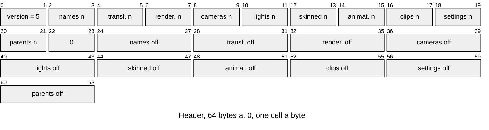

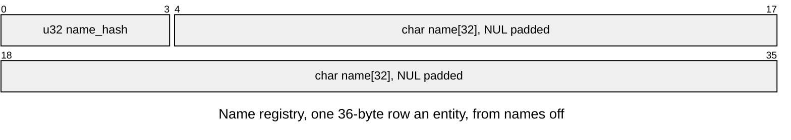


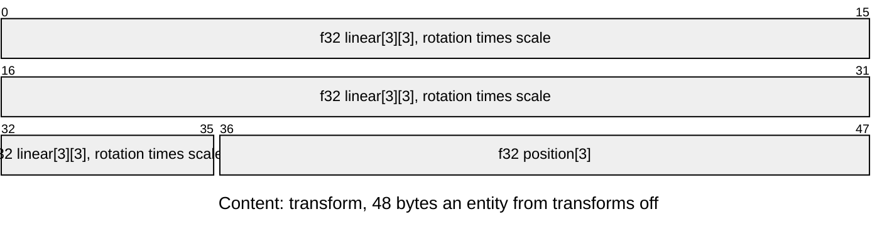

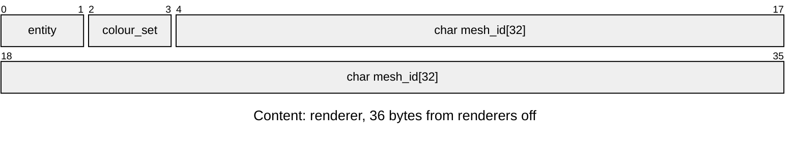

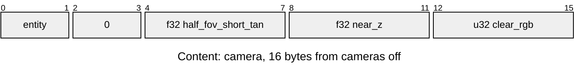

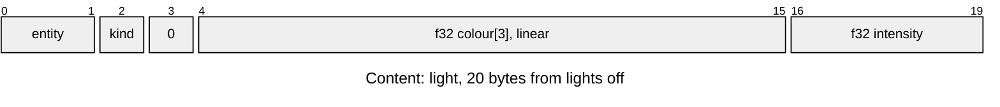

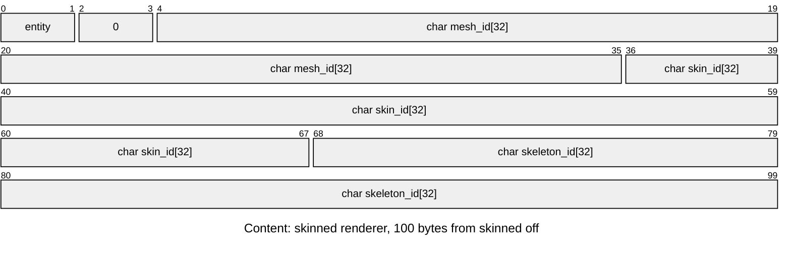

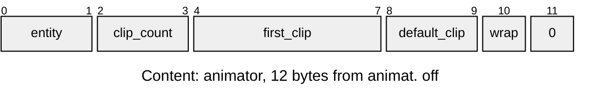

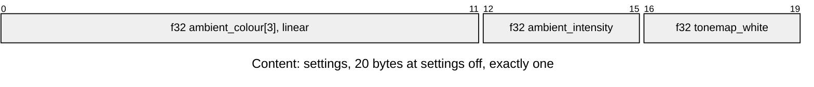

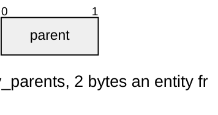

| Part | At | Size |
|---|---|---|
| Header | 0 | 64 bytes |
| Name registry | `names off` | 36 bytes an entity |
| Content: transforms | `transf. off` | 48 bytes an entity; the count equals the names' |
| Content: renderers | `render. off` | 36 bytes each |
| Content: cameras | `cameras off` | 16 bytes each |
| Content: lights | `lights off` | 20 bytes each |
| Content: skinned renderers | `skinned off` | 100 bytes each |
| Content: animators | `animat. off` | 12 bytes each; `wrap` is an `ANIM_CLAMP` or `ANIM_LOOP` code from `anim_track.h` |
| Clip registry | `clips off` | 32 bytes a clip id, indexed by `first_clip` and `clip_count` |
| Content: settings | `settings off` | 20 bytes, one row |
| Content: entity_parents | `parents off` | 2 bytes an entity; the count equals the names'; written for every scene, all roots included |

| Rule | Detail |
|---|---|
| Owners | `SCENE_ASSET_VERSION`, `_HEADER_SIZE` (64), `_AT_COUNTS`, `_AT_OFFSETS`, `SCENE_ASSET_DEFAULT_CLIP_NONE` (0xFFFF), `SCENE_ASSET_PARENT_ROOT` (0xFFFF), `SCENE_ASSET_COLOUR_SET_OWN` (0xFFFF), `SCENE_LIGHT_KIND_DIRECTIONAL` (1), `SCENE_ASSET_NAME_SIZE` (36), `_NAME_AT_HASH` (0), `_NAME_AT_TEXT` (4) in `scene_format.h`; row structs in `scene_internal.h`, checked against the sizes above by `_Static_assert` |
| Layout | little-endian; every part offset is a multiple of 4, at least 64, and the part ends inside the entry; the writer lays parts out in header order, each padded to 4 bytes |
| Counts | each at most 65535, entities at most 65534; names equals transforms and entity_parents; settings is exactly 1 |
| Parents | `parent` is `SCENE_ASSET_PARENT_ROOT` or below its own entity, so one forward pass meets every parent before its children; a camera, light or skinned renderer is a root; an entity with children has a uniform scale, the same on every axis, and `scene_load()` refuses one that does not, naming it; `scene_asset.encode()` folds a parent's uneven scale into its children, refusing a parent that draws or a turned child the fold would shear |
| Colour sets | [Selection and ownership](../assets/formats/LCOL.md): own colours require no LCOL, checked at pack time. Authored scenes write own colours |
| Entities | every `entity` is below the names' count; at most one light, one skinned renderer and one animator an entity |
| Name hash | `name_hash` is `name_hash(name)` and never `NAME_HASH_NONE`; finds compare it alone. The bake refuses a name that hashes to `NAME_HASH_NONE` and two names in one scene that share a hash, naming both |
| Text | `name`, `mesh_id`, `skin_id`, `skeleton_id` and clip ids are nonempty, NUL terminated, zero after the NUL; the bake limits names as stated above |
| Padding | every `0` above is zero |
| Camera | `half_fov_short_tan` and `near_z` finite and positive; `clear_rgb` at most `0xFFFFFF` |
| Light | `kind` is `SCENE_LIGHT_KIND_DIRECTIONAL`; colour in 0..1; intensity finite and at least 0 |
| Animator | `first_clip + clip_count` within the clip count; `default_clip` is below `clip_count` or `SCENE_ASSET_DEFAULT_CLIP_NONE` (no playback) |
| Settings | ambient colour in 0..1; `ambient_intensity` and `tonemap_white` finite and at least 0 |
| Errors | `ASSET_ERR_VERSION` for another version, v1 included, reported before its bounds; `ASSET_ERR_BOUNDS` for a part off its alignment or outside the entry; `ASSET_ERR_FORMAT` for the rest |
