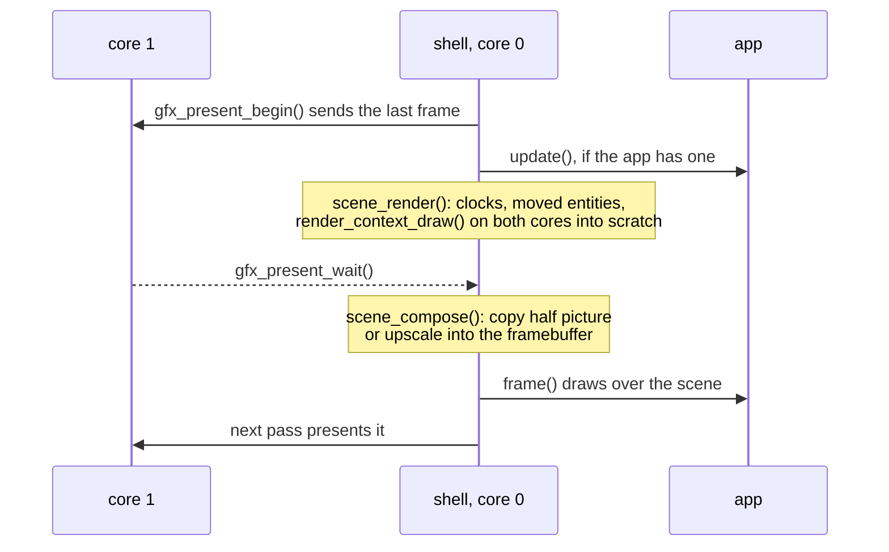

# Scene manager

Scenes are engine machinery the shell drives. An app loads a scene by name and
activates a camera; the shell advances every loaded scene and draws through the
active camera each frame, so an app never calls draw. The code is
`launcher/main/scene/`; [Building-a-Scene.md](Building-a-Scene.md#6-draw-it)
shows an app using it.

## What a scene holds

A scene holds packed component arrays indexed by a small integer entity id
(`scene_entity_t`). Attaching clips allocates the animator's bindings and pose
buffers in PSRAM; attaching a skin allocates its model matrices, palette and
output mesh together in internal RAM.

| Array | One per | Holds |
|---|---|---|
| `locals[]` | entity | canonical local position, quaternion rotation and scale; loaded placements must decompose without shear or reflection |
| `animators[]` | entity | optional clip configuration, layer, independent slot clocks and pose buffers |
| `skinned_renderers[]` | entity | optional SKIN and bind-mesh views, output positions and bounds; bind-colour pointers |
| `flags[]` | entity | enabled, and moved since the last draw |
| `renderers[]` | entity that draws | a view of its lit mesh in the asset pack, its entity id, and the placement built from its transform |
| `cameras[]` | camera | lens, entity TRS pose, clear colour, its entity id |
| `instances[]` | renderer | the list the raster draws this frame, refilled from `renderers[]` |
| names | entity | the scene entry's, read in the pack, looked up only by `scene_find()` |

Array lengths come from the scene's `SCNE` entry
([Scene-Files.md](Scene-Files.md#the-scene-entry)). Lights are baked offline
and are not carried. Names and immutable mesh and track views point into the
asset pack. Camera rows with clips create property animators; their source-node
alias belongs to that camera row. Binding resolves every clip row before playback.

## What an app calls

| Call | Meaning |
|---|---|
| `scene_load(id, &why)` | mounts the [asset pack](../assets/README.md#the-store) `id` and loads its scene entry `id`, every mesh it names and its camera's clip, beside any scene already loaded; NULL on failure, and `why` (which may be NULL) says what failed: no such scene, the manager full, no memory, or no pack or an entry it could not open, or an entity whose placement does not decompose, with the entry's id and the pack's status |
| `scene_unload(scene)` | frees it and releases its pack; its camera, if active, is deactivated |
| `scene_find(scene, name)` | the entity with that name: look it up once, after the load, and keep it |
| `scene_entity_mesh_id(scene, entity)` | the pack id of the mesh the entity draws, or NULL |
| `scene_camera_lens(scene, camera)` | a camera's lens and current entity pose (NULL: the first), to sample without drawing |
| `scene_set_transform()` / `scene_entity_set_enabled()` | set an entity's TRS value, hide or show a renderer |
| `scene_entity_transform(scene, entity)` | reads the entity's TRS component |
| `scene_animator_set_clips()` / `scene_renderer_set_skin()` | attach clips and a skeleton, or a skin, by asset id |
| `scene_animator_play()` / `_set_speed()` / `_set_paused()` / `_seek()` | control playback slots on an entity |
| `scene_animator_clip_count()` / `_clip_name()` / `_clip_duration_ms()` | query the attached clips |
| `scene_activate(scene, camera)` | makes that camera (NULL: the first) the one active camera |
| `scene_deactivate()` / `scene_set_paused()` | stop drawing, or hold the scene in place for an app that draws its own full screen |
| `render_context_set_scale()`, `render_context_set_dynamic_resolution()`, `render_context_frame()` | not the scene's: the render size, dynamic resolution and what the last frame drew belong to the render context the scene draws through ([Mesh-Rendering.md](Mesh-Rendering.md#the-render-context)) |

Exactly one camera is active engine-wide, and it draws the enabled renderers of
its own scene. Several scenes may be loaded at once; activating another scene's
camera changes what is seen.

## Each frame

`scene_render()` touches no framebuffer, so it runs while the last frame is
still being sent. `scene_compose()` writes the half picture when the draw is
exactly half the panel in both axes, otherwise the full framebuffer, once the
send is done; if `scene_render()` did not run (the first frame after
activating), it draws first. An app gets this overlap whenever a camera is
active, with or without `update()`. A paused expanded picture keeps the
overlap so each pass composes it again without rendering. With no camera
active the loop is the plain one. Unpaused frames redraw the whole picture,
a static scene included. A camera
needs the full-framebuffer layout; in band mode the scene is drawn into the
scratch but there is nothing to upscale it into.

`scene_render()` runs the animation and skinning stages
([Skeleton-and-Skin.md](Skeleton-and-Skin.md#runtime-pose-and-skinning)),
then rebuilds the placement of each renderer whose entity moved, fills
`instances[]` from the
enabled renderers and draws. The raster's scratch block is the engine's, sized
for the largest enabled mesh's working buffers, every enabled instance's
census slot and the render size. Dynamic resolution reserves the finest
step's raster block; the census list stays at the same offset across steps.
The block grows only when the required storage exceeds its capacity.

## Ownership

A scene belongs to the app running when it was loaded. When an app exits the
shell runs its systems' `app_exit` phase, which for scenes is
`scene_unload_all()`: it unloads every scene and frees the
scratch, so nothing an app loaded outlives it. An app may unload a scene itself
sooner.

Scenes are not taken from the app arena: it gives memory back only in the
reverse order it was taken, and scenes unload in any order. A scene is opened
from an `asset_pack_t`: `scene_load()` mounts the scene's pack, and
`scene_load_from()` takes the pack, so a test can load from one it builds. The
pack outlives the scene, which reads its entry, meshes and clip in place.

## Beneath it

Host tools and tests pass a `const render_view_t*` to `raster_draw()`
and compose its picture with `raster_upscale()`. `r3d_scene_view_at()` builds a
frame view from a camera's pose; a scene camera's pose is its entity's,
which a property animator moves.

The shell's half of the API (the two frame halves and the unload on exit) is
`scene/scene_shell.h`; apps include only `scene/scene.h`.
The shell does not call it by name: `shell/scene_system.c` registers it as the
engine system `scene`, at `SHELL_ORDER_SCENE`
([Firmware-Architecture.md](../Firmware-Architecture.md#engine-systems)).
