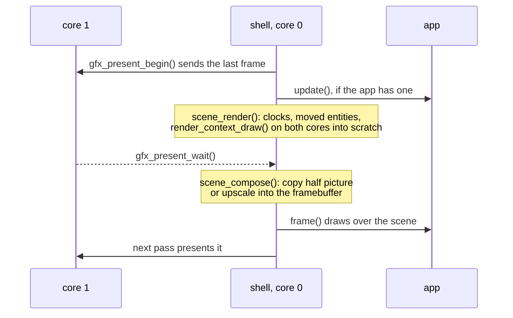
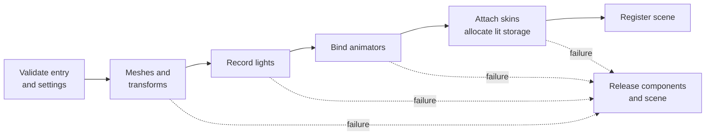

# Scene manager

Scenes are engine machinery the shell drives. An app loads a scene by name and
activates a camera; the shell advances every loaded scene and draws through the
active camera each frame, so an app never calls draw. The code is
`launcher/main/scene/`; [Building-a-Scene.md](Building-a-Scene.md#6-draw-it)
shows an app using it.

## What a scene holds

A scene holds packed component arrays indexed by a small integer entity id
(`scene_entity_t`). Attaching clips allocates the animator's bindings and pose
buffers in PSRAM; attaching a skin allocates its model matrices, palette and
output mesh together in internal RAM. Lit colors and the world-space normal
palette use a separate internal RAM block when a skin is attached and the
scene has directional lights or nonzero ambient. A baked-only scene reserves
no runtime-light storage. The first light allocates every existing skin's
block transactionally; attachment failure preserves the scene.

| Array | One per | Holds |
|---|---|---|
| `locals[]` | entity | canonical local position, quaternion rotation and scale; loaded placements must decompose without shear or reflection |
| `animators[]` | entity | optional clip configuration, layer, independent slot clocks and pose buffers |
| `skinned_renderers[]` | entity | optional SKIN and bind-mesh views, output positions, bounds and lit colors; bind-color pointers without runtime lights |
| `lights[]` | entity | optional directional light, linear color and intensity; at most `R3D_SKIN_LIGHT_MAX` attached per scene |
| `flags[]` | entity | enabled, moved since the last draw, and changed since the last skin stage |
| `renderers[]` | entity that draws | a view of its lit mesh in the asset pack, its entity id, and the placement built from its transform |
| `cameras[]` | camera | lens, clear color, its entity id (its pose is the entity's `locals[]` slot) |
| `instances[]` | renderer | the list the raster draws this frame, refilled from `renderers[]` |
| names | entity | the scene entry's, read in the pack, looked up only by `scene_find()` |

Array lengths come from the scene's `SCNE` entry
([Scene-Files.md](Scene-Files.md#the-scene-entry)). SCNE v2 carries authored lights, lighting settings, skins and animators.
Authored lights attach at load, and `scene_light_set_*()` attaches or changes
them at run time; only skinned renderers are lit at run time, baked renderers
keep their pack colors. Names and immutable mesh and track views point into
the asset pack. Animator rows create animators; a camera path is an animator
on the camera's entity whose tracks bind to that entity through
`ANIM_TARGET_SELF`. Binding resolves every clip before playback.

## What an app calls

| Call | Meaning |
|---|---|
| `scene_load(id, &why)` | mounts the [asset pack](../assets/README.md#the-store) `id` and loads its scene entry `id`, every mesh, skin, skeleton and clip it names, beside any scene already loaded; NULL on failure, and `why` (which may be NULL) says what failed: no such scene, the manager full, no memory, or no pack or an entry it could not open, or an entity whose placement does not decompose, with the entry's id and the pack's status |
| `scene_unload(scene)` | frees it and releases its pack; its camera, if active, is deactivated |
| `scene_find(scene, name)` | the entity with that name: look it up once, after the load, and keep it |
| `scene_entity_mesh_id(scene, entity)` | the pack id of the mesh the entity draws, or NULL |
| `scene_camera_lens(scene, camera)` | a camera's lens (NULL: the first); its pose is its entity's transform |
| `scene_camera_set_present(scene, camera, present)` | sets the camera's presentation; false for a non-camera entity or invalid mode |
| `scene_camera_set_small_fill(scene, camera, fill)` | sets its `small_fill_t` ceiling, colour gate and style; defaults are `SMALL_FILL_SMOOTH`; pass `SMALL_FILL_FAST` to opt into tuned filling; false for a non-camera entity or invalid ceiling or style ([Small fill](Mesh-Rendering.md#small-fill)) |
| `scene_set_transform()` / `scene_entity_set_enabled()` | set an entity's TRS value, hide or show a renderer |
| `scene_entity_transform(scene, entity)` | reads the entity's TRS component |
| `scene_animator_set_clips()` / `scene_renderer_set_skin()` | attach clips and a skeleton, or a skin, by asset id |
| `scene_animator_play()` / `_set_speed()` / `_set_paused()` / `_seek()` | control playback slots on an entity |
| `scene_animator_clip_count()` / `_clip_name()` / `_clip_duration_ms()` | query the attached clips |
| `scene_light_set_color()` / `_set_intensity()` | attach or update one directional light on an entity; color must be finite linear RGB in [0,1], intensity finite and nonnegative; invalid entities, a full light array or a skin without vertex colors fail without mutation |
| `scene_light_color()` / `_intensity()` | read a light field, or zero when none is attached |
| `scene_activate(scene, camera)` | makes that camera (NULL: the first) the one active camera |
| `scene_deactivate()` / `scene_set_paused()` | stop drawing, or hold the scene in place for an app that draws its own full screen |
| `render_context_set_scale()`, `render_context_set_dynamic_resolution()`, `render_context_frame()` | not the scene's: the render size, dynamic resolution and what the last frame drew belong to the render context the scene draws through ([Mesh-Rendering.md](Mesh-Rendering.md#the-render-context)) |

A new light starts white with zero intensity. Its world direction is its
entity's rotated +Y axis; moving its rotation changes skin shading next frame,
including while the pose is paused. Scene ambient and tone map are private;
SCNE settings apply ambient and tone map before authored lights attach.
All lit skins share world-space lights. Their normal palettes include entity
and joint scale through an inverse-transpose transform. Skin dirty bits are
consumed by the skin stage even when another scene is active.

Exactly one camera is active engine-wide, and it draws the enabled renderers of
its own scene. Several scenes may be loaded at once; activating another scene's
camera changes what is seen.

## Each frame

`scene_render()` touches no framebuffer, so it runs while the last frame is
still being sent.

`scene_compose()` expands the draw into the half picture when it is exactly
half the panel width and its height divides the half-panel height. Otherwise
it writes the full framebuffer, once the send is done.

If `scene_render()` did not run (the first frame after activating), compose
draws first. An app gets this overlap whenever a camera is active, with or
without `update()`.

A paused expanded picture keeps the overlap so each pass composes it again
without rendering. With no camera active the loop is the plain one.

Unpaused frames redraw the whole picture, including static scenes. A camera
needs full-framebuffer layout; in band mode the scene draws into scratch
with no destination for upscaling.

`scene_render()` runs the animation and skinning stages
([Skeleton-and-Skin.md](Skeleton-and-Skin.md#runtime-pose-and-skinning)),
then rebuilds the placement of each renderer whose entity moved, fills
`instances[]` from the
enabled renderers and draws. The raster's scratch block is the engine's, sized
for the largest enabled mesh's working buffers, every enabled instance's
census slot and the render size. Dynamic resolution reserves the finest
step's raster block; the census list stays at the same offset across steps.
The block grows only when the required storage exceeds its capacity.

## Ownership

A scene belongs to the app running when it was loaded. When an app exits the
shell runs its systems' `app_exit` phase, which for scenes is
`scene_unload_all()`: it unloads every scene and frees the
scratch, so nothing an app loaded outlives it. An app may unload a scene itself
sooner.

Scenes are not taken from the app arena: it gives memory back only in the
reverse order it was taken, and scenes unload in any order. A scene is opened
from an `asset_pack_t`: `scene_load()` mounts the scene's pack, and
`scene_load_from()` takes the pack, so a test can load from one it builds. The
pack outlives the scene, which reads its entry and every mesh, skin, skeleton
and clip it names in place.

`scene_load_from()` validates the entry before attaching its components.
Settings supply ambient and tone map before light and skin attachment.

## Beneath it

Host tools and tests pass a `const render_view_t*` to `raster_draw()`
and compose its picture with `raster_upscale()`. `camera_view()` builds a
frame view from a lens (`camera_t`, `scene/camera/camera.h`) and a pose; a
scene camera's pose is its entity's, which an [animation
track](../Animation-Tracks.md) moves.

The shell's half of the API (the two frame halves and the unload on exit) is
`scene/scene_shell.h`; apps include only `scene/scene.h`.
The shell does not call it by name: `shell/scene_system.c` registers it as the
engine system `scene`, at `SHELL_ORDER_SCENE`
([Firmware-Architecture.md](../Firmware-Architecture.md#engine-systems)).

## Per-renderer lighting mode

Each skinned renderer reads its lighting mode from SKIN, direct by default;
tests set it with `scene_skin_light_set_mode()` in `scene_internal.h`. See
[Lighting modes](Skinned-Lighting.md#lighting-modes).
