# Skeleton and skin entries

A skinned mesh is a mesh plus two pack entries. SKEL holds the joint tree and
its rest pose; SKIN holds, per vertex, which joints move it and by how much.

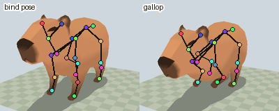

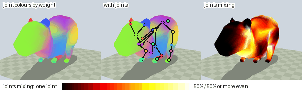

| Entry | Holds | Writer and reader | C view |
|---|---|---|---|
| SKEL v1 | joint parents, rest TRS, joint paths | `anim/skeleton_asset.py` | `anim/anim_skeleton.c` |
| SKIN v2 | inverse binds; per vertex joints, weights, bind normal | `r3d/skin_asset.py` | `render/r3d_skin.c` |

| Term | Meaning |
|---|---|
| LMSH | the baked mesh entry the skin moves ([Mesh import](Mesh-Import.md)) |
| TRCK | an animation clip entry ([Animation tracks](../Animation-Tracks.md)) |
| Tick | one int16 step of an LMSH position; the mesh's position scale is ticks per model unit |
| Palette | one matrix per joint taking a bind position to its posed position |
| Cluster, node | the mesh's draw clusters and the bounding tree over them |

## How a vertex follows its joints

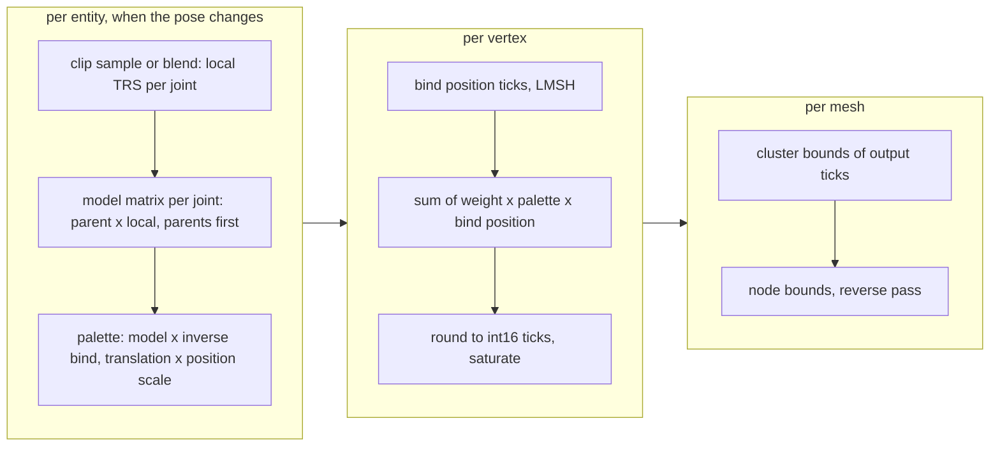

| Step | Owner | Beyond the diagram |
|---|---|---|
| Local TRS | `anim_pose_rest()`, `anim_sample_pose()`, `anim_pose_blend()` | blending in [Animation tracks](../Animation-Tracks.md#scene-playback) |
| Model matrices | `anim_pose_model()` | each root independent |
| Palette | the scene | the position scale makes bind ticks map to posed ticks |
| Blend | `render/skin/r3d_skinning.h` | linear blend skinning (LBS)[[57]](../Citations.md#57); two- and four-influence kernels, picked once per entry, outside the vertex loop |
| Output | `r3d_lit_mesh_t` view | ties round away from zero; the raster reads it |

A two-joint limb through `r3d_skin_palette()` and `r3d_skin_clusters()`:

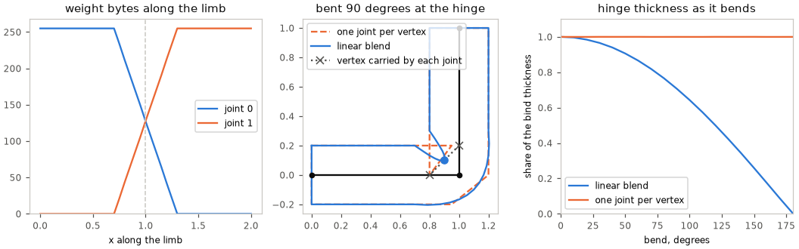

Each joint carries a vertex rigidly; linear blend puts it on the line between
those copies, by weight. At the hinge the copies fold toward each other, so
the limb thins as it bends and pinches to nothing at 180 degrees. One joint
per vertex keeps the thickness but tears the surface where the weight flips.

Lit skins blend normals in the same loop: see [Skinned lighting](Skinned-Lighting.md).

### Two or four influences

`build_pack.py --max-influences 2|4` keeps each vertex's heaviest joints;
the default is 2. Few vertices have more than two, but cutting the rest can
move them far:

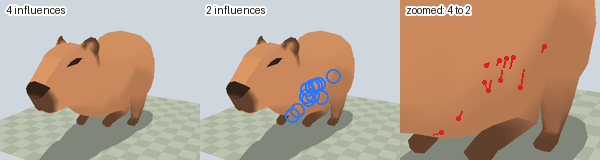

| Influences | Vertex record | Board cost |
|---|---|---|
| 2 | 8 bytes | the skin-only bar in [Skinned lighting](Skinned-Lighting.md#lighting-modes) |
| 4 | 12 bytes | not measured on the board |

<!-- generated: skin-influence-counts sha256=f8bf2db314cc2a12e679c8b68d8b9ec8576f14e8c27744cc97d4b5bc42ef7633 -->
| Source influences | Vertices | Worst move keeping 2, share of the mesh radius |
|---:|---:|---:|
| 1 | 118 | 0.0% |
| 2 | 484 | 0.0% |
| 3 | 4 | 4.9% |
| 4 | 7 | 16.2% |
<!-- /generated: skin-influence-counts -->

Weights become bytes summing to 255 (`WEIGHT_SUM`). The kept weights are
renormalised to sum to one, scaled and floored; leftover units go to the
largest remainders, ties by joint index, so two equal halves give 128 and 127:

<!-- generated: skin-weight-example sha256=a4584998468f8da63325d47156b599c39325aa2554f98d5cf8a46065e5fb70c0 -->
Vertex 7:

| glTF joint | Source weight | Kept of 4, byte | Kept of 2, byte |
|---:|---:|---:|---:|
| 3 | 0.2614 | 67 | 128 |
| 7 | 0.2614 | 66 | 127 |
| 4 | 0.2386 | 61 | — |
| 8 | 0.2386 | 61 | — |
| sum | 1.0000 | 255 | 255 |
<!-- /generated: skin-weight-example -->

## SKEL v1

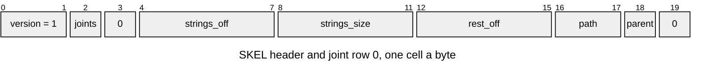

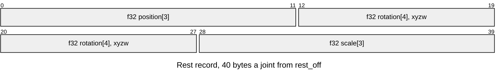

| Part | At | Size |
|---|---|---|
| Header | 0 | 16 bytes |
| Joint rows | 16 | 4 bytes each, `path` is an offset within strings |
| Rest TRS | `rest_off` | 40 bytes each |
| Strings | `strings_off` | UTF-8 joint paths, NUL terminated; ends at the entry end |

| Rule | Detail |
|---|---|
| Joints | 1..254 |
| Parents | `0xFF` is a root; any other parent is below its joint's index, so joint 0 is a root. Two roots under one armature node are allowed |
| Paths | from `gltf_read.skin_joint_paths`, starting at each root; nonempty, unique (checked by Python and C), each terminated within the table, which fits a u16 offset |
| Rest | finite; rotation with `abs(1 - sum(q*q))` at most `ANIM_SKELETON_UNIT_TOLERANCE` (1e-4, Python `UNIT_TOLERANCE`), boundary tests at the adjacent floats |
| Order | joint rows, rest, strings; gaps and reserved bytes zero |

## SKIN v2

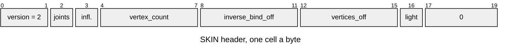

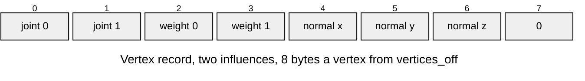

| Part | At | Size |
|---|---|---|
| Header | 0 | 20 bytes |
| Inverse binds | `inverse_bind_off` | 48 bytes each: `f32 matrix[3][4]`, row-major, model units |
| Vertices | `vertices_off` | `2 * influences + 4` bytes: joints, then weights, then normal; four influences add two of each |

| Rule | Detail |
|---|---|
| Joints | 1..254, in SKEL order; vertex order is LMSH order |
| Influences | 2 or 4; joint indices below the joint count; weights sum to 255 |
| Values | every matrix value finite; normal components in -127..127, nonzero |
| Lighting | `R3D_SKIN_LIGHT_DIRECT`, `_RENORMALISED` or `_TABLE` from `render/r3d_skin_format.h`, set by the import's `[skin].lighting` (default `direct`) and copied to the renderer's private mode on attachment; unknown codes refused |
| Order | matrices after the header, vertices after the matrices, ending at the entry end; gaps and padding zero |
| Binding | each open validates one entry; whoever binds SKIN to SKEL and LMSH checks joint and vertex counts |

## Opening an entry

Integers and floats are little-endian; offsets count from the entry start and
are four-byte aligned. The C views need a little-endian IEEE-754 binary32 host.

They validate without allocating and borrow the pack's bytes, which must
outlive the view.

| Fault | Result |
|---|---|
| Unknown version, including SKIN v1 | `ASSET_ERR_VERSION` |
| Range or alignment | `ASSET_ERR_BOUNDS` |
| A value breaking a rule above | `ASSET_ERR_FORMAT` |

A failed open clears the output view.

## Pack step

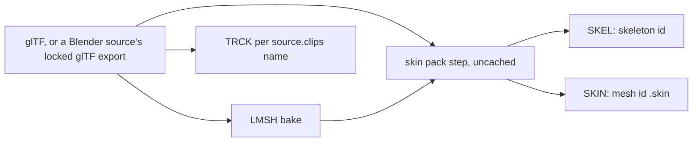

The step runs for every skinned mesh in a scene or standalone import pack,
including imports an app's demo manifest selects.

Unskinned sources and scenes get no rig entries; a skinned source gets its
skin or fails.

| Entry | Id |
|---|---|
| SKIN | `<mesh id>.skin` |
| SKEL | the glTF skin's name, else the root joints' common non-joint parent's; one per rig shared in a pack |
| TRCK | each name in `source.clips`, through `tracks_asset` ([layout](../Animation-Tracks.md)); Blender import settings accept the list |

Ids are ASCII and fit 31 bytes. `--max-influences` is a pack parameter, not
an import setting.

### Matching and frames

The step reads the glTF and the finished LMSH. Each quantized LMSH position,
at that LMSH's position scale, matches every source vertex that quantizes
there, by `lit_mesh.bake_lit_mesh`'s
rounding (pinned by `test_quantizer_matches_mesh_owner`).

Per source vertex, duplicate joints are summed, the heaviest `max_influences`
kept (ties by joint index), then quantized as above. Records are ordered by
joint and padded with zero influences. The bind normal is the matched
vertices' normalised mean, times 127 per axis, rounded.

| Failure | Names |
|---|---|
| A root joint's non-joint parent's world matrix differs from the mesh node's beyond `MODEL_SPACE_TOLERANCE` (`skeleton_asset.py`); a parentless root uses identity | the root and mesh node |
| Non-affine source inverse binds | — |
| The mesh node, a joint, or an ancestor uses `matrix`, not TRS | the node |
| An LMSH vertex with no source match | its index and position |
| Welded source vertices with different joint or weight records | the LMSH vertex and position |
| A zero or non-finite mean normal | the vertex |
| Several skinned mesh nodes in one source | those nodes |
| An unnamed rig without a common named parent; invalid or colliding ids | the id and sources |

Skinned vertices are in the mesh node's space; the rest chain starts at the
root joints and inverse binds apply as stored.

SKEL and SKIN use the [engine frame](Mesh-Import.md#the-offline-tools). The
pack boundary mirrors rest positions and rotations, inverse binds by `S M S`,
and bind normals; rest scales are unchanged. Matching reads the source-frame
LMSH first.

## Runtime

The scene owns animator and skinned-renderer components, indexed by entity.
`scene_animator_set_clips()` takes a skeleton id and clip ids;
`scene_renderer_set_skin()` binds a skin to the entity's mesh, checking joint
and vertex counts. Property animators use no skeleton.

| Block | Where | Sized by | Holds |
|---|---|---|---|
| Skin output | internal RAM, one per mesh, with model matrices and palette | `r3d_skin_output_bytes()`, carved by `r3d_skin_output_init()` | positions, cluster bounds, node bounds |
| Lit colours and normal palette | internal RAM, only with lights or nonzero ambient | `R3D_SKIN_LIGHT_CHANNELS` bytes per vertex, a `mat3f_t` per joint | see [Skinned lighting](Skinned-Lighting.md#memory); unlit skins keep the bind-colour pointer |
| Components | PSRAM | entity count | animators, skinned renderers |

Unloading the scene frees all of them.

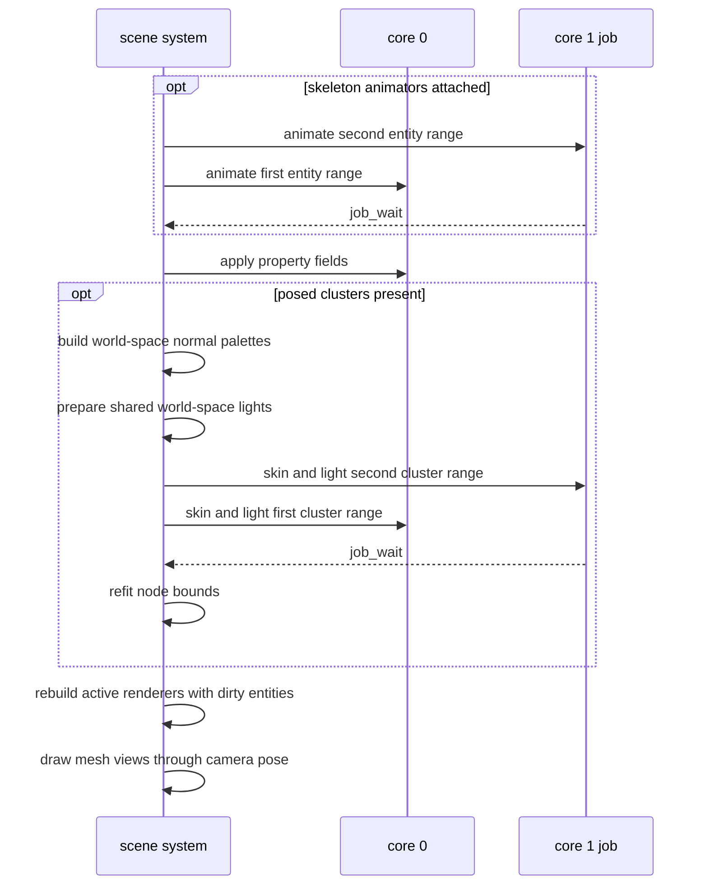

`job_run_split()` (`core/job.h`, shared with the raster) gives core 1 the
second range, or runs it inline first when core 1 is busy. Animator jobs
write their own poses and palettes; skin jobs write disjoint cluster vertex
ranges. Job contexts are checked against `JOB_CTX_MAX` at compile time.

| Stage | Runs when | Skipped when |
|---|---|---|
| Animate | skeleton animators exist | none exist |
| Property clips | always, `anim_apply()` on core 0 after the sync | — |
| Skin and node refit | the pose changed, or for a lit skin `SCENE_FLAG_SKIN_DIRTY` is set on it or a light | no posed clusters, or an unchanged pose |
| Placement | the active scene, for renderers with dirty entities | inactive scenes |

Light setters, `scene_set_transform()`, `scene_entity_set_enabled()` and
`scene_renderer_set_skin()` set `SCENE_FLAG_SKIN_DIRTY`. The skin stage
consumes it apart from the draw's `SCENE_FLAG_DIRTY`, inactive scenes
included. What skinning costs on the board is in [Skinned
lighting](Skinned-Lighting.md#lighting-modes) (the skin-only bar).

## Checking it

| Tool | Checks |
|---|---|
| [`skin_frame.py`](../../launcher/tools/r3d/skin/skin_frame.py) | builds the entries with their writers, drives the entity through the scene APIs, and holds the C positions to a packed-weight reference beside `gltf_skin.py`; sheets compare influence limits and crop chosen vertices ([options](../../launcher/tools/r3d/skin/README.md)) |
| `launcher/test/suites/suite_scene.c` | a committed rig gates both kernels through attachment, animation, split ranges, bounds and drawing |
| [`skin_sheet.py`](../../launcher/tools/r3d/skin/skin_sheet.py) | draws a skinned glTF's skeleton, weight and influence figures and this page's two generated tables |
| [`skin_figures.py`](../../launcher/tools/r3d/skin/skin_figures.py) | runs the limb through the kernel in [`skin_figures_probe.c`](../../launcher/tools/r3d/skin/skin_figures_probe.c) and plots it |

[`render_doc_images.sh`](../../launcher/tools/render/render_doc_images.sh)
runs both, with the model and clip it names, and rewrites the figures and tables.

## Current limits

Playback limits are in [Animation tracks](../Animation-Tracks.md#scene-playback);
authoring limits are in [Skinned Meshes](Skinned-Meshes.md#5-current-limits).
