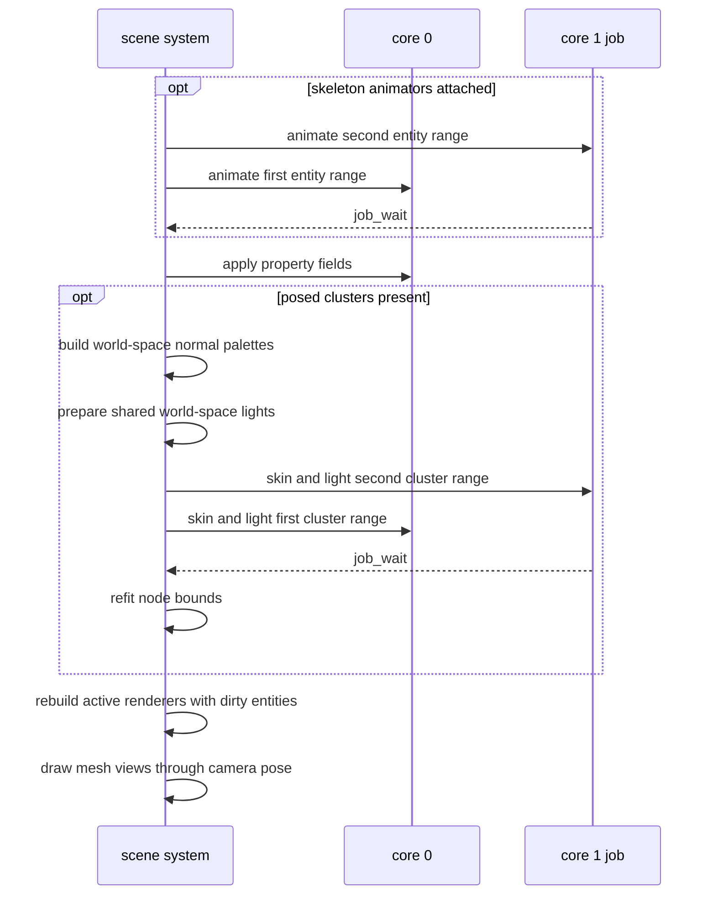

# Skeleton and skin entries

`anim/skeleton_asset.py` writes and reads SKEL; `r3d/skin_asset.py` writes
and reads SKIN. `anim/anim_skeleton.c` and `render/r3d_skin.c` validate
their mapped views without allocation. Integers and floats are little-
endian; offsets count from the entry start and are four-byte aligned. The
C views require a little-endian host with IEEE-754 binary32 floats.
Unknown versions are refused with `ASSET_ERR_VERSION`; bad ranges and
alignment with `ASSET_ERR_BOUNDS`; bad values with `ASSET_ERR_FORMAT`.
Failed opens clear the output view. The pack and its bytes must outlive
the view.

## SKEL v1

| Part | Layout |
|---|---|
| Header, 16 bytes | `u16 version=1`, `u8 joint_count`, `u8 zero`, `u32 strings_off`, `u32 strings_size`, `u32 rest_off` |
| Joint rows, at 16, four bytes each | `u16 path` (offset within strings), `u8 parent`, `u8 zero` |
| Rest, at rest_off, 40 bytes each | `f32 position[3]`, `f32 rotation[4]` (xyzw), `f32 scale[3]` |
| Strings, at strings_off | UTF-8 joint paths, NUL terminated |

Joint count is in 1..254. Any joint may be a root (`parent=0xFF`); every
other parent is below its joint's index. Joint zero is therefore a root,
and at least one root exists. This supports a rig whose two root joints
sit under one armature node. Joint paths come from
`gltf_read.skin_joint_paths`, starting at each root joint. Paths are
nonempty and unique, and each offset starts a string terminated within the
table. The table fits a u16 offset. Both Python and C check uniqueness on
open.

Rest values are finite. Rotations obey `abs(1 - sum(q*q)) <= ANIM_SKELETON_UNIT_TOLERANCE`, defined by the C format owner as `1e-4`
(`UNIT_TOLERANCE` in Python); boundary tests use adjacent representable
floats on both sides. Joint rows precede rest data, which precedes
strings; strings end at the entry end. Gaps and reserved bytes are zero.

## SKIN v1

| Part | Layout |
|---|---|
| Header, 16 bytes | `u16 version=1`, `u8 joint_count`, `u8 influences`, `u32 vertex_count`, `u32 inverse_bind_off`, `u32 vertices_off` |
| Inverse binds, at inverse_bind_off, 48 bytes each | `f32 matrix[3][4]`, row-major, model units |
| Vertex, at vertices_off, 2*influences+4 bytes | `u8 joints[influences]`, `u8 weights[influences]`, `i8 normal[3]`, `u8 zero` |

Joint count is in 1..254, influences are 2 or 4, joint indices are below
the joint count, and weights sum to 255. Every matrix value is finite.
Each normal component is in -127..127 and the normal is nonzero. Padding
is zero. Matrices follow the header and precede vertices; vertices end at
the entry end. Gaps are zero. SKIN joint order is its SKEL order, and
vertex order is its LMSH order. Each open validates one entry. A consumer
binding the entries must check joint and vertex counts against SKEL and
LMSH.

## Model space and matching

A skinned vertex is in its mesh node's space. For every root joint, the
world matrix of its non-joint parent must equal the skinned mesh node's
world matrix within `MODEL_SPACE_TOLERANCE` from `skeleton_asset.py`. A
root without a parent uses identity. A mismatch fails naming the root and
mesh node. The stored rest chain starts at root joints; inverse binds
apply as stored. Source inverse binds must be affine. The mesh node, every
joint, and their ancestors fail naming the node if they use `matrix`; they
need TRS before baking.

The uncached skin pack step reads glTF and the finished LMSH. It uses that
LMSH's position scale and matches each quantized LMSH position to every
source vertex quantizing there. `lit_mesh.bake_lit_mesh` owns the rounding
rule, pinned by `test_quantizer_matches_mesh_owner`. A vertex without a
source match fails naming its index and position.

For each source vertex, duplicate joint weights are combined, the heaviest
`max_influences` are kept (ties by joint index), and renormalized. Weights
are multiplied by 255 and quantized by largest remainder, ties by joint
index; records are ordered by joint index and padded with zero influences.
All matching source vertices must yield identical joint and weight
records. Disagreement fails naming the LMSH vertex and its position. The
bind normal is their normalized mean, each axis multiplied by 127 and
rounded. A zero or nonfinite mean fails naming the vertex.

A model whose welded vertices disagree on weights fails this step.

SKEL and SKIN entries use the [engine frame](Mesh-Import.md#the-offline-tools),
like the mesh and joint-local clips in their pack. The pack boundary mirrors
joint rest positions and rotations, inverse binds by `S M S`, and bind normals;
rest scales stay unchanged. Skin matching reads the source-frame LMSH before
that boundary.

## Pack step and ids

`r3d/build_pack.py --max-influences 2|4` sets the skin step's parameter;
its default is 2. The import settings do not hold it. The step adds
entries for every skinned mesh in a scene or standalone import pack,
including imports selected by an app's demo manifest, after obtaining its
LMSH bytes. A scene with no skinned meshes receives no rig entries; an
unskinned source receives none. A skinned source must produce its skin or
fail the pack step. A Blender source uses its locked glTF export; a glTF
source is read directly. A source must identify one skinned mesh node; a
source with several fails naming those nodes.

The skin id is `<mesh id>.skin`. The skeleton id is the glTF skin's name,
or the name of the root joints' common non-joint parent. An unnamed rig
without that common named parent fails. A rig shared by meshes in one pack
has one skeleton entry. Each name in `source.clips` becomes a TRCK entry
with that id through `tracks_asset`, whose layout is owned by [Animation
tracks](../Animation-Tracks.md). Import settings accept that clip list for
Blender sources. Ids are ASCII and fit 31 bytes; invalid ids and colliding
ids fail naming the id and sources.

## Runtime pose and skinning

The scene owns animator and skinned-renderer component arrays indexed by
entity. `scene_animator_set_clips()` accepts a skeleton id and clip ids;
`scene_renderer_set_skin()` binds a skin to that entity's mesh, checking joint
and vertex counts. Property animators use no skeleton. The scene releases
component PSRAM storage and each mesh's internal RAM when it unloads.

`anim_pose_rest()`, `anim_sample_pose()` and `anim_pose_blend()` produce local
joint TRS. `anim_pose_model()` walks joints once in stored order, multiplying
parents before children and treating each root independently. A palette is
model times inverse bind. Its translation is multiplied by the mesh's position
scale, so bind position ticks map directly to posed position ticks.

`render/skin/r3d_skinning.h` owns linear blend skinning
(LBS)[[57]](../Citations.md#57): each vertex is the weighted sum of
its palette-transformed bind position. Separate two- and four-influence kernels
are selected once per entry. They share the weighted-position operation;
influence selection is outside the vertex loop. The output rounds to nearest
int16 ticks, ties away from zero, and saturates at the int16 limits. Cluster
bounds enclose these output ticks. A reverse node pass unions child bounds.
The raster reads the output's `r3d_lit_mesh_t` view.

One caller-owned buffer block holds positions, cluster bounds and
node bounds for a mesh. `r3d_skin_output_bytes()` sizes it;
`r3d_skin_output_init()` carves it. The scene allocates it together with model
matrices and the palette in internal RAM. The same allocation reserves `R3D_SKIN_LIGHT_CHANNELS` bytes per vertex
for lit colors and a `mat3f_t` world-space normal palette per joint.
Without runtime lights the mesh retains its bind-colour pointer, with no copy.
With lights, `r3d_skin_clusters_lit()` skins positions and normals together,
renormalises the normal, and shades the bind albedo into that colour buffer.
The normal palette is the cofactor of entity world times joint palette.
Scene light directions stay in world space and are shared before cluster
jobs run; baked renderers keep their pack colours. See [Skinned lighting](Skinned-Lighting.md).
Pose blending is in [Animation tracks](../Animation-Tracks.md#scene-playback).

`core/job.h` owns `job_run_split()`, shared with the raster. Core 1 takes the
second range when available; the fallback runs that range inline before core
0's first range. Each stage waits before the next consumes its outputs.
Animator jobs write their own poses and palettes.
Property clips use `anim_apply()` directly on core 0 after synchronization,
then the active scene derives placements for renderers whose entities are dirty.
Inactive scenes do no placement work. Scenes without skeleton animators skip
the animation split, and no posed clusters means no skin split. Unchanged poses
skip skinning and node refit. A lit skin runs when its pose changes,
a light setter marks lighting dirty, or a light or skin entity carries
`SCENE_FLAG_SKIN_DIRTY`. The skin stage consumes this bit independently of
the draw's `SCENE_FLAG_DIRTY`, including for inactive scenes. Skin jobs
write disjoint cluster vertex ranges. Node refit runs after the skin sync.
Job contexts are checked against `JOB_CTX_MAX` at compile time.

The host comparison tool is
[`skin_frame.py`](../../launcher/tools/r3d/skin/skin_frame.py). It builds SKEL,
SKIN, TRCK and LMSH entries with their writers, controls the entity
through scene APIs, and renders its output positions with the preview
rasterizer beside `gltf_skin.py`. It checks the C result against a reference
with the packed weights and quantized bind positions; separate sheets compare
influence limits and crop every requested source vertex. Its options are
in [the tool's README](../../launcher/tools/r3d/skin/README.md).
The committed rig in `launcher/test/suites/suite_scene.c` gates both kernels
through scene attachment, animation, split ranges, bounds and drawing.

## Current limits

Playback limits are in [Animation tracks](../Animation-Tracks.md#scene-playback);
authored SCNE animator rows and dynamic skin lighting are planned.
