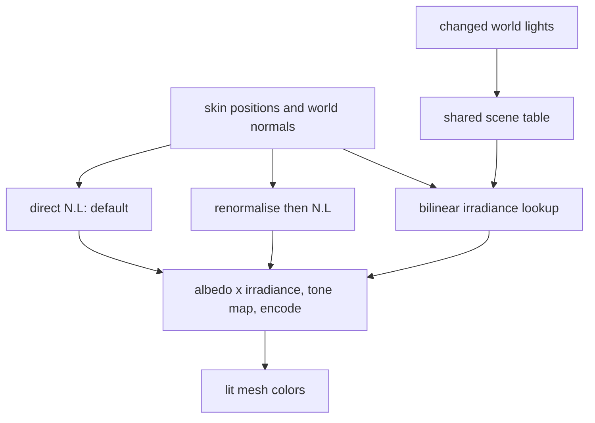

# Skinned-Mesh Lighting

The runtime shader offers three lighting modes and the bake's
albedo, tone map and gamma. This page holds its board measurements and the
host comparison with a normal-indexed illumination table<sup>[[58]](../Citations.md#58)</sup>.



## Runtime lighting

`render/skin/r3d_skin_light.h` owns the fused lighting kernels.
`r3d_skin_clusters_lit()` (direct), `r3d_skin_clusters_renormalised()` and
`r3d_skin_clusters_table()` share packed weights between position and normal
palettes, grow cluster bounds, and shade each vertex. The normal palette
holds the inverse-transpose of `entity_world * joint_palette` for each joint:
the cofactor divided by its determinant before blending. Non-uniform scale
and runtime reflections set through `scene_set_transform()` are lit correctly.
A zero or non-finite determinant, or a non-finite inverse-transpose, logs
`skin normal transform invalid` and skips lighting for that skin; its lit
colors are black while positions and bounds continue to update.
The renormalised mode normalises the blended skinned normal. `mathf_rsqrt()` uses the
S3's reciprocal-square-root seed and one Newton correction; host and QEMU
use exact square root. The device tests require relative reciprocal error
at most `MATHF_RSQRT_RELATIVE_LIMIT` over the dense normal sweep and
the light-byte error limit in `suite_skin_light.c` against exact square root.
These limits require device validation; host fallback results do not establish
the instruction's accuracy.

For albedo byte `a`, linear albedo is `(a / 255)^2.2`. Radiance is
`albedo * (ambient_color * ambient_intensity +
sum(light_color * intensity * max(0, N.L)))`. Runtime intensity is the scene
file's intensity, unscaled, matching `light.py:bake_directional`.
The Reinhard tone map<sup>[[7]](../Citations.md#7)</sup> computes
`linear / (1 + linear * tonemap_white)` per channel: white scales the
denominator and zero is identity. This is followed by clamping to [0,1]
and the bake's 1/2.2 gamma and byte rounding. Runtime lighting has no shadow,
sky visibility, ambient occlusion or bounced-light pass.

The decode table has `R3D_SKIN_LIGHT_DECODE_SIZE` uint16 entries,
stored as the rounded upper half of an IEEE float. A scene's first light
allocates the decode and encode tables together in internal RAM.
The radiance bins use `R3D_SKIN_LIGHT_RADIANCE_LOW_BITS` mantissa bits
below `R3D_SKIN_LIGHT_RADIANCE_SPLIT_EXP` and
`R3D_SKIN_LIGHT_RADIANCE_BITS` above it. Entries sample bin centers;
lookup reads one byte without interpolation. The exponent limits are
`R3D_SKIN_LIGHT_RADIANCE_MIN_EXP` and `R3D_SKIN_LIGHT_RADIANCE_MAX_EXP`.
Under-range values encode to zero; over-range values use the last entry.
Xtensa register bit transfers avoid stack spills in decode and encode.
The host sweep checks encoded bytes against the float formula. Its error
limits, albedo coverage and tone-map white sampling are in `suite_skin_light.c`.

The scene prepares shared world-space light directions and premultiplied
colors before splitting its cluster ranges. A directional
light's direction toward the light is its entity's +Y turned by its
rotation, matching `import_settings.py:load_light`.
Only skinned renderers use runtime lights. Without lights, their mesh view
retains the bind-color pointer and does no color copy or shading.
Only scenes with attached lights reserve `R3D_SKIN_LIGHT_CHANNELS` bytes per
vertex for lit colors and a `mat3f_t` normal palette per joint, in a separate
internal RAM block per skin. The first light allocates all existing skins'
blocks transactionally; a new skin in a lit scene allocates its own block.
Lighting needs per-vertex albedo. A light setter in a scene holding a skin
without vertex colors (a face-color skin, for example) fails with
`skin vertex colors required`, and so does attaching such a skin to a lit
scene. Neither changes anything. Disabled lights contribute nothing; attached
lights keep the lit color pointer, so zero ambient and no enabled lights
produce black. Scene unload releases the blocks. World light directions are
computed at most once per frame, and every lit renderer reads the scene's
shared `r3d_skin_lights_t`. Scene
component arrays and the world-light set remain in PSRAM.
SCNE v1 carries no lighting settings: absent ambient contributes zero,
and `SCENE_TONEMAP_WHITE_NONE` is zero, making the tone map the identity.
SCNE v1 has no writers for the private ambient and tone-map fields.
`test_skin_light_transfer.py` checks the runtime tables against `light.py`.

## Lighting modes

Lighting mode is private to each skinned renderer. **Direct is the default**,
the cheapest mode: it evaluates N.L on the blended world-space normal without
renormalising, so vertices where joints blend come out darker. Pick it when
that is acceptable. Renormalised evaluates
N.L after `mathf_rsqrt` normalisation and removes that darkening at small cost;
pick it when normal length must not affect light intensity. Table evaluates bilinear
irradiance from the normal's octahedral coordinate<sup>[[21]](../Citations.md#21)</sup>.
Its per-vertex cost does not grow with light count, but every light change
rebuilds the shared table. The table below compares it with direct at each
light count up to `R3D_SKIN_LIGHT_MAX`. No import setting or public call selects
a mode, so every renderer runs direct; reading the mode from the skin pack
entry is planned ([design sketch](../plans/Animation-System-Design-Sketch.md)).
Runtime tests and device suites select the mode through `scene_internal.h`.

Every mode reads the same inverse-transpose normal palette. A scene
allocates its shared irradiance table<sup>[[58]](../Citations.md#58)</sup> in
internal RAM only while at least one renderer uses table mode. Cells store
packed 8-bit RGB with one scale per table, kept in the scene's
`r3d_skin_lights_t`. The scale covers the grid's maximum irradiance, preserving irradiance above one.
Cell directions are a generated flash table,
`r3d_skin_light_directions.h`, so a build does not decode them per cell;
`gen_skin_light_directions.sh` produces it with the math package's
`vec3f_from_octahedral()`. The builder uses two irradiance passes to avoid a
scratch allocation. Its irradiance
range is `R3D_SKIN_LIGHT_IRRADIANCE_MIN` through `R3D_SKIN_LIGHT_IRRADIANCE_MAX`;
a table below the floor has zero cells and unit scale, and larger values clamp
to the ceiling before quantisation.
Integer bilinear lookup blends those fixed-point channels before
albedo multiplication, tone mapping and encoding, using multiplication by the
shared scale. `vec3f_octahedral()` pays a reciprocal division; interpolation
adds no divides. The host angular sweep in `suite_skin_light.c` checks this
format against direct lighting and an independent float reference. The cell
budget and encoding are defined by `R3D_SKIN_LIGHT_TABLE_*`.

A mode change keeps the shared color and normal-palette tail and changes the
renderer kernel outside the vertex loop. Allocation failure preserves the
mode, pointers and free bytes. The last table renderer releases the
table. Light setters and a light entity's `SCENE_FLAG_SKIN_DIRTY` rebuild it;
posing or rotating a skin does not. All table renderers read the same world
lights and scene table.

The generated table reports fused cycles per vertex at each light count,
worst and mean light-byte error against independently evaluated float
lighting, table build cycles per light change, normal-palette build cycles
per frame, and RAM per
renderer and per scene. Scene bytes are shared across renderers. The table is
generated from the [board capture](#board-measurement).

<!-- generated: skin-light-modes sha256=2a0381bc63b7442c9595ecfa9cf9496eb9ea33e9e1b7ca431e7cdcbe7866fd40 -->
Build `95e6c074f9ed-diag`.

| Mode | Lights | Cycles / vertex | Worst byte error | Mean byte error | Table build cycles / light change | Normal-palette build cycles / frame | Renderer internal bytes | Scene internal bytes | Scene PSRAM bytes |
|---|---:|---:|---:|---:|---:|---:|---:|---:|---:|
| direct | 1 | 640.509 | 8 | 0.246612 | — | 5104.000 | 3744 | 1024 | 124 |
| direct | 2 | 663.720 | 9 | 0.264905 | — | 5104.000 | 3744 | 1024 | 124 |
| direct | 4 | 708.673 | 13 | 0.353997 | — | 5104.000 | 3744 | 1024 | 124 |
| renormalised | 1 | 681.001 | 1 | 0.184282 | — | 5104.000 | 3744 | 1024 | 124 |
| renormalised | 2 | 703.676 | 1 | 0.185637 | — | 5104.000 | 3744 | 1024 | 124 |
| renormalised | 4 | 749.085 | 2 | 0.180217 | — | 5104.000 | 3744 | 1024 | 124 |
| table | 1 | 856.566 | 7 | 0.455623 | 90833.000 | 5104.000 | 3744 | 2048 | 124 |
| table | 2 | 856.338 | 4 | 0.360095 | 102537.000 | 5104.000 | 3744 | 2048 | 124 |
| table | 4 | 856.126 | 4 | 0.380420 | 125131.000 | 5104.000 | 3744 | 2048 | 124 |
<!-- /generated: skin-light-modes -->

## Board measurement

The committed [capture lines](data/skin-light-board.txt) hold the
build id, timing, quality, checksums, heap measurements and RAM allocations.
The generated table takes the median timing per build and kernel and the worst quality
errors across captured runs. The capture omits each session's first run, a warm-up.
Runtime error is measured against float lighting of packed bind normals.
The [comparison sheet](images/skin-light-sheet.png) shows source-normal
benchmark error; those inputs differ from packed normals.

<!-- generated: skin-light-board sha256=00069f3a572c5e2985d16cb17016f331b359b14fe09ca956ded64f3e8118f184 -->
| Build id | Kernel | Cycles | Per | Build / vertex | Max byte error | Mean byte error |
|---|---|---:|---|---:|---:|---:|
| 95e6c074f9ed-diag | normal_palette_build | 5104.000 | build | 5.187 | — | — |
| 95e6c074f9ed-diag | skin_only | 353.082 | vertex | — | — | — |
| 95e6c074f9ed-diag | fused_direct_1 | 640.509 | vertex | — | 8 | 0.246612 |
| 95e6c074f9ed-diag | fused_direct_2 | 663.720 | vertex | — | 9 | 0.264905 |
| 95e6c074f9ed-diag | fused_direct_4 | 708.673 | vertex | — | 13 | 0.353997 |
| 95e6c074f9ed-diag | fused_table_1 | 856.566 | vertex | — | 7 | 0.455623 |
| 95e6c074f9ed-diag | fused_table_2 | 856.338 | vertex | — | 4 | 0.360095 |
| 95e6c074f9ed-diag | fused_table_4 | 856.126 | vertex | — | 4 | 0.380420 |
| 95e6c074f9ed-diag | table_build_1 | 90833.000 | build | 92.310 | — | — |
| 95e6c074f9ed-diag | table_build_2 | 102537.000 | build | 104.204 | — | — |
| 95e6c074f9ed-diag | table_build_4 | 125131.000 | build | 127.166 | — | — |
| 95e6c074f9ed-diag | fused_renormalised_1 | 681.001 | vertex | — | 1 | 0.184282 |
| 95e6c074f9ed-diag | fused_renormalised_2 | 703.676 | vertex | — | 1 | 0.185637 |
| 95e6c074f9ed-diag | fused_renormalised_4 | 749.085 | vertex | — | 2 | 0.180217 |
| 95e6c074f9ed-diag | exact_separate_1 | 5695.488 | vertex | — | 0 | 0.000000 |
| 95e6c074f9ed-diag | exact_separate_2 | 5784.909 | vertex | — | 0 | 0.000000 |
| 95e6c074f9ed-diag | exact_separate_4 | 5969.760 | vertex | — | 0 | 0.000000 |
<!-- /generated: skin-light-board -->

The device suite measures skin-only, normal-palette build, the exact-separate
float reference, and each runtime mode under the requested light counts.
Table builds are timed separately. Each mode reports renderer and scene
internal-RAM bytes, quality and heap availability before allocation, after
allocation and after release. The exact-separate reference blends packed
normals and uses square root, float albedo decode and gamma independently
of the runtime transfer tables.

```sh
autana --wait 3600 suite suite_skin_light_perf --runs 6 --flash
# Copy BUILD_ID, POSE, timing, COST, QUALITY, CHECKSUM and HEAP lines from
# the printed capture path into docs/render/data/skin-light-board.txt. Include RAM lines.
python launcher/tools/r3d/skin_light/report_skin_light_board.py docs/render/data/skin-light-board.txt docs/render/Skinned-Lighting.md
```

## Results

The host comparison's variants:

| Variant | Per vertex |
|---|---|
| Reference | float bind normal, skinned, renormalised, N.L per light |
| Direct | skinned, not renormalised, N.L per light; bind normal as float or int8 per axis |
| Table, nearest | int8 bind normal, skinned, its octahedral point<sup>[[21]](../Citations.md#21)</sup> (`vec3f_octahedral`, any length) picks one cell |
| Table, bilinear | the same point blends the four nearest cell centres with 8-bit weights |

Each host comparison table cell holds the light of its centre's direction as three bytes, padded to
four. A cell's direction is fixed, so the directions are one table shared by
every object; the light bytes are rebuilt per object per frame. Every variant ends in
the same integer stage, so only the light bytes differ. The host comparison's lights are
directional lights plus ambient in object space; each light-count row uses
the first lights of `LIGHTS` in the benchmark.

The host benchmark keeps its linear-light direct and octahedral comparisons
in `launcher/tools/r3d/skin_light/skin_light_baseline.*`. The runtime table
stores irradiance before albedo and tone mapping; the host comparison tables
store encoded light bytes and use a different transfer.

The mesh is the hand-rigged capybara's glTF export, the cached bake
`python launcher/tools/bake/bake.py path capybara.glb` prints, passed to
`report_skin_light.sh`:
four influences per vertex, every frame of every clip. `mul`, `add`,
`div` and `sqrt` count float operations per vertex, read off each kernel in
[skin_light_bench.c](../../launcher/tools/r3d/skin_light/skin_light_bench.c),
as the board's proxy: host nanoseconds do not carry over to the S3's FPU, where
a divide or square root costs several instructions.

Per-vertex cost, the table's build excluded:

<!-- generated: skin-light-cost sha256=0230fcd048f963d58473099bf7c659d0c563c90aebe08d5985e009788ac43922 -->
613 vertices x 242 frames, median of 15 runs; host compiler 16.1.0.

| Variant | Lights | mul | add | div | sqrt | other | int mul | ns/vertex |
|---|---:|---:|---:|---:|---:|---:|---:|---:|
| Skin only (shared) | any | 45 | 33 | 0 | 0 | 0 | 0 | 6.1 |
| Reference: float normal, renormalised | 1 | 57 | 40 | 1 | 1 | 7 | 0 | 9.3 |
| Reference: float normal, renormalised | 2 | 63 | 45 | 1 | 1 | 8 | 0 | 10.6 |
| Reference: float normal, renormalised | 4 | 75 | 55 | 1 | 1 | 10 | 0 | 13.9 |
| Reference: float normal, renormalised | 8 | 99 | 75 | 1 | 1 | 14 | 0 | 20.9 |
| Direct: float normal | 1 | 51 | 38 | 0 | 0 | 7 | 0 | 7.5 |
| Direct: float normal | 2 | 57 | 43 | 0 | 0 | 8 | 0 | 8.4 |
| Direct: float normal | 4 | 69 | 53 | 0 | 0 | 10 | 0 | 9.9 |
| Direct: float normal | 8 | 93 | 73 | 0 | 0 | 14 | 0 | 12.9 |
| Direct: int8 normal | 1 | 51 | 38 | 0 | 0 | 10 | 0 | 7.6 |
| Direct: int8 normal | 2 | 57 | 43 | 0 | 0 | 11 | 0 | 8.4 |
| Direct: int8 normal | 4 | 69 | 53 | 0 | 0 | 13 | 0 | 10.5 |
| Direct: int8 normal | 8 | 93 | 73 | 0 | 0 | 17 | 0 | 13.7 |
| Table 8x8 nearest: int8 normal | any | 49 | 39 | 1 | 0 | 13 | 0 | 8.8 |
| Table 16x16 nearest: int8 normal | any | 49 | 39 | 1 | 0 | 13 | 0 | 8.8 |
| Table 32x32 nearest: int8 normal | any | 49 | 39 | 1 | 0 | 13 | 0 | 8.8 |
| Table 8x8 bilinear: int8 normal | any | 51 | 41 | 1 | 0 | 21 | 18 | 16.3 |
| Table 16x16 bilinear: int8 normal | any | 51 | 41 | 1 | 0 | 21 | 18 | 16.3 |
| Table 32x32 bilinear: int8 normal | any | 51 | 41 | 1 | 0 | 21 | 18 | 16.3 |
<!-- /generated: skin-light-cost -->

The table's build, per object per frame, and what it adds per vertex at the
capybara's vertex count and at a larger mesh's (`LARGE_MESH`):

<!-- generated: skin-light-build sha256=3be8439a05172d66dc570d6d8ebaca6d4e1416567b4c59eb393948609cabb2c1 -->
| Table | Cells | Bytes per object | Shared direction bytes | Lights | mul | add | div | sqrt | other | int mul | Build us/frame | Build ns/vertex, 613 vertices | Build ns/vertex, 1500 vertices |
|---|---:|---:|---:|---:|---:|---:|---:|---:|---:|---:|---:|---:|---:|
| 8x8 | 64 | 256 | 768 | 1 | 384 | 320 | 0 | 0 | 448 | 0 | 0.10 | 0.2 | 0.1 |
| 8x8 | 64 | 256 | 768 | 2 | 768 | 640 | 0 | 0 | 512 | 0 | 0.14 | 0.2 | 0.1 |
| 8x8 | 64 | 256 | 768 | 4 | 1536 | 1280 | 0 | 0 | 640 | 0 | 0.21 | 0.3 | 0.1 |
| 8x8 | 64 | 256 | 768 | 8 | 3072 | 2560 | 0 | 0 | 896 | 0 | 0.37 | 0.6 | 0.2 |
| 16x16 | 256 | 1024 | 3072 | 1 | 1536 | 1280 | 0 | 0 | 1792 | 0 | 0.40 | 0.6 | 0.3 |
| 16x16 | 256 | 1024 | 3072 | 2 | 3072 | 2560 | 0 | 0 | 2048 | 0 | 0.55 | 0.9 | 0.4 |
| 16x16 | 256 | 1024 | 3072 | 4 | 6144 | 5120 | 0 | 0 | 2560 | 0 | 0.85 | 1.4 | 0.6 |
| 16x16 | 256 | 1024 | 3072 | 8 | 12288 | 10240 | 0 | 0 | 3584 | 0 | 1.49 | 2.4 | 1.0 |
| 32x32 | 1024 | 4096 | 12288 | 1 | 6144 | 5120 | 0 | 0 | 7168 | 0 | 1.55 | 2.5 | 1.0 |
| 32x32 | 1024 | 4096 | 12288 | 2 | 12288 | 10240 | 0 | 0 | 8192 | 0 | 2.26 | 3.7 | 1.5 |
| 32x32 | 1024 | 4096 | 12288 | 4 | 24576 | 20480 | 0 | 0 | 10240 | 0 | 3.54 | 5.8 | 2.4 |
| 32x32 | 1024 | 4096 | 12288 | 8 | 49152 | 40960 | 0 | 0 | 14336 | 0 | 6.39 | 10.4 | 4.3 |
<!-- /generated: skin-light-build -->

Error against the reference over every vertex of every frame. Light byte is the
0-255 light of one channel; RGB565 step is one step of a 5- or 6-bit output
channel:

<!-- generated: skin-light-quality sha256=35b7fdbca2f282d1985104ac1033ec11e65c91a45ffff04af2c0a26ade01abb4 -->
| Variant | Lights | Light byte max | Light byte mean | RGB565 max step | RGB565 mean step | Vertices changed |
|---|---:|---:|---:|---:|---:|---:|
| Direct: float normal | 1 | 65 | 0.14 | 3 | 0.010 | 2.5% |
| Direct: float normal | 2 | 63 | 0.19 | 4 | 0.013 | 3.4% |
| Direct: float normal | 4 | 63 | 0.38 | 4 | 0.030 | 7.0% |
| Direct: float normal | 8 | 60 | 0.46 | 4 | 0.033 | 7.4% |
| Direct: int8 normal | 1 | 65 | 0.26 | 3 | 0.019 | 5.2% |
| Direct: int8 normal | 2 | 63 | 0.34 | 4 | 0.023 | 6.2% |
| Direct: int8 normal | 4 | 63 | 0.52 | 4 | 0.038 | 9.5% |
| Direct: int8 normal | 8 | 60 | 0.60 | 4 | 0.042 | 10.1% |
| Table 8x8 nearest: int8 normal | 1 | 88 | 6.87 | 10 | 0.540 | 41.1% |
| Table 8x8 nearest: int8 normal | 2 | 88 | 8.23 | 10 | 0.632 | 53.0% |
| Table 8x8 nearest: int8 normal | 4 | 68 | 7.50 | 8 | 0.566 | 58.0% |
| Table 8x8 nearest: int8 normal | 8 | 60 | 7.21 | 8 | 0.539 | 61.8% |
| Table 16x16 nearest: int8 normal | 1 | 47 | 3.50 | 6 | 0.271 | 35.8% |
| Table 16x16 nearest: int8 normal | 2 | 47 | 4.24 | 6 | 0.315 | 45.5% |
| Table 16x16 nearest: int8 normal | 4 | 40 | 3.96 | 5 | 0.278 | 44.5% |
| Table 16x16 nearest: int8 normal | 8 | 42 | 3.95 | 5 | 0.285 | 47.9% |
| Table 32x32 nearest: int8 normal | 1 | 23 | 1.72 | 3 | 0.137 | 25.8% |
| Table 32x32 nearest: int8 normal | 2 | 23 | 2.11 | 3 | 0.164 | 31.2% |
| Table 32x32 nearest: int8 normal | 4 | 20 | 2.02 | 3 | 0.148 | 31.6% |
| Table 32x32 nearest: int8 normal | 8 | 21 | 2.03 | 3 | 0.149 | 31.9% |
| Table 8x8 bilinear: int8 normal | 1 | 46 | 3.11 | 5 | 0.238 | 37.0% |
| Table 8x8 bilinear: int8 normal | 2 | 46 | 3.74 | 5 | 0.282 | 45.3% |
| Table 8x8 bilinear: int8 normal | 4 | 42 | 3.31 | 5 | 0.254 | 46.5% |
| Table 8x8 bilinear: int8 normal | 8 | 42 | 3.44 | 5 | 0.261 | 47.3% |
| Table 16x16 bilinear: int8 normal | 1 | 22 | 1.08 | 3 | 0.082 | 18.0% |
| Table 16x16 bilinear: int8 normal | 2 | 22 | 1.35 | 3 | 0.101 | 21.8% |
| Table 16x16 bilinear: int8 normal | 4 | 22 | 1.39 | 3 | 0.105 | 24.4% |
| Table 16x16 bilinear: int8 normal | 8 | 22 | 1.41 | 3 | 0.108 | 25.7% |
| Table 32x32 bilinear: int8 normal | 1 | 12 | 0.34 | 2 | 0.027 | 7.0% |
| Table 32x32 bilinear: int8 normal | 2 | 12 | 0.46 | 2 | 0.035 | 8.6% |
| Table 32x32 bilinear: int8 normal | 4 | 11 | 0.51 | 1 | 0.039 | 10.5% |
| Table 32x32 bilinear: int8 normal | 8 | 11 | 0.52 | 2 | 0.039 | 10.4% |
<!-- /generated: skin-light-quality -->

One gallop frame under the sheet's light count (`SHEET_LIGHTS`); the error
tiles compare the RGB565 output
with the reference's:


## Decision

Direct is the default; [Lighting modes](#lighting-modes) says when to pick
the others.

## Reproduce

From the repository root, with the committed glTF export that
`report_skin_light.sh` names:

```sh
launcher/tools/r3d/skin_light/report_skin_light.sh ASSET.glb gallop
```

It builds and runs the benchmark, redraws the sheet and rewrites the three
tables above.
