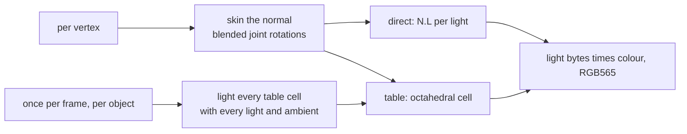

# Skinned-Mesh Lighting

A skinned mesh bends at run time, so its light cannot be baked into its vertex
colours the way a static mesh's is. This page measures two ways to light it
every frame in the host comparison: direct N.L per vertex, and a per-object lookup table
indexed by the skinned normal.



| Variant | Per vertex |
|---|---|
| Reference | float bind normal, skinned, renormalised, N.L per light |
| Direct | skinned, not renormalised, N.L per light; bind normal as float or int8 per axis |
| Table, nearest | int8 bind normal, skinned, its octahedral point<sup>[[21]](../Citations.md#21)</sup> (`vec3f_octahedral`, any length) picks one cell |
| Table, bilinear | the same point blends the four nearest cell centres with 8-bit weights |

Each table cell holds the light of its centre's direction as three bytes, padded to
four. A cell's direction is fixed, so the directions are one table shared by
every object; the light bytes are rebuilt per object per frame. Every variant ends in
the same integer stage, so only the light bytes differ. Lights are
directional lights plus ambient in object space; each light-count row uses
the first lights of `LIGHTS` in the benchmark.

## Runtime lighting

`render/skin/r3d_skin_light.h` owns the fused direct N.L shader.
`r3d_skin_clusters_lit()` shares palette rows and packed weights between
positions and normals, grows cluster bounds, and shades each vertex.
The skinned normal is always renormalised. `mathf_rsqrt_approx()` uses the
S3's reciprocal-square-root seed and one Newton correction; host and QEMU
use exact square root. The device tests require relative reciprocal error
at most `MATHF_RSQRT_APPROX_RELATIVE_LIMIT` over the dense normal sweep and
at most one light-byte error against exact square root over the measured mesh.
These limits require device validation; host fallback results do not establish
the instruction's accuracy.

For albedo byte `a`, linear albedo is `(a / 255)^2.2`. Linear radiance is
albedo times `ambient_colour * ambient_intensity` plus the sum of
`light_colour * intensity * max(0, N.L)`. Runtime intensity is the scene
file's intensity, unscaled, matching `light.py:bake_directional`.
The Reinhard tone map<sup>[[7]](../Citations.md#7)</sup> computes
`linear / (1 + linear * tonemap_white)`, followed by clamping to [0,1]
and the bake's 1/2.2 gamma and byte rounding. Runtime lighting has no shadow,
sky visibility, ambient occlusion or bounced-light pass.

The decode table has `R3D_SKIN_LIGHT_DECODE_SIZE` uint16 entries,
stored as the rounded upper half of an IEEE float: 512 bytes.
Each scene with an attached light allocates it together with a 512-byte
encode table in internal RAM. Its radiance bins use the float exponent and four mantissa
bits, covering [2^-24, 256); entries sample bin starts and lookup interpolates adjacent bytes with eight-bit weights.
Under-range values encode to zero; over-range values use the last entry.
This spacing spends precision near black without a divide or square root
in the lookup. The combined decode and encode budget is 1024 bytes.
The host sweep checks a maximum error of two encoded byte steps against
the float formula, including every albedo byte and white values from zero
through 16. The limits and sampling are in `suite_skin_light.c`.

The scene prepares light directions and premultiplied colours in each
renderer's object space before splitting its cluster ranges. A directional
light points along its entity's rotated +Y axis, matching `import_settings.py:load_light`.
Only skinned renderers use runtime lights. Without lights, their mesh view
retains the bind-colour pointer and does no colour copy or shading.
Each attached skin adds three internal-RAM bytes per vertex for lit colours
in the positions/palette allocation. Scene component arrays remain in PSRAM.
SCNE v1 carries no lighting settings: absent ambient contributes zero,
and `SCENE_TONEMAP_WHITE_NONE` is zero, making the tone map the identity.
The reader's absent tone-map value is `None`; this runtime identity is the
SCNE v1 policy, not a numeric reader default.

TODO: the SCNE v2 rebake must establish a shared Python/C owner for lighting
constants and fill scene lights, ambient and tone map from the scene file.

## Board measurement

The committed [capture lines](data/skin-light-board.txt) retain the supplied
build ids, timing, quality, checksums and heap measurements. Build
`8651de3988fb-diag` is the decision measurement. The table measurements use
rounded linear-light bytes and belong to the comparison, not the runtime
albedo/tone-map shader. Their error is measured against exact normalisation
of packed bind normals. The [comparison sheet](images/skin-light-sheet.png)
shows source-normal benchmark error; those inputs differ from packed normals.

<!-- generated: skin-light-board sha256=7532c53623b6dcfeb0b1722c64ecc967a0dd96572ea60c5f46048f594a1aeb2f -->
| Build id | Kernel | Cycles | Per | Build / vertex | Max byte error | Mean byte error |
|---|---|---:|---|---:|---:|---:|
| efbfc0cb8da4-diag | skin_only | 353.066 | vertex | — | — | — |
| efbfc0cb8da4-diag | direct_1 | 1024.163 | vertex | — | 46 | 0.557927 |
| efbfc0cb8da4-diag | direct_2 | 1047.131 | vertex | — | 44 | 0.749322 |
| efbfc0cb8da4-diag | direct_4 | 1087.561 | vertex | — | 62 | 1.195122 |
| efbfc0cb8da4-diag | renormalised_1 | 1167.243 | vertex | — | 0 | 0.000000 |
| efbfc0cb8da4-diag | renormalised_2 | 1190.062 | vertex | — | 0 | 0.000000 |
| efbfc0cb8da4-diag | renormalised_4 | 1235.703 | vertex | — | 0 | 0.000000 |
| efbfc0cb8da4-diag | table_lookup | 1060.467 | vertex | — | 18 | 1.484079 |
| efbfc0cb8da4-diag | table_build_1 | 129453.000 | build | 131.558 | 0 | 0.000000 |
| efbfc0cb8da4-diag | table_build_2 | 135345.000 | build | 137.546 | 0 | 0.000000 |
| efbfc0cb8da4-diag | table_build_4 | 146595.000 | build | 148.979 | 0 | 0.000000 |
| 8651de3988fb-diag | skin_only | 356.119 | vertex | — | — | — |
| 8651de3988fb-diag | fused_direct_1 | 581.288 | vertex | — | 46 | 0.557927 |
| 8651de3988fb-diag | fused_direct_2 | 604.694 | vertex | — | 44 | 0.749322 |
| 8651de3988fb-diag | fused_direct_4 | 649.839 | vertex | — | 62 | 1.195122 |
| 8651de3988fb-diag | fused_renormalised_4 | 757.315 | vertex | — | 0 | 0.000000 |
| 8651de3988fb-diag | direct_1 | 220.299 | vertex | — | 46 | 0.557927 |
| 8651de3988fb-diag | direct_2 | 244.654 | vertex | — | 44 | 0.749322 |
| 8651de3988fb-diag | direct_4 | 288.830 | vertex | — | 62 | 1.195122 |
| 8651de3988fb-diag | renormalised_1 | 325.807 | vertex | — | 0 | 0.000000 |
| 8651de3988fb-diag | renormalised_2 | 348.680 | vertex | — | 0 | 0.000000 |
| 8651de3988fb-diag | renormalised_4 | 392.871 | vertex | — | 0 | 0.000000 |
| 8651de3988fb-diag | table_lookup | 329.435 | vertex | — | 18 | 1.484079 |
| 8651de3988fb-diag | table_build_1 | 26811.000 | build | 27.247 | 0 | 0.000000 |
| 8651de3988fb-diag | table_build_2 | 32827.000 | build | 33.361 | 0 | 0.000000 |
| 8651de3988fb-diag | table_build_4 | 44347.000 | build | 45.068 | 0 | 0.000000 |
<!-- /generated: skin-light-board -->

The device suite measures skin-only, fused renormalised lighting with the
approximate reciprocal square root, and a suite-only exact square root in a
separate lighting pass, at each requested light count. The separate pass
has different row-sharing cost, so its difference from fused timing is not
an isolated reciprocal-square-root cost. It reports internal free space and
largest block before allocation, after allocation and after release.

```sh
autana --wait 3600 suite suite_skin_light_perf --flash
python launcher/tools/r3d/skin_light/report_skin_light_board.py docs/render/data/skin-light-board.txt docs/render/Skinned-Lighting.md
```

The host benchmark keeps its linear-light direct and octahedral comparisons
in `launcher/tools/r3d/skin_light/skin_light_baseline.*`. The engine has no
normal-indexed lighting table.

## Results

The mesh is the hand-rigged capybara's glTF export, the cached bake
`python launcher/tools/bake/bake.py path capybara.glb` prints, passed to
`report_skin_light.sh`:
four influences per vertex, every frame of every clip. `mul`, `add`,
`div` and `sqrt` count float operations per vertex, read off each kernel in
[skin_light_bench.c](../../launcher/tools/r3d/skin_light/skin_light_bench.c),
as the board's proxy: host nanoseconds do not carry over to the S3's FPU, where
a divide or square root costs several instructions.

Per-vertex cost, the table's build excluded:

<!-- generated: skin-light-cost sha256=0230fcd048f963d58473099bf7c659d0c563c90aebe08d5985e009788ac43922 -->
613 vertices x 242 frames, median of 15 runs; host compiler 16.1.0.

| Variant | Lights | mul | add | div | sqrt | other | int mul | ns/vertex |
|---|---:|---:|---:|---:|---:|---:|---:|---:|
| Skin only (shared) | any | 45 | 33 | 0 | 0 | 0 | 0 | 6.1 |
| Reference: float normal, renormalised | 1 | 57 | 40 | 1 | 1 | 7 | 0 | 9.3 |
| Reference: float normal, renormalised | 2 | 63 | 45 | 1 | 1 | 8 | 0 | 10.6 |
| Reference: float normal, renormalised | 4 | 75 | 55 | 1 | 1 | 10 | 0 | 13.9 |
| Reference: float normal, renormalised | 8 | 99 | 75 | 1 | 1 | 14 | 0 | 20.9 |
| Direct: float normal | 1 | 51 | 38 | 0 | 0 | 7 | 0 | 7.5 |
| Direct: float normal | 2 | 57 | 43 | 0 | 0 | 8 | 0 | 8.4 |
| Direct: float normal | 4 | 69 | 53 | 0 | 0 | 10 | 0 | 9.9 |
| Direct: float normal | 8 | 93 | 73 | 0 | 0 | 14 | 0 | 12.9 |
| Direct: int8 normal | 1 | 51 | 38 | 0 | 0 | 10 | 0 | 7.6 |
| Direct: int8 normal | 2 | 57 | 43 | 0 | 0 | 11 | 0 | 8.4 |
| Direct: int8 normal | 4 | 69 | 53 | 0 | 0 | 13 | 0 | 10.5 |
| Direct: int8 normal | 8 | 93 | 73 | 0 | 0 | 17 | 0 | 13.7 |
| Table 8x8 nearest: int8 normal | any | 49 | 39 | 1 | 0 | 13 | 0 | 8.8 |
| Table 16x16 nearest: int8 normal | any | 49 | 39 | 1 | 0 | 13 | 0 | 8.8 |
| Table 32x32 nearest: int8 normal | any | 49 | 39 | 1 | 0 | 13 | 0 | 8.8 |
| Table 8x8 bilinear: int8 normal | any | 51 | 41 | 1 | 0 | 21 | 18 | 16.3 |
| Table 16x16 bilinear: int8 normal | any | 51 | 41 | 1 | 0 | 21 | 18 | 16.3 |
| Table 32x32 bilinear: int8 normal | any | 51 | 41 | 1 | 0 | 21 | 18 | 16.3 |
<!-- /generated: skin-light-cost -->

The table's build, per object per frame, and what it adds per vertex at the
capybara's vertex count and at a larger mesh's (`LARGE_MESH`):

<!-- generated: skin-light-build sha256=3be8439a05172d66dc570d6d8ebaca6d4e1416567b4c59eb393948609cabb2c1 -->
| Table | Cells | Bytes per object | Shared direction bytes | Lights | mul | add | div | sqrt | other | int mul | Build us/frame | Build ns/vertex, 613 vertices | Build ns/vertex, 1500 vertices |
|---|---:|---:|---:|---:|---:|---:|---:|---:|---:|---:|---:|---:|---:|
| 8x8 | 64 | 256 | 768 | 1 | 384 | 320 | 0 | 0 | 448 | 0 | 0.10 | 0.2 | 0.1 |
| 8x8 | 64 | 256 | 768 | 2 | 768 | 640 | 0 | 0 | 512 | 0 | 0.14 | 0.2 | 0.1 |
| 8x8 | 64 | 256 | 768 | 4 | 1536 | 1280 | 0 | 0 | 640 | 0 | 0.21 | 0.3 | 0.1 |
| 8x8 | 64 | 256 | 768 | 8 | 3072 | 2560 | 0 | 0 | 896 | 0 | 0.37 | 0.6 | 0.2 |
| 16x16 | 256 | 1024 | 3072 | 1 | 1536 | 1280 | 0 | 0 | 1792 | 0 | 0.40 | 0.6 | 0.3 |
| 16x16 | 256 | 1024 | 3072 | 2 | 3072 | 2560 | 0 | 0 | 2048 | 0 | 0.55 | 0.9 | 0.4 |
| 16x16 | 256 | 1024 | 3072 | 4 | 6144 | 5120 | 0 | 0 | 2560 | 0 | 0.85 | 1.4 | 0.6 |
| 16x16 | 256 | 1024 | 3072 | 8 | 12288 | 10240 | 0 | 0 | 3584 | 0 | 1.49 | 2.4 | 1.0 |
| 32x32 | 1024 | 4096 | 12288 | 1 | 6144 | 5120 | 0 | 0 | 7168 | 0 | 1.55 | 2.5 | 1.0 |
| 32x32 | 1024 | 4096 | 12288 | 2 | 12288 | 10240 | 0 | 0 | 8192 | 0 | 2.26 | 3.7 | 1.5 |
| 32x32 | 1024 | 4096 | 12288 | 4 | 24576 | 20480 | 0 | 0 | 10240 | 0 | 3.54 | 5.8 | 2.4 |
| 32x32 | 1024 | 4096 | 12288 | 8 | 49152 | 40960 | 0 | 0 | 14336 | 0 | 6.39 | 10.4 | 4.3 |
<!-- /generated: skin-light-build -->

Error against the reference over every vertex of every frame. Light byte is the
0-255 light of one channel; RGB565 step is one step of a 5- or 6-bit output
channel:

<!-- generated: skin-light-quality sha256=35b7fdbca2f282d1985104ac1033ec11e65c91a45ffff04af2c0a26ade01abb4 -->
| Variant | Lights | Light byte max | Light byte mean | RGB565 max step | RGB565 mean step | Vertices changed |
|---|---:|---:|---:|---:|---:|---:|
| Direct: float normal | 1 | 65 | 0.14 | 3 | 0.010 | 2.5% |
| Direct: float normal | 2 | 63 | 0.19 | 4 | 0.013 | 3.4% |
| Direct: float normal | 4 | 63 | 0.38 | 4 | 0.030 | 7.0% |
| Direct: float normal | 8 | 60 | 0.46 | 4 | 0.033 | 7.4% |
| Direct: int8 normal | 1 | 65 | 0.26 | 3 | 0.019 | 5.2% |
| Direct: int8 normal | 2 | 63 | 0.34 | 4 | 0.023 | 6.2% |
| Direct: int8 normal | 4 | 63 | 0.52 | 4 | 0.038 | 9.5% |
| Direct: int8 normal | 8 | 60 | 0.60 | 4 | 0.042 | 10.1% |
| Table 8x8 nearest: int8 normal | 1 | 88 | 6.87 | 10 | 0.540 | 41.1% |
| Table 8x8 nearest: int8 normal | 2 | 88 | 8.23 | 10 | 0.632 | 53.0% |
| Table 8x8 nearest: int8 normal | 4 | 68 | 7.50 | 8 | 0.566 | 58.0% |
| Table 8x8 nearest: int8 normal | 8 | 60 | 7.21 | 8 | 0.539 | 61.8% |
| Table 16x16 nearest: int8 normal | 1 | 47 | 3.50 | 6 | 0.271 | 35.8% |
| Table 16x16 nearest: int8 normal | 2 | 47 | 4.24 | 6 | 0.315 | 45.5% |
| Table 16x16 nearest: int8 normal | 4 | 40 | 3.96 | 5 | 0.278 | 44.5% |
| Table 16x16 nearest: int8 normal | 8 | 42 | 3.95 | 5 | 0.285 | 47.9% |
| Table 32x32 nearest: int8 normal | 1 | 23 | 1.72 | 3 | 0.137 | 25.8% |
| Table 32x32 nearest: int8 normal | 2 | 23 | 2.11 | 3 | 0.164 | 31.2% |
| Table 32x32 nearest: int8 normal | 4 | 20 | 2.02 | 3 | 0.148 | 31.6% |
| Table 32x32 nearest: int8 normal | 8 | 21 | 2.03 | 3 | 0.149 | 31.9% |
| Table 8x8 bilinear: int8 normal | 1 | 46 | 3.11 | 5 | 0.238 | 37.0% |
| Table 8x8 bilinear: int8 normal | 2 | 46 | 3.74 | 5 | 0.282 | 45.3% |
| Table 8x8 bilinear: int8 normal | 4 | 42 | 3.31 | 5 | 0.254 | 46.5% |
| Table 8x8 bilinear: int8 normal | 8 | 42 | 3.44 | 5 | 0.261 | 47.3% |
| Table 16x16 bilinear: int8 normal | 1 | 22 | 1.08 | 3 | 0.082 | 18.0% |
| Table 16x16 bilinear: int8 normal | 2 | 22 | 1.35 | 3 | 0.101 | 21.8% |
| Table 16x16 bilinear: int8 normal | 4 | 22 | 1.39 | 3 | 0.105 | 24.4% |
| Table 16x16 bilinear: int8 normal | 8 | 22 | 1.41 | 3 | 0.108 | 25.7% |
| Table 32x32 bilinear: int8 normal | 1 | 12 | 0.34 | 2 | 0.027 | 7.0% |
| Table 32x32 bilinear: int8 normal | 2 | 12 | 0.46 | 2 | 0.035 | 8.6% |
| Table 32x32 bilinear: int8 normal | 4 | 11 | 0.51 | 1 | 0.039 | 10.5% |
| Table 32x32 bilinear: int8 normal | 8 | 11 | 0.52 | 2 | 0.039 | 10.4% |
<!-- /generated: skin-light-quality -->

One gallop frame under the sheet's light count (`SHEET_LIGHTS`); the error
tiles compare the RGB565 output
with the reference's:


## Decision

The board selects direct N.L. In the decision build, separate direct lighting
costs 220.299, 244.654 and 288.830 cycles per vertex for one, two and four
lights. The table lookup alone costs 329.435 cycles per vertex, with its
build added per object. The fused direct measurements and the exact
renormalisation comparison are in the generated table above.

Runtime uses the fused direct kernel with renormalised int8 bind normals.
The normal-indexed table remains a host comparison only. Runtime transfer
lookup tables serve albedo decode, tone mapping and gamma; they do not
replace per-light N.L evaluation.

## Reproduce

From the repository root, with the committed glTF export that
`report_skin_light.sh` names:

```sh
launcher/tools/r3d/skin_light/report_skin_light.sh ASSET.glb gallop
```

It builds and runs the benchmark, redraws the sheet and rewrites the three
tables above.
