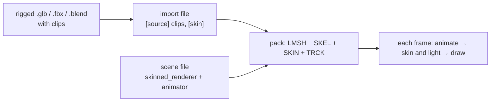

# Skinned Meshes

A skinned mesh is a rigged model whose vertices follow its joints. A scene
plays the model's clips, blends from one clip to the next, skins the mesh
and lights it every frame, before the draw. This page is the entry point:
how to bring a rigged model in, the options it takes, the calls an app makes,
and what it costs on the board. [Skeleton and skin entries](Skeleton-and-Skin.md)
is the pack format reference; [Skinned-Mesh Lighting](Skinned-Lighting.md)
holds the lighting measurements.



## 1. Import

The import file names the source and the clips to keep. A `.glb`, `.fbx` or
`.blend` source with a skinned mesh node bakes its bind pose as the mesh;
the pack build adds its skeleton (SKEL), skin (SKIN) and one clip (TRCK) per
name in `clips`.

```toml
[source]
path = "subject.glb"
credit = "Who made it, and its licence."
clips = ["idle", "walk", "gallop"]

[output]
name = "subject"
position_scale = 16384

[skin]
lighting = "direct"
```

Colours are the material's unlit albedo, per vertex: the scene lights the
mesh at run time. The source's units, joint rules and model-space checks
are in [Model space and matching](Skeleton-and-Skin.md#model-space-and-matching).

## 2. Skin options

| Option | Where | What it does | Default | Cost |
|---|---|---|---|---|
| Influences per vertex | pack build `--max-influences` | Keeps the heaviest 2 or 4 joint weights per vertex. | 2 | 4 costs more per vertex; see [Runtime pose and skinning](Skeleton-and-Skin.md#runtime-pose-and-skinning). |
| `[skin] lighting` | import file | Selects the runtime lighting kernel: `direct`, `renormalised` or `table`. | `direct` | [Lighting modes](Skinned-Lighting.md#lighting-modes) compares cost and quality. |

Pick `direct` unless the darkening where joints blend shows; `renormalised`
removes it for a few percent more; `table` keeps a flat cost when a scene
has many lights.

## 3. In a scene

The scene file gives the object a `skinned_renderer` and an `animator`
([skinned_renderer and animator](Scene-Files.md#skinned_renderer-and-animator)):

```toml
[[objects]]
name = "subject"
[objects.skinned_renderer]
mesh = "subject.import.toml"
[objects.animator]
default_clip = "idle"
```

An app finds the entity once and plays clips by index; the second argument
of a play is the transition blend in milliseconds:

```c
static scene_t* scene;
static scene_entity_t subject;

void start(void) {
    scene = scene_load("meadow", NULL);
    subject = scene_find(scene, "subject");
    scene_activate(scene, NULL);
}

void on_pick(int clip) {
    scene_animator_play(scene, subject, clip, 250);
}
```

| Call | Does |
|---|---|
| `scene_animator_play(scene, entity, clip, blend_ms)` | Plays a clip, blending from the shown pose over `blend_ms` (0 cuts). |
| `scene_animator_clip_count()` / `_clip_name()` / `_clip_duration_ms()` | Lists the attached clips, for a picker. |
| `scene_animator_set_speed()` / `_set_paused()` / `_seek()` | Controls one playback slot. |
| `scene_animator_set_clips()` / `scene_renderer_set_skin()` | Attach clips or a skin by asset id at run time, when the scene file has no rows for them. |
| `scene_light_set_color()` / `_set_intensity()` | Attach or change a directional light; runtime lights shade skinned renderers only. |

A clip picker lists `scene_animator_clip_name()` for every index below
`scene_animator_clip_count()` and plays the chosen index with the blend the
user set.

## 4. Budget

The design budget is about 1 µs per vertex for the skin stage. The
`capybara_perf` suite measures it on the board with the demo capybara
(800 vertices, 22 joints, 2 influences, direct lighting, one light) playing
gallop in a lit scene.

| Stage, per frame | One core | Two cores |
|---|---:|---:|
| Animate: sample, blend, palette | 288 µs | 307 µs |
| Skin and light | 2149 µs (2.69 µs / vertex) | 1284 µs (1.61 µs / vertex) |
| Whole animation step (the shipped path) | | 1630 µs |
| Scene render, playing vs paused | | +2.3 ms (9.8 vs 7.5 ms) |

| Internal RAM | Free / largest block, bytes |
|---|---:|
| Before the scene loads | 100475 / 47104 |
| Capybara loaded and playing | 87443 / 47104 |

Build `2e0848e1164f-diag`, five runs of 100 frames, the first discarded;
runs agree within 1%. Skinning splits across both cores by cluster;
animating a single character gains nothing from the split. The skin stage
is above budget on both cores.

## 5. Current limits

- Loop or clamp is set per animator in the scene file, not per clip.
- A skin whose colours are per face (no vertex colours) cannot be lit.
- A skinned mesh in a baked scene gets the direct lights and ambient, not
  the scene's baked indirect light.
- Influences per vertex are set per pack build, not per rig.
