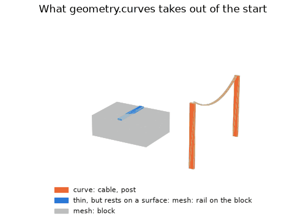
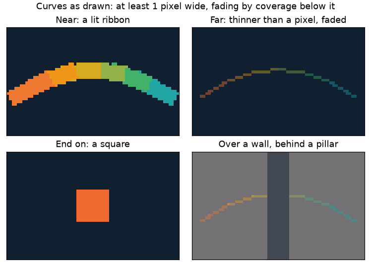

# Thin curves

Thin connected parts such as poles and cables can leave the triangle start and
fit and be drawn as lit curves. Edge collapse loses small cross-sections
(Garland and Heckbert 1997, Fig. 3 [[12]](../Citations.md#garland-1997)), so a
fit drops or smears them. The import setting
[`geometry.curves`](offline/Mesh-Import.md#curves) turns this on; the curves are
stored in [LCRV](../assets/formats/LCRV.md) beside the mesh.

## What is taken

A part is a curve when it is long, slender and narrow across its own
centreline, measured against the side of a start triangle at the object's
budget. Shape is all the rule reads: no names. A part resting on a surface
stays in the mesh, and so does the material that
[`geometry.thin`](offline/Mesh-Import.md#thin) thins.

| Stage | Behaviour |
|---|---|
| Source | Detect connected parts by budget side, length, slenderness and width across their own centreline, so a sagging cable counts as thin as a taut one. A part with half its vertices within half its width of any other triangle, thin ones included, rests on a surface and stays in the mesh |
| Start | Exclude their triangles; fit and light radius-bearing polylines against the full source, each knot over the stretch it draws, from the ring directions not facing nearby geometry |
| Fit | Exclude thin surface samples; draw frozen six-sided tubes with copies and include them in the coverage gate |

## How they draw

| Stage | Behaviour |
|---|---|
| Runtime | After all triangle clusters, cull curve boxes and draw near-clipped camera-facing ribbons in each row band: every opaque segment first, then the faded ones. The depth fit counts the curve boxes |
| Width | Draw at least one picture pixel; an end-on segment draws one square, as wide as its wider end |
| Coverage | Subpixel ribbons fade by true width / drawn width, depth-tested, mixing over what is behind; they write depth only over empty depth, mixed with the clear colour, so upscaling shows them. Solid ribbons write depth |

The minimum width and coverage fade follow Persson's wire antialiasing
[[116]](../Citations.md#persson-2012). Curve positions and radii share the
mesh's position units and placed lens. Where the draw sits in the frame is in
[Mesh-Rendering.md](Mesh-Rendering.md#one-frame).

The figures are made by
[`thin_figures.py`](../../launcher/tools/r3d/thin/thin_figures.py): the
pictures by the curve draw itself through a probe, the scene's colours by the
detector.
