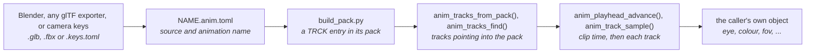
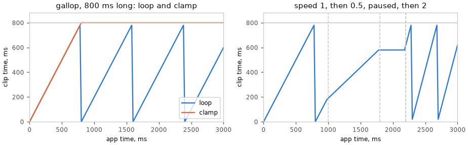
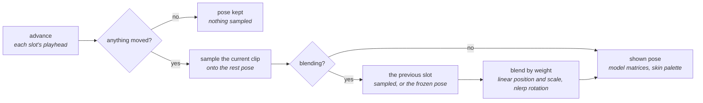
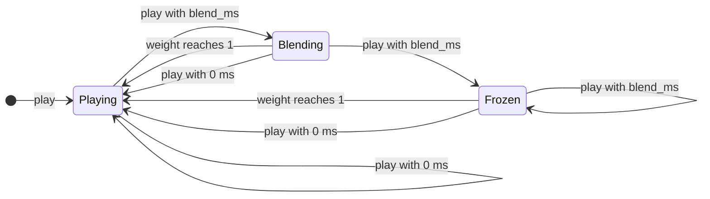
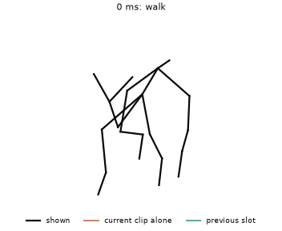
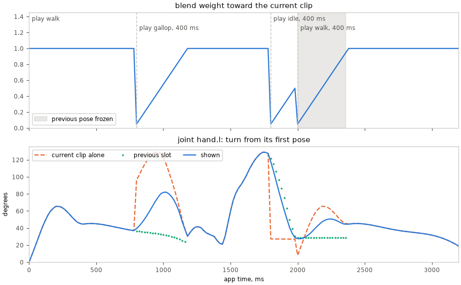
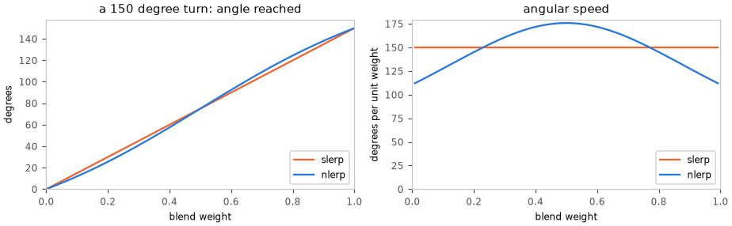

# Animation Tracks

`launcher/main/anim/` plays keyed values over time. A track is a list of
keys, each a time and a value, and one call gives the value at any moment.
It knows a target only through the field declarations a caller passes to
`anim_bind()`; a caller may also sample a track and map the numbers itself.
Its layer is in
[firmware/README.md](../../firmware/README.md); it sits above `asset/`,
`core/` and `math/`, and allocates nothing.

The format is glTF 2.0's own animation model<sup>[[17]](../../Citations.md#khronos-gltf-2-0)</sup>, so a track authored in Blender
or any other exporter plays back as it was made.



A clip reaches the firmware as an entry of an
[asset pack](../../assets/README.md): `build_pack.py` bakes it through
`tools/anim/tracks_asset.py`, the entry's one writer, when the packs are
built.

## What a track stores

| Field | Meaning |
|---|---|
| `times` | Key times in seconds, strictly increasing |
| `values` | `width` floats per key; three runs of them per key for `ANIM_CUBIC` |
| `width` | 1 to 4 components: a scalar, a translation, a quaternion |
| `interp` | `ANIM_STEP`, `ANIM_LINEAR` or `ANIM_CUBIC` (glTF `CUBICSPLINE`) |
| `quaternion` | The value is an xyzw rotation, sampled unit: linear keys slerp<sup>[[19]](../../Citations.md#shoemake-1985)</sup>, copied and cubic keys are normalised |

A cubic key holds an in-tangent, the value and an out-tangent, in units per
second, exactly as glTF stores them, and samples as the specification's cubic
Hermite spline<sup>[[17]](../../Citations.md#khronos-gltf-2-0)</sup>. A track has one interpolation.

A binding names an object path, a component and a field. Re-exporting a
file with reordered nodes preserves these names. The bake maps glTF targets
onto engine fields:

| glTF channel | Component | Field | Value type |
|---|---|---|---|
| node `translation` | `TRNS` | `position` | `VEC3` |
| node `rotation` | `TRNS` | `rotation` | `QUAT` |
| node `scale` | `TRNS` | `scale` | `VEC3` |
| `/cameras/N/perspective/yfov` pointer (`KHR_animation_pointer`<sup>[[18]](../../Citations.md#khronos-khr-animation-pointer)</sup>) | `CAMR` | `half_fov_short_tan` | `FLOAT` |

The camera pointer binds to the one node holding that camera. The bake uses
`gltf_read.camera_half_fov_short_tan()` for values and
`gltf_read.camera_half_fov_short_tan_derivative()` for cubic tangents.
The camera's static perspective aspect ratio defaults to 1 when absent.
Other pointer targets and morph weights are refused.
A channel that never changes is baked as one key; a cubic channel counts as
unchanging only when every tangent is zero.

The clip's root is `SKELETON` when every channel drives a joint of one skin.
A path runs from the joint's root joint, which it includes, such as
`root/spine`, and excludes non-joint ancestors such as an armature node. A
skin may have several root joints; two joints with one path fail the bake.
Other clips use `SCENE` and paths name scene nodes.
`anim_bind()` refuses a skeleton clip with `ANIM_BIND_ERR_ROOT`;
`anim_tracks_binding_at()` and `anim_track_sample()` still read and sample it.

A **clip** is the tracks of one animation, on one timeline as in glTF: a
track's key times are clip seconds, so tracks that start or end at different
times stay in step, and the clip's duration is the last key of any of them.

## The pack entry

A `NAME.anim.toml` beside its source names one animation in it: a `.glb`, an
`.fbx` (converted to glTF once) or a camera `.keys.toml` (built into glTF in
memory at every bake). `build_pack.py` finds every such file by searching,
so no list is kept. A
clip no scene names is a [pack](../../assets/Building-Packs.md#packs) of its own, named
`NAME`, holding the one entry `NAME`; `asset_store_load("NAME")` mounts it.
A clip a scene's camera flies travels in that scene's pack instead.
The [asset-pack boundary](../offline/Mesh-Import.md#the-offline-tools) mirrors
translation and rotation tracks, cubic tangents included, into the engine
frame; other tracks, key times and interpolation stay as authored.

```toml
source = "NAME.glb"     # a .glb, .fbx or .keys.toml beside this one
animation = "walk"      # the animation's name in the glTF
```

The entry's layout is [TRCK v3](../../assets/formats/TRCK.md).

### Reading a clip

<!-- generated: anim-track-example check: python launcher/tools/gen/examples_doc.py --check -->
```c
/* Track: load a position curve once, then sample it each frame. */
#include "anim/anim_tracks.h"
#include "anim/playback/anim_playhead.h"

typedef struct {
    anim_tracks_t clip;
    anim_track_t move;
    anim_playhead_t playhead;
    float out[ANIM_WIDTH_MAX];
} track_example_t;

static bool
track_example_start(track_example_t* s, const asset_pack_t* pack) {
    const name_hash_t camera = name_hash("camera");
    const name_hash_t position = name_hash("position");
    if (anim_tracks_from_pack(pack, "probe", &s->clip) != ASSET_OK
        || anim_tracks_find(&s->clip, camera, ANIM_COMPONENT_TRANSFORM, position, &s->move) != ASSET_OK) {
        return false;
    }
    anim_playhead_init(&s->playhead, ANIM_LOOP);
    return true;
}

static void
track_example(track_example_t* s, uint32_t dt_ms) {
    anim_playhead_advance(&s->playhead, &s->clip.clip, dt_ms);
    anim_track_sample(&s->move, anim_playhead_seconds(&s->playhead), s->out);
}
```
<!-- /generated: anim-track-example -->

| Call | Gives |
|---|---|
| `anim_tracks_binding_at()` | one row's path, component, field, type and curve |
| `anim_tracks_find()` | the curve of one path, component and field |
| `anim_tracks_find_node()`, `anim_transform_sample()` | a node's `TRNS` tracks as an `anim_node_tracks_t`, sampled into a transform; position (vec3) and rotation (quaternion) are required, absent scale stays unit |
| `anim_bind()` | every scene binding resolved against the caller's `anim_target_t` objects into caller-owned `anim_bound_t` storage ([Binding any field](#binding-any-field)) |
| `anim_bind_field()` | one binding resolved against component references, without a path lookup |
| `anim_apply(bound, count, seconds)` | a contiguous range sampled into its target fields, setting each target's dirty bit when supplied; `bound + first` starts a later range |
| `anim_binding_describe()` | a binding's name, as `path:CCCC.field` |

Curves and strings point into the pack, so the pack must outlive them.
Nothing is allocated, and the sampler normalizes quaternion keys.

`anim_bind()` returns a distinct `anim_bind_status_t` for a missing path,
component or field, a type mismatch, too little storage and a skeleton root.
Apply only a set that resolved.

Its failed index is -1 on success and for root or storage errors, otherwise
the failing binding. A component's declaration sits beside its struct, such
as `CAMERA_FIELDS` in `scene/camera/camera.h`.

## Sampling

`anim_playhead_t` (`anim/playback/anim_playhead.h`) owns clip time in
integer milliseconds; `anim_playhead_advance()` moves it by each frame's
`dt_ms`; the [reading example](#reading-a-clip) samples with it each frame.

Below, a real clip played through the scene's calls:



| Setting | Clip time |
|---|---|
| `ANIM_LOOP` | wraps at the clip's duration; a loop authors its first key again as its last |
| `ANIM_CLAMP` | holds at the duration |
| Speed | Q16.16: the step widens `dt_ms` times speed to 64 bits and carries the sub-millisecond rest, so a slow speed still moves |
| Pause | holds; it resumes where it held |
| Empty clip | stays at zero |

Integer milliseconds keep `anim_playhead_seconds()` at millisecond resolution
over a long run. `anim_track_sample()` holds the first value before its first
key and the last after its last, as glTF defines. `anim_quat_rotate()` turns
a vector by a sampled rotation, such as a camera's look direction.

## Authoring

For a camera path without Blender, write a `NAME.keys.toml` and name it as
the source of a `NAME.anim.toml`; `tools/anim/camera_keys.py` builds it into
glTF when the clip is baked, so no `.glb` is kept. The keys file sets `node`,
`animation` and `[[keys]]` with seconds `t`, `eye` and `look_at` vectors.
Translation is a smooth Catmull-Rom curve<sup>[[20]](../../Citations.md#catmull-1974)</sup> and rotation interpolates
short-way quaternions with +Y up; repeat the first key at the end to close
the loop.

1. Animate in Blender and export glTF binary (`.glb`) with animation on. Name
   the action: the bake finds it by name. Blender exports keys as
   `LINEAR`, `STEP` or `CUBICSPLINE` per curve; a camera's field of view needs the
   exporter's animation-pointer option; the bake refuses any other pointer.
2. Keep the file beside the code that plays it, as an asset, and write a
   `NAME.anim.toml` beside it naming the animation, as in
   [The pack entry](#the-pack-entry).
3. Build the packs: `build_pack.py` finds the `.anim.toml` and bakes the
   clip into its pack. Nothing is generated into the source tree.
4. Open the clip with `anim_tracks_from_pack()`, find the tracks the scene
   needs by path, component and field, or resolve them with `anim_bind()`.

The bake refuses keys out of order, a channel with no node and no pointer,
and a value that is not finite. Joint TRS curves are tracks; skin data is a
separate asset.

## Binding any field

A track can drive any field that a component declares bindable. Three
pieces make that work:

1. **Declaration.** A component lists its bindable fields once, beside its
   struct, as an `anim_component_fields_t`: the component's four-character
   code, defined by the component's owner, and for each field its name, its
   `anim_value_t` and its byte offset in the struct. A field that is not
   declared cannot be bound.
2. **Resolution, once at load.** `anim_bind()` takes each binding in turn.
   Its path finds the object among the `anim_target_t`s the caller passes, by
   name. Its component code finds that object's `anim_component_ref_t` (the
   declaration and the struct's address). Its field name finds the declared
   field, and the value types must match. `anim_bind_field()` does those last
   two steps for a caller that finds the object some other way. Resolution is
   the only place names are compared; the result is a pointer to the field.
3. **Failure.** An unknown path, component or field, or a type mismatch,
   returns its own `anim_bind_status_t` with the binding's index, and the
   caller fails the load, naming the binding with `anim_binding_describe()`.
   Nothing is skipped.

Each frame, `anim_apply()` then samples every resolved curve straight into
its field.

To make a new component animatable, define its code and declare its fields.
If glTF can animate the property, map the channel in
`tracks_asset.channel_binding()`, converting the curve to the field's units in
the bake. The readers accept any nonzero code, so neither reader changes.

For example, resolve a camera's field of view once at load, then sample the
curve each frame:

<!-- generated: anim-camera-field-example check: python launcher/tools/gen/examples_doc.py --check -->
```c
/* Camera field: resolve a lens curve and sample its field of view. */
#include "anim/anim_tracks.h"

static asset_status_t
camera_field_example_start(const anim_tracks_t* clip, anim_track_t* lens) {
    const name_hash_t camera = name_hash("camera");
    const name_hash_t field = name_hash("half_fov_short_tan");
    return anim_tracks_find(clip, camera, ANIM_COMPONENT_CAMERA, field, lens);
}

static void
camera_field_example(const anim_track_t* lens, float seconds, float fov[ANIM_WIDTH_MAX]) {
    anim_track_sample(lens, seconds, fov);
}
```
<!-- /generated: anim-camera-field-example -->

## Looking at a baked animation

`launcher/tools/anim/track_host.py` prints every track of a clip every N
milliseconds, read from the clip's `TRCK` entry by the same
`anim_tracks_from_pack()` and `anim_track_sample()` the firmware runs. Given
`NAME.anim.toml`, it bakes the clip into a scratch pack in the source frame;
given `--pack PACK --clip ID`, it reads the built pack in the engine frame.
With `--poses NODE W H TAN NEAR`, it prints a camera node as the poses file
[`report_triangle_sizes.sh`](../../../launcher/tools/r3d/README.md#triangle-sizes)
reads. A poses file is in the source frame, so `--poses` takes a `.anim.toml`:
a built pack's tracks are in the engine frame and give wrong poses
([Mesh-Import.md](../offline/Mesh-Import.md#the-offline-tools)).

```sh
python launcher/tools/anim/track_host.py PATH/NAME.anim.toml --every 250
python launcher/tools/anim/track_host.py PATH/NAME.anim.toml --every 5000 --poses camera 184 224 0.62 6
```

The program, `track_host.c`, is one for every clip: it is compiled once into
`launcher/tools/anim/build/`, and again only when a file the compiler reads to
build it, the compiler or the flags change.

## How it is tested

- `suite_anim_track.c` holds each interpolation, clamp and loop, tracks on one
  clip timeline, the quaternion path and the cubic layout to hand-built tracks.
- `suite_anim_playback.c` holds the playhead's long-run resolution, loop, clamp,
  pause, fractional speed and empty clip, and the layer's transition blend.
- `suite_anim_binding.c` checks scene field resolution, error reports, dirty
  bits and quaternion writes.
- `suite_anim_tracks.c` refuses each malformed entry with its status and
  opens every clip in the boot clip's shipped pack, on the host and on the board. On the
  host it also holds every track of a test clip to the Python sampler, bit
  for bit where the sampler copies a key (`tools/tests/anim_probe.py` marks
  those).
- `tools/tests/test_anim_tracks_asset.py` reads back what the writer writes,
  refuses what the reader refuses, and has `build_pack.py` make a pack
  of each `.anim.toml` no scene names.
- `tools/tests/test_anim_bake.py` builds a glTF of its own with every
  interpolation, a quaternion, a pointer-targeted scalar and a non-zero first
  key, bakes it to a `TRCK` entry, samples it in C through `track_host`, and
  holds every value to the Python sampler in
  `launcher/tools/gltf/gltf_read.py`, looping and clamped.

## Rules

- **Single precision only**, as in [Mesh-Rendering.md](../Mesh-Rendering.md#rules-the-layer-keeps).
- **Portable.** No ESP-IDF and no allocation; a host suite runs all of it.
- **The caller owns the environment.** Time is passed in; nothing reads a
  clock.

## Scene playback

An app plays clips through the scene and includes only `scene/scene.h`;
`anim/pose/` and `anim/playback/` stay engine-private behind it.

| Call | Does |
|---|---|
| `scene_animator_set_clips()` | gives an entity its clips, resolving asset ids once; the scene owns the animator, its bindings and buffers |
| `scene_animator_play()` | starts a clip in the current slot at clip time 0, speed 1, unpaused, blending from what is shown over `blend_ms` |
| `scene_animator_set_speed()`, `scene_animator_set_paused()` | one slot's speed or pause, current or previous ([Sampling](#sampling)) |
| `scene_animator_seek()` | puts a slot at a clip time and samples at once, without drawing |
| `scene_animator_clip_count()`, `scene_animator_clip_name()`, `scene_animator_clip_duration_ms()` | the entity's clips |

The scene file's `wrap` sets loop or clamp. A camera `path` loads as an
animator on the camera's entity: the pack build keeps the path node's tracks
and names them `ANIM_TARGET_SELF`, which binds to the animator's own entity.

### Two kinds of clip

| | Property clip | Skeleton clip |
|---|---|---|
| `skeleton_id` | `NULL` | the skeleton's asset id |
| Binds | scene transforms and camera lens fields, strictly: every binding resolves | joint paths, with `anim_bind_skeleton()` |
| Unkeyed fields | keep their values | keep the rest pose |
| Transition blend | none: `blend_ms` is 0 | over `blend_ms` |
| Each frame | `anim_apply()` writes the current slot into its fields | the pose below, then the skin palette |

Each entity has one animator, of one kind: a property clip cannot replace the
skeleton animator on a skinned entity. Both kinds keep a playhead per slot.

### Each frame of a skeleton clip



### Transition blends



| State | Current slot | Previous slot |
|---|---|---|
| Playing | the clip shown | empty |
| Blending | the new clip, weight rising 0 to 1 over `blend_ms` | the old clip, still playing at its own speed |
| Frozen | the new clip, weight rising 0 to 1 | empty: the pose shown when the blend was interrupted, copied into the layer's PSRAM buffer |

A blended play during a blend starts from the pose on screen. Speed
and pause on an empty or frozen previous slot return false.

Below, a skinned mesh's clips play first to second, then to a third,
interrupted half way by a play back to the first:





### Blending rotations

Position and scale blend linearly. Rotation takes the sign-corrected,
normalized quaternion sum (nlerp)<sup>[[56]](../../Citations.md#kavan-2008)</sup> per joint
between the two poses, without the paper's dual quaternions.

It stays unit and takes the short way, but its angular speed peaks mid-blend:


