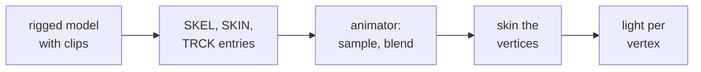

# Animation and skinned meshes

Keyed values over time, and the rigged meshes whose joints follow them. Start
with [Skinned-Meshes.md](Skinned-Meshes.md) to put an animated character in a
scene.

| Page | Covers |
|---|---|
| [Skinned-Meshes.md](Skinned-Meshes.md) | **Start here**: import a rigged model with clips, the skin options, the animator calls, the budget and limits |
| [Animation-Tracks.md](Animation-Tracks.md) | Tracks, sampling, binding any field, and scene playback: clips, transitions, rotation blends |
| [Skeleton-and-Skin.md](Skeleton-and-Skin.md) | How a vertex follows its joints, the pack step, the runtime skinning |
| [Skinned-Lighting.md](Skinned-Lighting.md) | Lighting a skinned mesh every frame: the modes, the lookup table, measured cost |

The entries' bytes: [SKEL](../../assets/formats/SKEL.md),
[SKIN](../../assets/formats/SKIN.md), [TRCK](../../assets/formats/TRCK.md).
