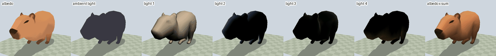
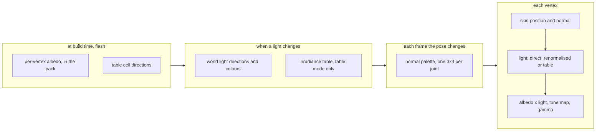
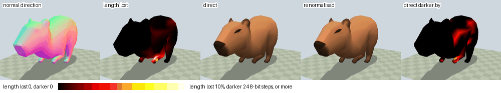
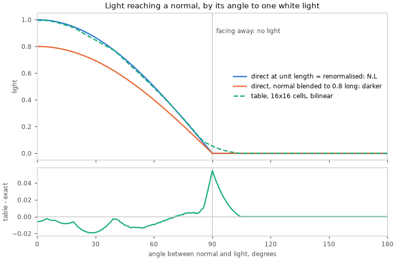
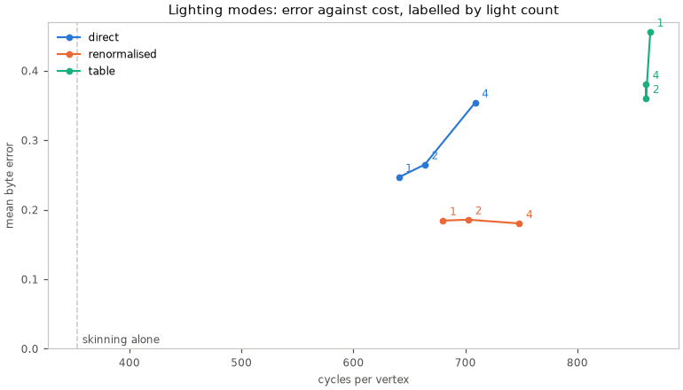
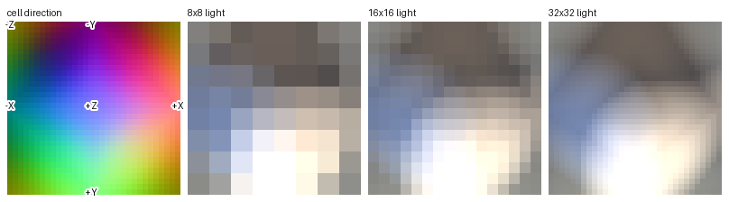
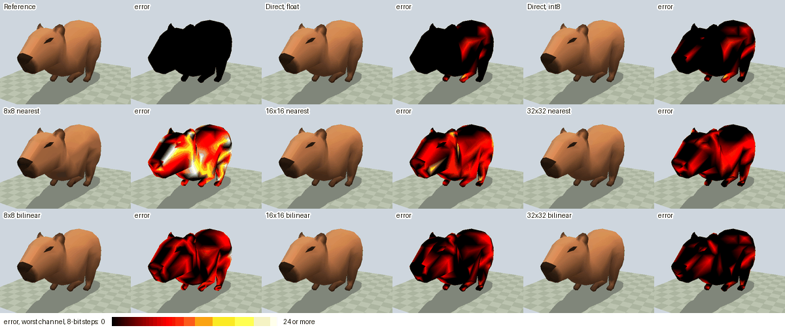

# Skinned-Mesh Lighting

A skinned mesh is lit on the CPU, one colour per vertex, in each frame its
pose or lights change. Each vertex's albedo is multiplied by the light its
skinned normal receives, then tone mapped and gamma encoded like the bake.



| Term | What it adds |
|---|---|
| Albedo | the vertex colour from the import, unlit |
| Ambient | a constant light from every direction |
| Directional light | its colour times intensity times `max(0, N.L)`: full facing the light, nothing facing away |
| Lit | albedo times the sum, then tone map and gamma |

There is no shadow, sky visibility, ambient occlusion or bounced light at run
time.

## What runs when



| Stage | Owner | Cost |
|---|---|---|
| Cell directions | `r3d_skin_light_directions.h`, made by `gen_skin_light_directions.sh` | none at run time |
| World lights | the scene, at most once per frame, shared by every lit renderer | per light |
| Irradiance table | the scene, shared by every table-mode renderer | [build cycles per light change](#lighting-modes) |
| Normal palette | each renderer | [cycles per frame](#lighting-modes) |
| Skin and light | `render/skin/r3d_skin_light.h`, one fused loop over the vertices | [cycles per vertex](#lighting-modes) |

Posing or rotating a skin rebuilds its normal palette, not the table. A
light setter or a light entity's `SCENE_FLAG_SKIN_DIRTY` rebuilds the table.

## How normals follow the bones



Each joint's normal palette entry is the inverse-transpose of
`entity_world * joint_palette`: its cofactor matrix over its determinant. So
non-uniform scale and reflections set by `scene_entity_set_local()` light
correctly. A vertex blends its joints' entries by weight, like its position.

Blending two rotations shortens the normal where joints mix (second tile), and
a short normal makes N.L smaller: direct comes out darker there (last tile).
That is the difference between the modes:

| Mode | Normal it lights |
|---|---|
| Direct | the blended normal as it is; darker where joints mix |
| Renormalised | the blended normal scaled back to unit length by `mathf_rsqrt_approx()` |
| Table | the blended normal's direction only, so length never matters |



The table follows N.L to within about 0.02 of full light, except near 90°:
its bilinear blend carries a little light past the edge, where N.L is zero.

`mathf_rsqrt_approx()` is the S3's reciprocal-square-root seed plus one Newton
step; host and QEMU use an exact square root. The device tests hold it to
`MATHF_RSQRT_APPROX_RELATIVE_LIMIT` and the light-byte limit in `suite_skin_light.c`.

## Lighting modes

The import's [`[skin].lighting`](../offline/Mesh-Import.md#skin-lighting) picks the mode.

| Mode | Per vertex | Cost on the board | Pick it when |
|---|---|---|---|
| **direct** (default) | N.L per light on the blended normal | cheapest; about 23 cycles more per light | the darkening where joints mix does not show |
| renormalised | the same after `mathf_rsqrt_approx()` | about 40 cycles above direct | normal length must not change brightness |
| table | one bilinear lookup in a shared irradiance table | flat, about 860 cycles, plus a rebuild per light change | many lights: it costs more than direct up to the current `R3D_SKIN_LIGHT_MAX`, with the crossover estimated near 10 lights; scenes with many or dynamic lights are not yet measured |



An exact float evaluation costs about 5,700 cycles per vertex ([every kernel](#board-measurement)).

Errors are 0-255 steps of a light channel against float lighting of the
packed normals; the plot shows the mean. Board measurements, from the [capture](#board-measurement):

<!-- generated: skin-light-modes check: python launcher/tools/r3d/skin_light/report_skin_light_board.py docs/render/data/skin-light-board.txt docs/render/animation/Skinned-Lighting.md --check -->
Skinning alone costs 353 cycles per vertex.

In every row the normal palette costs 5104 cycles to build per frame, the renderer holds 3744 bytes of internal memory and the scene holds 124 bytes of PSRAM.

| Mode | Lights | Worst byte error | Table build cycles / light change | Scene internal bytes |
|---|---:|---:|---:|---:|
| direct | 1 | 8 | — | 1024 |
| direct | 2 | 9 | — | 1024 |
| direct | 4 | 13 | — | 1024 |
| renormalised | 1 | 1 | — | 1024 |
| renormalised | 2 | 1 | — | 1024 |
| renormalised | 4 | 2 | — | 1024 |
| table | 1 | 7 | 32224 | 2048 |
| table | 2 | 4 | 44202 | 2048 |
| table | 4 | 4 | 67278 | 2048 |
<!-- /generated: skin-light-modes -->

### The table



A normal-indexed irradiance table<sup>[[58]](../../Citations.md#miller-1984)</sup> holds
the light arriving from every direction. The sphere of directions unfolds
onto a square by its octahedral coordinate<sup>[[21]](../../Citations.md#cigolle-2014)</sup>.

A vertex finds its normal's point on the square and blends the four nearest
cells. The square's centre faces +Z, its edges' middles ±X and ±Y, its corners -Z.

The runtime table is `R3D_SKIN_LIGHT_TABLE_SIDE` cells a side, 16x16:

| Part | Detail |
|---|---|
| Cell | packed 8-bit RGB irradiance, before albedo and tone mapping |
| Scale | one per table, covering the grid's largest irradiance, so values above one survive |
| Range | `R3D_SKIN_LIGHT_IRRADIANCE_MIN` to `_MAX`; below, every cell is zero with unit scale; above, clamped |
| Lookup | `vec3f_octahedral()` (one reciprocal), then integer bilinear weights: no divide |
| Build | two irradiance passes, no scratch allocation |

The [host benchmark](#host-comparison)'s variants, each beside its error
against renormalised float lighting of the source normals; the board table
above measures packed normals, so its errors differ:



## Light and transfer

Per channel, with intensity unscaled as in `light.py:bake_directional`:

| Step | Formula |
|---|---|
| Albedo decode | `(a / 255)^2.2` for albedo byte `a` |
| Light | `ambient_color * ambient_intensity + sum(light_color * intensity * max(0, N.L))` |
| Radiance | `albedo * light` |
| Tone map, Reinhard<sup>[[7]](../../Citations.md#reinhard-2002)</sup> | `radiance / (1 + radiance * tonemap_white)`; white 0 (`SCENE_TONEMAP_WHITE_NONE`) is identity |
| Encode | clamp to [0,1], gamma 1/2.2, round to a byte |

A light's direction is its entity's +Y turned by its rotation, as
`import_settings.py:load_light` reads it. SCNE settings give ambient (absent
is zero) and the tone map.

`test_skin_light_bake.py` holds an offline baked patch and the C kernel within
the host test's byte-error bound. The Python tools read these constants from
their C headers through `read_define`.

Decode and encode are byte tables, not `pow()`:

| Table | Layout |
|---|---|
| Decode | `R3D_SKIN_LIGHT_DECODE_SIZE` uint16 entries, each the rounded upper half of an IEEE float |
| Encode | radiance bins of `R3D_SKIN_LIGHT_RADIANCE_LOW_BITS` mantissa bits below exponent `_SPLIT_EXP`, `_RADIANCE_BITS` above; exponents `_MIN_EXP` to `_MAX_EXP`; one byte read at the bin centre, no interpolation; under range is zero, over range the last entry |

On the S3, Xtensa register bit transfers keep both off the stack. The host
sweep in `suite_skin_light.c` checks the encoded bytes against the float
formula over its albedo and tone-map samples.

## Memory

Only skinned renderers use runtime lights. A scene with no directional light
and zero ambient allocates nothing: its skins draw their bind colours.

| Block | Where | Size | Lives while |
|---|---|---|---|
| Decode and encode tables | internal RAM, one `r3d_skin_light_transfer_t` per scene | `R3D_SKIN_LIGHT_DECODE_SIZE` uint16 plus one byte per radiance bin | an attached skin and a light or nonzero ambient |
| Lit colours and normal palette | internal RAM, one block per skin | `R3D_SKIN_LIGHT_CHANNELS` bytes per vertex, a `mat3f_t` per joint | the skin is attached in a lit scene |
| Irradiance table and its scale | internal RAM, in the scene's `r3d_skin_lights_t` | `R3D_SKIN_LIGHT_TABLE_CELLS` cells | at least one renderer is in table mode |
| Scene components, world-light set | PSRAM | the modes table's scene PSRAM bytes | the scene |

The first light allocates every attached skin's block in one transaction; a
skin attached later allocates its own. A mode change keeps the colour and
palette block and switches the kernel outside the vertex loop; the last table
renderer frees the table. Scene unload frees everything.

## Failures

| Condition | Result |
|---|---|
| A skin without vertex colours (face colours) and a light, either order | `skin vertex colors required`; nothing changes |
| Zero or non-finite determinant, or non-finite inverse-transpose | `skin normal transform invalid`; that skin's colours go black, positions and bounds still update |
| Lights attached, all disabled, zero ambient | black |
| Allocation fails on a mode change | mode, pointers and free bytes unchanged |

Runtime tests and device suites set the mode through `scene_internal.h`.

## Board measurement

The suite times skin-only, the normal-palette build, an exact float
reference, each mode at 1, 2 and 4 lights, and table builds; it also records
RAM and free heap. The tables take the median time and worst error over the
[capture lines](../data/skin-light-board.txt), skipping each session's warm-up.

<details>
<summary>Every captured kernel</summary>

<!-- generated: skin-light-board check: python launcher/tools/r3d/skin_light/report_skin_light_board.py docs/render/data/skin-light-board.txt docs/render/animation/Skinned-Lighting.md --check -->
| Build id | Kernel | Cycles | Per | Build / vertex | Max byte error | Mean byte error |
|---|---|---:|---|---:|---:|---:|
| 8d0d33ecbdb9-diag | normal_palette_build | 5104.000 | build | 5.187 | — | — |
| 8d0d33ecbdb9-diag | skin_only | 353.080 | vertex | — | — | — |
| 8d0d33ecbdb9-diag | fused_direct_1 | 640.495 | vertex | — | 8 | 0.246612 |
| 8d0d33ecbdb9-diag | fused_direct_2 | 663.714 | vertex | — | 9 | 0.264905 |
| 8d0d33ecbdb9-diag | fused_direct_4 | 708.679 | vertex | — | 13 | 0.353997 |
| 8d0d33ecbdb9-diag | fused_table_1 | 865.099 | vertex | — | 7 | 0.455623 |
| 8d0d33ecbdb9-diag | fused_table_2 | 861.271 | vertex | — | 4 | 0.360095 |
| 8d0d33ecbdb9-diag | fused_table_4 | 861.167 | vertex | — | 4 | 0.380420 |
| 8d0d33ecbdb9-diag | table_build_1 | 32224.000 | build | 32.748 | — | — |
| 8d0d33ecbdb9-diag | table_build_2 | 44202.000 | build | 44.921 | — | — |
| 8d0d33ecbdb9-diag | table_build_4 | 67278.000 | build | 68.372 | — | — |
| 8d0d33ecbdb9-diag | fused_renormalised_1 | 680.045 | vertex | — | 1 | 0.184282 |
| 8d0d33ecbdb9-diag | fused_renormalised_2 | 702.716 | vertex | — | 1 | 0.185637 |
| 8d0d33ecbdb9-diag | fused_renormalised_4 | 748.143 | vertex | — | 2 | 0.180217 |
| 8d0d33ecbdb9-diag | exact_separate_1 | 5695.459 | vertex | — | 0 | 0.000000 |
| 8d0d33ecbdb9-diag | exact_separate_2 | 5784.883 | vertex | — | 0 | 0.000000 |
| 8d0d33ecbdb9-diag | exact_separate_4 | 5969.855 | vertex | — | 0 | 0.000000 |
<!-- /generated: skin-light-board -->

</details>

```sh
autana --wait 3600 suite suite_skin_light_perf --runs 6 --flash
# Copy BUILD_ID, POSE, timing, COST, QUALITY, CHECKSUM, HEAP and RAM lines from
# the printed capture path into docs/render/data/skin-light-board.txt.
python launcher/tools/r3d/skin_light/report_skin_light_board.py docs/render/data/skin-light-board.txt docs/render/animation/Skinned-Lighting.md
```

## Host comparison

The figures above come from a host benchmark over the capybara's glTF export:
613 vertices, four influences, every frame of every clip. It lights in object
space with the first lights of its `LIGHTS`, and stores light bytes, not the
runtime's irradiance, so its transfer differs from the runtime's.

Every variant ends in the same integer stage, so only the light bytes differ.
A table cell holds the light of its centre's direction, three bytes padded to four.

| Variant | Per vertex |
|---|---|
| Reference | float bind normal, skinned, renormalised, N.L per light |
| Direct | skinned, not renormalised; bind normal as float or int8 per axis |
| Table, nearest | int8 bind normal, skinned, its octahedral point picks one cell |
| Table, bilinear | the same point blends the four nearest cells with 8-bit weights |

Operation counts are read off each kernel in
[skin_light_bench.c](../../../launcher/tools/r3d/skin_light/skin_light_bench.c);
they are the board's proxy, since host nanoseconds do not carry over to the
S3's FPU, where a divide or square root costs several instructions.

<details>
<summary>Cost per vertex, table build excluded</summary>

<!-- generated: skin-light-cost sha256=0230fcd048f963d58473099bf7c659d0c563c90aebe08d5985e009788ac43922 -->
613 vertices x 242 frames, median of 15 runs; host compiler 16.1.0.

| Variant | Lights | mul | add | div | sqrt | other | int mul | ns/vertex |
|---|---:|---:|---:|---:|---:|---:|---:|---:|
| Skin only (shared) | any | 45 | 33 | 0 | 0 | 0 | 0 | 6.1 |
| Reference: float normal, renormalised | 1 | 57 | 40 | 1 | 1 | 7 | 0 | 9.3 |
| Reference: float normal, renormalised | 2 | 63 | 45 | 1 | 1 | 8 | 0 | 10.6 |
| Reference: float normal, renormalised | 4 | 75 | 55 | 1 | 1 | 10 | 0 | 13.9 |
| Reference: float normal, renormalised | 8 | 99 | 75 | 1 | 1 | 14 | 0 | 20.9 |
| Direct: float normal | 1 | 51 | 38 | 0 | 0 | 7 | 0 | 7.5 |
| Direct: float normal | 2 | 57 | 43 | 0 | 0 | 8 | 0 | 8.4 |
| Direct: float normal | 4 | 69 | 53 | 0 | 0 | 10 | 0 | 9.9 |
| Direct: float normal | 8 | 93 | 73 | 0 | 0 | 14 | 0 | 12.9 |
| Direct: int8 normal | 1 | 51 | 38 | 0 | 0 | 10 | 0 | 7.6 |
| Direct: int8 normal | 2 | 57 | 43 | 0 | 0 | 11 | 0 | 8.4 |
| Direct: int8 normal | 4 | 69 | 53 | 0 | 0 | 13 | 0 | 10.5 |
| Direct: int8 normal | 8 | 93 | 73 | 0 | 0 | 17 | 0 | 13.7 |
| Table 8x8 nearest: int8 normal | any | 49 | 39 | 1 | 0 | 13 | 0 | 8.8 |
| Table 16x16 nearest: int8 normal | any | 49 | 39 | 1 | 0 | 13 | 0 | 8.8 |
| Table 32x32 nearest: int8 normal | any | 49 | 39 | 1 | 0 | 13 | 0 | 8.8 |
| Table 8x8 bilinear: int8 normal | any | 51 | 41 | 1 | 0 | 21 | 18 | 16.3 |
| Table 16x16 bilinear: int8 normal | any | 51 | 41 | 1 | 0 | 21 | 18 | 16.3 |
| Table 32x32 bilinear: int8 normal | any | 51 | 41 | 1 | 0 | 21 | 18 | 16.3 |
<!-- /generated: skin-light-cost -->

</details>

<details>
<summary>Table build per object per frame, at the capybara's and a larger mesh's (<code>LARGE_MESH</code>) vertex count</summary>

<!-- generated: skin-light-build sha256=3be8439a05172d66dc570d6d8ebaca6d4e1416567b4c59eb393948609cabb2c1 -->
| Table | Cells | Bytes per object | Shared direction bytes | Lights | mul | add | div | sqrt | other | int mul | Build us/frame | Build ns/vertex, 613 vertices | Build ns/vertex, 1500 vertices |
|---|---:|---:|---:|---:|---:|---:|---:|---:|---:|---:|---:|---:|---:|
| 8x8 | 64 | 256 | 768 | 1 | 384 | 320 | 0 | 0 | 448 | 0 | 0.10 | 0.2 | 0.1 |
| 8x8 | 64 | 256 | 768 | 2 | 768 | 640 | 0 | 0 | 512 | 0 | 0.14 | 0.2 | 0.1 |
| 8x8 | 64 | 256 | 768 | 4 | 1536 | 1280 | 0 | 0 | 640 | 0 | 0.21 | 0.3 | 0.1 |
| 8x8 | 64 | 256 | 768 | 8 | 3072 | 2560 | 0 | 0 | 896 | 0 | 0.37 | 0.6 | 0.2 |
| 16x16 | 256 | 1024 | 3072 | 1 | 1536 | 1280 | 0 | 0 | 1792 | 0 | 0.40 | 0.6 | 0.3 |
| 16x16 | 256 | 1024 | 3072 | 2 | 3072 | 2560 | 0 | 0 | 2048 | 0 | 0.55 | 0.9 | 0.4 |
| 16x16 | 256 | 1024 | 3072 | 4 | 6144 | 5120 | 0 | 0 | 2560 | 0 | 0.85 | 1.4 | 0.6 |
| 16x16 | 256 | 1024 | 3072 | 8 | 12288 | 10240 | 0 | 0 | 3584 | 0 | 1.49 | 2.4 | 1.0 |
| 32x32 | 1024 | 4096 | 12288 | 1 | 6144 | 5120 | 0 | 0 | 7168 | 0 | 1.55 | 2.5 | 1.0 |
| 32x32 | 1024 | 4096 | 12288 | 2 | 12288 | 10240 | 0 | 0 | 8192 | 0 | 2.26 | 3.7 | 1.5 |
| 32x32 | 1024 | 4096 | 12288 | 4 | 24576 | 20480 | 0 | 0 | 10240 | 0 | 3.54 | 5.8 | 2.4 |
| 32x32 | 1024 | 4096 | 12288 | 8 | 49152 | 40960 | 0 | 0 | 14336 | 0 | 6.39 | 10.4 | 4.3 |
<!-- /generated: skin-light-build -->

</details>

<details>
<summary>Error against the reference over every vertex of every frame</summary>

A light byte is the 0-255 light of one channel; an RGB565 step is one step of
a 5- or 6-bit output channel.

<!-- generated: skin-light-quality sha256=35b7fdbca2f282d1985104ac1033ec11e65c91a45ffff04af2c0a26ade01abb4 -->
| Variant | Lights | Light byte max | Light byte mean | RGB565 max step | RGB565 mean step | Vertices changed |
|---|---:|---:|---:|---:|---:|---:|
| Direct: float normal | 1 | 65 | 0.14 | 3 | 0.010 | 2.5% |
| Direct: float normal | 2 | 63 | 0.19 | 4 | 0.013 | 3.4% |
| Direct: float normal | 4 | 63 | 0.38 | 4 | 0.030 | 7.0% |
| Direct: float normal | 8 | 60 | 0.46 | 4 | 0.033 | 7.4% |
| Direct: int8 normal | 1 | 65 | 0.26 | 3 | 0.019 | 5.2% |
| Direct: int8 normal | 2 | 63 | 0.34 | 4 | 0.023 | 6.2% |
| Direct: int8 normal | 4 | 63 | 0.52 | 4 | 0.038 | 9.5% |
| Direct: int8 normal | 8 | 60 | 0.60 | 4 | 0.042 | 10.1% |
| Table 8x8 nearest: int8 normal | 1 | 88 | 6.87 | 10 | 0.540 | 41.1% |
| Table 8x8 nearest: int8 normal | 2 | 88 | 8.23 | 10 | 0.632 | 53.0% |
| Table 8x8 nearest: int8 normal | 4 | 68 | 7.50 | 8 | 0.566 | 58.0% |
| Table 8x8 nearest: int8 normal | 8 | 60 | 7.21 | 8 | 0.539 | 61.8% |
| Table 16x16 nearest: int8 normal | 1 | 47 | 3.50 | 6 | 0.271 | 35.8% |
| Table 16x16 nearest: int8 normal | 2 | 47 | 4.24 | 6 | 0.315 | 45.5% |
| Table 16x16 nearest: int8 normal | 4 | 40 | 3.96 | 5 | 0.278 | 44.5% |
| Table 16x16 nearest: int8 normal | 8 | 42 | 3.95 | 5 | 0.285 | 47.9% |
| Table 32x32 nearest: int8 normal | 1 | 23 | 1.72 | 3 | 0.137 | 25.8% |
| Table 32x32 nearest: int8 normal | 2 | 23 | 2.11 | 3 | 0.164 | 31.2% |
| Table 32x32 nearest: int8 normal | 4 | 20 | 2.02 | 3 | 0.148 | 31.6% |
| Table 32x32 nearest: int8 normal | 8 | 21 | 2.03 | 3 | 0.149 | 31.9% |
| Table 8x8 bilinear: int8 normal | 1 | 46 | 3.11 | 5 | 0.238 | 37.0% |
| Table 8x8 bilinear: int8 normal | 2 | 46 | 3.74 | 5 | 0.282 | 45.3% |
| Table 8x8 bilinear: int8 normal | 4 | 42 | 3.31 | 5 | 0.254 | 46.5% |
| Table 8x8 bilinear: int8 normal | 8 | 42 | 3.44 | 5 | 0.261 | 47.3% |
| Table 16x16 bilinear: int8 normal | 1 | 22 | 1.08 | 3 | 0.082 | 18.0% |
| Table 16x16 bilinear: int8 normal | 2 | 22 | 1.35 | 3 | 0.101 | 21.8% |
| Table 16x16 bilinear: int8 normal | 4 | 22 | 1.39 | 3 | 0.105 | 24.4% |
| Table 16x16 bilinear: int8 normal | 8 | 22 | 1.41 | 3 | 0.108 | 25.7% |
| Table 32x32 bilinear: int8 normal | 1 | 12 | 0.34 | 2 | 0.027 | 7.0% |
| Table 32x32 bilinear: int8 normal | 2 | 12 | 0.46 | 2 | 0.035 | 8.6% |
| Table 32x32 bilinear: int8 normal | 4 | 11 | 0.51 | 1 | 0.039 | 10.5% |
| Table 32x32 bilinear: int8 normal | 8 | 11 | 0.52 | 2 | 0.039 | 10.4% |
<!-- /generated: skin-light-quality -->

</details>

From the repository root, with the cached export
`python launcher/tools/bake/bake.py path capybara.glb` prints:

```sh
launcher/tools/r3d/skin_light/report_skin_light.sh ASSET.glb gallop
```

It builds and runs the benchmark, redraws the figures and rewrites the three
host tables.
