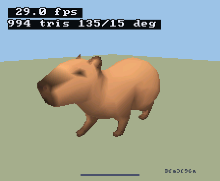
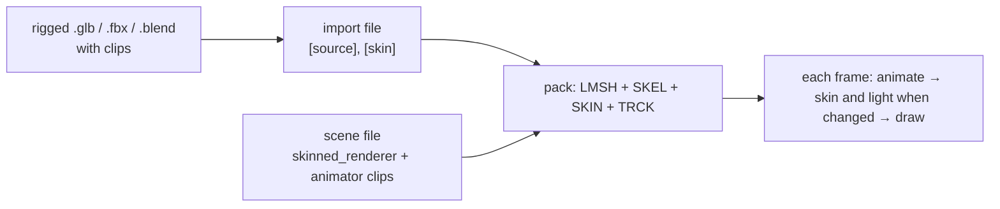

# Skinned Meshes

A skinned mesh is a rigged model whose vertices follow its joints. A scene
plays the model's clips, blends from one clip to the next, and skins and
lights the mesh in any frame its pose or lights change, before the draw. This page is the entry point:
how to bring a rigged model in, the options it takes, the calls an app makes,
and what it costs on the board. [Skeleton and skin entries](Skeleton-and-Skin.md)
is the pack format reference; [Skinned-Mesh Lighting](Skinned-Lighting.md)
holds the lighting measurements.





## 1. Import

A `.glb`, `.fbx` or `.blend` source with exactly one skinned mesh node bakes
its bind pose as the mesh. The pack build adds its skeleton (SKEL), its skin
(SKIN) and one clip (TRCK) for each name in the import's `source.clips` (a
`.blend` source only) or the scene's `animator.clips`. A `.glb` or `.fbx`
source names its clips in the scene file.

```toml
[source]
path = "subject.blend"
credit = "Who made it, and its licence."
clips = ["idle", "walk", "gallop"]

[output]
name = "subject"
position_scale = 16384

[skin]
lighting = "direct"
```

Colours are the material's unlit albedo, per vertex: the scene lights the
mesh at run time. The source's units, joint rules and model-space checks
are in [Matching and frames](Skeleton-and-Skin.md#matching-and-frames).

## 2. Skin options

| Option | Where | What it does | Default | Cost |
|---|---|---|---|---|
| Influences per vertex | [`build_pack.py --max-influences`](Skeleton-and-Skin.md#two-or-four-influences) | Keeps the heaviest 2 or 4 joint weights per vertex. | 2 | 4 runs the four-influence kernel; not measured on the board. |
| [`[skin].lighting`](../offline/Mesh-Import.md#skin-lighting) | import file | Selects the runtime lighting kernel: `direct`, `renormalised` or `table`. | `direct` | [Lighting modes](Skinned-Lighting.md#lighting-modes) compares cost and quality. |

Pick `direct` unless the darkening where joints blend shows; `renormalised`
removes it at a small cost; `table` costs the same at any light count: more
than `direct` up to the current `R3D_SKIN_LIGHT_MAX`, with the crossover
estimated near 10 lights, not yet measured.

## 3. In a scene

The scene file gives the object a `skinned_renderer` and an `animator`
([skinned_renderer and animator](../scene/Scene-Files.md#skinned_renderer-and-animator)):

```toml
[[objects]]
name = "subject"
[objects.skinned_renderer]
mesh = "subject.import.toml"
[objects.animator]
default_clip = "idle"
```

An app finds the entity once and plays clips by index; the last argument of
a play is the transition blend in milliseconds. `start` and `on_pick` are the
app's own functions:

<!-- generated: scene-animator-example check: python launcher/tools/gen/examples_doc.py --check -->
```c
/* Animator: find an entity at load and blend to a selected clip. */
#include "scene/scene.h"

#define BLEND_MS 250

static scene_t* scene;
static scene_entity_t subject;

static void
start(void) {
    scene = scene_load("meadow", NULL);
    subject = scene_find(scene, name_hash("subject"));
    scene_activate(scene, SCENE_CAMERA_FIRST);
}

static bool
on_pick(int clip) {
    return scene_animator_play(scene, subject, clip, BLEND_MS);
}
```
<!-- /generated: scene-animator-example -->

| Call | Does |
|---|---|
| `scene_animator_play(scene, entity, clip, blend_ms)` | Plays a clip, blending from the shown pose over `blend_ms` (0 cuts). |
| `scene_animator_clip_count()` / `_clip_name()` / `_clip_duration_ms()` | Lists the attached clips, for a picker. |
| `scene_animator_set_speed()` / `_set_paused()` / `_seek()` | Controls one playback slot. |
| `scene_animator_set_clips()` / `scene_renderer_set_skin()` | Attach clips or a skin by asset id at run time, when the scene file has no rows for them. |
| `scene_light_set_color()` / `_set_intensity()` | Attach or change a directional light; runtime lights shade skinned renderers only; mesh renderers keep their bake. |

## 4. Budget

<!-- generated: skinning-budget check: python launcher/main/apps/render_lab/tools/report_performance.py docs/render/data/skinning-board.txt docs/render/animation/Skinned-Meshes.md --check -->
The skin stage's budget is 1 µs per vertex. The board capture
measures the animated subject playing: 800 vertices, 22 joints,
2 influences, direct lighting, 1 light.

| Stage, per frame | One core | Two cores |
|---|---:|---:|
| Animate: sample, blend, palette | 286 µs (0.357 µs / vertex) | 306 µs (0.383 µs / vertex) |
| Skin and light | 2149 µs (2.686 µs / vertex) | 1284 µs (1.605 µs / vertex) |

| As a frame runs it (worker use not recorded) | Per frame |
|---|---:|
| Whole animation step | 1630 µs (2.038 µs / vertex) |
| Scene render, playing minus paused | +2333 µs (9830 vs 7497 µs) |

Skin and light: above budget on both cores (budget 1 µs / vertex).

| Internal RAM | Free / largest block, bytes |
|---|---:|
| Before the scene loads | 100467 / 47104 |
| Scene loaded | 87447 / 47104 |
| Scene playing | 87447 / 47104 |

Build `ea49f9a0eaf7-diag`; 5 runs, 100 samples per stage,
800 vertices. Values are medians of each run's last measurement.

To repeat: `autana suite run_capybara_perf_suite --flash --perf-scope`.
<!-- /generated: skinning-budget -->

## 5. Current limits

- Loop or clamp is set per animator in the scene file, not per clip.
- A skin whose colours are per face (no vertex colours) cannot be lit.
- A skinned mesh in a baked scene gets the direct lights and ambient, not
  the scene's baked indirect light.
- Influences per vertex are set per pack build, not per rig.

The frame perf harness holds the display quarter, so gravity cannot change
a test frame's orientation. Timed render and frame windows run separately
in forced portrait and landscape, paused and playing; their rows carry
`quarter=portrait` or `quarter=landscape`. Skin, animate and animation-step
windows have no quarter because they do not render. The report keeps
each render quarter separate. The skin budget comes from
`SKIN_PERF_BUDGET_NS_PER_VERTEX`.
