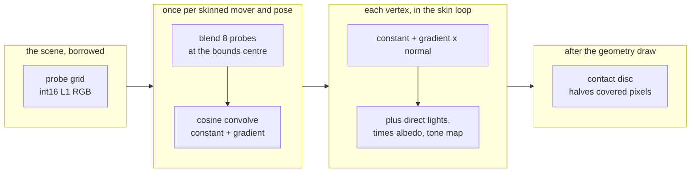
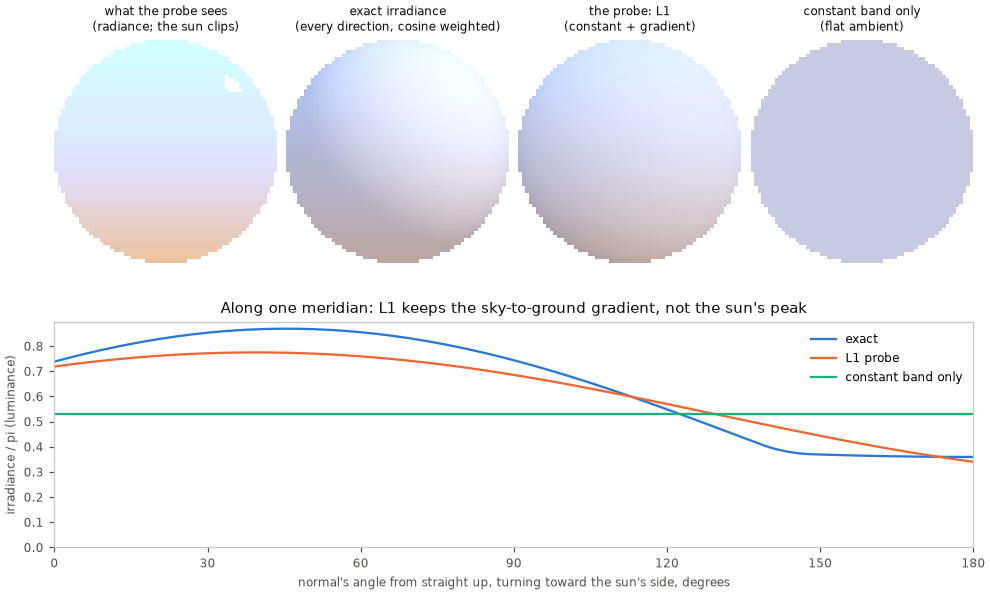
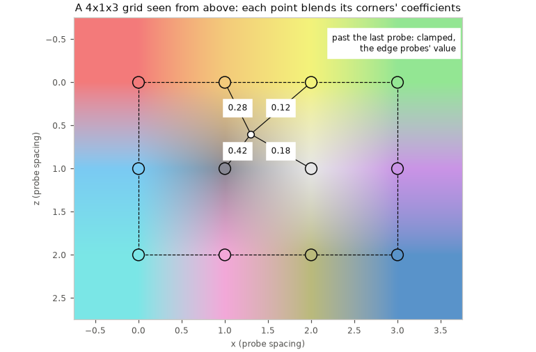
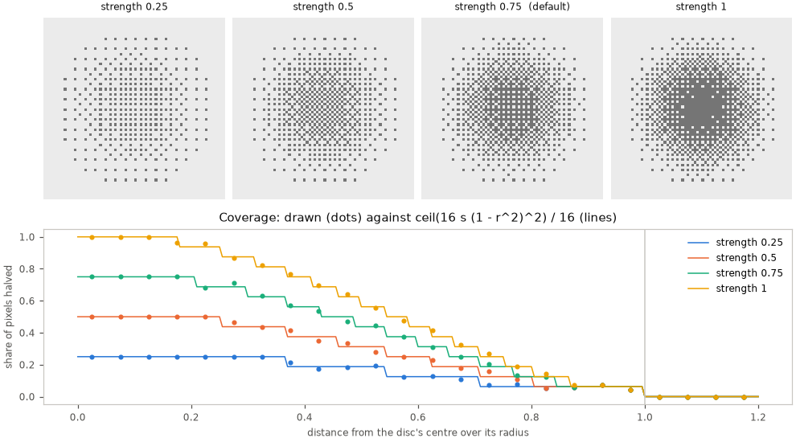

# Ambient Irradiance

Ambient irradiance is the light a surface gets from everything except the
scene's direct lights: sky, bounce and fill. Static meshes carry it already,
baked into their vertex colours ([Bake-Method](../offline/Bake-Method.md)).
A skinned mesh moves, so it reads its ambient at run time from a grid of
spherical-harmonics (SH) probes.



| Step | What happens | Owner |
|---|---|---|
| [1. The grid](#1-the-grid) | the scene hands the runtime a probe grid | `scene_set_probes()` |
| [2. What a probe stores](#2-what-a-probe-stores) | four RGB L1 coefficients, 24 bytes | `sh_probes_t`, `sh1_rgb_t` |
| [3. Finding and blending probes](#3-finding-and-blending-probes) | trilinear blend of the 8 surrounding probes | `sh_probes_sample()` |
| [4. From SH to shading](#4-from-sh-to-shading) | convolve once per mover, evaluate per vertex | `r3d_skin_light_ambient_sh()`, `sh1_irradiance_eval()` |
| [5. The contact disc](#5-the-contact-disc) | a dithered dark disc on the ground under the mover | `contact_blob_draw()` |
| [6. Cost and goals](#6-cost-and-goals) | the stress presets' board goals | `suite_stress_perf.c` |
| [7. Limits](#7-limits) | what the technique does not do | |

The technique is the irradiance volume<sup>[[132]](../../Citations.md#greger-1998)</sup>
(a grid of irradiance samples blended trilinearly), stored as first-order SH
and convolved the way Ramamoorthi and Hanrahan describe<sup>[[128]](../../Citations.md#ramamoorthi-hanrahan-2001)</sup>.

## 1. The grid

A scene takes a grid with `scene_set_probes(root, &grid)`, where `root` is
the entity its pack loaded as. It keeps a pointer, not a copy, so the grid
must outlive the scene. `NULL` returns the scene to its flat ambient colour.
Every lit skinned renderer under that root samples the same grid.

A grid also turns skin lighting on for a scene with no direct lights. No
bake writes a grid yet: its positions, spacing and contents are its owner's
choice, filled as in the [example](#a-grid-in-code) below.

| Field of `sh_probes_t` | Meaning |
|---|---|
| `origin` | world position of probe (0, 0, 0) |
| `spacing` | world distance between neighbours, per axis |
| `dims` | probes per axis, each at least 1; a 1 axis ignores its spacing |
| `scale` | world radiance per int16 step |
| `coefficients` | `dims` x by y by z probes, x fastest, then y, then z |

Positions and SH directions are world axes, +y up.

## 2. What a probe stores



A probe holds the radiance arriving at its point, projected onto the real SH
basis up to order 1: one constant band and three linear ones, each RGB.
That is 4 × 3 int16 values, 24 bytes a probe.<sup>[[129]](../../Citations.md#sloan-2008)</sup>

| Index | Basis | Function | Stored as |
|---:|---|---|---|
| 0 | $`Y_{0,0}`$ | $`0.282095`$ | R, G, B |
| 1 | $`Y_{1,-1}`$ | $`0.488603\,y`$ | R, G, B |
| 2 | $`Y_{1,0}`$ | $`0.488603\,z`$ | R, G, B |
| 3 | $`Y_{1,1}`$ | $`0.488603\,x`$ | R, G, B |

Coefficient $`L_i = \int L(\omega)\,Y_i(\omega)\,d\omega`$, stored raw:
the basis constants are applied at projection, not divided out. Over $`N`$
even directions, `sh1_rgb_add_direction()` adds each radiance times its
solid angle $`4\pi/N`$. The figure's probe is that sum, over a few thousand
directions of a sky with a sun.

L1 keeps the sky's top-to-bottom gradient and loses the sun's peak (the
meridian below the spheres). Each value is stored as `round(L / scale)`, so
pick `scale` as the grid's largest $`|L_i|`$ over 32767.

### A grid in code

```c fragment
static int16_t coefficients[2 * 2 * 2][SH_PROBES_COMPONENTS];
static const sh_probes_t grid = {.origin = {-10.0F, 0.0F, -10.0F}, .spacing = {20.0F, 4.0F, 20.0F},
                                 .dims = {2, 2, 2}, .scale = 1.0F / 1024.0F, .coefficients = coefficients};

/* Per probe p: project what it sees, then store each band's channels. */
sh1_rgb_t radiance = {0};
for (int i = 0; i < count; i++) {
    sh1_rgb_add_direction(&radiance, direction[i], vec3f_scale(seen[i], 4.0F * MATH_PI / count));
}
for (int c = 0; c < SH1_COEFFICIENTS; c++) {
    coefficients[p][c * SH1_CHANNELS + 0] = (int16_t)lroundf(radiance.c[c].x / grid.scale);
    coefficients[p][c * SH1_CHANNELS + 1] = (int16_t)lroundf(radiance.c[c].y / grid.scale);
    coefficients[p][c * SH1_CHANNELS + 2] = (int16_t)lroundf(radiance.c[c].z / grid.scale);
}

scene_set_probes(root, &grid);
```

## 3. Finding and blending probes



A point's grid coordinate is `(world - origin) / spacing` per axis, clamped
to the grid. Its integer part picks the lower corner, its fraction the
weight. The 8 surrounding probes' coefficients blend trilinearly into one
`sh1_rgb_t`; a 1-probe axis takes its one probe.

Past the last probe the coordinate clamps, so the edge probes' value carries
on (the figure's margin). Blending coefficients, then convolving, equals
convolving each probe and blending the results, since both steps are linear.

The scene samples at the centre of each skinned renderer's last resolved
world bounds, once per pose for each range of clusters a core skins. The
whole mover gets one ambient.

## 4. From SH to shading

Convolving L1 radiance with the clamped cosine gives irradiance that is
linear in the normal $`n`$:<sup>[[128]](../../Citations.md#ramamoorthi-hanrahan-2001)</sup>

```math
\frac{E(n)}{\pi} = \underbrace{\frac{A_0 Y_{0,0}}{\pi} L_0}_{\text{constant}} + \underbrace{\frac{A_1 Y_1}{\pi}\begin{bmatrix} L_3 & L_1 & L_2 \end{bmatrix}}_{\text{gradient}}\, n, \qquad A_0 = \pi,\ A_1 = \tfrac{2\pi}{3}
```

The bands are reordered to x, y, z ($`L_3, L_1, L_2`$) so the gradient
multiplies the normal directly. `sh1_rgb_irradiance()` builds the constant
and that 3×3 gradient (a row per channel); `r3d_skin_light_ambient_sh()` divides by $`\pi`$ to match the direct
lights, which are irradiance over $`\pi`$ too. That runs once per mover and
lives on the skin job's stack.

Per vertex, `sh1_irradiance_eval()` is 9 multiply-adds. The sum then goes
through the same albedo, tone map and gamma as the direct lights
([Skinned-Lighting](../animation/Skinned-Lighting.md)). How it joins them
depends on the renderer's lighting mode:

| Mode | Ambient per vertex |
|---|---|
| direct | constant + gradient × the blended normal, then the direct lights added |
| renormalised | the same on the normal scaled back to unit length |
| table | the shared table already holds the flat ambient; add (probe constant − flat ambient) + gradient × the unit normal, so moving between probes never rebuilds the table; a zero normal takes the constant alone |

Static meshes do not read the grid: their baked colours already hold the
scene's sky and bounce light.

## 5. The contact disc



Probes do not see the mover, so nothing darkens the ground under it. A
contact disc stands in: `scene_set_contact_blob(renderer, ground_y, strength)`
puts a disc on the plane `y = ground_y`, under the centre of the renderer's
world bounds, with a radius of the bounds' smaller horizontal half extent.
A strength of 0 turns it off.

It draws after the geometry, against its depth, so walls in front hide it.
A pixel at distance $`r`$ (over the radius) is halved in each RGB565 channel
when its 4×4 Bayer threshold $`t`$ passes $`t/16 < s\,(1 - r^2)^2`$, with
$`s`$ the strength: coverage falls smoothly to zero at the rim.
`SCENE_CONTACT_BLOB_STRENGTH_DEFAULT` is 0.75.

Rows are bounded by the disc's projected outline, clipped at the near
plane, and the coverage test needs no per-pixel divide. Partial redraw
covers the disc's old and new bounds with the renderer's.

## 6. Cost and goals

The board goals of the two stress presets that run this code, in
microseconds per frame, held by `suite_stress_perf.c`. Each is the worst of
several board captures plus 1%. Quarter is the panel's orientation; each
stage is a [frame-cost](../../tools/Frame-Cost.md) bracket.

<!-- generated: ambient-cost check: python launcher/main/apps/render_lab/tools/stress_doc_table.py docs/render/frame/Ambient-Irradiance.md ambient-cost stress-skinned-sh-blobs stress-contact-blobs --check -->
| Preset | Quarter | `r3d.cull` | `r3d.transform` | `r3d.draw` | `r3d.upscale` | `frame.record` | `anim.pose` | `anim.light` | `anim.skin` | Sum goal | Ceiling |
|---|---|---:|---:|---:|---:|---:|---:|---:|---:|---:|---:|
| `stress-skinned-sh-blobs` | portrait | 330 | 1250 | 7060 | 2130 | 10 | 1550 | 240 | 2930 | 15340 | 17650 |
| `stress-skinned-sh-blobs` | landscape | 320 | 1250 | 7790 | 2180 | 10 | 1540 | 240 | 2920 | 16080 | 18500 |
| `stress-contact-blobs` | portrait | 190 | 720 | 4160 | 2180 | 10 | — | — | — | 7190 | 8270 |
| `stress-contact-blobs` | landscape | 200 | 700 | 7320 | 2210 | 10 | — | — | — | 10320 | 11870 |
<!-- /generated: ambient-cost -->

| Where the work lands | Stage |
|---|---|
| probe sample, convolution and the per-vertex evaluation | `anim.skin`, inside the fused skin-and-light loop |
| the contact discs | `r3d.draw`, as the raster's post draw |

Neither is timed apart from its stage, so the cost of probe ambient over
flat ambient, per vertex, and of one disc are not measured. A probe-ambient
kernel in the skin-light benchmark would measure the first.

Memory is the grid itself, 24 bytes a probe, wherever its owner keeps it;
the scene stores one pointer.

## 7. Limits

- No tool bakes a grid, and no shipped scene has one; a grid comes from the
  code that sets it.
- Static meshes take no probe light.
- One sample per mover: a mover half in shadow is lit as one.
- L1 holds a gradient only; a small bright source such as the sun blurs
  into it.
- A probe inside a wall reads the wall's inside; the runtime does not check
  where probes are.
- The sample uses the bounds from the mover's last pose, so its light trails
  a fast move by a pose.
- The disc lies on one flat plane at the height its caller gives, is round
  whatever the mover's shape and ignores the light's direction.
- A coefficient over 32767 × `scale` does not fit; the grid's owner picks
  `scale`.

## Figures

[`ambient_figures.py`](../../../launcher/tools/r3d/ambient/ambient_figures.py)
draws the three plots from
[`ambient_figures_probe.c`](../../../launcher/tools/r3d/ambient/ambient_figures_probe.c),
which calls the runtime's SH, grid and disc code. The picture in step 1 is
the stress preset's host render.
