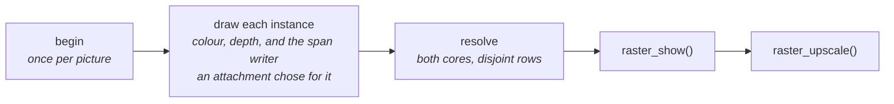

# Depth and Attachments

What a draw writes per pixel besides colour: the depth buffer every draw
tests, and the attachments a view asks for.

## Depth

The depth buffer holds 16-bit inverse depth: a point at view depth $`z`$
stores $`\mathrm{R3D\_DEPTH\_NEAREST}\cdot d_{near}/z`$, larger when nearer.
Inverse depth interpolates linearly across the screen, so a span steps it
with one add per pixel.

Two surfaces a gap $`h`$ apart, seen from height $`H`$ above them at view
depth $`z`$, are this many steps apart:

```math
N = \mathrm{R3D\_DEPTH\_NEAREST}\cdot\frac{d_{near}\,h}{H\,z}
```

Below one step they tie, and which one shows flips as the camera moves.

$`d_{near}`$ is fitted each frame, apart from the clip plane:

| Step | Owner | What it does |
|---|---|---|
| Cull every instance | `raster_draw()`, `raster_census()` | all lists first, so every instance draws with one scale |
| Bound each kept cluster | `r3d_pipeline_cull()` | the least view depth of its box inside each frustum plane it crosses, the best of them (`box3f_plane_distance_min_inside()`) |
| Fit | `raster.c` | the least bound, `inverse_depth_scale_fit()`: down to a power of two, never under `near_z` |
| Draw | `r3d_lens_set_depth_near()` | each instance's lens encodes with it; the clip plane stays `near_z` |
| Decode | `raster_depth_near()` | the scale the picture was drawn with, for readers such as motion vectors |

The bound looks only at the part of a box the frustum keeps. A cluster as
large as a ground square reaching behind the eye still bounds the nearest
ground the picture can see.

The scale is stored beside the census list, so a draw at another render
size encodes with the census's. Snapping to a power of two keeps it still
while the bound drifts, so ties do not flip from frame to frame.

Looking down from 26 m, the nearest roof is metres away while `near_z` is
6 cm. The fitted scale gives the street about a hundred times the steps. Below,
the same six frames have depth scaled by `near_z` (top) and by the fit
(bottom). On top, a ground square 2 to 7 cm under the street shows through
as dashes that come and go.


`render.depth_fit = 0` encodes with `near_z`, for comparisons.

## Attachments

A raster's picture is a render target
([gfx/Targets-and-Modes.md](../../gfx/Targets-and-Modes.md#render-targets)):
colour and depth, then any further attachment the caller lists in
`raster_t.attachments`.

- An attachment with pixels is carved from the scratch block at the drawn
  size, so a picture drawn at a new size carves anew, and none keeps pixels
  from one picture to the next.
- A view with `format == 0` reserves no scratch pixels.
- One whose `clear` hook is NULL is not cleared. Depth and tiles have NULL
  clear hooks and use only colour and depth in their `show` hooks.



| Hook | When | What it may do |
|---|---|---|
| `clear` | the first instance of a picture, on its rows | start its pixels; the only hook colour and depth have |
| `begin` | once per `raster_draw()`, before anything is drawn | read the `const render_view_t*` and the instances, keep its own state |
| `writer` | once per instance | return a span writer, or none. The fill calls every writer after each span's colour and depth, with the span's depth, so each writes where that triangle won. With none, the fill runs exactly as without attachments, and the writers' code sits apart from it |
| `drawn` | once each instance is drawn | read the lens, the kept clusters and their transformed vertices |
| `resolve` | once every instance is drawn | turn what was written into the final map |
| `show` | `raster_show()` | paint the colour from it |

A writer finds the pixels its triangle won by their depth equalling the
triangle's, so where two instances meet at exactly the same depth the pixel
takes the later one's write.

A writer sees depth and one value per instance, or its base plus the mesh
cluster or triangle index, as its `r3d_span_writer_t.step` says. A map that needs
more, such as normals, rebuilds it from depth in its `resolve`.

### Motion vectors

`raster_motion.h`: for each pixel, the previous position of the point it
shows minus this one, two signed bytes in half pixels of this picture.

`RASTER_MOTION_UNKNOWN` marks a pixel nothing drew, the first picture, a
point behind the previous camera, and motion past the range.

The motion view along a flythrough, red for x and green for y:


An instance is known by its placement's address. One whose placement
changed since the previous picture gets its own map, carrying the point to
where the mesh was.

A raster with motion attached draws at most `RASTER_MOTION_INSTANCES_MAX`
instances.

| Hook | Motion |
|---|---|
| `begin` | Builds this picture's lens and the previous camera's lens at this picture's size, so a size change between pictures needs nothing special |
| `writer` | From the first instance that moved on, every triangle writes its instance's tag, 0 for anything still; before it, pixels keep the 0 they were cleared to. On a picture where nothing moved, nothing is written while drawing |
| `resolve` | Takes each pixel back to the world through its depth, through the map its tag picks, and projects it through the previous lens |

The caller owns a zeroed `raster_motion_t`, attaches `raster_motion_view()`,
and calls `raster_motion_forget()` after a cut. The render context attaches
it while the motion view is selected.

### Meshlet IDs

`raster_meshlets_view()` keeps a 16-bit map, its IDs distinct per draw for
up to 65535 clusters.

| Hook | Meshlets |
|---|---|
| `clear` | Zeroes the map |
| `begin` | Resets its next ID to one before each draw |
| `writer` | Reserves each instance's cluster count and writes the reserved base plus the mesh's cluster index |
| `resolve` | None: it needs no resolve pass |
| `show` | Maps IDs to hues through a multiplicative hash; zero takes the clear colour |

The meshlets view along the same flythrough, one hue per cluster:


