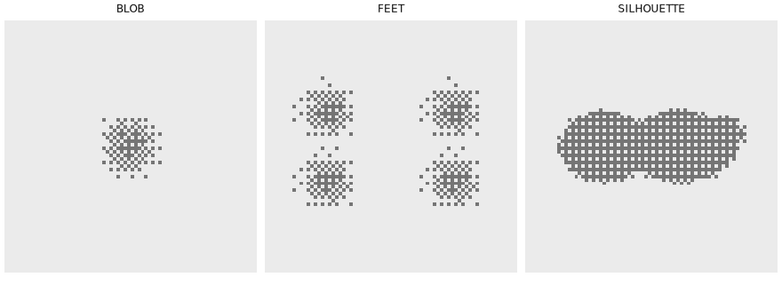
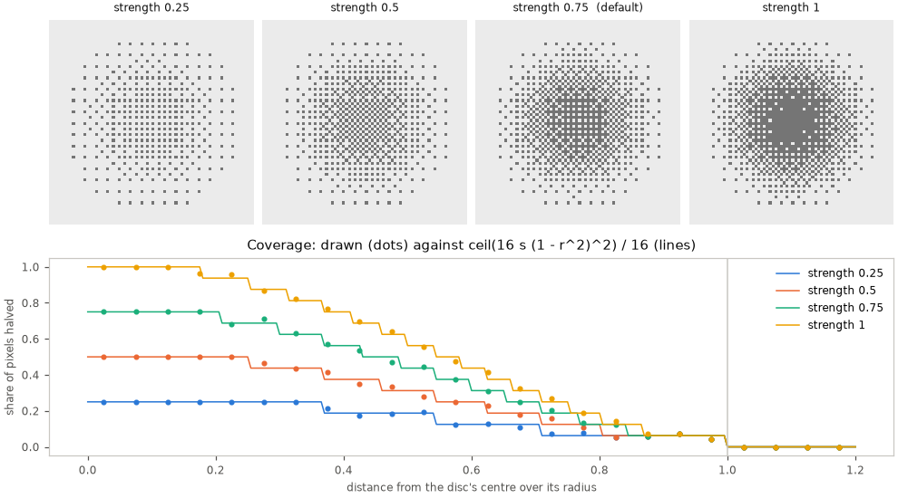
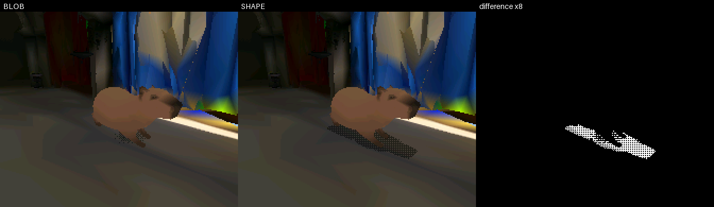
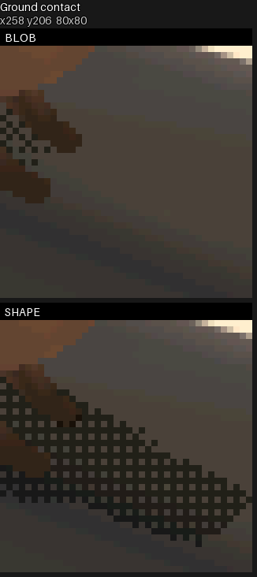
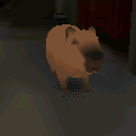

# Contact Shadows

Skinned movers can darken the ground with a contact shadow. The footprint
lies on a flat plane and draws after geometry, against its depth. Covered
pixels have each RGB565 channel halved.

## Choose a shape

Call [`scene_set_contact(renderer, &contact)`](../../../launcher/main/scene/scene.h)
with a `scene_contact_t` giving a shape, ground height, strength and optional warp.
Zero strength disables the shadow. `SCENE_CONTACT_BLOB_STRENGTH_DEFAULT` is 0.75.

| Shape | Footprint | Preparation |
|---|---|---|
| `SCENE_CONTACT_BLOB` | Disc at the world bounds centre, with the smaller horizontal half extent as radius. | Computes one ellipse from the bounds at fill. |
| `SCENE_CONTACT_FEET` | Discs at posed contact joints. No footprint without usable contacts. | Selects bind-space leaf joints when the skin activates or the contact setting changes. |
| `SCENE_CONTACT_SILHOUETTE` | Union of posed joint ellipses over the world bounds' horizontal rectangle. Falls back to BLOB without skin or mask storage. | Fits bind ellipsoids on first use and refreshes their projection as the pose or world transform changes. |

### BLOB

At distance $`r`$ in units of the radius, a pixel darkens when its 4×4 Bayer
threshold $`t`$ passes $`t/16 < s\,(1 - r^2)^2`$, where $`s`$ is strength.
Coverage falls to zero at the rim.

### FEET

Contacts are leaf joints within `CONTACT_JOINT_BAND` times rig height of
the lowest leaf. The rig uses a common radius of `CONTACT_RADIUS_FRACTION`
times the nearest positive horizontal contact spacing.

With one contact or coincident contacts, rig height supplies the spacing.
The radius scales with the largest horizontal scale magnitude. Joint height
does not change the disc strength or radius, and overlaps darken once.

### SILHOUETTE

Each proxy ellipsoid uses skin-weighted vertex means and radii of
`CONTACT_MASK_SPREAD` standard deviations in bind space. The skin palette
and world transform project the ellipsoids into a ground mask.

`CONTACT_MASK_SIDE` sets the mask width and height, `CONTACT_MASK_BYTES` its
storage, and `CONTACT_MASK_CELL_HALF` the sampling offset and minimum
spread. The cells soften the edge without blur or height fade.

Each active silhouette renderer also retains one `contact_joint_t` per
joint in `MEMORY_FAST`. The skin releases both allocations with its other
buffers. Raster work follows the footprint, and mask refresh follows joints
and covered cells.

The mask represents bulk contact. Thin details and articulated gaps can
differ from the mesh silhouette.

## Light warp

Warp defaults off. Enable `scene_contact_t.warp` to shift and stretch the
footprint away from the light on the ground plane, following Blinn's
planar projection.[[146]](../../Citations.md#blinn-1988)

| Shape | Warp off | Warp on |
|---|---|---|
| BLOB |  |  |
| FEET |  |  |
| SILHOUETTE |  |  |

The offset is $`r\sqrt{1-e^2}/e`$ and the stretch is $`1/e`$.
Here $`r`$ is the smaller horizontal half extent or the foot radius, and
$`e`$ is the vertical component of the light direction clamped to
`CONTACT_LIGHT_ELEVATION_MIN`. An overhead light leaves the footprint centred.

The brightest positive-luminance directional light in the first drawn
scene with one supplies the direction. Otherwise the mover's sampled SH L1
gradient supplies it. An absent or isotropic field uses straight up.

## Drawing and redraw bounds

Radial footprints use a homogeneous ellipse test without a per-pixel divide.
SILHOUETTE maps each ground intersection to a mask byte with one reciprocal.
The raster visits rows inside the near-clipped projected footprint.

Fill resolves the footprint bounds and the warp light. Partial redraw
covers both the previous and current bounds, including light-direction changes.

## Cost and goals

Contact coverage runs inside `r3d.draw`. The goals are per frame in
microseconds, with rows for both panel orientations. Stages are
[frame-cost](../../tools/Frame-Cost.md) brackets.

Stress preset goals

<!-- generated: contact-cost check: python launcher/main/apps/render_lab/tools/stress_doc_table.py docs/render/frame/Contact-Shadows.md contact-cost stress-contact-blobs stress-skinned-feet-blobs stress-skinned-blob-warped stress-skinned-silhouette-blobs stress-skinned-silhouette-warped --check -->
| Preset | Quarter | `r3d.cull` | `r3d.transform` | `r3d.draw` | `r3d.upscale` | `frame.record` | `anim.pose` | `anim.light` | `anim.skin` | Sum goal | Ceiling |
|---|---|---:|---:|---:|---:|---:|---:|---:|---:|---:|---:|
| `stress-skinned-blob-warped` | portrait | 310 | 1230 | 7220 | 2030 | 10 | 1550 | 250 | 2900 | 15400 | 17710 |
| `stress-skinned-blob-warped` | landscape | 310 | 1210 | 8080 | 2140 | 10 | 1540 | 250 | 2920 | 16370 | 18830 |
| `stress-contact-blobs` | portrait | 190 | 720 | 4160 | 2180 | 10 | — | — | — | 7190 | 8270 |
| `stress-contact-blobs` | landscape | 200 | 700 | 7320 | 2210 | 10 | — | — | — | 10320 | 11870 |
| `stress-skinned-feet-blobs` | portrait | 320 | 1240 | 7680 | 2020 | 10 | 1540 | 250 | 2880 | 15810 | 18190 |
| `stress-skinned-feet-blobs` | landscape | 310 | 1230 | 8940 | 2110 | 10 | 1530 | 250 | 2900 | 17160 | 19740 |
| `stress-skinned-silhouette-warped` | portrait | 310 | 1230 | 8250 | 2090 | 10 | 1560 | 250 | 2900 | 16480 | 18960 |
| `stress-skinned-silhouette-warped` | landscape | 310 | 1240 | 9170 | 2150 | 10 | 1550 | 260 | 2900 | 17490 | 20120 |
| `stress-skinned-silhouette-blobs` | portrait | 310 | 1240 | 7670 | 2100 | 10 | 1550 | 250 | 2910 | 15900 | 18290 |
| `stress-skinned-silhouette-blobs` | landscape | 320 | 1230 | 8460 | 2170 | 10 | 1550 | 260 | 2890 | 16810 | 19340 |
<!-- /generated: contact-cost -->

## Figures

[`contact_figures.py`](../../../launcher/tools/r3d/contact/contact_figures.py)
renders the coverage figures with the
[host probe](../../../launcher/tools/r3d/contact/contact_figures_probe.c).
The [host render harness](../../tools/Render-Harness.md) captures the scene
comparison and warp clips.
