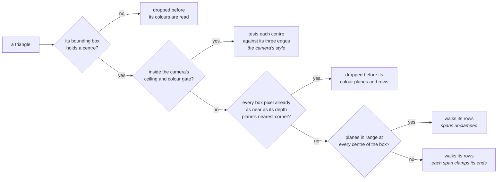

# Coverage and Small Triangles

A pixel belongs to a triangle when its centre is inside by the top-left
rule, decided in integers on positions snapped to 1/16 pixel. Two triangles
sharing an edge therefore never both fill a pixel, nor both miss one, in any
window of rows.

`r3d_pipeline_transform()` snaps each vertex once, into an 8-byte
`r3d_pipeline_vertex_t`. Every position the rasterizer takes is within 1024
pixels of the origin, which keeps its edge arithmetic in 32 bits:

- A triangle with a corner behind the near plane or farther off screen is
  rebuilt from the mesh and clipped to a guard band inside that reach.
- The fast path stops short of the guard band, so a clip never cuts an edge
  that a fast triangle shares.

A detailed mesh drawn small has many triangles covering a few pixel centres
or none, so the draw routes each by the centres its bounding box holds:



| Step | Why |
|---|---|
| Per-centre test | Skips the walk's setup but loses the triangle's gradient; [Small fill](#small-fill) controls that cost and look trade-off |
| Walk | Each edge's column is found exactly by an integer step |
| Depth plane | A triangle to be walked works it out first; a hidden one could write nothing. The test pays because clusters are drawn roughly nearest first, so a triangle behind is usually drawn after what hides it |
| Clamps | A centre just outside a triangle extrapolates its planes past the vertex range. Most kept triangles stay in range, where the clamps would change nothing |

Both fill paths apply the same rule to the same integers, so a small
triangle and a walked one sharing an edge still meet without a gap or an
overlap.

`suite_r3d_lit.c` holds every triangle to a reference implementation of the
rule, and a mesh of mixed sizes to one fill per pixel.

## Small fill

Eligible triangles skip plane setup and use one depth, with colour from the
camera's style.

The camera owns the bounding-box ceiling, colour gate and
style; `render_view_t.small_fill` carries them to the frame's row workers.

| Preset | Ceiling/gate, style | Use |
|---|---|---|
| `SMALL_FILL_SMOOTH` | 4/0 FLAT | Cameras start with it; it preserves the smooth rendering checksum |
| `SMALL_FILL_FAST` | 12/16 FLAT | Apps opt in for the measured frame-cost gains |
| `SMALL_FILL_FAST_DITHER` | 12/16 DITHER | FAST's ceiling and gate with the DITHER style |
| `SMALL_FILL_FAST_GRAIN` | 12/16 GRAIN | FAST's ceiling and gate with the GRAIN style |

<!-- generated: small-fill-levers sha256=46ed813c7858d86cdd5da15850ac97079edbfa75daf563de4d3405d5a429d84d -->
| Camera field | Range | Default | Effect |
|---|---|---|---|
| `ceiling` | 0..16 | 4 | Largest bounding-box side in pixel centres; 0 disables small fill |
| `gate` | 0..255 | 0 | Vertex RGB565 spread limit at the ceiling; 0 disables the colour gate |
| `style` | 0..2 | 0 | FLAT (0), GRAIN (1), DITHER (2) |
<!-- /generated: small-fill-levers -->

The presets are defined in `render_view.h`. Opt in with the
[scene camera API](../scene/Scene-Manager.md#what-an-app-calls), or pass custom `small_fill_t` values:

<!-- generated: scene-small-fill-example check: python launcher/tools/gen/examples_doc.py --check -->
```c
/* Small fill: choose the fast policy for a scene camera. */
#include "scene/scene.h"

static bool
small_fill_example(scene_t* scene, scene_entity_t camera) {
    return scene_camera_set_small_fill(scene, camera, SMALL_FILL_FAST);
}
```
<!-- /generated: scene-small-fill-example -->

The gate:

- One limit applies to all packed RGB565 per-channel spreads: green's six
  bits get half the relative tolerance of red and blue.
- Above `R3D_SPAN_SMALL_MAX_SIDE`, the limit tightens from
  `SMALL_SPREAD_OFF` to `gate` at the ceiling. If only one side is eligible,
  it uses `gate` directly.
- Face colours and sides through `R3D_SPAN_SMALL_MAX_SIDE` bypass the gate
  and use FLAT.

| Style | What it writes |
|---|---|
| FLAT | The averaged colour |
| DITHER | Screen-anchored ordered picks of the vertex colours |
| GRAIN | Flat and one shade alternating in a screen-anchored checker, moving R/B by one step and G by two in the same direction |

GRAIN splits the colour range: a colour in its dark half gets the lighter
shade, one in its bright half the darker. On overflow it tries the other
direction; if neither fits it uses flat. Channels never clamp independently.

<table>
<tr><th>Look</th><th>Picture</th><th>Amplified difference from SMOOTH</th></tr>
<tr><td>SMOOTH (4/0 FLAT)</td><td></td><td></td></tr>
<tr><td>FAST (12/16 FLAT)</td><td></td><td></td></tr>
<tr><td>12/16 GRAIN</td><td></td><td></td></tr>
<tr><td>12/16 DITHER</td><td></td><td></td></tr>
</table>

Clips show the same full renderer frames and camera window, one look per GIF.
The [temporal method](../../tools/Render-Harness.md#temporal-video-columns)
measures triangle-scale pops; the difference clips also show spatial noise.

<!-- generated: small-fill-temporal sha256=348854d83f0b4c0a5dc518fade64b76bc25fe53a467917f162e3356f235f3b5c -->
| Look vs SMOOTH | Extra frame-to-frame change (levels of 255) | Blocks popping (>8/255) |
|---|---|---|
| SMOOTH (4/0 FLAT) | 0.000 | 0.0000% |
| FAST (12/16 FLAT) | 0.809 | 1.7679% |
| 12/16 GRAIN | 0.909 | 1.9629% |
| 12/16 DITHER | 1.048 | 3.0372% |
<!-- /generated: small-fill-temporal -->

### Board frame-cost gains when opted in

Two committed sweeps time the fitted-full mesh frame and the animated
skinned render. Times are seed means in
landscape, and each sweep's percentages compare with its first row.

| Sweep | Measures | Its plan records |
|---|---|---|
| [Ceiling by gate](../data/small-fill/ceiling-gate-sweep.json) | FLAT | [Build IDs, captures and layout seeds](../data/small-fill/ceiling-gate-plan.json) |
| [Camera style](../data/small-fill/styles-sweep.json) | The styles against the baseline on the same build | [Both orientations](../data/small-fill/styles-plan.json); the tables show landscape |

<!-- generated: small-fill-board sha256=24330a668e20cf85bd5c6648faf10a09567b57eee4a1cdef496be94247e38184 -->
<details><summary>Ceiling by gate, FLAT, rows in the sweep's point order</summary>

| Ceiling | Gate | Style | Mesh frame ms | vs first row | Skinned render ms | vs first row |
|---|---|---|---|---|---|---|
| 4 | 0 | FLAT | 41.103 | +0.00% | 8.743 | +0.00% |
| 4 | 8 | FLAT | 41.114 | +0.03% | 8.745 | +0.02% |
| 4 | 16 | FLAT | 41.108 | +0.01% | 8.742 | -0.01% |
| 4 | 24 | FLAT | 41.109 | +0.01% | 8.739 | -0.05% |
| 12 | 0 | FLAT | 36.356 | -11.55% | 8.014 | -8.34% |
| 12 | 8 | FLAT | 37.569 | -8.60% | 8.136 | -6.95% |
| 12 | 16 | FLAT | 37.355 | -9.12% | 8.115 | -7.19% |
| 12 | 24 | FLAT | 37.261 | -9.35% | 8.113 | -7.21% |
| 14 | 0 | FLAT | 35.556 | -13.50% | 7.914 | -9.48% |
| 14 | 8 | FLAT | 36.866 | -10.31% | 8.034 | -8.10% |
| 14 | 16 | FLAT | 36.711 | -10.69% | 8.024 | -8.22% |
| 14 | 24 | FLAT | 36.610 | -10.93% | 8.017 | -8.30% |
| 16 | 0 | FLAT | 35.043 | -14.74% | 7.856 | -10.14% |
| 16 | 8 | FLAT | 36.457 | -11.30% | 7.960 | -8.96% |
| 16 | 16 | FLAT | 36.285 | -11.72% | 7.965 | -8.90% |
| 16 | 24 | FLAT | 36.159 | -12.03% | 7.961 | -8.95% |

</details>

<details><summary>Camera style, rows in the sweep's point order</summary>

| Ceiling | Gate | Style | Mesh frame ms | vs first row | Skinned render ms | vs first row |
|---|---|---|---|---|---|---|
| 4 | 16 | FLAT | 40.113 | +0.00% | 8.577 | +0.00% |
| 4 | 16 | GRAIN | 40.116 | +0.01% | 8.579 | +0.01% |
| 4 | 16 | DITHER | 40.119 | +0.02% | 8.575 | -0.02% |
| 12 | 16 | FLAT | 36.972 | -7.83% | 8.038 | -6.29% |
| 12 | 16 | GRAIN | 38.649 | -3.65% | 8.294 | -3.30% |
| 12 | 16 | DITHER | 38.985 | -2.81% | 8.351 | -2.63% |

</details>
<!-- /generated: small-fill-board -->
