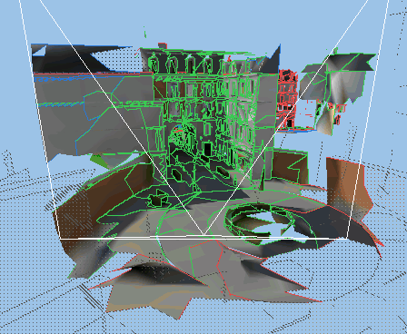
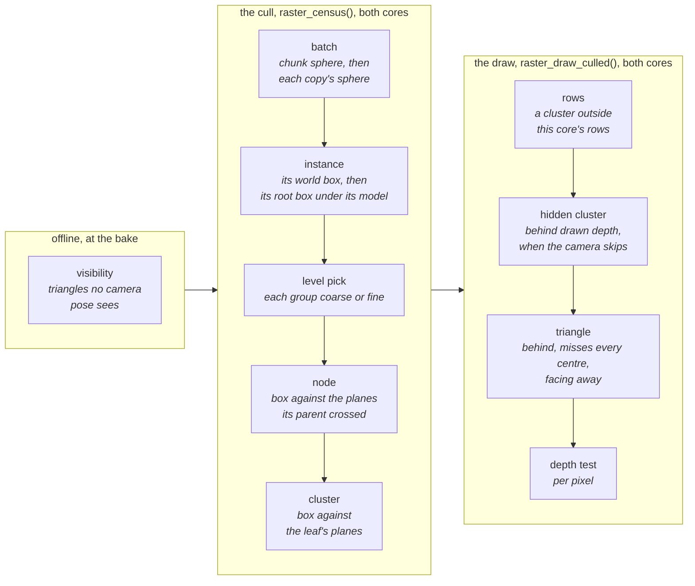
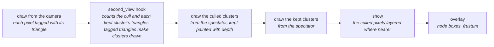
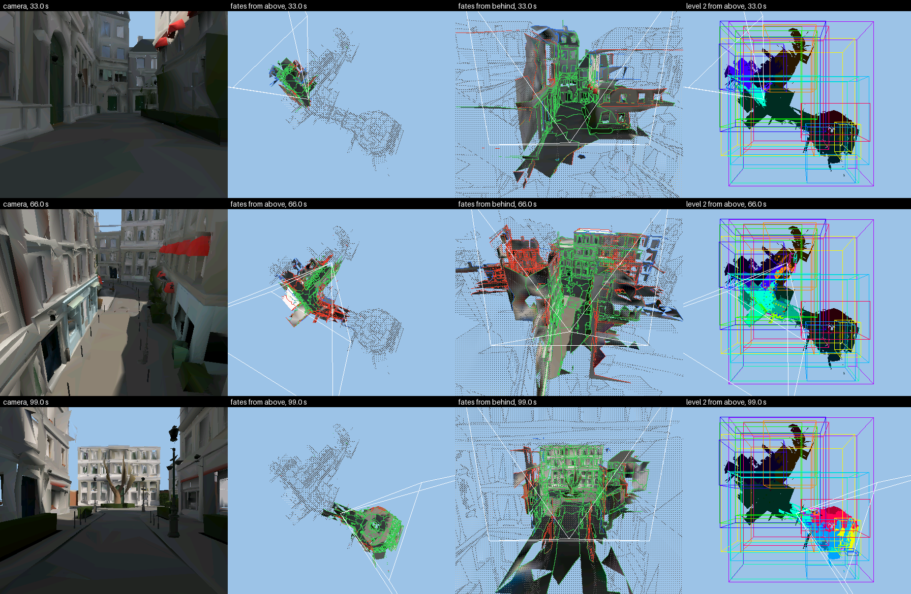
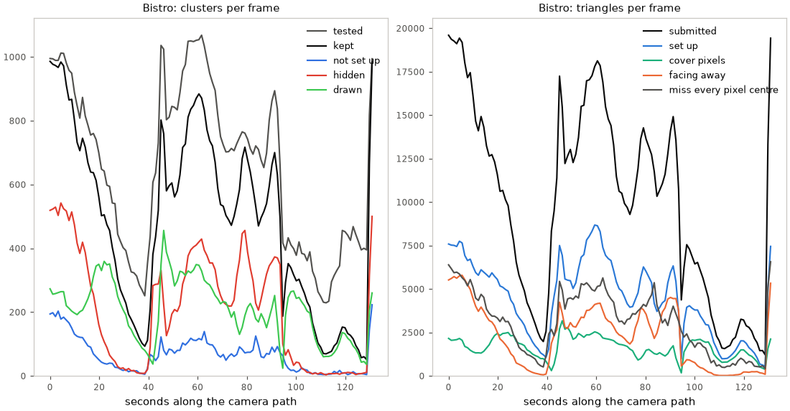
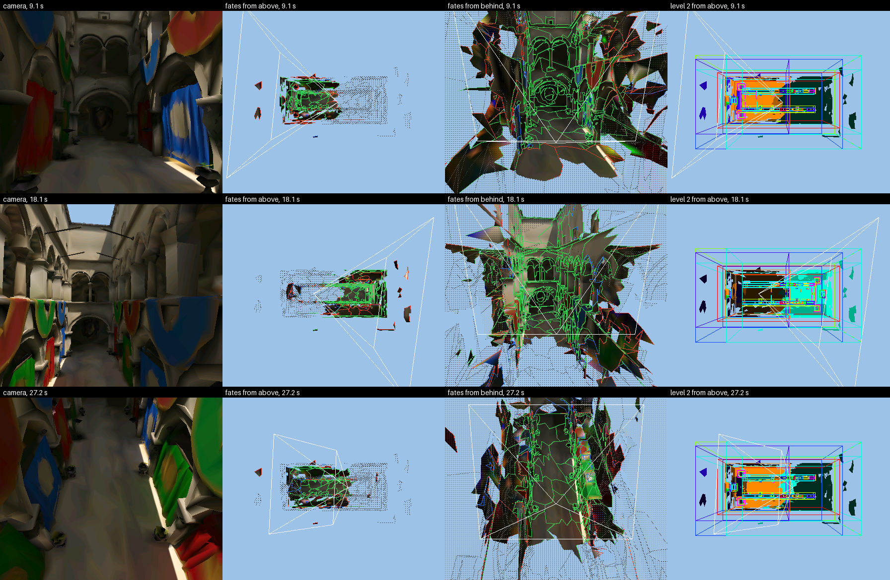
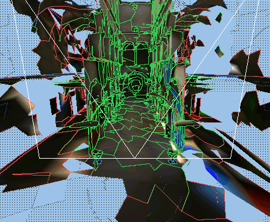
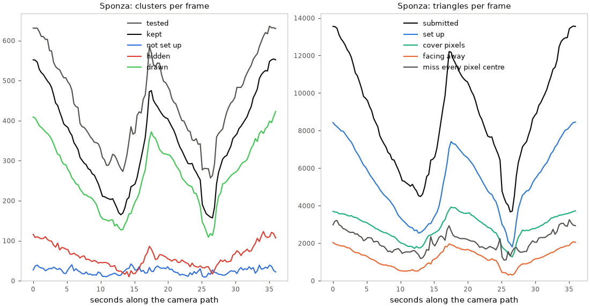
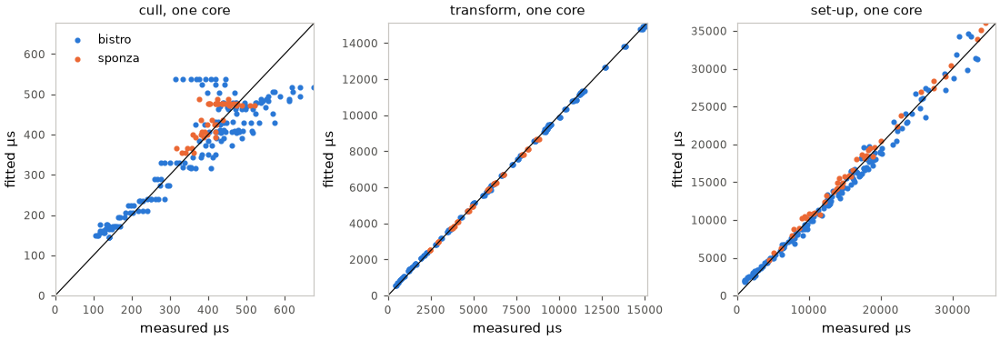

# Culling

Culling keeps a frame's work to what may show. Each stage drops what it can
prove hidden at the cheapest unit it can: a triangle the bake never saw, an
instance or subtree outside the frustum, a cluster outside a core's rows, a
triangle that would fill nothing.



Bistro along its camera path, seen from behind the camera: culled clusters as a
grey screen door, each kept one outlined blue if not set up, red if hidden,
green if drawn ([the cull, seen](#the-cull-seen)).



| Stage | Test | Unit | Where | Saves |
|---|---|---|---|---|
| Visibility | no ray from the camera region or path reaches it | triangle | the importer, offline ([visibility](../scene/Scene-Files.md#visibility-camera_region)) | flash and every stage below |
| Batch | a chunk's sphere, then each copy's, is outside a frustum plane | chunk of copies, then copy | `expand_batch()` in [raster.c](../../../launcher/main/render/raster.c) | the copy's slot in the census list and every stage below |
| Instance | its world box, then its root node's box, is outside a frustum plane | instance, each copy under its own model | `cull_slice()` in [raster.c](../../../launcher/main/render/raster.c), then `r3d_pipeline_cull()` from the root | the whole mesh; with the world box, its lens, its level pick and its walk too |
| Level pick | each group's projected error against the tolerance, and its radius against the coverage cap ([the pick](Levels-of-Detail.md#the-pick)) | group of clusters | `r3d_lod_pick()` | the finer level's clusters |
| Node | its box is outside a plane its parent's box crossed | node of the cluster tree | `r3d_pipeline_cull()` | its subtree |
| Cluster | its box is outside a plane its leaf's box crossed | cluster | `r3d_pipeline_cull()` | its vertices' transform and its triangles |
| Rows | its transformed vertices span no row of this core's half | cluster, per core | `r3d_pipeline_draw()` | its triangles on that core |
| Hidden cluster | every pixel under its box holds nearer depth; the gate scans when the previous frame predicts savings, or to sample | cluster, per core | `r3d_pipeline_cluster_hidden()` | its triangles' set-up and fill |
| Triangle | behind the near plane, misses every pixel centre, or faces away ([per triangle](#per-triangle)) | triangle | `r3d_pipeline_draw()` | its set-up and fill |
| Depth | a nearer depth is already drawn | pixel | `r3d_span` | the pixel's write |

What each stage costs on the board is
[measured below](#what-a-cluster-and-a-triangle-cost); what each keeps along
two camera paths is in [the cull, seen](#the-cull-seen).

## One entry

`raster_census()` is the whole cull: it writes the census list, the kept
clusters of every instance and kept copy, and returns what it kept.
`raster_draw_culled()` draws that list, and `raster_draw()` is the two in turn.

| Property | Why |
|---|---|
| The cull's lens is the view's, at the view's size, not fitted to the raster's | the list, its counts and its level picks are the same at every render size, so a caller can price sizes before choosing one ([Dynamic-Resolution.md](Dynamic-Resolution.md)) |
| The draw's lens is fitted to the raster | pixels land on the size drawn |
| The list holds for the same instances, whatever camera draws it | a spectator draws the camera's list ([the cull, seen](#the-cull-seen)); with the same lens, as the draw keeps the census's [depth scale](Attachments.md#depth) |
| Every cull is timed under `r3d.cull` | one bracket, whichever entry ran it ([Frame-Cost.md](../../tools/Frame-Cost.md)) |

## The tree walk

`r3d_pipeline_cull()` tests boxes against five planes of the lens's picture:
the near plane and the four sides ([`r3d_lens_frustum()`](../../../launcher/main/render/r3d_pipeline.h)).
There is no far plane. The boxes and the tree are the bake's
([Baked-Mesh.md](../offline/Baked-Mesh.md)).

- **Plane mask.** Each entry on the walk's stack carries the planes its
  parent's box crossed. A box wholly inside a plane drops it from the mask
  for everything under it, and an empty mask keeps a subtree untested.
- **Nearest first.** Children go on the stack farthest first, by their box
  centres' view depth, so leaves come out roughly front to back.
- **Depth bound.** Each kept cluster lowers a bound on the nearest view depth
  of its box inside the frustum, which sets the picture's
  [depth scale](Attachments.md#depth).

An instance is culled through its own lens, the picture's composed with its
model, so copies of one mesh each walk the tree where they sit. The picture's
lens is built once per position scale and each copy only adds its placement.

An instance may carry a world box: its root box through its model, in RAM
(`r3d_lit_mesh_world_bounds()`), kept current by the caller as its meshes
move or refit. It is tested first against the picture's planes, grown on
every side by a slack past float rounding, so it only drops instances the
root test would drop:

```math
s = k\,\max\left(\lVert \mathbf{e} \rVert_\infty,\ \max_i \lvert b_i \rvert\right)
```

where $`k`$ is `WORLD_SLACK` in [raster.c](../../../launcher/main/render/raster.c),
$`\mathbf{e}`$ the eye's position and $`b_i`$ the box's six coordinates.
Those then build no lens and read no tree. Kept clusters and pixels are the
same either way.

An instance that kept no cluster gets no slot in the draw's batch; its
attachment writers still see it. `cull` off in the context's settings
(`render_context_set_settings()`, or the development knob `render.cull` set
to 0) keeps every cluster and skips the world box; the meshlet-size table in
[Baked-Mesh.md](../offline/Baked-Mesh.md#meshlets)
measures both.

## Per triangle

The draw sorts each triangle of a kept cluster before it fills it
([`r3d_triangle_tests.h`](../../../launcher/main/render/r3d_triangle_tests.h)).
A cluster whose vertices all passed the near and range tests skips the first
two rows; a draw with writers keeps them:

| Test | Then | Counted as |
|---|---|---|
| every corner behind the near plane | dropped | `triangles_behind` |
| a corner behind the near plane, or too far off screen to snap | rebuilt from the mesh and clipped to the near plane and a guard band | `triangles_clipped` |
| its bounding box holds no pixel centre of the target | dropped: off screen, or small and between centres | `triangles_missed` |
| single-sided and wound clockwise on screen | dropped | `triangles_facing_away` |
| none of these | set up and filled, each pixel depth-tested | `triangles_set_up` |

`render/view/r3d_pipeline_count.h` counts these beside the frame's own draw,
with the walk's nodes visited and cut and its clusters tested and kept.

## The cull, seen

The cull view ([raster_cull_view.h](../../../launcher/main/render/view/raster_cull_view.h))
paints every cluster in the colour of its fate this frame: of a mesh with
levels, only the clusters its level pick chose. Seen from the camera only drawn
clusters show, so it redraws from a spectator.

| Fate | Colour | The cluster |
|---|---|---|
| culled | grey | its box, or a box above it, is outside the frustum |
| not set up | blue | kept, but every triangle is behind the camera, misses every pixel centre or faces away |
| hidden | red | each triangle lost its depth test |
| depth skipped | violet | the box scan skipped the cluster in every slice it met |
| gate bypassed | amber | the gate passed the cluster through without scanning in at least one slice |
| drawn | green | owns at least one pixel |

| Tunable | Values |
|---|---|
| `cullview.from` | 0 the camera, 1 above the instances' bounds looking down, 2 behind and above the camera |
| `cullview.paint` | 0 the baked colours, culled clusters as a sparse screen door with a dashed grey border, each kept cluster's border solid in its fate's colour; 1 each cluster flat in its fate's colour; 2 each cluster in the hue of its node at `cullview.level`, darker the earlier it was dropped |
| `cullview.level` | the tree depth whose node boxes the overlay draws; 0 none, 1 the root's children |

An observer set on the context replaces the spectator's pose, whatever
`cullview.from` says; the lens stays the camera's.

From a spectator the culled and the kept clusters are drawn apart, so culled
geometry never hides kept geometry behind it: the holes in its screen door
show what lies behind. The overlay also draws the camera's frustum.

- Where two triangles fill a pixel at the same depth, it goes to the later
  one, as with every [attachment](Attachments.md#attachments).
- A triangle the near plane cuts counts as reaching the fill even when its
  clipped polygon then faces away or vanishes.



The camera draw supplies the violet and amber tints. The cull and triangle
replay supplies the counts in `scene_viewer.sh --view cull --counts FILE`.

`RASTER_CULL_FRAME_FIELDS` owns the CSV and replay field names. Its
`sized_*` fields count set-up triangles through `R3D_SIZES_FIELDS` in
[r3d_triangle_size.h](../../../launcher/main/render/view/r3d_triangle_size.h).

| Field component | Meaning |
|---|---|
| `face` | a mesh with per-face colours |
| `uniform` | zero quantized colour-plane steps from the draw's lit corner colours |
| `shaded` | nonzero colour-plane steps |
| `zero`, `one`, `two_to_four`, `more` | pixel centres covered by the triangle under the top-left rule |

The bins sum to `triangles_set_up`. They use the pipeline's snapped screen
corners, wound positive, with pixel centres at i + 0.5. Clipped triangles
remain in `triangles_clipped` and do not enter these bins.

The counted pass reads the instance's lit mesh and each batch copy's selected
colour set. `r3d_span_uniform()` uses the fill's own colour-plane calculation;
small flat triangles still enter their size and colour-mode bins.

| Field | Meaning |
|---|---|
| `pixels_face`, `pixels_uniform`, `pixels_shaded` | covered centres of set-up triangles in each mode, clipped to the screen, before depth tests; overlapping triangles each contribute |
| `render_width`, `render_height` | render picture dimensions |
| `output_width`, `output_height` | compose destination dimensions, including half-picture composition |
| `quarter` | camera quarter in panel coordinates |
| `upscale_path` | selected `upscale_path_t` value |
| `upscale_surface` | whether the kept-width path uses surface filtering rather than scanlines |
| `vertices_transformed` | sum of kept clusters' vertex ranges, including vertices their triangles do not use |
| `clusters_off_frustum` | tested, drawn-level clusters rejected by their own frustum test |
| `nodes_cut` | rejected subtrees, including leaf nodes; not a count of their descendants |
| `triangles_facing_away` | backfacing rejection |
| `triangles_missed` | sub-pixel or off-screen rejection |
| `triangles_behind` + `triangles_clipped` | near/range rejection or rebuilding |

Exact pixel counting scans each set-up triangle's clipped bounding box in the
cull view: work scales with their summed box areas. It reads no framebuffer
and allocates no pixel buffer. Shipping cull and draw perform none of this work.

Bistro along its camera path:





<!-- generated: cull-bistro sha256=caf64ec68837041150185e62f4eafded5cf37a855d86920ba0272c620b51e23d -->
| Per frame, path mean | Bistro |
|---|---|
| Nodes visited / cut | 259 / 49 |
| Clusters tested / kept | 765 / 578 |
| Kept clusters: nothing set up / hidden / drawn | 76 / 259 / 243 |
| Triangles submitted | 10668 |
| Submitted triangles behind the near plane | 68 (1 %) |
| Submitted triangles clipped | 71 (1 %) |
| Submitted triangles miss every pixel centre | 3184 (30 %) |
| Submitted triangles facing away | 2637 (25 %) |
| Submitted triangles set up | 4709 (44 %) |
| Submitted triangles covering pixels | 1666 (16 %) |
<!-- /generated: cull-bistro -->

Sponza's fitted full bake along its flythrough:







<!-- generated: cull-sponza sha256=1420b823e66e1d9ebeb63d5fe819468afe66cc00182e91cef882a9008fb7d7a3 -->
| Per frame, path mean | Sponza |
|---|---|
| Nodes visited / cut | 197 / 40 |
| Clusters tested / kept | 471 / 357 |
| Kept clusters: nothing set up / hidden / drawn | 32 / 92 / 233 |
| Triangles submitted | 9482 |
| Submitted triangles behind the near plane | 160 (2 %) |
| Submitted triangles clipped | 197 (2 %) |
| Submitted triangles miss every pixel centre | 2423 (26 %) |
| Submitted triangles facing away | 2031 (21 %) |
| Submitted triangles set up | 4671 (49 %) |
| Submitted triangles covering pixels | 2072 (22 %) |
<!-- /generated: cull-sponza -->

## What a cluster and a triangle cost

The board's cull-cost suite (`run_cull_cost_suite`) times one core's cull,
transform and draw, stopped once each triangle is set up, along both paths.
Each pose is drawn three ways, so the counts move apart:

- as baked;
- with each cluster's triangles halved: same clusters and vertices, half the
  triangles submitted;
- through a mirrored lens: same clusters and triangles, the other faces set up.

[cull_cost.py](../../../launcher/tools/render/cull_cost.py) fits each stage by
non-negative least squares:

```math
\begin{aligned}
t_{\mathrm{cull}} &= a + b\,n_{\mathrm{nodes\ visited}} + c\,n_{\mathrm{clusters\ tested}} \\
t_{\mathrm{transform}} &= a + b\,n_{\mathrm{clusters\ kept}} + c\,n_{\mathrm{vertices\ transformed}} \\
t_{\mathrm{set\text{-}up}} &= a + b\,n_{\mathrm{clusters\ kept}} + c\,n_{\mathrm{triangles\ submitted}} + d\,n_{\mathrm{triangles\ set\ up}}
\end{aligned}
```



<!-- generated: cull-cost sha256=3e63a002a74d986120fc5c3578f0b9f5a2ea8fae728b4a9ac1af670c39892d47 -->
| Stage | Term | One core |
|---|---|---|
| cull | per node visited | 2158 ns |
| cull | per cluster tested | 0 ns |
| cull | constant | 58 µs |
| cull | worst error over the poses | 222 µs |
| transform | per cluster kept | 223 ns |
| transform | per vertex transformed | 582 ns |
| transform | constant | 0 µs |
| transform | worst error over the poses | 214 µs |
| set-up | per cluster kept | 3476 ns |
| set-up | per triangle submitted | 460 ns |
| set-up | per triangle set up | 3345 ns |
| set-up | constant | 1238 µs |
| set-up | worst error over the poses | 3340 µs |
<!-- /generated: cull-cost -->
