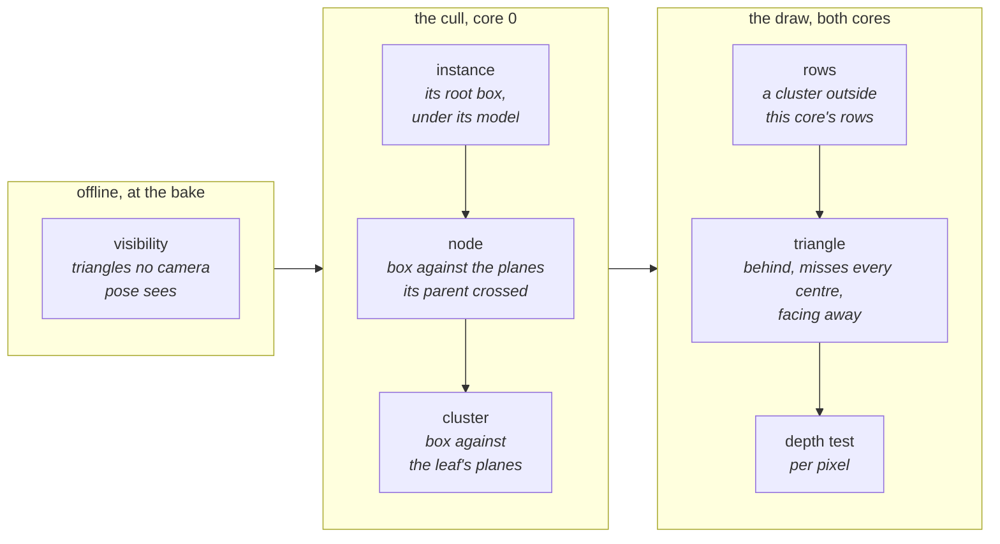
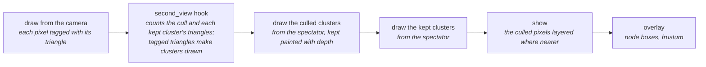

# Culling

Culling keeps a frame's work to what may show. Each stage drops what it can
prove hidden at the cheapest unit it can: a triangle the bake never saw, an
instance or subtree outside the frustum, a cluster outside a core's rows, a
triangle that would fill nothing.

| Stage | Test | Unit | Where | Saves |
|---|---|---|---|---|
| Visibility | no ray from the camera region or path reaches it | triangle | the importer, offline ([visibility](../scene/Scene-Files.md#visibility-camera_region)) | flash and every stage below |
| Instance | its root node's box is outside a frustum plane | instance, each copy under its own model | `r3d_pipeline_cull()`, from the root | the whole mesh |
| Node | its box is outside a plane its parent's box crossed | node of the cluster tree | `r3d_pipeline_cull()` | its subtree |
| Cluster | its box is outside a plane its leaf's box crossed | cluster | `r3d_pipeline_cull()` | its vertices' transform and its triangles |
| Rows | its transformed vertices span no row of this core's half | cluster, per core | `r3d_pipeline_draw()` | its triangles on that core |
| Triangle | behind the near plane, misses every pixel centre, or faces away ([per triangle](#per-triangle)) | triangle | `r3d_pipeline_draw()` | its set-up and fill |
| Depth | a nearer depth is already drawn | pixel | `r3d_span` | the pixel's write |

What each stage costs on the board is
[measured below](#what-a-cluster-and-a-triangle-cost); what each keeps along
two camera paths is in [the cull, seen](#the-cull-seen).

## The tree walk

`r3d_pipeline_cull()` tests boxes against five planes of the lens's picture:
the near plane and the four sides ([`r3d_lens_frustum()`](../../../launcher/main/render/r3d_pipeline.h)).
There is no far plane. The boxes and the tree are the bake's
([Baked-Mesh.md](../offline/Baked-Mesh.md)).

- **Plane mask.** Each entry on the walk's stack carries the planes its
  parent's box crossed. A box wholly inside a plane drops it from the mask
  for everything under it, and an empty mask keeps a subtree untested.
- **Nearest first.** Children go on the stack farthest first, by their box
  centres' view depth, so leaves come out roughly front to back.
- **Depth bound.** Each kept cluster lowers a bound on the nearest view depth
  of its box inside the frustum, which sets the picture's
  [depth scale](Attachments.md#depth).

An instance is culled through its own lens, the picture's composed with its
model, so copies of one mesh each walk the tree where they sit. `render.cull`
(a development tunable, default 1) set to 0 keeps every cluster; the
meshlet-size table in [Baked-Mesh.md](../offline/Baked-Mesh.md#meshlets)
measures both.

## Per triangle

The draw sorts each triangle of a kept cluster before it fills it
([`r3d_triangle_tests.h`](../../../launcher/main/render/r3d_triangle_tests.h)):

| Test | Then | Counted as |
|---|---|---|
| every corner behind the near plane | dropped | `triangles_behind` |
| a corner behind the near plane, or too far off screen to snap | rebuilt from the mesh and clipped to the near plane and a guard band | `triangles_clipped` |
| its bounding box holds no pixel centre of the target | dropped: off screen, or small and between centres | `triangles_missed` |
| single-sided and wound clockwise on screen | dropped | `triangles_facing_away` |
| none of these | set up and filled, each pixel depth-tested | `triangles_set_up` |

`render/view/r3d_pipeline_count.h` counts these beside the frame's own draw,
with the walk's nodes visited and cut and its clusters tested and kept.

## The cull, seen

The cull view ([raster_cull_view.h](../../../launcher/main/render/view/raster_cull_view.h))
paints every cluster in the colour of its fate this frame. Seen from the camera
only drawn clusters show, so it redraws from a spectator.

| Fate | Colour | The cluster |
|---|---|---|
| culled | grey | its box, or a box above it, is outside the frustum |
| not set up | blue | kept, but every triangle is behind the camera, misses every pixel centre or faces away |
| hidden | red | each triangle lost its depth test; the frame may have skipped it whole before setup, which this view does not see |
| drawn | green | owns at least one pixel |

| Tunable | Values |
|---|---|
| `cullview.from` | 0 the camera, 1 above the instances' bounds looking down, 2 behind and above the camera |
| `cullview.paint` | 0 the baked colours, culled clusters as a sparse screen door with a dashed grey border, each kept cluster's border solid in its fate's colour; 1 each cluster flat in its fate's colour; 2 each cluster in the hue of its node at `cullview.level`, darker the earlier it was dropped |
| `cullview.level` | the tree depth whose node boxes the overlay draws; 0 none, 1 the root's children |

From a spectator the culled and the kept clusters are drawn apart, so culled
geometry never hides kept geometry behind it: the holes in its screen door
show what lies behind. The overlay also draws the camera's frustum.

- Where two triangles fill a pixel at the same depth, it goes to the later
  one, as with every [attachment](Attachments.md#attachments).
- A triangle the near plane cuts counts as reaching the fill even when its
  clipped polygon then faces away or vanishes.

The frame's own cull and draw count nothing; `r3d_pipeline_cull_counted()` and
`r3d_pipeline_count_triangles()` count beside them. `scene_viewer.sh --view cull
--counts FILE` writes the counts per frame.

Bistro along its camera path:

<!-- generated: cull-bistro sha256=c8ab3c5c527ead3520e2b7fdb145fecf73a3df5be49e08e26952397ff5fe8552 -->
| Per frame, path mean | Bistro |
|---|---|
| Nodes visited / cut | 145 / 32 |
| Clusters tested / kept | 458 / 376 |
| Kept clusters: nothing set up / hidden / drawn | 44 / 151 / 181 |
| Triangles submitted | 7736 |
| Submitted triangles behind the near plane | 67 (1 %) |
| Submitted triangles clipped | 61 (1 %) |
| Submitted triangles miss every pixel centre | 2371 (31 %) |
| Submitted triangles facing away | 1648 (21 %) |
| Submitted triangles set up | 3589 (46 %) |
| Submitted triangles covering pixels | 1574 (20 %) |
<!-- /generated: cull-bistro -->

Sponza's fitted full bake along its flythrough:

<!-- generated: cull-sponza sha256=464a55906b51d0a10196a6c861853fce41a28670d872dd60dba95156104b226e -->
| Per frame, path mean | Sponza |
|---|---|
| Nodes visited / cut | 175 / 49 |
| Clusters tested / kept | 371 / 300 |
| Kept clusters: nothing set up / hidden / drawn | 11 / 43 / 246 |
| Triangles submitted | 8369 |
| Submitted triangles behind the near plane | 67 (1 %) |
| Submitted triangles clipped | 77 (1 %) |
| Submitted triangles miss every pixel centre | 2291 (27 %) |
| Submitted triangles facing away | 704 (8 %) |
| Submitted triangles set up | 5230 (62 %) |
| Submitted triangles covering pixels | 2692 (32 %) |
<!-- /generated: cull-sponza -->

## What a cluster and a triangle cost

The board's cull-cost suite (`run_cull_cost_suite`) times one core's cull,
transform and draw, stopped once each triangle is set up, along both paths.
Each pose is drawn three ways, so the counts move apart:

- as baked;
- with each cluster's triangles halved: same clusters and vertices, half the
  triangles submitted;
- through a mirrored lens: same clusters and triangles, the other faces set up.

[cull_cost.py](../../../launcher/tools/render/cull_cost.py) fits each stage by
non-negative least squares:

- cull = a + b × nodes visited + c × clusters tested
- transform = a + b × clusters kept + c × vertices transformed
- set-up = a + b × clusters kept + c × triangles submitted + d × triangles set up

<!-- generated: cull-cost sha256=3e63a002a74d986120fc5c3578f0b9f5a2ea8fae728b4a9ac1af670c39892d47 -->
| Stage | Term | One core |
|---|---|---|
| cull | per node visited | 2158 ns |
| cull | per cluster tested | 0 ns |
| cull | constant | 58 µs |
| cull | worst error over the poses | 222 µs |
| transform | per cluster kept | 223 ns |
| transform | per vertex transformed | 582 ns |
| transform | constant | 0 µs |
| transform | worst error over the poses | 214 µs |
| set-up | per cluster kept | 3476 ns |
| set-up | per triangle submitted | 460 ns |
| set-up | per triangle set up | 3345 ns |
| set-up | constant | 1238 µs |
| set-up | worst error over the poses | 3340 µs |
<!-- /generated: cull-cost -->
