# Dynamic resolution

A scene's camera can draw each frame at a render size picked to hold a frame
budget, instead of one fixed scale. The sizes are a ladder of steps, finest
first. Below, the two presentation choices first, then how a size is chosen,
then the measurements.

## Camera presentation

A camera can draw half the rows and let the present fill the rest.
`CAMERA_PRESENT_SCANLINE` darkens every second row, `CAMERA_PRESENT_DOUBLE`
repeats it, and `CAMERA_PRESENT_NEAREST` (the default) draws the full height.

The GIFs show the same flythrough in each mode. The dark lines run along the
panel's rows, which is vertical in this orientation.

| NEAREST | SCANLINE | DOUBLE |
|---|---|---|
| 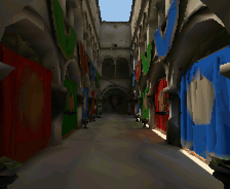 | 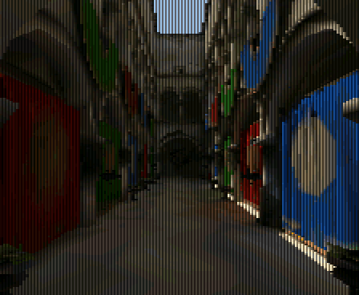 |  |

One call turns it on; there are no other settings:

<!-- generated: scene-present-example check: python launcher/tools/gen/examples_doc.py --check -->
```c
/* Presentation: choose how the camera's rendered rows reach the panel. */
#include "scene/scene.h"

static bool
present_example(scene_t* scene, scene_entity_t cam) {
    return scene_camera_set_present(scene, cam, CAMERA_PRESENT_SCANLINE);
}
```
<!-- /generated: scene-present-example -->

| Mode | Rows drawn | Look |
|---|---|---|
| `CAMERA_PRESENT_NEAREST` | The chosen render height | The default picture |
| `CAMERA_PRESENT_SCANLINE` | Half that height | Each row twice, the second dimmed to `UPSCALE_SCANLINE_KEEP` |
| `CAMERA_PRESENT_DOUBLE` | Half that height | Each row twice, unchanged |

The halved draw expands into [the half picture](../Rendering-Options.md#render-scale-and-the-half-picture), as in `render_context_compose()` below. When its row map is uneven, such as a dynamic-resolution step whose height does not divide the half height, the rows are copied without the dimmed line.

The saving comes from the halved draw: fewer rows, spans and edge steps. SCANLINE adds a darkened copy of every second row; DOUBLE costs a little less.

On a dense benchmark scene SCANLINE cut the frame by about a quarter; the measured tables are in the test app's tools README.

## Upscaling by surface

Off by default: `UPSCALE_FILTER_SURFACE` or `UPSCALE_FILTER_EDGES` in [`render/upscale.h`](../../../launcher/main/render/upscale.h), set with `render_context_set_upscale_filter()`.

Both apply to the steps that compose into the half picture, and both judge "same surface" from the low-resolution depth alone.
SURFACE is joint bilateral upsampling<sup>[[101]](../../Citations.md#kopf-2007)</sup> with a yes-or-no range weight; EDGES is Scale2x<sup>[[110]](../../Citations.md#mazzoleni-scale2x)</sup> with that test in place of equal colours.

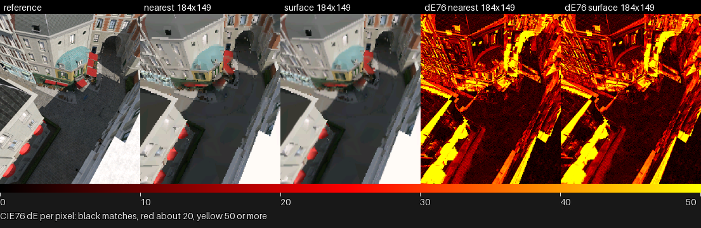

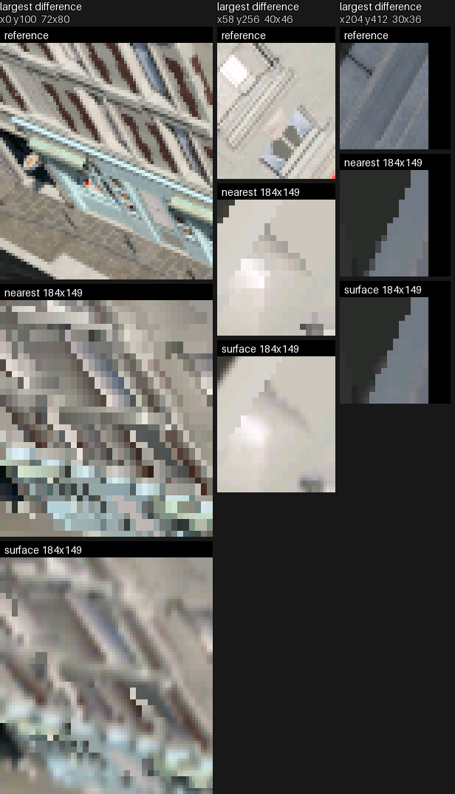

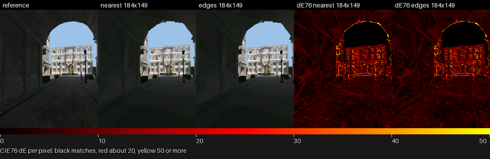

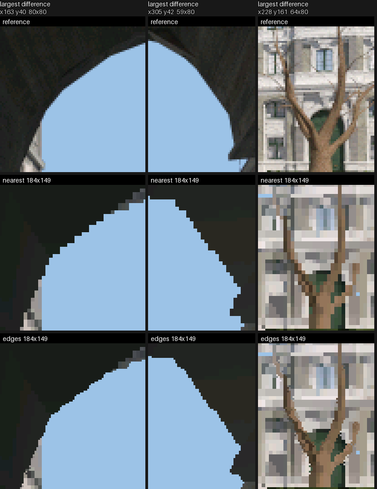

| Stage | Nearest | Surface | Edges |
|---|---|---|---|
| Compose, rows to the half height | each row its nearest source row | blends the two source rows around it when their depths are one surface, else takes the nearer | as nearest |
| Compose, same loop | - | a seam bit per half-picture pixel: another surface right of it or below it | four corner bits per half-picture pixel, from the depths of its four neighbours |
| Present, 2x expand | each pixel to a 2x2 block | centre-aligned 2x bilinear, a quarter of each neighbour, except across a seam | as nearest, then each marked corner takes the colour of the neighbour beside it in the row |

Two depths are one surface when they differ by at most the nearer's
1/2^`UPSCALE_SURFACE_STEP_SHIFT`. Clear against drawn is always a seam.

For pixel P with up A, right B, left C and down D, a corner takes its neighbour when the two neighbours on that corner are one surface and neither is one surface with the neighbour opposite the other:

| Corner | Takes | When |
|---|---|---|
| top-left | C | C, A one surface; C, D not; A, B not |
| top-right | B | A, B one surface; A, C not; B, D not |
| bottom-left | C | C, D one surface; C, A not; D, B not |
| bottom-right | B | B, D one surface; B, A not; D, C not |

Inside one surface no corner changes, so interiors are nearest exactly. Compose skips eight pixels at a time when the depths around them all fall within one step of the farthest.

The seam and the corners share one buffer, the half picture's expand hints (`GFX_HINT_PLANES` one-bit masks after its pixels); SURFACE reads the first mask, EDGES all four.

<!-- generated: dynres-upscale sha256=fd120993bf10ea00f9397975ade8e524f2f3c7e58d9df00ab9749308998dd8f7 -->
| Scene | Filter | mean dE | p95 dE | SSIM |
|---|---|---|---|---|
| bistro-fitted-full | surface | 7.08 → 7.05 (-0.03) | 22.0 → 21.4 (-0.6) | 0.564 → 0.569 (+0.005) |
| bistro-fitted-full | edges | 7.08 → 7.07 (-0.01) | 22.0 → 21.9 (-0.0) | 0.564 → 0.564 (+0.001) |
| sponza-fitted-full | surface | 5.94 → 5.91 (-0.03) | 16.4 → 15.9 (-0.5) | 0.704 → 0.712 (+0.007) |
| sponza-fitted-full | edges | 5.94 → 5.92 (-0.02) | 16.4 → 16.4 (-0.1) | 0.704 → 0.705 (+0.001) |
| sponza-fitted | surface | 6.60 → 6.56 (-0.04) | 18.8 → 18.2 (-0.6) | 0.655 → 0.663 (+0.008) |
| sponza-fitted | edges | 6.60 → 6.59 (-0.02) | 18.8 → 18.7 (-0.1) | 0.655 → 0.657 (+0.001) |
| sponza-flat-fitted | surface | 5.78 → 5.71 (-0.07) | 16.7 → 15.9 (-0.8) | 0.690 → 0.707 (+0.017) |
| sponza-flat-fitted | edges | 5.78 → 5.76 (-0.02) | 16.7 → 16.6 (-0.1) | 0.690 → 0.691 (+0.002) |
| sponza | surface | 9.59 → 9.50 (-0.09) | 28.1 → 27.5 (-0.6) | 0.548 → 0.557 (+0.009) |
| sponza | edges | 9.59 → 9.57 (-0.02) | 28.1 → 28.0 (-0.1) | 0.548 → 0.549 (+0.001) |
| sponza-flat | surface | 13.42 → 13.16 (-0.26) | 46.2 → 44.8 (-1.4) | 0.390 → 0.412 (+0.022) |
| sponza-flat | edges | 13.42 → 13.41 (-0.01) | 46.2 → 46.1 (-0.1) | 0.390 → 0.391 (+0.001) |
| sponza-lite | surface | 11.44 → 11.36 (-0.08) | 33.2 → 32.8 (-0.4) | 0.494 → 0.501 (+0.007) |
| sponza-lite | edges | 11.44 → 11.42 (-0.01) | 33.2 → 33.1 (-0.1) | 0.494 → 0.494 (+0.001) |

At 184x224, each cell is nearest → the row's filter (change), the mean over the path's frames against the reference at full size; lower dE and higher SSIM are closer.

<details>
<summary>Every size, with edge and interior dE</summary>

| Scene | Size | Filter | mean dE | p95 dE | SSIM | edge dE | interior dE |
|---|---|---|---|---|---|---|---|
| bistro-fitted-full | 184x224 | surface | 7.08 → 7.05 | 22.0 → 21.4 | 0.564 → 0.569 | 10.84 → 10.78 | 4.77 → 4.76 |
| bistro-fitted-full | 184x224 | edges | 7.08 → 7.07 | 22.0 → 21.9 | 0.564 → 0.564 | 10.84 → 10.82 | 4.77 → 4.76 |
| bistro-fitted-full | 184x149 | surface | 7.22 → 7.17 | 22.6 → 21.7 | 0.550 → 0.559 | 11.18 → 11.05 | 4.80 → 4.80 |
| bistro-fitted-full | 184x149 | edges | 7.22 → 7.21 | 22.6 → 22.5 | 0.550 → 0.551 | 11.18 → 11.15 | 4.80 → 4.80 |
| bistro-fitted-full | 184x112 | surface | 7.27 → 7.26 | 22.8 → 21.9 | 0.545 → 0.551 | 11.29 → 11.22 | 4.82 → 4.84 |
| bistro-fitted-full | 184x112 | edges | 7.27 → 7.26 | 22.8 → 22.7 | 0.545 → 0.546 | 11.29 → 11.26 | 4.82 → 4.81 |
| sponza-fitted-full | 184x224 | surface | 5.94 → 5.91 | 16.4 → 15.9 | 0.704 → 0.712 | 10.28 → 10.19 | 4.58 → 4.58 |
| sponza-fitted-full | 184x224 | edges | 5.94 → 5.92 | 16.4 → 16.4 | 0.704 → 0.705 | 10.28 → 10.22 | 4.58 → 4.58 |
| sponza-fitted-full | 184x149 | surface | 6.10 → 6.04 | 17.2 → 16.3 | 0.690 → 0.703 | 10.78 → 10.56 | 4.64 → 4.63 |
| sponza-fitted-full | 184x149 | edges | 6.10 → 6.08 | 17.2 → 17.1 | 0.690 → 0.691 | 10.78 → 10.72 | 4.64 → 4.63 |
| sponza-fitted-full | 184x112 | surface | 6.14 → 6.12 | 17.5 → 16.7 | 0.685 → 0.696 | 10.91 → 10.79 | 4.66 → 4.67 |
| sponza-fitted-full | 184x112 | edges | 6.14 → 6.12 | 17.5 → 17.4 | 0.685 → 0.687 | 10.91 → 10.84 | 4.66 → 4.65 |
| sponza-fitted | 184x224 | surface | 6.60 → 6.56 | 18.8 → 18.2 | 0.655 → 0.663 | 11.57 → 11.45 | 5.06 → 5.05 |
| sponza-fitted | 184x224 | edges | 6.60 → 6.59 | 18.8 → 18.7 | 0.655 → 0.657 | 11.57 → 11.51 | 5.06 → 5.06 |
| sponza-fitted | 184x149 | surface | 6.71 → 6.64 | 19.3 → 18.4 | 0.646 → 0.658 | 11.89 → 11.67 | 5.10 → 5.08 |
| sponza-fitted | 184x149 | edges | 6.71 → 6.69 | 19.3 → 19.2 | 0.646 → 0.648 | 11.89 → 11.83 | 5.10 → 5.10 |
| sponza-fitted | 184x112 | surface | 6.73 → 6.69 | 19.3 → 18.6 | 0.644 → 0.654 | 11.96 → 11.82 | 5.11 → 5.10 |
| sponza-fitted | 184x112 | edges | 6.73 → 6.71 | 19.3 → 19.2 | 0.644 → 0.645 | 11.96 → 11.88 | 5.11 → 5.10 |
| sponza-flat-fitted | 184x224 | surface | 5.78 → 5.71 | 16.7 → 15.9 | 0.690 → 0.707 | 10.25 → 10.04 | 4.38 → 4.36 |
| sponza-flat-fitted | 184x224 | edges | 5.78 → 5.76 | 16.7 → 16.6 | 0.690 → 0.691 | 10.25 → 10.18 | 4.38 → 4.38 |
| sponza-flat-fitted | 184x149 | surface | 5.94 → 5.84 | 17.5 → 16.3 | 0.677 → 0.701 | 10.74 → 10.39 | 4.44 → 4.41 |
| sponza-flat-fitted | 184x149 | edges | 5.94 → 5.92 | 17.5 → 17.4 | 0.677 → 0.678 | 10.74 → 10.67 | 4.44 → 4.44 |
| sponza-flat-fitted | 184x112 | surface | 5.98 → 5.93 | 17.6 → 16.6 | 0.674 → 0.694 | 10.84 → 10.65 | 4.45 → 4.45 |
| sponza-flat-fitted | 184x112 | edges | 5.98 → 5.95 | 17.6 → 17.5 | 0.674 → 0.676 | 10.84 → 10.76 | 4.45 → 4.44 |
| sponza | 184x224 | surface | 9.59 → 9.50 | 28.1 → 27.5 | 0.548 → 0.557 | 15.66 → 15.41 | 7.70 → 7.66 |
| sponza | 184x224 | edges | 9.59 → 9.57 | 28.1 → 28.0 | 0.548 → 0.549 | 15.66 → 15.59 | 7.70 → 7.70 |
| sponza | 184x149 | surface | 9.65 → 9.52 | 28.2 → 27.4 | 0.543 → 0.556 | 15.80 → 15.46 | 7.73 → 7.67 |
| sponza | 184x149 | edges | 9.65 → 9.63 | 28.2 → 28.1 | 0.543 → 0.544 | 15.80 → 15.74 | 7.73 → 7.72 |
| sponza | 184x112 | surface | 9.66 → 9.52 | 28.3 → 27.4 | 0.541 → 0.555 | 15.86 → 15.48 | 7.73 → 7.67 |
| sponza | 184x112 | edges | 9.66 → 9.64 | 28.3 → 28.2 | 0.541 → 0.542 | 15.86 → 15.80 | 7.73 → 7.72 |
| sponza-flat | 184x224 | surface | 13.42 → 13.16 | 46.2 → 44.8 | 0.390 → 0.412 | 21.18 → 20.52 | 11.00 → 10.87 |
| sponza-flat | 184x224 | edges | 13.42 → 13.41 | 46.2 → 46.1 | 0.390 → 0.391 | 21.18 → 21.14 | 11.00 → 11.00 |
| sponza-flat | 184x149 | surface | 13.47 → 13.13 | 46.3 → 44.5 | 0.386 → 0.415 | 21.37 → 20.45 | 11.02 → 10.85 |
| sponza-flat | 184x149 | edges | 13.47 → 13.46 | 46.3 → 46.3 | 0.386 → 0.387 | 21.37 → 21.33 | 11.02 → 11.02 |
| sponza-flat | 184x112 | surface | 13.46 → 13.11 | 46.3 → 44.3 | 0.387 → 0.418 | 21.29 → 20.42 | 11.02 → 10.84 |
| sponza-flat | 184x112 | edges | 13.46 → 13.44 | 46.3 → 46.2 | 0.387 → 0.388 | 21.29 → 21.25 | 11.02 → 11.02 |
| sponza-lite | 184x224 | surface | 11.44 → 11.36 | 33.2 → 32.8 | 0.494 → 0.501 | 18.34 → 18.14 | 9.31 → 9.27 |
| sponza-lite | 184x224 | edges | 11.44 → 11.42 | 33.2 → 33.1 | 0.494 → 0.494 | 18.34 → 18.30 | 9.31 → 9.30 |
| sponza-lite | 184x149 | surface | 11.48 → 11.36 | 33.3 → 32.7 | 0.491 → 0.501 | 18.46 → 18.16 | 9.33 → 9.27 |
| sponza-lite | 184x149 | edges | 11.48 → 11.47 | 33.3 → 33.3 | 0.491 → 0.491 | 18.46 → 18.42 | 9.33 → 9.32 |
| sponza-lite | 184x112 | surface | 11.47 → 11.36 | 33.3 → 32.7 | 0.490 → 0.501 | 18.43 → 18.15 | 9.32 → 9.26 |
| sponza-lite | 184x112 | edges | 11.47 → 11.46 | 33.3 → 33.2 | 0.490 → 0.491 | 18.43 → 18.40 | 9.32 → 9.32 |

Each cell is nearest → the row's filter.

</details>
<!-- /generated: dynres-upscale -->

Surface lowers p95 dE and raises SSIM at every step of every scored scene; mean dE moves less. Interiors blend, while depth edges keep their stairs, which is most of the edge error left.

Edges improves every metric at every step too, by less: it changes about one panel pixel in a hundred, all on silhouettes. What it changes is the stairs themselves, which the crops show and the means barely weigh.

## How a size is chosen

`render_context_compose()` expands a step that fits into the half picture
and upscales any other with [`render/upscale.h`](../../../launcher/main/render/upscale.h),
any ratio in either axis ([the rule](../Rendering-Options.md#render-scale-and-the-half-picture)).

The caller's chosen size is the top step; no policy draws finer. A frame under budget keeps its speed, and only a frame over budget steps down.

The code is `launcher/main/render/resolution/`. Resolution selection is a setting of the render context, not of a scene or a camera.

An app opts in with `render_context_set_dynamic_resolution()` ([Mesh-Rendering.md](../Mesh-Rendering.md#the-render-context)); with no call every frame draws at the context's fixed scale.

With [frame generation](Frame-Generation.md#with-dynamic-resolution) on, the
budget stays the cost of a shown frame, and each drawn frame is priced for
itself and the frame generated from it.

| Policy | Chooses | From | Guards against flapping |
|---|---|---|---|
| Stepped controller | one step at a time, after the cost, never above the top | the mean of a window of measured frames against an up and a down threshold | a cooldown after each step that doubles when a step reverses the last one; a panic drop for one frame far over budget |
| Predictor | down any number of steps, up one, before the cost, never above the top | a linear model of the frame, priced at every step from the triangles culling kept this frame, then scaled and offset by what recent frames cost | going finer needs the next step to fit with a margin under the budget for a hold in time, which doubles when a step reverses the last one |

The predictor's model is fitted on the board on every mesh scene at every step ([below](#the-ladder-on-every-mesh-scene)). Live frames refit it with a two-state Kalman filter<sup>[[22]](../../Citations.md#kalman-1960)</sup>:

- It learns a scale and an offset on the fitted price from each frame's measured cost, and clips a single hitch frame.
- It leans back to the plain fit when frames stop disagreeing with it.
- A scale and an offset can be learnt from frames at any one step, which four separate weights cannot, so the fit's shape carries over to steps not drawn lately.

The scene's second path, which the fit never sees, measures how well the refit tracks a view the fit did not cover.

The cost a policy holds is the part that scales: the draw and the compose each step pays.

- Calibration uses the render context's compose decision, including expansion into the half picture.
- The present and whatever an app draws over the scene are not in it.
- The predictor culls once with the picture's unfitted lens before it chooses a size, then draws from the scratch block's census list with a fitted lens.
- The list's offset is independent of render size, so the context reserves only the finest step's raster block.
- Fixed and stepped draws share one fitted lens per instance between culling and drawing.

## Where a frame's time goes at each size

The raster brackets its stages for [frame cost](../../tools/Frame-Cost.md): `r3d.cull` (through the predictor, the census, `r3d.census`), `r3d.transform`, `r3d.draw` and `r3d.upscale`.

The suite draws the test scene's path at every size on both cores, then again on one core with the span rasterizer stopped after each stage.

<!-- generated: dynres-stages sha256=ed7a438112dae64eca59a14c1936eab021fe12508def057affc0143dc88e6852 -->
| Render size | Divisor | Pixels | Frame mean | p50 | max |
|---|---|---|---|---|---|
| 368x448 | 1.00 | 100% | 94.1 | 92.8 | 113.2 |
| 368x358 | 1.00 x 1.25 | 80% | 79.2 | 78.7 | 95.6 |
| 368x298 | 1.00 x 1.50 | 67% | 69.5 | 68.6 | 84.4 |
| 294x358 | 1.25 | 64% | 72.7 | 72.5 | 87.2 |
| 276x336 | 1.33 | 56% | 68.2 | 68.3 | 82.2 |
| 368x224 | 1.00 x 2.00 | 50% | 58.0 | 57.9 | 71.3 |
| 184x448 | 2.00 x 1.00 | 50% | 69.2 | 69.2 | 82.2 |
| 245x298 | 1.50 | 44% | 60.3 | 60.5 | 73.1 |
| 184x358 | 2.00 x 1.25 | 40% | 59.0 | 59.4 | 70.8 |
| 245x224 | 1.50 x 2.00 | 33% | 51.9 | 52.6 | 63.4 |
| 184x298 | 2.00 x 1.50 | 33% | 52.8 | 53.6 | 64.0 |
| 210x256 | 1.75 | 33% | 54.1 | 55.3 | 64.8 |
| 184x224 | 2.00 | 25% | 45.4 | 46.4 | 57.2 |
| 184x179 | 2.00 x 2.50 | 20% | 40.5 | 40.7 | 49.9 |
| 184x149 | 2.00 x 3.01 | 17% | 37.6 | 38.9 | 47.4 |
| 147x179 | 2.50 | 16% | 40.1 | 40.2 | 49.6 |
| 122x149 | 3.02 | 11% | 35.8 | 36.6 | 43.8 |

Milliseconds, both cores.
<!-- /generated: dynres-stages -->

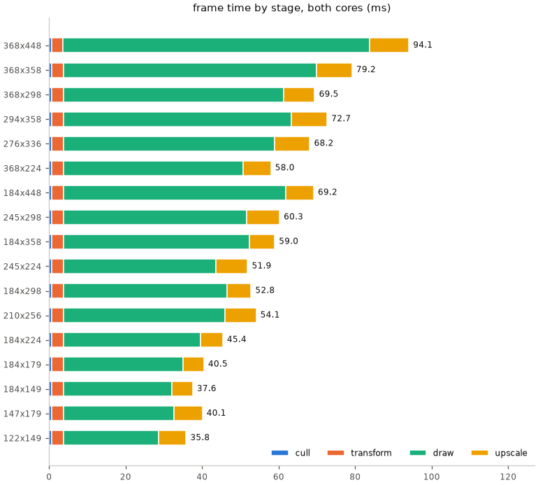

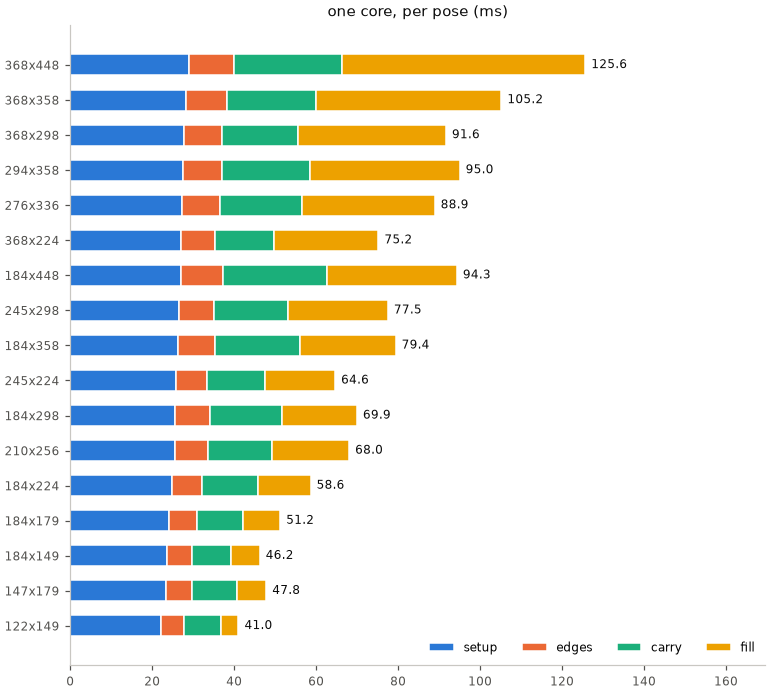

The questions the split answers, as differences between two sizes:

- A width equal to the panel's or half of it upscales whole rows or pixel pairs. Any other width pays the mapped upscale on top, so both ladders keep to those two widths.
- Halving the height saves far more than halving the width, since edges and attribute carry follow the height, so a ladder cuts the height first.
- 184x179 costs about what isotropic 2.5x (147x179) does, and 184x149 what 3x (122x149) does: the upscale they save pays for the pixels they keep.
- The one-core setup stage barely moves with size; no step goes under it.

The split times a full upscale at every size. A live frame half as wide and at most half as tall composes into the half picture instead, and the policies below are priced and flown with that compose.

<!-- generated: dynres-findings sha256=b6de6dd789bc75a2c9130251f7476144a2fa7cda1be7bffcd06b4e5a721203f0 -->
| Question | Compared | Frame | draw | upscale | 1 core: edges | carry | fill |
|---|---|---|---|---|---|---|---|
| half width, more height over half | 184x298 minus 184x224 | 7.4 | 6.9 | 0.5 | 1.0 | 3.9 | 5.6 |
| half over a fifth less height | 184x224 minus 184x179 | 4.9 | 4.7 | 0.3 | 0.7 | 2.4 | 3.6 |
| half width over 2.5x, same height | 184x179 minus 147x179 | 0.4 | 2.2 | -1.8 | 0.3 | 0.3 | 2.1 |
| half width over 3x, same height | 184x149 minus 122x149 | 1.7 | 3.5 | -1.8 | 0.5 | 0.5 | 2.7 |
| full height over half | 368x448 minus 368x224 | 36.1 | 33.1 | 3.1 | 2.7 | 12.1 | 33.9 |
| full width over half | 368x448 minus 184x448 | 24.9 | 22.0 | 3.0 | 0.8 | 1.0 | 27.6 |
<!-- /generated: dynres-findings -->

## The ladder on every mesh scene

Each scene's camera path is drawn once per step of a height-first ladder, holding the step and advancing the clock a fixed amount per frame, so frame i shows the same pose at every step. The model is fitted on all of these frames.

Every scene also pays about 10 ms per frame outside the draw and the compose, so a 33 ms frame target leaves a 23 ms budget for the part that scales.

<!-- generated: dynres-steps sha256=909696f662928a495763d13f4ca67148a6c0b2d8cdf0f69662b24c105bf67e67 -->
| Scenario | 368x448 | 368x358 | 368x298 | 368x224 | 184x224 | 184x179 | 184x149 | 184x112 |
|---|---|---|---|---|---|---|---|---|
| bistro-fitted-full | 79.0 | 68.9 | 62.2 | 54.0 | 41.3 | 38.1 | 35.9 | 33.1 |
| sponza | 98.5 | 84.6 | 75.5 | 64.6 | 49.2 | 44.9 | 41.9 | 38.2 |
| sponza-lite | 89.3 | 75.9 | 67.0 | 56.6 | 41.9 | 37.8 | 35.1 | 32.0 |
| sponza-flat | 82.2 | 70.6 | 63.2 | 54.4 | 41.6 | 38.2 | 36.0 | 33.4 |
| sponza-fitted | 83.7 | 71.4 | 63.4 | 54.0 | 40.5 | 36.6 | 34.0 | 30.9 |
| sponza-fitted-full | 94.3 | 81.6 | 73.3 | 63.4 | 49.3 | 45.0 | 42.0 | 38.2 |
| sponza-flat-fitted | 76.7 | 66.5 | 60.0 | 52.4 | 40.7 | 37.7 | 35.5 | 32.8 |
| capybara | 41.6 | 36.7 | 33.7 | 29.8 | 20.9 | 19.4 | 18.6 | 17.7 |
| compose, every scenario | 10.2 | 9.1 | 8.2 | 7.3 | 2.6 | 2.3 | 2.0 | 1.8 |

Mean whole frame in milliseconds; compose is the upscale into the panel's picture.
<!-- /generated: dynres-steps -->

The heights between the half size and the floor compose into the half picture through the row map, at about the half size's compose cost, so they keep their draw saving.

Below, the predictor flown over the same frames against the fixed half scale: it starts at the half size and holds the 23 ms budget.

<!-- generated: dynres-flight sha256=ee6e06ecbad98ec2538b542975605c1fd86e2191ab0df3e3b5642b6c0eec366e -->
| Scenario | Fixed mean | p95 | Dynamic mean | p95 | max | Switches |
|---|---|---|---|---|---|---|
| bistro-fitted-full | 41.3 | 60.3 | 34.6 | 47.8 | 49.6 | 17 |
| sponza | 49.2 | 58.6 | 38.2 | 45.8 | 46.7 | 3 |
| sponza-lite | 41.9 | 47.5 | 32.7 | 36.4 | 37.6 | 9 |
| sponza-flat | 41.6 | 49.8 | 34.0 | 40.1 | 40.8 | 9 |
| sponza-fitted | 40.5 | 47.2 | 32.0 | 36.1 | 37.2 | 11 |
| sponza-fitted-full | 49.3 | 60.1 | 38.4 | 46.4 | 47.7 | 5 |
| sponza-flat-fitted | 40.7 | 50.0 | 33.7 | 40.4 | 41.3 | 11 |
| capybara | 20.9 | 21.5 | 20.9 | 21.5 | 21.5 | 0 |

Whole frame in milliseconds.
<!-- /generated: dynres-flight -->

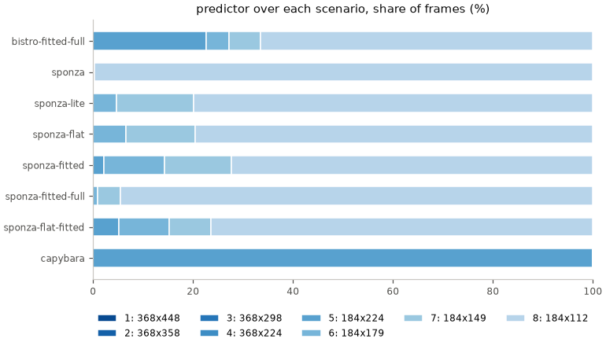

- A scene under budget at the top stays there at its fixed speed.
- On a scene over budget the predictor spends most frames at the floor, which cuts the mean and cuts the p95 more.
- Its heaviest frames still run over the target: triangle count binds them, and render size cannot reduce it.

## The policies on the board

Each policy flew each camera's whole path at a fixed frame step through the scene manager, at two budgets. The fixed row is the camera's half scale, the same at both budgets.

The quality columns score every frame's size against the reference render of the same pose at full size ([Render-Harness.md](../../tools/Render-Harness.md)).

<!-- generated: dynres-policies sha256=762d99b5a117fa98a434c5a7ec7a70bca44f89b813621a76e318b75e4f00dbd8 -->
**camera**

| Budget | Policy | Ladder | p50 | p95 | max | Over budget | Switches | Mean dE | SSIM |
|---|---|---|---|---|---|---|---|---|---|
| any | fixed | half | 42.5 | 53.6 | 54.7 | 0.0% | 0 | 9.53 | 0.5581 |
| 60.0 | stepped | width | 50.2 | 60.1 | 65.2 | 5.6% | 10 | 9.53 | 0.5584 |
| 60.0 | predicted | width | 53.0 | 58.2 | 60.8 | 0.8% | 12 | 9.52 | 0.5587 |
| 60.0 | predicted | height | 51.2 | 58.9 | 60.9 | 0.4% | 10 | 9.51 | 0.5604 |
| 75.0 | stepped | width | 62.4 | 88.9 | 93.0 | 25.0% | 12 | 9.50 | 0.5608 |
| 75.0 | predicted | width | 65.8 | 72.0 | 76.2 | 0.4% | 7 | 9.51 | 0.5601 |
| 75.0 | predicted | height | 66.6 | 72.8 | 76.3 | 0.4% | 11 | 9.46 | 0.5640 |

**tour**

| Budget | Policy | Ladder | p50 | p95 | max | Over budget | Switches | Mean dE | SSIM |
|---|---|---|---|---|---|---|---|---|---|
| any | fixed | half | 26.1 | 40.8 | 44.2 | 0.0% | 0 | 12.05 | 0.4968 |
| 60.0 | stepped | width | 47.4 | 67.9 | 92.1 | 15.9% | 15 | 12.04 | 0.4981 |
| 60.0 | predicted | width | 48.5 | 57.7 | 61.8 | 1.6% | 14 | 12.04 | 0.4981 |
| 60.0 | predicted | height | 52.8 | 58.5 | 61.6 | 0.9% | 19 | 12.03 | 0.4987 |
| 75.0 | stepped | width | 65.8 | 74.5 | 81.1 | 4.3% | 14 | 12.03 | 0.4989 |
| 75.0 | predicted | width | 63.1 | 73.0 | 76.7 | 0.8% | 9 | 12.03 | 0.4988 |
| 75.0 | predicted | height | 66.0 | 73.3 | 76.7 | 0.6% | 14 | 12.02 | 0.4997 |

Frame time is the scaled part, draw plus upscale, in milliseconds; dE and SSIM are against the reference at full size, lower dE and higher SSIM being closer.
<!-- /generated: dynres-policies -->

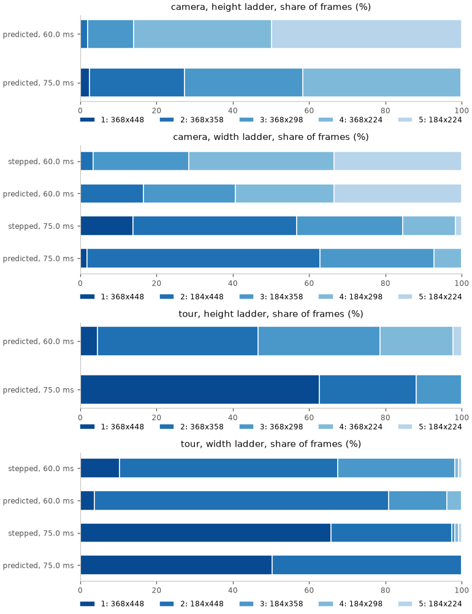

Prediction error compares each predicted frame's corrected price with its
measured cost, grouped by path, ladder and budget.

<!-- generated: dynres-prediction sha256=d1879a5ff699a7511f4d77f8afb5764e679c3329cdb81f515bf562ced67794a6 -->
| Path | Ladder | Budget | Frames | Median error | p95 error | Over budget |
|---|---|---|---|---|---|---|
| camera | height | 60.0 | 727 | 0.5% | 2.4% | 0.4% |
| camera | width | 60.0 | 727 | 0.5% | 2.2% | 0.8% |
| camera | height | 75.0 | 727 | 0.4% | 2.1% | 0.4% |
| camera | width | 75.0 | 727 | 0.4% | 2.3% | 0.4% |
| tour | height | 60.0 | 900 | 0.5% | 2.1% | 0.9% |
| tour | width | 60.0 | 900 | 0.7% | 2.4% | 1.6% |
| tour | height | 75.0 | 900 | 0.6% | 2.2% | 0.6% |
| tour | width | 75.0 | 900 | 0.6% | 2.4% | 0.8% |

Online refit: 1000 calls, mean 3.730 us, max 27 us per call.
<!-- /generated: dynres-prediction -->

What the table shows:

- **Over budget.** At the tight budget the half scale itself is often over, and both policies step down to the floor and stop there: a little over budget costs less than a harsh drop in picture.
- **Reaction.** The predictor steps on the frame the load arrives, the controller a window later.
- **Switches.** Neither flaps: the cooldown spaces the controller's steps, and the finer-step margin keeps the predictor off a step it just left.
- **Quality.** The scorer's dE is mostly the bake against the reference, a floor every size shares, so the differences are small and the order is what counts.
- **Ladder.** At the same budget, cutting the height first keeps the full width longer and scores closer to the reference than cutting the width first.

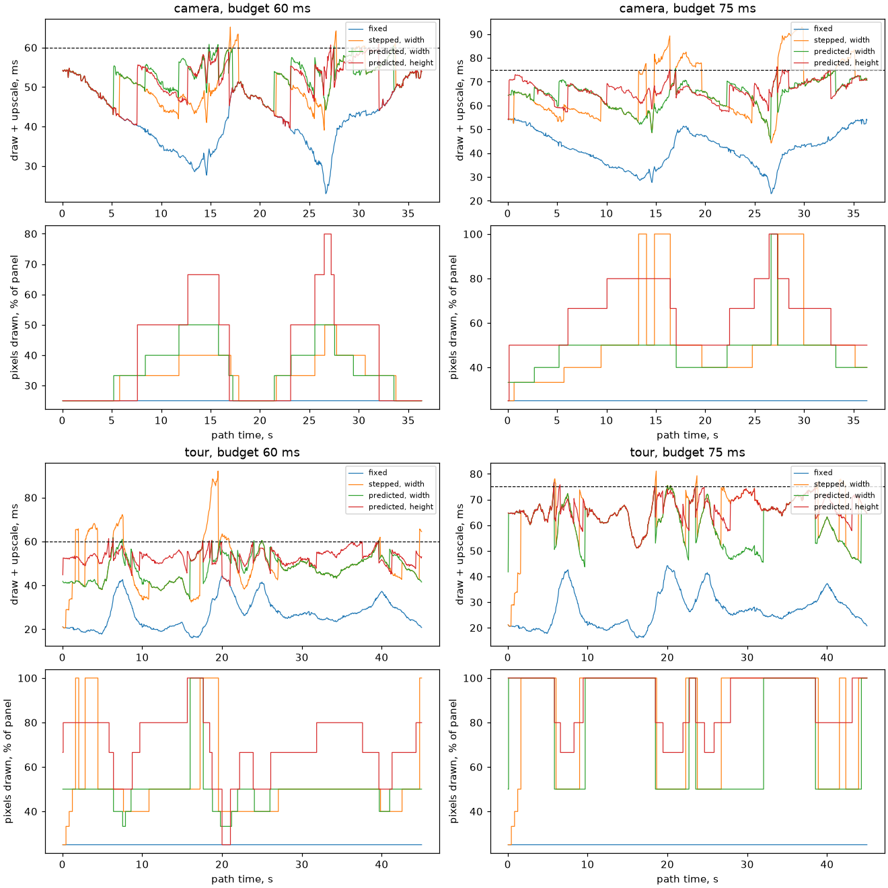

## Refreshing

The tables and figures are made by the docs generator, `launcher/tools/render/render_doc_images.sh`, like every other measured page. Its inputs are in `data/`:

- the board capture, made by the suite's `scale_split`, `scale_spans`, `dynres_step` and `dynres_frames` lines;
- `dynamic-resolution-quality-camera.csv` and `dynamic-resolution-quality-tour.csv`, each made by the test scene's quality script, which renders the path at each size on a host and scores it;
- `upscale-filter-quality.csv`, the upscale filter's scores.

A new board run replaces the capture, and the generator does the rest:

```sh
autana suite run_raster_scale_perf_suite --flash --out docs/render/data/dynamic-resolution-board.log
sh launcher/tools/render/render_doc_images.sh
```

The upscale filter's scores and figures come from the test app's upscale quality script, one host run per scene and filter; its tools README has the command.

For the frame-stage captures see [frame/README.md](README.md#refreshing);
for the GPU-stage bake tables, [offline/README.md](../offline/README.md#where-the-time-goes).

The raster-scale perf suite forces portrait and landscape for every timed window:

- Its rows carry `quarter=portrait` or `quarter=landscape`, including calibration, policy flights, span splits and refit costs.
- Render sizes are physical panel sizes; the viewport quarter determines their upright axes.
- `dynres_report.py --quarter portrait` selects one quarter for its tables and chart, `--quarter landscape` the other. The default is portrait.
