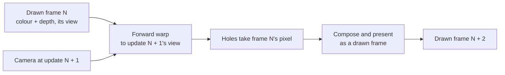
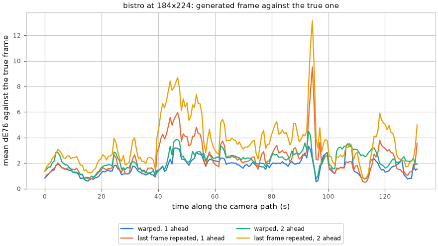
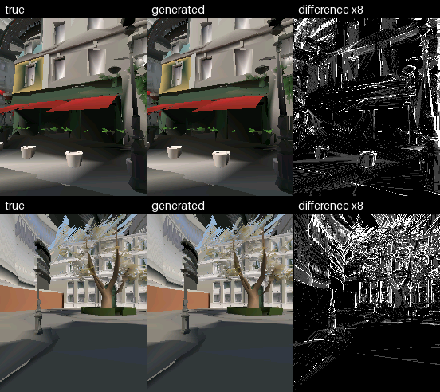
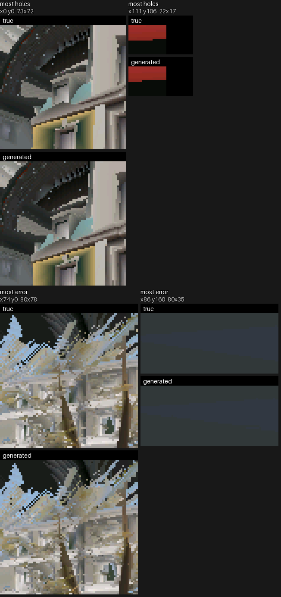
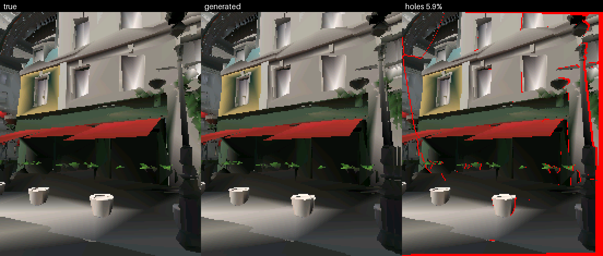
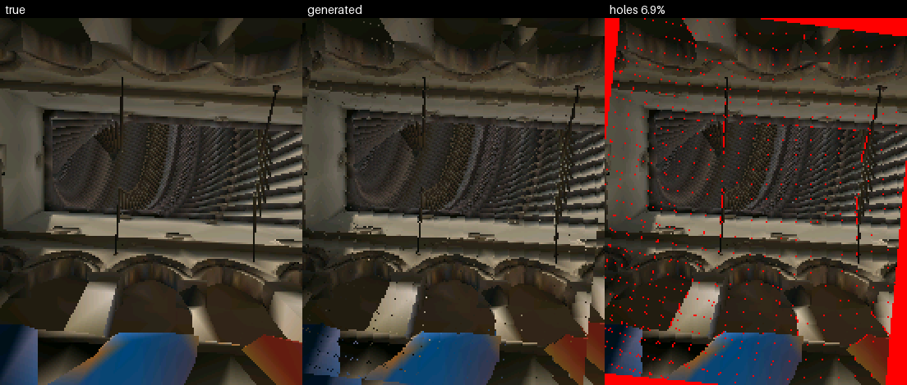
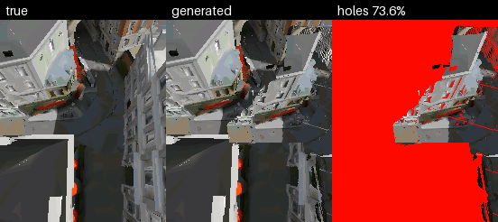

# Frame generation by depth reprojection

Frame generation shows a warped copy of the last drawn frame between drawn
frames, so more frames reach the panel without drawing more triangles. Each
drawn frame's colour and depth are forward-warped to the camera view of the
next update<sup>[[97]](../../Citations.md#mark-1997)</sup>. The warp
extrapolates rather than interpolates, so it adds no frame of
latency<sup>[[98]](../../Citations.md#meta-asw-2016)</sup>.

The view is the camera's exact pose at that update; objects that move on
their own show one drawn frame behind ([Moving objects](#moving-objects)).
`render/framegen/` holds the warp, and the render
context runs it: `render_context_set_frame_generation()` turns it on.



## Method

| Step | What it does |
|---|---|
| Warp | Each pixel goes back to the world through its depth and the view it was drawn through, then into the new view, and lands on the nearest pixel; the nearer point wins. The sky has no depth and only turns |
| Holes | Pixels nothing lands on: pinholes where the warp stretches the picture, background uncovered behind a near edge, and the screen edge |
| Fill | A hole keeps the drawn frame's pixel at the same place |
| Compose | The generated picture goes through the same upscale and present as a drawn one |

Lighting is baked, so a surface's colour does not change with the view and
a warped pixel is the right colour. Depth-based warps for head motion work
the same way<sup>[[100]](../../Citations.md#meta-asw2-2019)</sup>.

A filled hole is the frame before's pixel, not the background it uncovered.
Filling holes from neighbouring background instead<sup>[[99]](../../Citations.md#didyk-2010)</sup>
scored worse on the host, and filling the pinholes from their neighbours first
gained less than 0.02 dE: what error is left comes from the warp's
nearest-pixel resampling, not from holes.

## Picture

On the host, every scene's camera path is drawn at each half-picture size of
the [dynamic-resolution](Dynamic-Resolution.md) ladder, one frame per display
step of a 30 fps display. A sample of frames is warped one and two steps
ahead and scored against the frame really drawn there with the reference
scorer ([Bake-Method.md](../offline/Bake-Method.md)): mean CIE76 dE and luma SSIM.
Repeating the last frame, what the panel shows without frame generation, is
scored beside it.

<details><summary>Every scene and size</summary>

<!-- generated: framegen-scores sha256=b714a6dbc93bb01bb2f94eee66db9f6bace88f9bb2b957137a4de8bd6276e2f0 -->
| Scene | Size | Ahead | Holes % (pinholes) | dE warp, row fill | dE warp, previous fill | dE repeat | p95 frame dE warp / repeat | SSIM warp / repeat |
|---|---|---|---|---|---|---|---|---|
| bistro | 184x224 | 1 | 2.9 (2.2) | 1.73 | 1.68 | 2.36 | 2.88 / 4.89 | 0.910 / 0.873 |
| bistro | 184x224 | 2 | 5.6 (4.1) | 2.24 | 2.17 | 3.67 | 3.32 / 7.65 | 0.879 / 0.793 |
| bistro | 184x149 | 1 | 2.7 (2.1) | 1.81 | 1.76 | 2.36 | 3.07 / 4.92 | 0.907 / 0.877 |
| bistro | 184x149 | 2 | 5.5 (4.1) | 2.39 | 2.31 | 3.66 | 3.55 / 7.68 | 0.871 / 0.798 |
| bistro | 184x112 | 1 | 2.8 (2.2) | 1.88 | 1.81 | 2.36 | 3.28 / 4.93 | 0.904 / 0.879 |
| bistro | 184x112 | 2 | 5.4 (4.0) | 2.51 | 2.42 | 3.66 | 3.73 / 7.61 | 0.865 / 0.801 |
| sponza | 184x224 | 1 | 2.2 (1.3) | 2.04 | 1.93 | 2.88 | 3.76 / 5.83 | 0.919 / 0.884 |
| sponza | 184x224 | 2 | 4.4 (2.7) | 2.41 | 2.24 | 4.47 | 4.02 / 8.76 | 0.902 / 0.806 |
| sponza | 184x149 | 1 | 2.1 (1.3) | 2.17 | 2.05 | 2.87 | 3.98 / 5.83 | 0.916 / 0.886 |
| sponza | 184x149 | 2 | 4.4 (2.7) | 2.60 | 2.42 | 4.46 | 4.25 / 8.77 | 0.895 / 0.807 |
| sponza | 184x112 | 1 | 2.0 (1.3) | 2.25 | 2.13 | 2.86 | 4.18 / 5.79 | 0.914 / 0.888 |
| sponza | 184x112 | 2 | 4.3 (2.6) | 2.77 | 2.59 | 4.45 | 4.44 / 8.75 | 0.889 / 0.810 |
<!-- /generated: framegen-scores -->

</details>

- The warp beats repeating the frame on every scene and size: the mean dE
  drops by a fifth to a half, and the worst frames' dE (p95) by over a
  quarter to over a half, most at two steps ahead.
- One step ahead leaves 2-3% holes, most of them pinholes; two steps ahead
  doubles both.
- Smaller render heights keep the gain; the warp's error grows a little with
  the coarser grid.

Bistro along its whole path at 184x224: where repeating the frame jumps
(turns and fast passes), the generated frame stays close to the true one.

<picture>
  <source media="(prefers-color-scheme: dark)" srcset="../../images/render/framegen-bistro-path-dark.png">
  <source media="(prefers-color-scheme: light)" srcset="../../images/render/framegen-bistro-path.png">
  
</picture>

The frame with the most holes that are not pinholes, and the frame the
generated one strays from most, against the true frame, with where they
differ most enlarged:





The holes themselves, in red over the warp, before the fill:





The screen edge opens most holes on a turn: a guard band, drawing a few
pixels past each edge, would remove them. Uncovered background behind thin
near objects (a lamp post, chair legs) is what is left.



## Cost on the board

The on-request `run_framegen_perf_suite` draws each path at every
half-picture step. At 24 poses along it, it warps the drawn frame one display
step on, both cores taking half the rows, fills the holes and composes the
generated picture into the half picture; the send overlaps it.

<!-- generated: framegen-board sha256=fb434d8e5cc5d6327b52096b21eae743728ecab9a4c650b573c99a707e3ae589 -->
| Scene | Size | Drawn frame | Warp | Fill | Compose | Generated frame |
|---|---|---|---|---|---|---|
| bistro | 184x224 | 48.0 ms | 10.0 ms | 2.1 ms | 2.8 ms | 14.9 ms |
| bistro | 184x179 | 44.1 ms | 8.0 ms | 1.8 ms | 2.4 ms | 12.3 ms |
| bistro | 184x149 | 41.4 ms | 6.6 ms | 1.4 ms | 2.2 ms | 10.2 ms |
| bistro | 184x112 | 38.2 ms | 4.8 ms | 1.1 ms | 1.9 ms | 7.8 ms |
| sponza | 184x224 | 56.5 ms | 10.2 ms | 1.9 ms | 2.7 ms | 14.8 ms |
| sponza | 184x179 | 51.1 ms | 7.8 ms | 1.4 ms | 2.4 ms | 11.6 ms |
| sponza | 184x149 | 47.6 ms | 6.7 ms | 1.3 ms | 2.1 ms | 10.1 ms |
| sponza | 184x112 | 43.2 ms | 4.9 ms | 0.9 ms | 1.8 ms | 7.7 ms |
<!-- /generated: framegen-board -->

- A generated frame costs about a third of a drawn one at 184x224 and a
  fifth at 184x112.
- The fill writes only the holes, a few percent of the pixels, from the
  drawn frame into the warp's own picture, and compose reads that picture
  (`raster_upscale_picture()`). The drawn frame stays as it was drawn.

Where the warp's time goes. The same warp is timed with every splat off screen
(the clear, the maths and the source reads), to the drawn view itself (adding
every write, in order), and to the next view (adding their scatter):

<!-- generated: framegen-profile sha256=280d6170d97a9f9046448fa48e3b8a5938a287d3a726725bf0528a1a86e8978b -->
| Scene | Size | Clear | Off screen | To the drawn view | To the next view |
|---|---|---|---|---|---|
| bistro | 184x224 | 0.8 ms | 10.4 ms | 10.0 ms | 10.0 ms |
| bistro | 184x179 | 0.6 ms | 7.4 ms | 8.1 ms | 8.0 ms |
| bistro | 184x149 | 0.4 ms | 6.2 ms | 6.6 ms | 6.6 ms |
| bistro | 184x112 | 0.3 ms | 4.7 ms | 4.9 ms | 4.8 ms |
| sponza | 184x224 | 0.8 ms | 10.5 ms | 10.0 ms | 10.2 ms |
| sponza | 184x179 | 0.5 ms | 7.4 ms | 7.8 ms | 7.8 ms |
| sponza | 184x149 | 0.4 ms | 6.3 ms | 6.8 ms | 6.7 ms |
| sponza | 184x112 | 0.3 ms | 4.8 ms | 4.9 ms | 4.9 ms |
<!-- /generated: framegen-profile -->

The three warps cost the same: writing and scattering the splats is free next
to the maths. The warp is bound by its arithmetic, a reciprocal and about ten
multiply-adds per pixel, so it takes two pixels a step and lets their
dependent chains overlap. The reciprocal keeps 14 bits
(`mathf_recip_approx`), a hundredth of a pixel across the picture, which
saves 6% of the warp over a full-precision one.

## When it pays

A generated frame only helps when it costs less than a drawn one. A scene
that draws faster than the warp runs would show fewer frames with generation
on, so the render context times both and decides each frame:

| Last measured | Next frame after a drawn one |
|---|---|
| No generated frame yet | Generated |
| The generated frame cost under (100 − `FRAMEGEN_GAIN_PERCENT`)% of the drawn one | Generated |
| Already generating, and it still costs less than the drawn one | Generated |
| It saved less | Drawn |
| `FRAMEGEN_RETRY_DRAWN` drawn frames in a row | Generated, to measure it again |

A frame drawn as a held one is never generated: a warp to the same camera
shows nothing new, so its moving objects are drawn as
[partial redraw](Partial-Redraw.md#when-every-row-is-drawn) draws them. A
held view under [dynamic resolution](Dynamic-Resolution.md#a-held-camera)
that was handed back to the policy is generated as a moving one is.

The margin keeps a generated frame, which shows the scene less exactly than
a drawn one, from being shown for a saving too small to see.

## With dynamic resolution

A [dynamic-resolution](Dynamic-Resolution.md) budget is the cost of a shown
frame. With frame generation on, the render context prices each drawn frame
at one shown frame's budget, as without it. A generated frame is not priced;
its cost only decides whether generation pays.

A drawn frame draws at the rows a frame without generation gets, so the
slowest frames are as fast with generation as without. The budget sets the
rate: a tighter one draws coarser and shows more frames.

Each scene's path played in real time on the board, per mode:

<!-- generated: framegen-modes sha256=3ccd0dab03c42672db57196a4b3a439da6643a875d92e957a660c1c0409e4a5f -->
| Scene | Frame generation | Budget | Shown | p95 frame | Drawn | Drawn height |
|---|---|---|---|---|---|---|
| bistro | off | off | 23.9 fps | 63.5 ms | 100% | 224 |
| bistro | on | off | 29.3 fps | 58.7 ms | 52% | 224 |
| bistro | off | 33 ms | 26.5 fps | 50.8 ms | 100% | 166 |
| bistro | on | 33 ms | 33.5 fps | 47.9 ms | 52% | 163 |
| bistro | on | 24 ms | 35.5 fps | 47.4 ms | 52% | 140 |
| bistro | on | 16 ms | 37.4 fps | 47.2 ms | 50% | 118 |
| sponza | off | off | 18.5 fps | 65.3 ms | 100% | 224 |
| sponza | on | off | 25.1 fps | 64.8 ms | 50% | 224 |
| sponza | off | 33 ms | 23.4 fps | 50.3 ms | 100% | 123 |
| sponza | on | 33 ms | 32.4 fps | 49.9 ms | 50% | 123 |
| sponza | on | 24 ms | 33.5 fps | 49.9 ms | 50% | 112 |
| sponza | on | 16 ms | 33.5 fps | 49.9 ms | 50% | 112 |
| capybara-sponza | off | off | 25.5 fps | 49.7 ms | 100% | 224 |
| capybara-sponza | on | off | 30.0 fps | 49.4 ms | 50% | 224 |
| capybara-sponza | off | 33 ms | 26.8 fps | 40.8 ms | 100% | 195 |
| capybara-sponza | on | 33 ms | 31.8 fps | 40.2 ms | 50% | 193 |
| capybara-sponza | on | 24 ms | 36.2 fps | 39.1 ms | 50% | 141 |
| capybara-sponza | on | 16 ms | 39.0 fps | 39.1 ms | 50% | 112 |
<!-- /generated: framegen-modes -->

- At the same budget, frame generation shows more frames at about the same
  rows: Bistro shows 33.5 fps instead of 26.5, at 163 rows instead of 166,
  and its p95 frame falls from 50.8 ms to 47.9 ms.
- A tighter budget turns the saving into rate: Bistro shows 37.4 fps at a
  16 ms budget.
- The rate gains less than the cost table suggests: every update, drawn or
  generated, also pays the frame's own work outside the render, a few
  milliseconds.

## Pacing

A generated frame is shown as soon as it is made, right after the drawn frame
before it. The shown frames alternate between a drawn frame's interval and a
generated frame's. Each frame's view is right for when it is shown, so motion
stays correct, but the intervals are uneven.

Even intervals need the generated frame presented halfway through the next
drawn frame, while both cores draw it: a slot in the frame loop, not in the
render context, and the frame loop has no such slot.

## For an app

Frame generation and the budget are per render context, set by whoever owns
it: an app for its scenes, a player setting, or later a default the frame
loop applies.

<!-- generated: render-framegen-example check: python launcher/tools/gen/examples_doc.py --check -->
```c
/* Frame generation with dynamic resolution: while it pays, every second frame
 * is warped from the one drawn before it, and each drawn frame is priced at
 * one shown frame's budget. */
#include "render/context/render_context.h"

static void
framegen_example(render_context_t* context, const resolution_config_t* ladder) {
    render_context_set_dynamic_resolution(context, ladder, NULL, 0); /* ladder->budget_us: per shown frame */
    render_context_set_frame_generation(context, true);
}

/* After a frame: whether it was generated rather than drawn. */
static bool
framegen_example_generated(const render_context_t* context) {
    return render_context_frame(context).generated;
}
```
<!-- /generated: render-framegen-example -->

| Call | Use |
|---|---|
| `render_context_set_frame_generation(context, on)` | On for any scene; objects that move on their own show one drawn frame behind ([Moving objects](#moving-objects)); off costs nothing. The context generates a frame only [when it pays](#when-it-pays); a debug view, a camera cut or a new viewport draws the next frame instead |
| `render_context_set_dynamic_resolution(context, config, model, step)` | `config->budget_us` is the budget per shown frame; with generation on, each drawn frame is priced at it |
| `render_context_frame(context).generated` | Whether the last frame was generated rather than drawn |

## Moving objects

The warp moves everything with the camera, so an object moving on its own
shows where the last drawn frame put it until the next drawn frame: one
drawn frame behind. An app turns generation on as for any scene. The modes
suite measures a scene with a skinned runner and a camera that follows it,
with each mode's slowest frames by stage.

## Reproducing

[`launcher/tools/r3d/framegen/`](../../../launcher/tools/r3d/framegen/) holds
the host experiment, with the host scene renderer's `--dump` option. The
board numbers come from the on-request `run_framegen_perf_suite` and
`run_framegen_modes_suite`, captured in
[`docs/render/data/framegen-board.log`](../data/framegen-board.log).

| File | Role |
|---|---|
| [`warp.py`](../../../launcher/tools/r3d/framegen/warp.py) | The warp and the fills, on a raster dump |
| [`framegen_score.py`](../../../launcher/tools/r3d/framegen/framegen_score.py) | One scene and size: render, warp, score; stills, sheet, clip and video |
| [`framegen_report.py`](../../../launcher/tools/r3d/framegen/framegen_report.py) | The tables and figures, from the scores and the board capture |
| [`framegen_docs.sh`](../../../launcher/tools/r3d/framegen/framegen_docs.sh) | Regenerates this page's tables and images |
