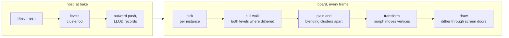
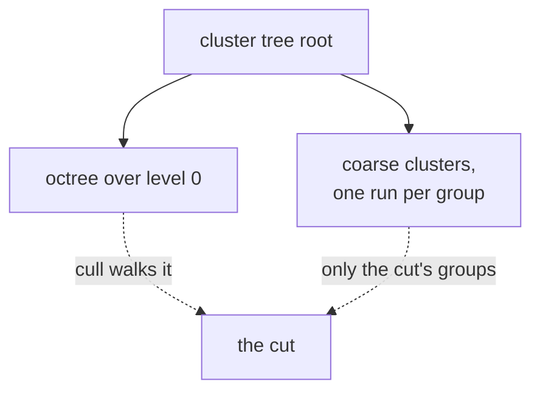
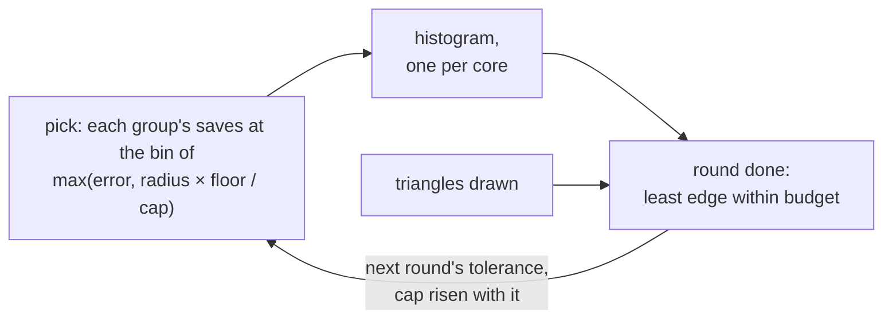
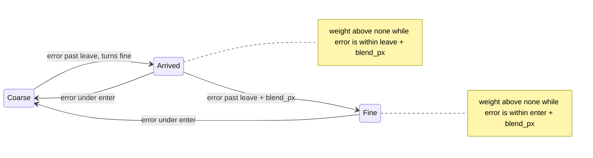

# Levels of detail

A baked mesh carries coarser levels of its clusters; the cull picks a level per
cluster group by its error in output pixels, and a blend can soften the switch.



| Piece | Where | Runs |
|---|---|---|
| Levels of a mesh | [`lod/levels.py`](../../../launcher/tools/r3d/lod/levels.py), [`lod/clusterlod.cpp`](../../../launcher/tools/r3d/lod/clusterlod.cpp) | host |
| Levels in the baked mesh | [`lod/bake_levels.py`](../../../launcher/tools/r3d/lod/bake_levels.py), [`r3d_lit_mesh.h`](../../../launcher/main/render/r3d_lit_mesh.h), [LLOD](../../assets/formats/LLOD.md) | bake |
| Pick | [`r3d_lod_pick()`](../../../launcher/main/render/lod/r3d_lod.h), from the main view's cull (`raster_t.picks_levels`) | board |
| Blend | [`r3d_lod.h`](../../../launcher/main/render/lod/r3d_lod.h), morph targets in [LMOR](../../assets/formats/LMOR.md) | board |
| Steer to `lod.triangle_budget` | [`r3d_lod_steer_frame()`](../../../launcher/main/render/lod/r3d_lod.h), its state per scene renderer (`raster_t.steer`) | board |
| Tolerance for a budget | [`lod/pick.py`](../../../launcher/tools/r3d/lod/pick.py), [`lod/lod_replay.py`](../../../launcher/tools/r3d/lod/lod_replay.py) | host |

## The levels

Clusters are grouped, simplified with each group's border locked, and split
again until a group no longer simplifies<sup>[[54]](../../Citations.md#karis-2021)</sup>
(meshoptimizer's<sup>[[11]](../../Citations.md#meshoptimizer)</sup> `clusterlod`).



| Rule | Why |
|---|---|
| Level 0 is `clusterlod`'s own clusters of the fitted mesh | one tree; a fit starts without levels |
| Positions only; a coarse cluster samples colour from the nearest level-0 surface facing its way | a one-colour strip is not simplified alone |
| One hierarchy per sidedness, shared positions locked | the two meet without a crack |
| Coarse vertices pushed outward up to the group's error | a coarse level never sits inside the surface it replaces |
| Spheres and errors rounded outward into position ticks | ordering holds after rounding ([LLOD](../../assets/formats/LLOD.md)) |
| `[geometry] lod = false` | no levels; level 0 is the baked meshlets |

## The pick

| Rule | Effect |
|---|---|
| A cluster draws when its error ≤ tolerance < its group's error, each projected at the group's sphere | neighbours in a group switch together: no crack |
| Coarse below `tolerance − hysteresis_px`, fine above `tolerance + hysteresis_px` | a still camera never flickers |
| A group whose radius spans more than `coverage_permille` of the height stays fine | no large coarse patch shimmering under drift |
| A coarse group's finer groups are coarse too; a closing pass fixes float rounding | the cut stays crack-free |
| Each instance every `lod.pick_every` frames, all on a scene's first | the cull walk only reads the bits |

Settings: [`lod.*`](../Render-Settings.md#lod). The rest mesh is one
hierarchy across welded objects; each copy shape has its own, shared by its copies.

Each coverage cap along the paths, against the finest level. Blocks popping is
frame-to-frame change beyond the finest level's own; triangles are those submitted.

<!-- generated: lod-coverage sha256=c00f806b82117544844c4f01a5e0640694835f3ce1b4d93ef43b030d5b99d876 -->
| Path | Cap | Blocks popping | Mean difference /255 | Triangles, mean | Triangles, p95 |
|---|---|---|---|---|---|
| Sponza | none | 0.0516% | 0.041 | -6.6% | -6.8% |
| Sponza | 50% | 0.0516% | 0.041 | -6.6% | -6.8% |
| Sponza | 25% | 0.0516% | 0.041 | -6.6% | -6.8% |
| Sponza | 10% | 0.0495% | 0.037 | -5.7% | -6.8% |
| Bistro | none | 0.1663% | 0.155 | -10.7% | -11.5% |
| Bistro | 50% | 0.1268% | 0.104 | -8.6% | -10.6% |
| Bistro | 25% | 0.0952% | 0.062 | -6.6% | -7.6% |
| Bistro | 10% | 0.0437% | 0.028 | -4.6% | -4.5% |
<!-- /generated: lod-coverage -->

```sh
python launcher/tools/r3d/lod/coverage_table.py --script HOST_RENDER.sh \
    --morph sponza.atrium_fitted_full --morph bistro.street_fitted_full \
    --render Sponza "--scene sponza-fitted-full --no-hud --frames 1101 --dt 33" \
    --render Bistro "--scene bistro-fitted-full --no-hud --frames 900 --dt 33" --doc docs/render/frame/Levels-of-Detail.md
```

**Gate:** at the levels a pose picks, no more hidden surface shows and the
sky-through-walls test finds no more holed frames than at the finest level.

## The budget

One tolerance per frame is also the cut that meets a triangle budget at the
least error<sup>[[110]](../../Citations.md#wimmer-1998)</sup>, refining by
screen-space error<sup>[[111]](../../Citations.md#hoppe-1997)</sup>; the floor
is `lod.tolerance_px`, and a steered floor is at least the first bin's edge.
With `lod.triangle_budget` set, each pick adds a group's `saves` (LLOD) at the
half-octave bin of the least tolerance that turns it coarse, and the
instance's finest triangles once. That is its projected error, or the
tolerance whose coverage cap its radius fits: steered, the cap rises in
proportion to the tolerance.

When a round of picks has seen every instance, the finest less the saves below
each edge is the count there, scaled by what the round drew over what it
predicted, which takes in culling. The steer takes the least edge within
budget, from `lod.tolerance_px` up. It rises at once and falls a bin a round,
and only once the edge two below fits, so a held view settles and a closing
camera does not dip and climb back; with partial redraw, a still view keeps picking until
a round leaves the tolerance where it was.



Errors bin, and the tolerance is kept, in `lod.tolerance_px`'s pixels, so a
picture drawn at another size steers the same. A rise can overshoot by a bin
or more: the round after it still draws some instances at the old cut, and
falling one bin a round brings the tolerance back down. On the host,
`pick.py` finds the tolerance from the same bins and `lod_replay.py` scores
it along a path against the exact one.

```sh
python launcher/tools/r3d/lod/lod_replay.py SCENE.scene.toml --object NAME --out DIR [--budgets N,...] [--segment T0 T1]
```

## The blend

A fine group blends toward its parent's coarse surface as the parent nears its
switch, so the switch itself moves nothing<sup>[[117]](../../Citations.md#hoppe-1996)</sup><sup>[[118]](../../Citations.md#strugar-2009)</sup>.

| Blend | When | Draws during a blend | Flash |
|---|---|---|---|
| Switch | default (`lod.blend = 0`) | one level | none |
| Dither | `lod.blend = 1` | both levels through complementary 4×4 screen doors | none |
| Morph | `lod.blend = 1`, `[geometry] morph = true` | the fine level, moved toward the coarse surface | the LMOR sibling ([`lod/morph.py`](../../../launcher/tools/r3d/lod/morph.py)) |


The weight is whole at the next switch and fades to none `lod.blend_px` past
it. Two more bits per group track it, held by every instance whatever
`lod.blend` is ([`R3D_LOD_STATE_SETS`](../../../launcher/main/render/lod/r3d_lod.h)):




A camera closing in on a carved relief down the fitted Sponza atrium:
finest, switch, dither and morph. It is drawn at `lod.tolerance_px = 16`, so
each switch is large enough to see.


| Morph target | Rule |
|---|---|
| Kept vertex | the coarse vertex it became; nearer pairs claim first |
| Removed vertex | the nearest point on the parent's coarse triangles facing its way |
| Colour | the coarse colour where it lands; face-colour meshes blend positions only |
| Shared position | stays put across clusters under different parents, so no crack |

Each path against the finest level; the morph rows add morph targets to the
locked meshes. The 4×4 columns average luma over the screen door's tile, where
a dither reads as its blend; the worst pop is each arm's peak where the switch
pops most, scored only at frames whose coarse clusters drawn change. Each
group's blending bit is set one ramp ([`R3D_LOD_BLEND_LEAD`](../../../launcher/main/render/lod/r3d_lod.h)) before its
weight rises, so a pick spread over frames never starts a blend partway. Stacked vertices are those whose target's own level was blending
too, so the target sits off its neighbour.

<!-- generated: lod-morph sha256=e811a72f821ffd2dc64fe0303253bcc294036f832337348a0317f277697f3879 -->
| Path | Arm | Blocks popping | Mean difference /255 | 4×4 | Worst switch pop /255 | 4×4 | Vertices blended | Frames stacked | Vertices stacked | Stacked, most px |
|---|---|---|---|---|---|---|---|---|---|---|
| Sponza | switches | 0.1085% | 0.075 | 0.058 | 6.03 | 6.01 | 0.0% | 0.0% | 0.00% | 0.00 |
| Sponza | blend, dither | 0.1173% | 0.084 | 0.064 | 3.69 | 2.68 | 4.0% | 0.0% | 0.00% | 0.00 |
| Sponza | blend, morph | 0.1196% | 0.082 | 0.063 | 3.19 | 2.47 | 2.5% | 2.3% | 0.03% | 0.26 |
| Bistro | switches | 0.1537% | 0.087 | 0.075 | 4.88 | 3.78 | 0.0% | 0.0% | 0.00% | 0.00 |
| Bistro | blend, dither | 0.2015% | 0.128 | 0.108 | 4.88 | 3.78 | 10.0% | 0.0% | 0.00% | 0.00 |
| Bistro | blend, morph | 0.1967% | 0.121 | 0.104 | 4.88 | 3.78 | 5.4% | 0.0% | 0.00% | 0.00 |
<!-- /generated: lod-morph -->

Today the blend wins at Sponza's worst switch, whose peak falls from 6.03 to
3.69 dithered and 3.19 morphed. It loses slightly on blocks popping and on the
mean difference in both scenes, and Bistro's worst switch pops the same in
every arm.

```sh
python launcher/tools/r3d/lod/morph_table.py --script HOST_RENDER.sh \
    --morph sponza.atrium_fitted_full --morph bistro.street_fitted_full \
    --render Sponza "--scene sponza-fitted-full --no-hud --frames 1101 --dt 33" \
    --render Bistro "--scene bistro-fitted-full --no-hud --frames 900 --dt 33" --doc docs/render/frame/Levels-of-Detail.md
```
