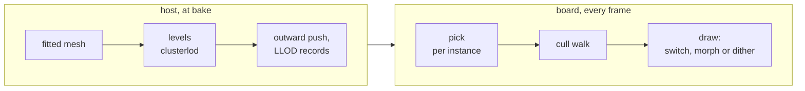
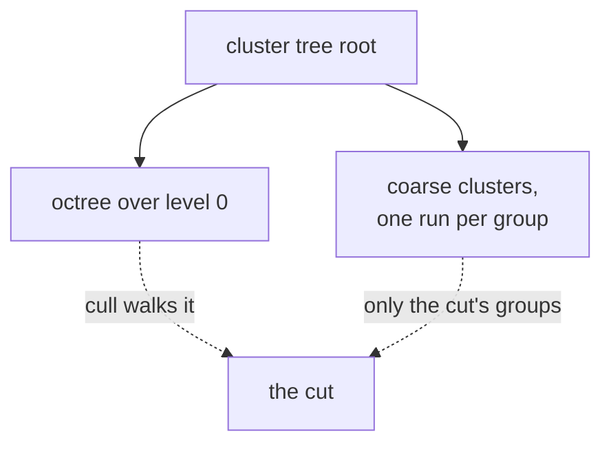
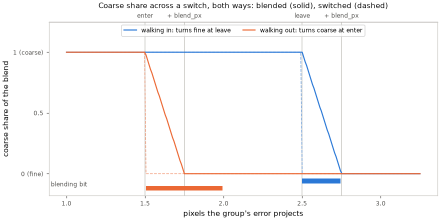
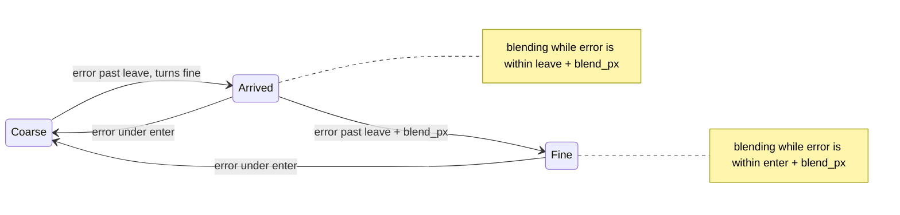
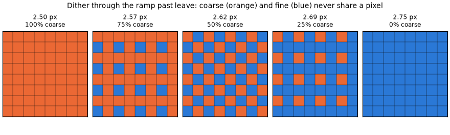
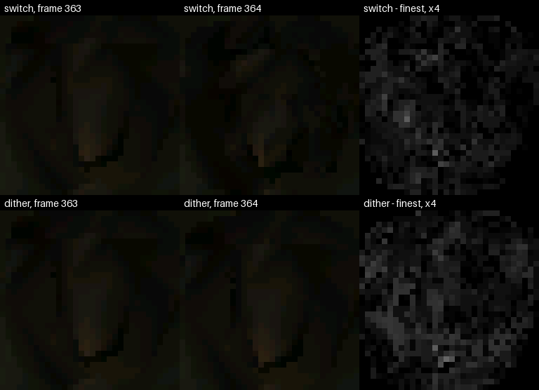
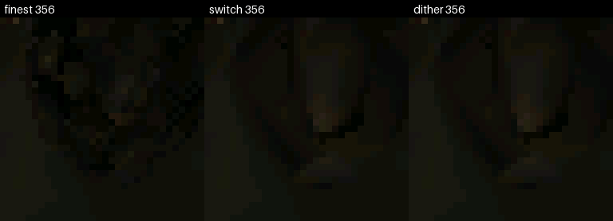

# Levels of detail

A baked mesh carries coarser levels of its clusters; the cull picks a level per
cluster group by its error in output pixels, and the blend hides the switch.



| Piece | Where | Runs |
|---|---|---|
| Levels of a mesh | [`lod/levels.py`](../../../launcher/tools/r3d/lod/levels.py), [`lod/clusterlod.cpp`](../../../launcher/tools/r3d/lod/clusterlod.cpp) | host |
| Levels in the baked mesh | [`lod/bake_levels.py`](../../../launcher/tools/r3d/lod/bake_levels.py), [`r3d_lit_mesh.h`](../../../launcher/main/render/r3d_lit_mesh.h), [LLOD](../../assets/formats/LLOD.md) | bake |
| Pick | [`r3d_lod_pick()`](../../../launcher/main/render/lod/r3d_lod.h), from the main view's cull (`raster_t.picks_levels`) | board |
| Blend | [`r3d_lod.h`](../../../launcher/main/render/lod/r3d_lod.h), morph targets in [LMOR](../../assets/formats/LMOR.md) | board |
| Tolerance for a budget | [`lod/pick.py`](../../../launcher/tools/r3d/lod/pick.py), [`lod/lod_replay.py`](../../../launcher/tools/r3d/lod/lod_replay.py) | host |

## The levels

Clusters are grouped, simplified with each group's border locked, and split
again until a group no longer simplifies<sup>[[54]](../../Citations.md#karis-2021)</sup>
(meshoptimizer's<sup>[[11]](../../Citations.md#meshoptimizer)</sup> `clusterlod`).



| Rule | Why |
|---|---|
| Level 0 is `clusterlod`'s own clusters of the fitted mesh | one tree; a fit starts without levels |
| Positions only; a coarse cluster samples colour from the nearest level-0 surface facing its way | a one-colour strip is not simplified alone |
| One hierarchy per sidedness, shared positions locked | the two meet without a crack |
| Coarse vertices pushed outward up to the group's error | a coarse level never sits inside the surface it replaces |
| Spheres and errors rounded outward into position ticks | ordering holds after rounding ([LLOD](../../assets/formats/LLOD.md)) |
| `[geometry] lod = false` | no levels; level 0 is the baked meshlets |

## The pick

| Rule | Effect |
|---|---|
| A cluster draws when its error ≤ tolerance < its group's error, each projected at the group's sphere | neighbours in a group switch together: no crack |
| Coarse below `tolerance − hysteresis_px`, fine above `tolerance + hysteresis_px` | a still camera never flickers |
| A group whose radius spans more than `coverage_permille` of the height stays fine | no large coarse patch shimmering under drift |
| A coarse group's finer groups are coarse too; a closing pass fixes float rounding | the cut stays crack-free |
| Each instance every `lod.pick_every` frames, all on a scene's first | the cull walk only reads the bits |

Settings: [`lod.*`](../Render-Settings.md#lod). The rest mesh is one
hierarchy across welded objects; each copy shape has its own, shared by its copies.

Each coverage cap along the paths, against the finest level. Blocks popping is
frame-to-frame change beyond the finest level's own; triangles are those submitted.

<!-- generated: lod-coverage sha256=c00f806b82117544844c4f01a5e0640694835f3ce1b4d93ef43b030d5b99d876 -->
| Path | Cap | Blocks popping | Mean difference /255 | Triangles, mean | Triangles, p95 |
|---|---|---|---|---|---|
| Sponza | none | 0.0516% | 0.041 | -6.6% | -6.8% |
| Sponza | 50% | 0.0516% | 0.041 | -6.6% | -6.8% |
| Sponza | 25% | 0.0516% | 0.041 | -6.6% | -6.8% |
| Sponza | 10% | 0.0495% | 0.037 | -5.7% | -6.8% |
| Bistro | none | 0.1663% | 0.155 | -10.7% | -11.5% |
| Bistro | 50% | 0.1268% | 0.104 | -8.6% | -10.6% |
| Bistro | 25% | 0.0952% | 0.062 | -6.6% | -7.6% |
| Bistro | 10% | 0.0437% | 0.028 | -4.6% | -4.5% |
<!-- /generated: lod-coverage -->

```sh
python launcher/tools/r3d/lod/coverage_table.py --script HOST_RENDER.sh \
    --render Sponza "--scene sponza-fitted-full --no-hud --frames 1101 --dt 33" \
    --render Bistro "--scene bistro-fitted-full --no-hud --frames 900 --dt 33" --doc docs/render/frame/Levels-of-Detail.md
```

**Gate:** at the levels a pose picks, no more hidden surface shows and the
sky-through-walls test finds no more holed frames than at the finest level.

## The budget

The board picks at a fixed `lod.tolerance_px`. One tolerance per frame is also
the cut that meets a triangle budget at the least error<sup>[[110]](../../Citations.md#wimmer-1998)</sup>
by screen-space error<sup>[[111]](../../Citations.md#hoppe-1997)</sup>.
`pick.py` finds that tolerance from a histogram of log-spaced bins;
`lod_replay.py` scores it along a path against the exact one.

```sh
python launcher/tools/r3d/lod/lod_replay.py SCENE.scene.toml --object NAME --out DIR [--budgets N,...] [--segment T0 T1]
```

## The blend

A fine group blends toward its parent's coarse surface as the parent nears its
switch, so the switch itself moves nothing<sup>[[116]](../../Citations.md#hoppe-1996)</sup><sup>[[117]](../../Citations.md#strugar-2009)</sup>.

| Blend | When | Draws during a blend | Flash |
|---|---|---|---|
| Switch | `lod.blend = 0` | one level | none |
| Dither | default | both levels through complementary 4×4 screen doors | none |
| Morph | `[geometry] morph = true` | the fine level, moved toward the coarse surface | the LMOR sibling ([`lod/morph.py`](../../../launcher/tools/r3d/lod/morph.py)) |



The weight is whole at the next switch and fades to none `lod.blend_px` past
it. Two more bits per group track it ([`R3D_LOD_STATE_SETS`](../../../launcher/main/render/lod/r3d_lod.h)):





The fitted Sponza path's worst pop, switched and dithered, each beside its
difference from the finest level:





| Morph target | Rule |
|---|---|
| Kept vertex | the coarse vertex it became; nearer pairs claim first |
| Removed vertex | the nearest point on the parent's coarse triangles facing its way |
| Colour | the coarse colour where it lands; face-colour meshes blend positions only |
| Shared position | stays put across clusters under different parents, so no crack |

Blended per path against the finest level. Stacked vertices are those whose
target's own level was blending too, so the target sits off its neighbour.

<!-- generated: lod-morph sha256=13ac2dd45108c862682f0abf5ad3351aca84842b3805d84df2b238d33e230f14 -->
| Path | Arm | Blocks popping | Mean difference /255 | Vertices blended | Frames stacked | Vertices stacked | Stacked, most px |
|---|---|---|---|---|---|---|---|
| Sponza | switches | 0.0933% | 0.071 | 0.0% | 0.0% | 0.00% | 0.00 |
| Sponza | blend | 0.0979% | 0.077 | 3.4% | 0.0% | 0.00% | 0.00 |
| Bistro | switches | 0.1720% | 0.105 | 0.0% | 0.0% | 0.00% | 0.00 |
| Bistro | blend | 0.1846% | 0.127 | 9.1% | 0.0% | 0.00% | 0.00 |
<!-- /generated: lod-morph -->

```sh
python launcher/tools/r3d/lod/morph_table.py --script HOST_RENDER.sh \
    --render Sponza "--scene sponza-fitted-full --no-hud --frames 1101 --dt 33" \
    --render Bistro "--scene bistro-fitted-full --no-hud --frames 900 --dt 33" --doc docs/render/frame/Levels-of-Detail.md
```
