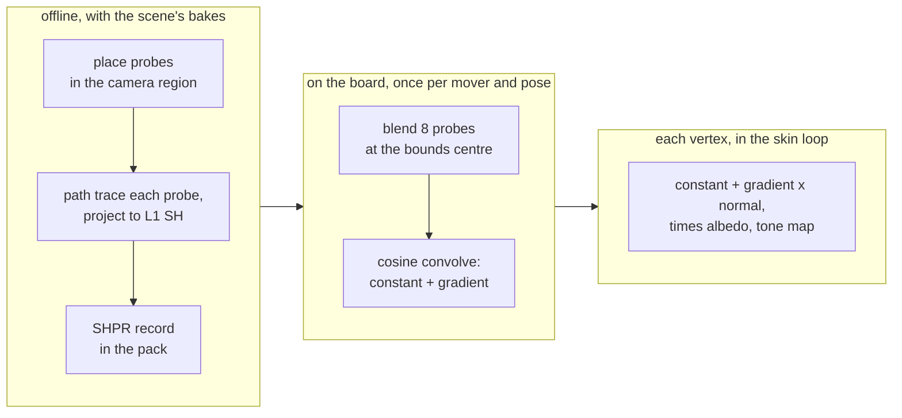
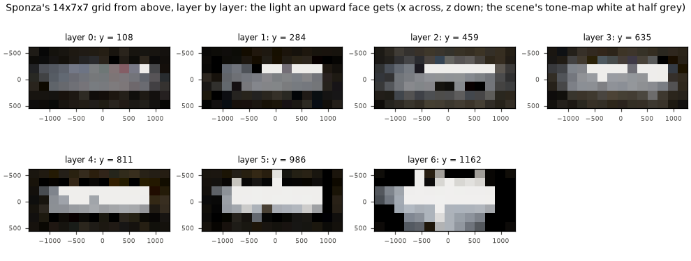
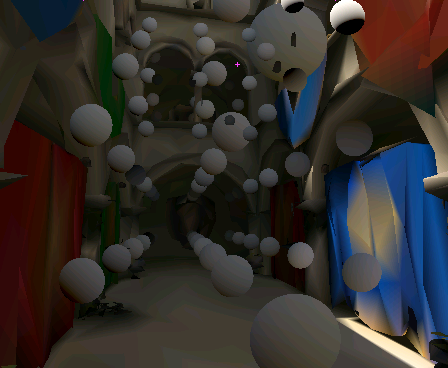
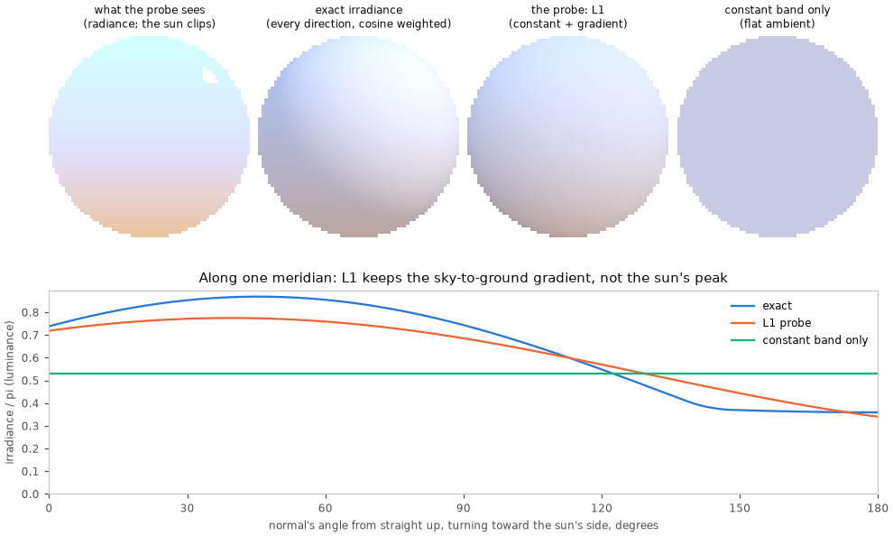
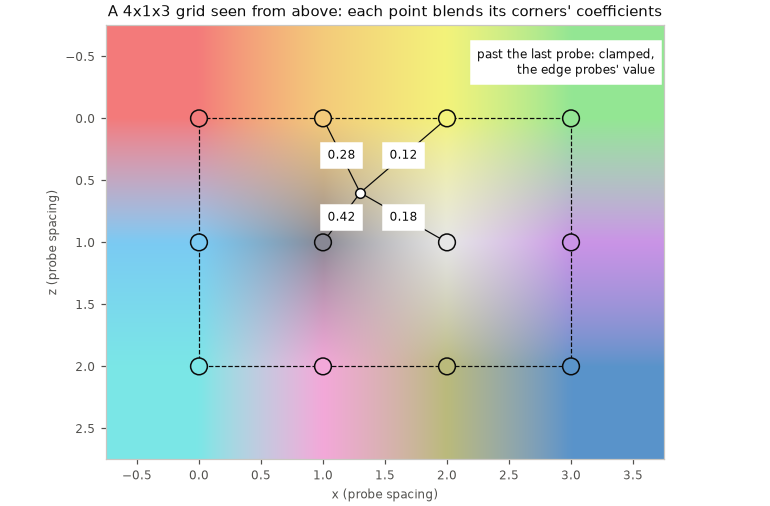
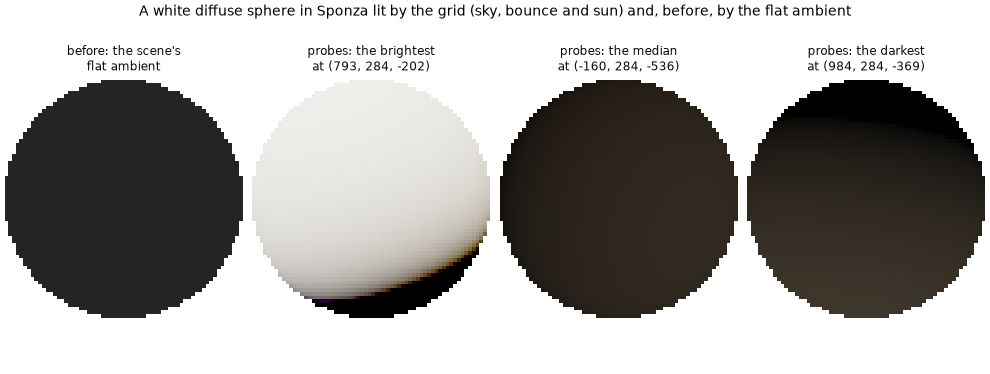
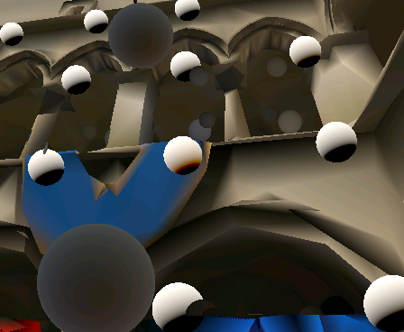
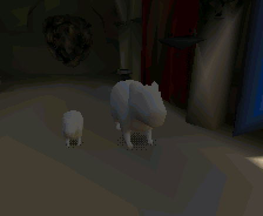
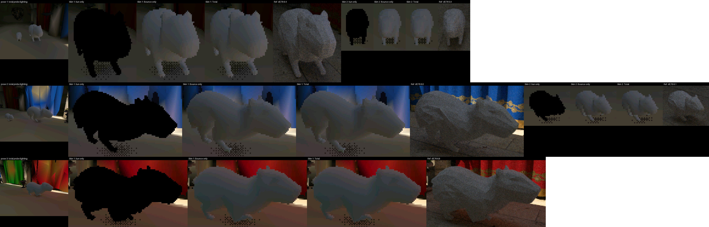

# Dynamic GI with Light Probes

The engine's global illumination is mixed. Static geometry carries baked GI
in its vertex colours ([Bake-Method](../offline/Bake-Method.md)). A dynamic
object cannot be baked, so it samples baked light probes: a grid of points
that each store the light arriving from every direction, as first-order
spherical harmonics (SH).

This is the established light-probe technique: Unity's Light Probes<sup>[[137]](../../Citations.md#unity-light-probes)</sup>
and Unreal's Volumetric Lightmaps<sup>[[138]](../../Citations.md#epic-volumetric-lightmaps)</sup>
(which replaced its Indirect Lighting Cache) both light moving objects from
a precomputed probe volume; here each mover takes one sample, with no
per-pixel probe lookup. The grid is the irradiance volume<sup>[[136]](../../Citations.md#greger-1998)</sup>;
its convolution is Ramamoorthi and Hanrahan's<sup>[[128]](../../Citations.md#ramamoorthi-hanrahan-2001)</sup>.



| Step | What happens | Owner |
|---|---|---|
| [1. Placement](#1-placement) | one probe per cell of the camera region, moved out of walls | [`probes.py`](../../../launcher/tools/r3d/views/probes.py) |
| [2. The bake](#2-the-bake) | path-traced radiance and the sun, projected to SH | [`sh_probe_bake.py`](../../../launcher/tools/r3d/sh_probe_bake.py), [SH-Probes](../offline/SH-Probes.md) |
| [3. What a probe stores](#3-what-a-probe-stores) | four RGB L1 coefficients, 24 bytes | [SHPR](../../assets/formats/SHPR.md), `sh_probes_t` |
| [4. Attaching a grid](#4-attaching-a-grid) | a scene borrows the grid | `scene_set_probes()` |
| [5. Finding and blending probes](#5-finding-and-blending-probes) | trilinear blend of 8 probes | `sh_probes_sample()` |
| [6. From SH to shading](#6-from-sh-to-shading) | convolve once per mover, evaluate per vertex | `r3d_skin_light_ambient_sh()`, `sh1_irradiance_eval()` |
| [7. Cost and goals](#7-cost-and-goals) | bake time, bytes, board goals | |
| [8. Limits](#8-limits) | what the technique does not do | |

## 1. Placement



The grid covers the scene camera's region (the source's bounds without
one). Its spacing is the request's `spacing`, or 32 camera near planes,
widened until the region holds at most 1024 cells. At the default spacing
Sponza's region holds 14 × 7 × 7 = 686 probes.

Each cell's probe starts at the cell centre, jittered by up to 0.4 of a
cell. The DDGI classification<sup>[[119]](../../Citations.md#majercik-2021)</sup>
then casts 32 rays from it: more than a quarter hitting back faces means it
is inside geometry; a front face nearer than 2 near planes means it is
against a wall.

Either moves the probe, by at most 0.45 of a cell, and it is tested again.
A probe still inside is not traced. The constants are
[`probes.py`](../../../launcher/tools/r3d/views/probes.py)'s, shared with
the offline fitter's choice of extra camera views.



The [probes view](View-Modes.md) draws each probe where the grid holds it, as
a sphere lit the way a skin at that probe is; a probe still inside geometry
is a magenta cross.

## 2. The bake

Each probe outside geometry traces 512 Fibonacci-sphere directions with 4
paths each, through the scene's sky, its emitters and the surface bake's
bounce depth. A direction's radiance is the mean of its paths.
Projection onto the basis is

```math
L_i = \frac{4\pi}{N} \sum_{d=1}^{N} L(\omega_d)\, Y_i(\omega_d)
```

The sun is added apart from the paths, as $`\pi\,c\,I\,v\,Y_i(s)`$ for sun
colour $`c`$, intensity $`I`$ and direction $`s`$, where $`v`$ is one
shadow ray's visibility. A point light that small would need far more
directions to be found by chance.

The record holds the regular cell centres, but each probe's light is
sampled where the probe moved to. A probe inside geometry takes the mean of
its outside six-neighbours, layer by layer, until every cell has a value.
Options and commands are in [SH-Probes](../offline/SH-Probes.md).

## 3. What a probe stores



A probe holds the radiance arriving at its point, projected onto the real SH
basis up to order 1: one constant band and three linear ones, each RGB.
That is 4 × 3 int16 values, 24 bytes a probe.<sup>[[129]](../../Citations.md#sloan-2008)</sup>

| Index | Basis | Function | Stored as |
|---:|---|---|---|
| 0 | $`Y_{0,0}`$ | $`0.282095`$ | R, G, B |
| 1 | $`Y_{1,-1}`$ | $`0.488603\,y`$ | R, G, B |
| 2 | $`Y_{1,0}`$ | $`0.488603\,z`$ | R, G, B |
| 3 | $`Y_{1,1}`$ | $`0.488603\,x`$ | R, G, B |

Coefficients are stored raw, as `round(L / scale)`; the bake picks `scale`
as the grid's largest $`|L_i|`$ over 32767. Directions are world axes, +y
up. The [SHPR](../../assets/formats/SHPR.md) record is a 40-byte header
(origin, spacing, scale, dimensions) and the probes, x fastest.

L1 keeps the light's gradient across the sphere and loses sharp features:
the figure's sun peak blurs into it (the meridian below the spheres).

## 4. Attaching a grid

A scene takes a grid with `scene_set_probes(root, &grid)`, where `root` is
the entity its pack loaded as. Each field of `sh_probes_t` is the SHPR
header field of the same name, and `coefficients` points at the record's
probes in place.

```c fragment
const sh_probes_t grid = {.origin = origin, .spacing = spacing, .dims = {nx, ny, nz},
                          .scale = scale, .coefficients = probes};
scene_set_probes(root, &grid);
```

The scene keeps the pointer, so the record must stay loaded. `NULL` returns
the scene to its flat ambient colour. Every lit skinned renderer under
`root` samples the same grid, and a grid turns skin lighting on even in a
scene with no direct lights.

## 5. Finding and blending probes



A point's grid coordinate is `(world - origin) / spacing` per axis, clamped
to the grid. Its integer part picks the lower corner, its fraction the
weight. The 8 surrounding probes' coefficients blend trilinearly into one
[`sh1_rgb_t`](../../../launcher/packages/math/include/math/sh/sh1.h); a 1-probe axis takes its one probe.

Past the last probe the coordinate clamps, so the edge probes' value carries
on (the figure's margin). Blending coefficients, then convolving, equals
convolving each probe and blending the results, since both steps are linear.

The scene samples at the centre of each skinned renderer's last resolved
world bounds, once per range of clusters a core skins; every vertex of the
mover shares that value.

## 6. From SH to shading

Convolving L1 radiance with the clamped cosine gives irradiance that is
linear in the normal $`n`$:<sup>[[128]](../../Citations.md#ramamoorthi-hanrahan-2001)</sup>

```math
\frac{E(n)}{\pi} = \underbrace{\frac{A_0 Y_{0,0}}{\pi} L_0}_{\text{constant}} + \underbrace{\frac{A_1 Y_1}{\pi}\begin{bmatrix} L_3 & L_1 & L_2 \end{bmatrix}}_{\text{gradient}}\, n, \qquad A_0 = \pi,\ A_1 = \tfrac{2\pi}{3}
```

The bands are reordered to x, y, z ($`L_3, L_1, L_2`$) so the gradient
multiplies the normal directly; the two factors are 0.282095 and 0.325735.
[`sh1_rgb_irradiance()`](../../../launcher/packages/math/include/math/sh/sh1.h) builds the constant
and that 3×3 gradient (a row per channel); `r3d_skin_light_ambient_sh()`
divides by $`\pi`$, as the direct lights are, once per mover.



The brightest probe sits in the sunlit atrium: its sphere clips on the sun
side and turns black on the far side, where L1's gradient passes zero.



### Against a path-traced reference

`skin.albedo=1` draws every skin white, so its colour is the light alone. The
capybara scene, rendered that way along its path:



At three of its frames, [`skin_reference.py`](../../../launcher/tools/r3d/skin_reference.py)
poses the same white capybaras in Sponza and traces them with Mitsuba. The
sheet crops each skin from both renders and labels the reference crop with
the mean CIE76 colour difference (dE76) over the skin's mask, eroded by a pixel:



Per vertex, `sh1_irradiance_eval()` is 9 multiply-adds. The sum takes the
same albedo, tone map and gamma as the direct lights
([Skinned-Lighting](../animation/Skinned-Lighting.md)); how it joins them
depends on the renderer's lighting mode (that page describes the three):

| Mode | Ambient per vertex |
|---|---|
| direct | constant + gradient × the blended normal, then the direct lights added |
| renormalised | the same on the normal scaled back to unit length |
| table | the shared table already holds the flat ambient; add (probe constant − flat ambient) + gradient × the unit normal, so moving between probes never rebuilds the table; a zero normal takes the constant alone |

Static meshes never read the grid: the same transport is already in their
baked colours.

### Baked and realtime lights

A light's [`mode`](../scene/Scene-Files.md#light) is `"realtime"` or `"baked"`, as in Unity's light
modes<sup>[[139]](../../Citations.md#unity-light-modes)</sup>. A baked
light goes into the probe bake, direct and bounced, and a probe-lit
renderer skips it, so a mover takes it only through the probes. A realtime
light is not baked and lights the mover per vertex. Sponza's sun is baked.

| | Baked sun, through the probes | Realtime sun |
|---|---|---|
| Occlusion | the probe's shadow ray: a mover under the arcades is out of the sun | none without shadow maps: a mover indoors is sunlit |
| Response | L1's soft lobe: no sharp terminator, no highlight | a sharp `max(0, N.L)` terminator |
| Cost | none past the probe sample | an `N.L` term per vertex |

## 7. Cost and goals

The bake prints its path and sun-ray counts, the grid's bytes and its time
([SH-Probes](../offline/SH-Probes.md)); a grid is rebaked only when its key
changes ([Bakes](../../assets/Bakes.md)).

On the board, the grid costs its record's bytes and nothing per frame
beyond the movers. The skinned stress preset's goals, in microseconds per
frame, each the worst of several board captures plus 1%; quarter is the
panel's orientation, each stage a [frame-cost](../../tools/Frame-Cost.md) bracket:

<!-- generated: light-probes-cost check: python launcher/main/apps/render_lab/tools/stress_doc_table.py docs/render/frame/Light-Probes.md light-probes-cost stress-skinned-sh-blobs --check -->
| Preset | Quarter | `r3d.cull` | `r3d.transform` | `r3d.draw` | `r3d.upscale` | `frame.record` | `anim.pose` | `anim.light` | `anim.skin` | Sum goal | Ceiling |
|---|---|---:|---:|---:|---:|---:|---:|---:|---:|---:|---:|
| `stress-skinned-sh-blobs` | portrait | 310 | 1230 | 7090 | 2040 | 10 | 1530 | 250 | 2900 | 15260 | 17550 |
| `stress-skinned-sh-blobs` | landscape | 310 | 1240 | 7810 | 2130 | 10 | 1530 | 250 | 2890 | 16060 | 18470 |
<!-- /generated: light-probes-cost -->

The sample, the convolution and the per-vertex evaluation run inside
`anim.skin`; they are not timed apart from it, so the cost of probe ambient
over flat ambient is not measured.

## 8. Limits

- A scene has a grid only when it has a `<scene>.probes.toml` beside it and
  a `bake.indirect` section.
- One sample per mover: a mover half in shadow is lit as one.
- L1 holds a gradient only, so the sun on a mover is soft, and the side
  facing away from it can go dark, past zero (the brightest sphere above);
  nothing windows or clamps the coefficients.
- Probes inside geometry hold their neighbours' mean, not their own light.
- The sample uses the bounds from the mover's last pose, so its light trails
  a fast move by a pose.
- Probes do not see the mover, so nothing darkens the ground under it; a
  [contact shadow](Contact-Shadows.md) stands in.

## Figures

[`light_probe_figures.py`](../../../launcher/tools/r3d/probes/light_probe_figures.py)
draws the grid, sphere and blend figures from
[`light_probe_figures_probe.c`](../../../launcher/tools/r3d/probes/light_probe_figures_probe.c),
which calls the runtime's SH and grid code, and from a scene's baked grid;
[`launcher/demo/light_probe_figures.py`](../../../launcher/demo/light_probe_figures.py)
runs it on Sponza.
[`probe_view_figures.py`](../../../launcher/tools/render/probe_view_figures.py)
renders the probes view. The [figure index](../../tools/Figures.md) names the
producer of the others.
