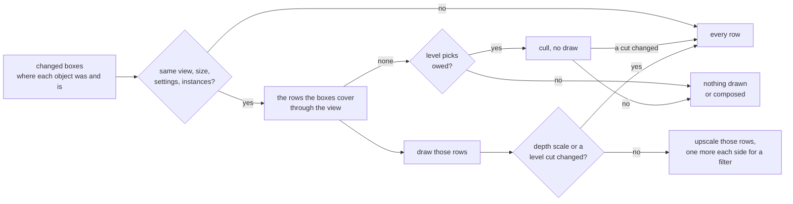

# Partial Redraw

`render/partial/render_partial.h`: while the camera holds still, a frame
redraws and recomposes only the rows where something changed. The rest of the
picture stays as the last frame left it, and the result is the same picture a
full redraw gives.

It is on by default, with the `partial_redraw` render setting
([Render-Settings.md](../Render-Settings.md#partial_redraw)).

## What it is told

The caller gives the next frame's changed boxes in world units with
`render_context_set_changed()`, each the union of where an object was drawn
and where it is now. A negative count means anything may have changed.

## When every row is drawn

| Cause | Why |
|---|---|
| A new view, size, clear colour or instance count | the kept picture is of something else |
| A drawn object left as another joined | the boxes say where the new one is, not where the old one was drawn |
| A mesh of another size took an instance's place | the raster's scratch now holds its picture elsewhere |
| Any render setting changed | settings may change pixels anywhere |
| A debug view | it painted its own colours over the picture |
| Dynamic resolution or frame generation on, or on last frame | each frame may draw at another size or be warped |
| More than `RENDER_PARTIAL_CHANGES_MAX` boxes, or a negative count | the changes are not known |
| A box corner at or behind the near plane | its rows cannot be bounded |
| The draw refitted its depth scale | kept rows hold depth at the old scale |
| A level pick changed an instance's cut | picks spread over frames may land on a still frame, and the kept rows hold the old cut |
| The last picture went to another destination, or none (no framebuffer) | the kept rows are not in this one; the compose writes every row |
| The shell composed into the framebuffer, not the half picture | the app and its UI paint the framebuffer after the compose; the compose writes every row |

Level picks ([Cluster-LOD](../../plans/Cluster-LOD.md)) are made in the
cull, before the rows are drawn, so a pick that changed any cut is known in
time to draw every row.

Picks spread over `lod.pick_every` frames are owed for that many frames
after a frame with rows to redraw. A frame in that window with no changed
rows still culls, without drawing, and draws every row if a pick changed.

## Rows

A box's rows are its eight corners projected through the frame's lens, plus
`RENDER_PARTIAL_ROW_MARGIN` rows each side for a vertex snapped to the next
row and a small fill's spill. The draw splits only those rows between the two
cores, and the upscale rewrites the destination rows they reach.

`render_context_frame()` reports what a frame recomposed: `unchanged` when it
drew nothing, else destination rows `[rows_first, rows_end)`.

An expanded frame presents only those rows from the half picture. The UI,
replayed over the panel, marks the bands whose own content changed, so
text that changes over a held picture still reaches the panel.
