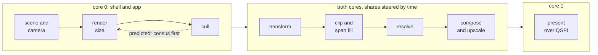
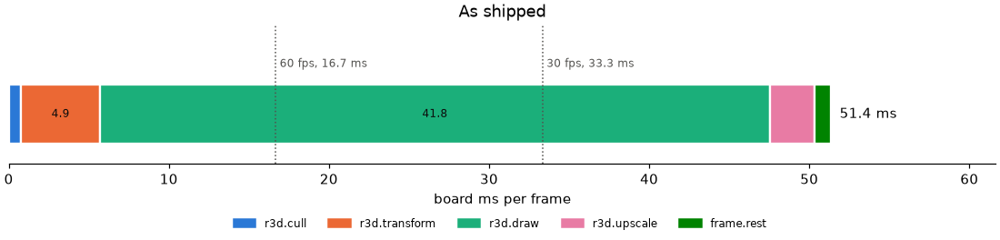
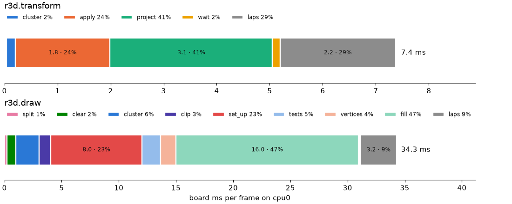
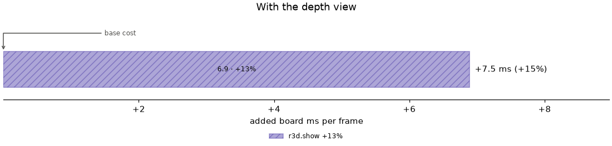
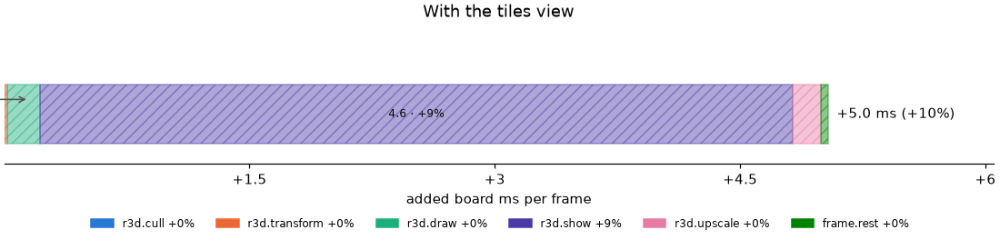
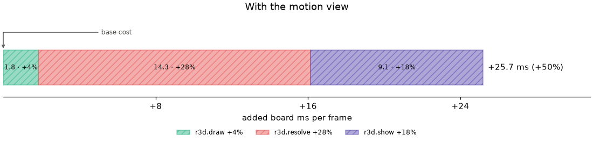
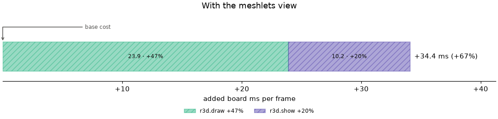

# Every frame, on the board

The board half of the [render pipeline](../README.md). An app never calls
draw: it loads a scene and activates a camera, and the shell advances and
draws it each frame ([Scene-Manager.md](../scene/Scene-Manager.md#each-frame)).
The work before the framebuffer runs while the previous frame is sent.

| Stage | Core | Reads → writes | Cost bracket | Owner |
|---|---|---|---|---|
| Scene and camera | 0 | the scene's pack → this frame's instances and view | part of `frame.rest` | [Scene-Manager.md](../scene/Scene-Manager.md#each-frame), [Camera.md](../scene/Camera.md) |
| Render size | 0 | recent frames' cost, or the census → render width and height | part of `frame.rest` | [Dynamic-Resolution.md](Dynamic-Resolution.md) |
| Cull | 0 | node and cluster bounds, the camera → kept clusters | `r3d.cull`, or `r3d.census` when the size is predicted | [Culling.md](Culling.md) |
| Transform | both, by cluster share | kept clusters, the lens → screen vertices, each cluster's rows | `r3d.transform` | [Mesh-Rendering.md](../Mesh-Rendering.md#on-both-cores) |
| Clip and span fill | both, by row share | triangles → colour, depth, each attachment's pixels | `r3d.draw` | [Coverage.md](Coverage.md), [Culling.md](Culling.md#per-triangle) |
| Resolve | both, disjoint rows | depth, an attachment's pixels → its map; only when a view's attachment resolves | `r3d.resolve` | [Attachments.md](Attachments.md#attachments) |
| View modes | both | depth, an attachment → colour; development builds | `r3d.show` | [View-Modes.md](View-Modes.md) |
| Compose and upscale | both, by row share | the picture → the framebuffer, or a half picture | `r3d.upscale` | [gfx/Targets-and-Modes.md](../../gfx/Targets-and-Modes.md#expanded-frames) |
| Frame generation | both | the last picture and depth → a warped frame between renders | its own rows | [Frame-Generation.md](Frame-Generation.md) |
| Present | 1 | the framebuffer's dirty rows, or a half picture doubled → the panel | `present.wait` | [gfx/Present.md](../../gfx/Present.md#present-what-gets-sent) |

| Page | Covers |
|---|---|
| [Mesh-Rendering.md](../Mesh-Rendering.md) | The raster: one frame, the render context, both cores, memory |
| [Culling.md](Culling.md) | Every cull stage in order, from the bake's visibility to the per-triangle tests, and what each costs |
| [Coverage.md](Coverage.md) | Which pixels a triangle fills, and small fill: cheaper draws for triangles a few pixels wide |
| [Attachments.md](Attachments.md) | The depth buffer, and the extra per-pixel maps a draw can write: motion vectors, meshlet IDs |
| [View-Modes.md](View-Modes.md) | The development-build views that paint depth, tiles, motion, meshlets or the cull |
| [Dynamic-Resolution.md](Dynamic-Resolution.md) | The render size picked per frame to hold a budget: the stepped controller and the predictor |
| [Frame-Generation.md](Frame-Generation.md) | Frames warped from the last render to the next camera pose, shown between renders |

## Where the time goes

The first bar is the shipped frame. Under it, `r3d.transform` and `r3d.draw`
are split into their sub-stages, the laps named after the code they time:

| Sub-stage | What runs |
|---|---|
| `split` | the share of clusters or rows each core takes |
| `apply` | transform: one vertex through the lens matrix, and its near-plane test |
| `project` | transform: the vertex's divide, snap and screen-range test |
| `clear` | draw: clearing this core's rows of each attachment |
| `tests` | draw: a triangle's rejection tests, no pixel centre or facing away |
| `vertices` | draw: gathering a kept triangle's screen corners and colours |
| `clip` | draw: rebuilding and clipping a triangle that crosses the near plane or the guard band |
| `set_up` | draw: one triangle's set-up in `r3d_span`: its box, planes and the hidden test |
| `fill` | draw: the triangle's span fill, small or walked |
| `cluster` | what is left of the loops over clusters, vertices and triangles |
| `wait` | the frame core waiting for core 1's half |
| `laps` | what the laps themselves cost, taken out of the rows above |

The dropdown has each debug view's hatched bar, what it adds, and every stage
in ms.

<!-- generated: pipeline-frame-stages sha256=ec5ccaa6435e5e9ab983f97c208eb9cc57447abc392c97480eb51ad3f339d838 -->

Sub-stages in milliseconds

| Sub-stage | cpu0 | cpu1 | Share of the parent on cpu0 |
|---|---|---|---|
| r3d.transform.split | 0.03 | 0.00 | 0% |
| r3d.transform.cluster | 0.17 | 0.16 | 2% |
| r3d.transform.apply | 1.79 | 2.01 | 24% |
| r3d.transform.project | 3.06 | 3.17 | 41% |
| r3d.transform.wait | 0.14 | 0.00 | 2% |
| r3d.transform laps | 2.18 | 1.01 | 29% |
| r3d.transform untimed | 0.03 |  | 0% |
| r3d.transform | 7.40 |  | 100% |
| r3d.draw.split | 0.22 | 0.00 | 1% |
| r3d.draw.clear | 0.78 | 1.12 | 2% |
| r3d.draw.cluster | 2.04 | 2.00 | 6% |
| r3d.draw.clip | 1.00 | 1.03 | 3% |
| r3d.draw.set_up | 7.99 | 7.98 | 23% |
| r3d.draw.tests | 1.63 | 1.62 | 5% |
| r3d.draw.vertices | 1.33 | 1.35 | 4% |
| r3d.draw.fill | 15.98 | 15.49 | 47% |
| r3d.draw.wait | 0.16 | 0.00 | 0% |
| r3d.draw laps | 3.17 | 3.11 | 9% |
| r3d.draw untimed | 0.02 |  | 0% |
| r3d.draw | 34.31 |  | 100% |

Board ms per frame from a perf-scope image, mean of 79 lap windows. A parent is its frame-cost bracket on cpu0; its sub-stages are cycle-counter laps on each core, and cpu0's add up to the parent but for the untimed row, at most 2% of it. The laps row is what the laps cost themselves, one lap's measured cost times its starts, taken out of each sub-stage; the image runs them, so its parents are not the shipped bar's.

Debug views and every stage in milliseconds

| Stage | As shipped | Share | depth view adds | tiles view adds | motion view adds | meshlets view adds |
|---|---|---|---|---|---|---|
| r3d.cull | 0.76 | 1% | +0.01 | +0.00 | +0.02 | +0.01 |
| r3d.transform | 4.87 | 10% | +0.10 | +0.02 | +0.22 | +0.02 |
| r3d.draw | 41.94 | 82% | +0.25 | +0.20 | +1.85 | +23.89 |
| r3d.resolve | not run | not run | +0.00 | +0.00 | +14.29 | +0.00 |
| r3d.show | not run | not run | +6.89 | +4.60 | +9.05 | +10.21 |
| present.wait | 0.00 | 0% | +0.00 | +0.00 | +0.00 | +0.00 |
| r3d.upscale | 2.59 | 5% | +0.16 | +0.17 | +0.16 | +0.16 |
| frame.rest | 1.07 | 2% | +0.06 | +0.05 | +0.11 | +0.12 |
| total | 51.23 | 100% | +7.47 | +5.04 | +25.70 | +34.40 |

Board ms per frame, mean of 78 to 79 report windows per capture; a view adds the difference between its capture and the scene as shipped. Not captured: cull.

<!-- /generated: pipeline-frame-stages -->

## Refreshing

The docs generator, `launcher/tools/render/render_doc_images.sh`, writes the
`pipeline-frame-stages` chart and table from frame-cost report windows of one
development build. Two minutes spans several passes of the camera path.

| Capture | Build | Command | Into |
|---|---|---|---|
| The scene as shipped | development | `autana monitor 120 --out docs/render/data/pipeline-present-board.log` | every bracket |
| One per debug view | development, `autana tune view N` | `autana monitor 120 --out docs/render/data/pipeline-view-<name>-board.log` | what the view adds to each bracket |
| Sub-stages | `autana flash diag --perf-scope --frame-laps` | `autana monitor 120 --out docs/render/data/pipeline-laps-board.log` | the sub-stage table ([laps](../../tools/Frame-Cost.md#laps-inside-a-bracket)) |

- View `N` is its place in the view table of `render/context/render_context.c`,
  counted from 1; 0 (`RENDER_DEBUG_VIEW_SHADED`) is the scene as shipped.
- A view without a capture is listed as not captured. A missing capture of the
  scene as shipped, or one without report windows, fails the run.
- The run fails when the frame core's laps leave more of their parent untimed
  than `UNTIMED_SHARE` in `frame_stages.py`; the dropdown states it.
- Check `autana status` and `autana buildid` before and after each capture.
