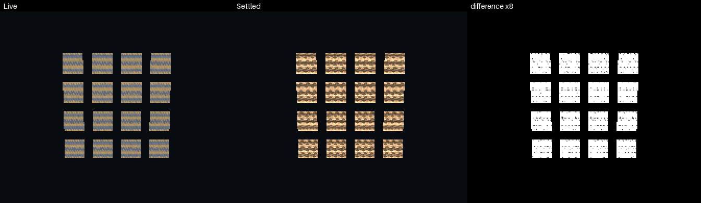
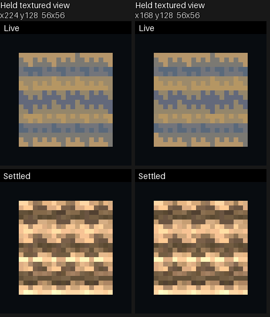
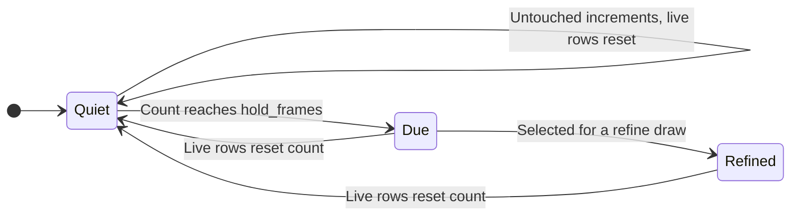

# Settle

[`render/settle/render_settle.h`](../../../launcher/main/render/settle/render_settle.h): quiet rows of a held picture refine after
[partial redraw](Partial-Redraw.md) draws the live changes. A held view is
never [generated](Frame-Generation.md).

Look for the brick detail and the finer shading on the small triangles after the view settles.

| Live choice | Refined value |
|---|---|
| `texture.divide_px` | 1: divide at every pixel |
| `texture.affine_bend` | 0 |
| `texture.affine_level` | 0 |
| `texture.far_level` | 0: keep texturing |
| `small_fill.ceiling` | `SMALL_FILL_CEILING_OFF` |

The raster is split into `RENDER_SETTLE_BANDS` horizontal bands. Band `b`
covers rows `[b * height / BANDS, (b + 1) * height / BANDS)`.

A non-held, timed or generated frame forgets every band, as does a zero
budget or live settings that already match refined quality.

The first due band is picked middle out. With no cost estimate it draws
alone. A later run can cross a refined band to reach another due band,
charging the budget for every row it draws. A due band always draws even
if it exceeds the budget.

| Setting | Meaning |
|---|---|
| `settle.frame_us` | Refine budget per held frame; 0 disables settle |
| `settle.hold_frames` | Quiet frames before a band is due |

Defaults and pack ranges are in [Render-Settings.md](../Render-Settings.md).
The fixed-point cost estimate moves by `1 / RENDER_SETTLE_COST_WEIGHT_DIVISOR`
of the difference to each sample and survives when the bands are forgotten.

Refine time goes in `frame.settle_us`, not `frame.draw_us`, so the held-frame
judgement in [Dynamic-Resolution.md](Dynamic-Resolution.md#a-held-camera)
sees live work only.
