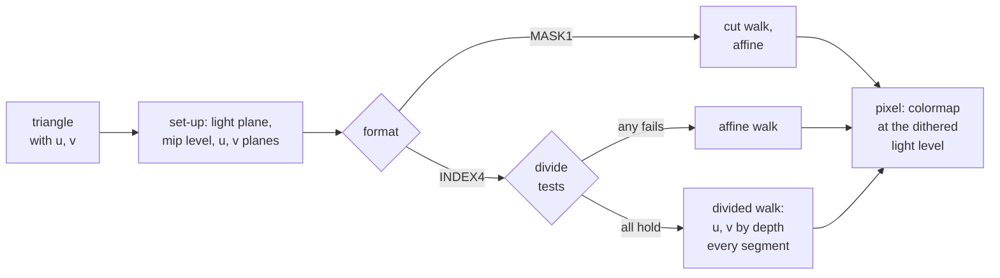
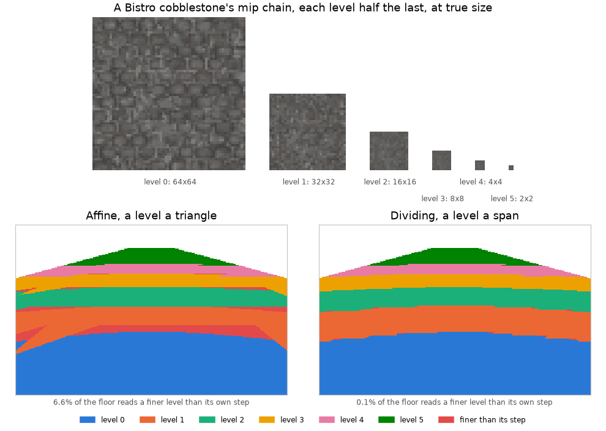
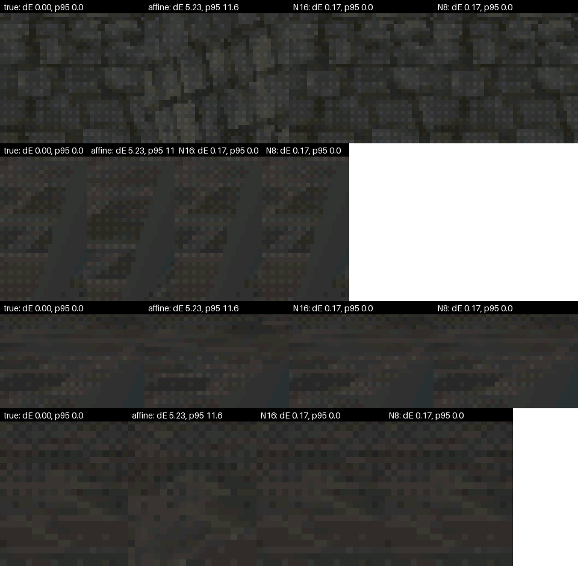

# Texture mapping

How the span fill draws a textured triangle: which texel each pixel takes,
from which mip level, and how bright. The texture's bytes are
[LTEX](../../assets/formats/LTEX.md); a mesh names its textures and u, v
through its [LUVS](../../assets/formats/LUVS.md) entry. The fill is
[`r3d_span_textured.c`](../../../launcher/main/render/texture/r3d_span_textured.c);
its texture type is
[`r3d_texture.h`](../../../launcher/main/render/texture/r3d_texture.h).

## A pixel

A pixel's colour is one load from the texture's colormap: a row per light
level, a column per palette colour. The texture builds it at open, lit by
its tint, from black at level 0 up to `R3D_TEXTURE_LIGHT_LEVELS - 1`.

| | INDEX4 | MASK1 |
|---|---|---|
| Texel | 4 bits: a palette colour | 1 bit: kept or not |
| Pixel | the colormap at the texel's colour | texel 0 leaves the pixel; texel 1 draws palette colour 1 |
| Steps | affine, or dividing by depth | affine |

The light level is the vertex light's luminance, stepped across the triangle
in 8.8. A 4x4 Bayer threshold at the pixel's screen position dithers it
between two rows.

## Mip level

Level 0 is full size; each mip halves the last
[[126]](../../Citations.md#williams-1983). A pixel should read the
level where one screen step moves about one texel: floor(log2 ρ), ρ the longer
of the level-0 texel steps per pixel along x and y, capped at the last level.

A triangle picks one level from the steps of its affine u and v planes,
averaged over the triangle. Where it recedes the true step grows
[[127]](../../Citations.md#heckbert-1989), so far pixels read a
finer level than they need and alias.

The red pixels are the far part of each triangle. A per-span pick would
remove them.

## Perspective

Stepped affine, u and v bend across a receding triangle: floor rows near the
camera curve. An INDEX4 span divides u and v by depth every few pixels,
affine between [[127]](../../Citations.md#heckbert-1989), when all
of these hold on the triangle's unclipped box, so every row slice agrees:

| Test | Setting ([Render-Settings.md](../Render-Settings.md)) |
|---|---|
| Dividing is on | `texture.divide_px` is not 0 |
| It is wider than one segment | its box's longer side exceeds `texture.divide_px` |
| Affine would bend it too far | its estimated bend exceeds `texture.affine_bend` texels of its mip level, so a coarse level can divide too |

A dividing triangle starts from segments of `texture.divide_px` pixels. It
doubles them, up to `RENDER_TEXTURE_DIVIDE_PX_MAX`, while one segment would
still bend no more than `texture.affine_bend`.

The dividing fill and its row walk run from IRAM
([Internal-Memory-Map.md](../../memory/Internal-Memory-Map.md)).

CIE76 is the distance between two colours in CIELAB.

## Related

- [LTEX](../../assets/formats/LTEX.md): the texture's bytes, its levels and
  palette, and a textured frame against its source
- [Mesh-Rendering.md](../Mesh-Rendering.md): the raster this fill is part of
- [Render-Settings.md](../Render-Settings.md): `texture.divide_px` and
  `texture.affine_bend`
