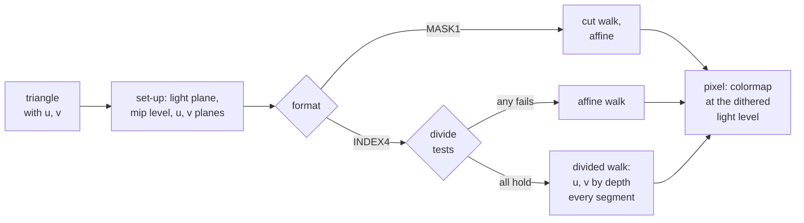

# Texture mapping

How the span fill draws a textured triangle: which texel each pixel takes,
from which mip level, and how bright. The texture's bytes are
[LTEX](../../assets/formats/LTEX.md); a mesh names its textures and u, v
through its [LUVS](../../assets/formats/LUVS.md) entry. The fill is
[`render/texture/r3d_texture.h`](../../../launcher/main/render/texture/r3d_texture.h).

## A pixel

A pixel's colour is one load from the texture's colormap: a row per light
level, a column per palette colour. The texture builds it at open, lit by
its tint, from black at level 0 up to `R3D_TEXTURE_LIGHT_LEVELS - 1`.

| | INDEX4 | MASK1 |
|---|---|---|
| Texel | 4 bits: a palette colour | 1 bit: kept or not |
| Pixel | the colormap at the texel's colour | texel 0 leaves the pixel; texel 1 draws palette colour 1 |
| Steps | affine, or dividing by depth | affine |

The light level is the vertex light's luminance, stepped across the triangle
in 8.8. A 4x4 Bayer threshold at the pixel's screen position dithers it
between two rows.

## Mip level

Level 0 is the texture's full size; each mip halves the last. A pixel should
read the level where one step across the screen moves about one texel: the
level is floor(log2 ρ), where ρ is the longer of the texel steps per pixel
along x and along y, in level-0 texels, up to the last level
[[123]](../../Citations.md#williams-1983).

A triangle picks one level for all its pixels, from the steps of its affine
u and v planes: the step averaged over the triangle. On a triangle that
recedes, the true step grows towards the far end
[[124]](../../Citations.md#heckbert-1989). Its far pixels read a
finer level than their step needs, and those texels alias.

## Perspective

Stepped affine, u and v bend across a triangle that recedes: rows on a floor
near the camera curve. An INDEX4 span instead divides u and v by depth every
few pixels and steps them affine between, when all of these hold, judged on
the triangle's unclipped box so every row slice draws it alike:

| Test | Setting ([Render-Settings.md](../Render-Settings.md)) |
|---|---|
| Dividing is on | `texture.divide_px` is not 0 |
| It is wider than one segment | its box's longer side exceeds `texture.divide_px` |
| Affine would bend it too far | its estimated bend exceeds `texture.affine_bend` texels |

A dividing triangle starts from segments of `texture.divide_px` pixels. It
doubles them, up to `RENDER_TEXTURE_DIVIDE_PX_MAX`, while one segment would
still bend less than `texture.affine_bend`.

CIE76 is the distance between two colours in CIELAB. The columns divide
every pixel, step affine, then divide every 16 and every 8 pixels.

The divide's set-up, walk and fill sit at the end of flash code, apart from
the affine walk.

## Related

- [LTEX](../../assets/formats/LTEX.md): the texture's bytes, its levels and
  palette, and a textured frame against its source
- [Mesh-Rendering.md](../Mesh-Rendering.md): the raster this fill is part of
- [Render-Settings.md](../Render-Settings.md): `texture.divide_px` and
  `texture.affine_bend`
