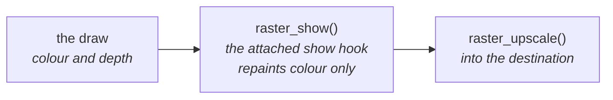
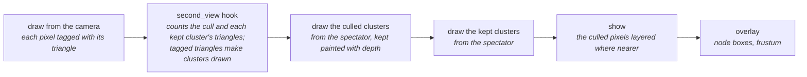

# View Modes

Development builds select one row from the `render_debug_view_t` table in
`render/context/render_context.c`: depth, tiles, motion, meshlets, cull or boxes.

The depth and depth-tile views along a flythrough:

| Call | What it does with the row |
|---|---|
| `render_context_set_debug_view()` | Attaches it and owns its zeroed PSRAM state; switching frees the previous state |
| `RENDER_DEBUG_VIEW_SHADED` | Detaches it |
| `render_context_release()` | Frees its state |
| `render_context_debug_view()` | Exposes its name and constructor to tools |

| View | The colour buffer becomes |
|---|---|
| shaded | untouched: the baked colours as drawn |
| depth | the depth as a grey ramp, nearest white and farthest black |
| tiles | the same ramp, each `RASTER_SHOW_TILE` square at its farthest depth |
| motion | mid-grey for none, red for x and green for y |
| meshlets | a flat hue for each cluster, with disjoint IDs for each instance |
| cull | each cluster in the colour of its fate this frame; see [The cull, seen](#the-cull-seen) |
| boxes | untouched; its overlay draws each instance's box as the frame placed it, one hue per mesh, for meshes drawn at least `boxview.copies` times; edges behind the drawn depth hidden, dimmed or full by `boxview.behind` |

A row may also carry two optional hooks:

| Row hook | What it does |
|---|---|
| `second_view` | After the frame's draw and after each draw it asks for, may name another view and fill the census list with the clusters to draw through it, and its depth scale; the frame's stats stay those of the first draw |
| `overlay` | Draws lines over the composed picture; the shell then composes at full size, not into a half picture |

Overlays draw with `render/view/raster_lines.h`: segments and boxes in a lens's space, cut at the near plane, optionally dimmed or left out where the drawn depth is nearer.

- The ramp is stretched over the range this frame drew: the most detail
  within a frame, not comparable between frames.
- A pixel nothing drew takes the raster's `clear`, the colour upscaling gives
  it, so it reads as empty in every view; a tile holding one such pixel is
  empty.
- The views are at the raster's own size, before upscaling.
- `r3d_span.h` defines the depth encoding they read.

## The cull, seen

The cull view ([raster_cull_view.h](../../../launcher/main/render/view/raster_cull_view.h))
paints every cluster in the colour of its fate this frame. Seen from the camera
only drawn clusters show, so it redraws from a spectator.

| Fate | Colour | The cluster |
|---|---|---|
| culled | grey | its box, or a box above it, is outside the frustum |
| not set up | blue | kept, but every triangle is behind the camera, misses every pixel centre or faces away |
| hidden | red | triangles were set up and filled, but each lost its depth test |
| drawn | green | owns at least one pixel |

| Tunable | Values |
|---|---|
| `cullview.from` | 0 the camera, 1 above the instances' bounds looking down, 2 behind and above the camera |
| `cullview.paint` | 0 the baked colours, culled clusters as a sparse screen door with a dashed grey border, each kept cluster's border solid in its fate's colour; 1 each cluster flat in its fate's colour; 2 each cluster in the hue of its node at `cullview.level`, darker the earlier it was dropped |
| `cullview.level` | the tree depth whose node boxes the overlay draws; 0 none, 1 the root's children |

From a spectator the culled and the kept clusters are drawn apart, so culled
geometry never hides kept geometry behind it: the holes in its screen door
show what lies behind. The overlay also draws the camera's frustum.

- Where two triangles fill a pixel at the same depth, it goes to the later
  one, as with every [attachment](Attachments.md#attachments).
- A triangle the near plane cuts counts as reaching the fill even when its
  clipped polygon then faces away or vanishes.

The frame's own cull and draw count nothing; `r3d_pipeline_cull_counted()` and
`r3d_pipeline_count_triangles()` count beside them. `scene_viewer.sh --view cull
--counts FILE` writes the counts per frame.

Bistro along its camera path:

<!-- generated: cull-bistro sha256=c8ab3c5c527ead3520e2b7fdb145fecf73a3df5be49e08e26952397ff5fe8552 -->
| Per frame, path mean | Bistro |
|---|---|
| Nodes visited / cut | 145 / 32 |
| Clusters tested / kept | 458 / 376 |
| Kept clusters: nothing set up / hidden / drawn | 44 / 151 / 181 |
| Triangles submitted | 7736 |
| Submitted triangles behind the near plane | 67 (1 %) |
| Submitted triangles clipped | 61 (1 %) |
| Submitted triangles miss every pixel centre | 2371 (31 %) |
| Submitted triangles facing away | 1648 (21 %) |
| Submitted triangles set up | 3589 (46 %) |
| Submitted triangles covering pixels | 1574 (20 %) |
<!-- /generated: cull-bistro -->

Sponza's fitted full bake along its flythrough:

<!-- generated: cull-sponza sha256=464a55906b51d0a10196a6c861853fce41a28670d872dd60dba95156104b226e -->
| Per frame, path mean | Sponza |
|---|---|
| Nodes visited / cut | 175 / 49 |
| Clusters tested / kept | 371 / 300 |
| Kept clusters: nothing set up / hidden / drawn | 11 / 43 / 246 |
| Triangles submitted | 8369 |
| Submitted triangles behind the near plane | 67 (1 %) |
| Submitted triangles clipped | 77 (1 %) |
| Submitted triangles miss every pixel centre | 2291 (27 %) |
| Submitted triangles facing away | 704 (8 %) |
| Submitted triangles set up | 5230 (62 %) |
| Submitted triangles covering pixels | 2692 (32 %) |
<!-- /generated: cull-sponza -->
