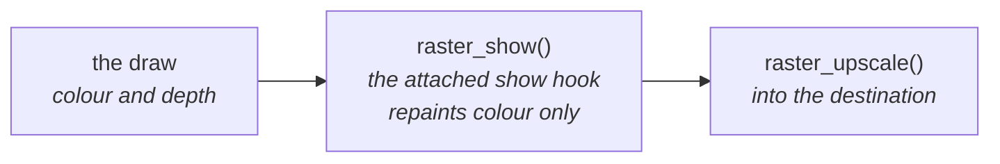

# View Modes

Development builds select one row from the `render_debug_view_t` table in
`render/context/render_context.c`: depth, tiles, motion, meshlets or cull.

The depth and depth-tile views along a flythrough:

| Call | What it does with the row |
|---|---|
| `render_context_set_debug_view()` | Attaches it and owns its zeroed PSRAM state; switching frees the previous state |
| `RENDER_DEBUG_VIEW_SHADED` | Detaches it |
| `render_context_release()` | Frees its state |
| `render_context_debug_view()` | Exposes its name and constructor to tools |

| View | The colour buffer becomes |
|---|---|
| shaded | untouched: the baked colours as drawn |
| depth | the depth as a grey ramp, nearest white and farthest black |
| tiles | the same ramp, each `RASTER_SHOW_TILE` square at its farthest depth |
| motion | mid-grey for none, red for x and green for y |
| meshlets | a flat hue for each cluster, with disjoint IDs for each instance |
| cull | each cluster in the colour of its fate this frame; see [The cull, seen](../Mesh-Rendering.md#the-cull-seen) |

A row may also carry two optional hooks:

| Row hook | What it does |
|---|---|
| `second_view` | After the frame's draw and after each draw it asks for, may name another view and fill the census list with the clusters to draw through it, and its depth scale; the frame's stats stay those of the first draw |
| `overlay` | Draws lines over the composed picture; the shell then composes at full size, not into a half picture |

- The ramp is stretched over the range this frame drew: the most detail
  within a frame, not comparable between frames.
- A pixel nothing drew takes the raster's `clear`, the colour upscaling gives
  it, so it reads as empty in every view; a tile holding one such pixel is
  empty.
- The views are at the raster's own size, before upscaling.
- `r3d_span.h` defines the depth encoding they read.
