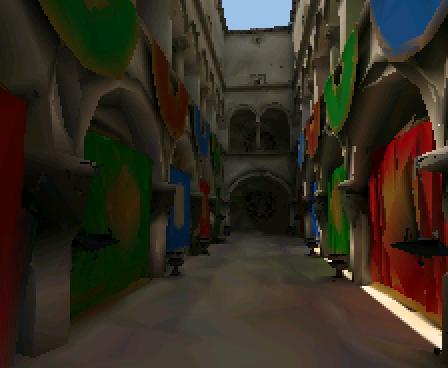
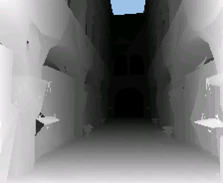
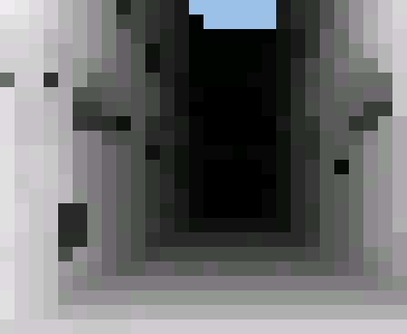
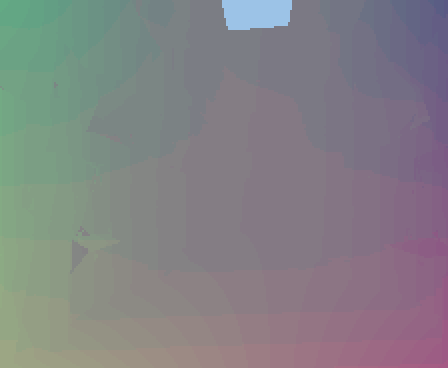
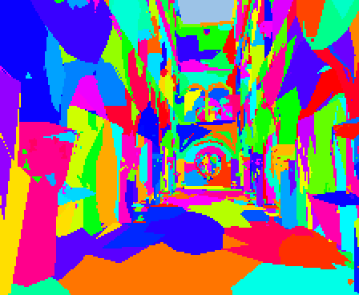
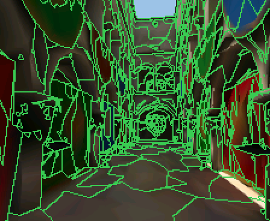
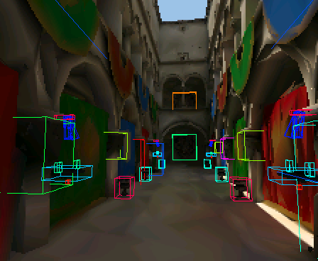
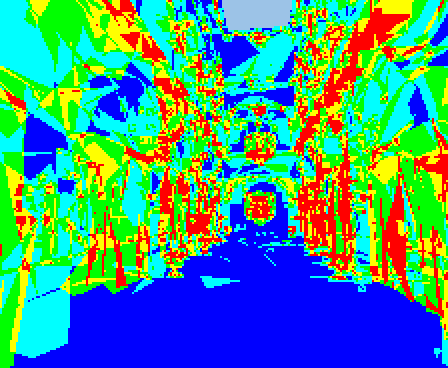
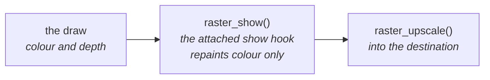
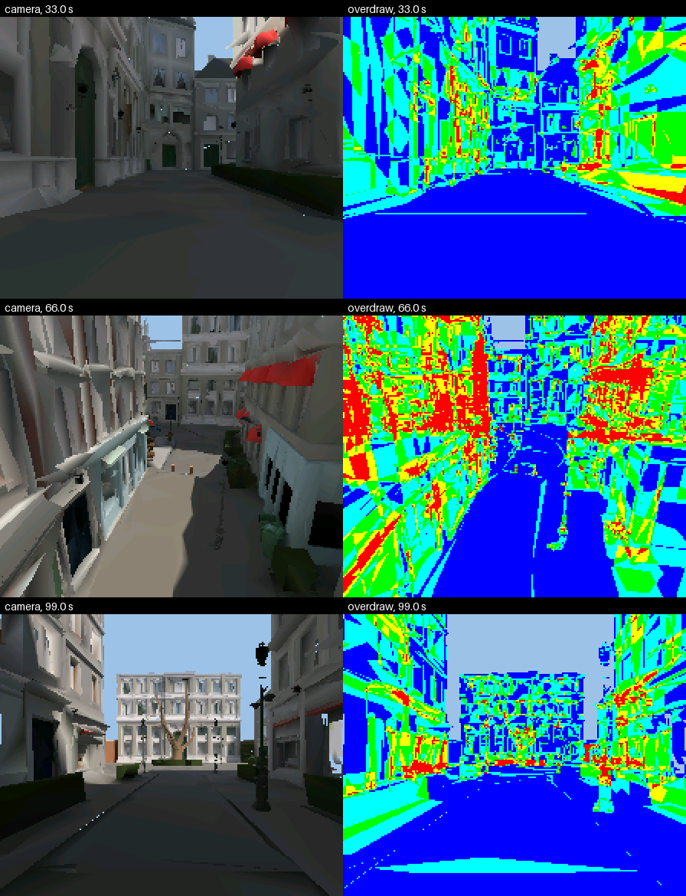

# View Modes

Development builds select one row from the `render_debug_view_t` table in
`render/context/render_context.c`: depth, tiles, motion, meshlets, cull, boxes or overdraw.

Every view, drawn at the same pose:

| View | Looks like | The colour buffer becomes |
|---|---|---|
| shaded |  | untouched: the baked colours as drawn |
| depth |  | the depth as a grey ramp, nearest white and farthest black |
| tiles |  | the same ramp, each `RASTER_SHOW_TILE` square at its farthest depth |
| motion |  | mid-grey for none, red for x and green for y |
| meshlets |  | a flat hue for each cluster, with disjoint IDs for each instance |
| cull |  | each cluster in the colour of its fate this frame; see [The cull, seen](Culling.md#the-cull-seen) |
| boxes |  | untouched; its overlay draws each instance's box as the frame placed it, one hue per mesh, for meshes drawn at least `boxview.copies` times; edges behind the drawn depth hidden, dimmed or full by `boxview.behind` |
| overdraw |  | each pixel by how many triangle spans tested it, on a fixed ramp; see [Overdraw, seen](#overdraw-seen) |

The depth and depth-tile views along a flythrough:

| Call | What it does with the row |
|---|---|
| `render_context_set_debug_view()` | Attaches it and owns its zeroed PSRAM state; switching frees the previous state |
| `RENDER_DEBUG_VIEW_SHADED` | Detaches it |
| `render_context_release()` | Frees its state |
| `render_context_debug_view()` | Exposes its name and constructor to tools |

A row may also carry optional hooks:

| Row hook | What it does |
|---|---|
| `second_view` | After the frame's draw and after each draw it asks for, may name another view and fill the census list with the clusters to draw through it, and its depth scale; the frame's stats stay those of the first draw |
| `overlay` | Draws lines over the composed picture; the shell then composes at full size, not into a half picture |
| `reserve` | Before each draw, makes room in the state for that draw's instances; when it cannot, the view is detached with an error log and the frame draws shaded |
| `release` | Frees what `reserve` took, before the context frees the state |

Overlays draw with `render/view/raster_lines.h`: segments and boxes in a lens's space, cut at the near plane, optionally dimmed or left out where the drawn depth is nearer.

- The ramp is stretched over the range this frame drew: the most detail
  within a frame, not comparable between frames.
- A pixel nothing drew takes the raster's `clear`, the colour upscaling gives
  it, so it reads as empty in every view; a tile holding one such pixel is
  empty.
- The views are at the raster's own size, before upscaling.
- `r3d_span.h` defines the depth encoding they read.

## Overdraw, seen

The overdraw view ([raster_overdraw.h](../../../launcher/main/render/view/raster_overdraw.h))
counts, per pixel, the triangle spans that reached it and those that won their
depth test. It paints the tested count on a hue ramp, the same every frame:
blue for one layer, through cyan, green and yellow, to red at
`RASTER_OVERDRAW_RAMP_LAYERS` or more.

- A cluster the cull drops never reaches a pixel, so it adds nothing here.
- A hidden cluster (red in the cull view) adds tested layers but no written ones.
- The view's frame totals (pixels, layers tested and written, the most at one
  pixel) are kept for a caller to print; `RASTER_OVERDRAW_LINE` is their line.

Bistro in landscape at the scene's own render size, at the same poses as its
[cull sheet](Culling.md#the-cull-seen):

Most extra layers lose their depth test at once, because the cull walk visits
clusters roughly near to far. Each costs a depth compare, not a shaded pixel,
so a frame's time follows the triangles set up
([What a cluster and a triangle cost](Culling.md#what-a-cluster-and-a-triangle-cost))
more than its layers.
