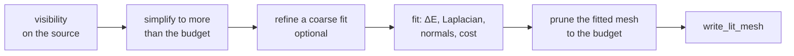
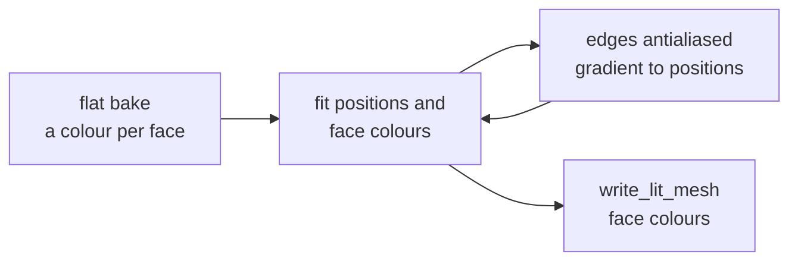

# Appearance Fit

A fit remakes a baked mesh so it looks like the full-detail source from the
camera's path. It is appearance-driven simplification<sup>[[1]](../../Citations.md#hasselgren-2021)</sup>:
it starts from the renderer's bake at its budget and moves welded positions and
colours against reference renders, keeping the triangles. The budget and the
frame cost hold.

Use it for a mesh seen from known views when the simplifier's colours or
silhouettes visibly drift from the source. It needs a CUDA GPU and minutes per
mesh, and costs nothing at run time. A renderer asks for one with a `fit` table
([Scene-Files.md](../scene/Scene-Files.md#fitprune)); [`fitted_variant.py` remakes the mesh](../../../launcher/tools/r3d/README.md#appearance-fit)
in its GPU environment. A `fit` table records the budget, the training,
held-out and coverage poses, the optimiser settings and the output hashes; the
reference, fitted-output, crop and heatmap sheets are in the scene tools README.
Measured results are in
[Bake-Quality.md](Bake-Quality.md#appearance-fit-of-the-lite-and-full-meshes).


| Key | Symbol | What it does |
|---|---|---|
| `fit.prune.budget` | | triangles the fitted mesh keeps after pruning, at most the variant's `triangles` |
| `fit.prune.coverage_every_ms` | | camera-path spacing of the dense poses pruning counts pixels over, at `size` widened |
| `fit.poses.size` | | pose resolution for training, held-out references and coverage |
| `fit.poses.train_every_ms` | | camera-path spacing of the training poses |
| `fit.poses.held_out_every_ms` | | which of those poses are held out and only scored |
| `fit.optimise.steps` | $`K`$ | optimiser steps |
| `fit.optimise.batch` | $`\lvert B\rvert`$ | training poses drawn each step |
| `fit.optimise.laplacian` | $`\lambda`$ | how strongly the mesh keeps its starting shape: higher holds local detail in place, lower lets it move to match colour |
| `fit.optimise.normal_weight` | $`\lambda_n`$ | how strongly fitted normals must match the source's where both cover a pixel, so geometry agrees from every view |
| `fit.optimise.surface_weight` | $`w`$ | how strongly the fit stays on the source surface |
| `fit.optimise.surface_margin` | $`\epsilon`$ | how far from the source face's plane, in local edge lengths, a sample may sit before the surface penalty starts |

## Stages

Source visibility is the renderer's
[`visibility`](../scene/Scene-Files.md#visibility-camera_region) (region by default). A
region source keeps the backing surfaces that simplification and fitting would
otherwise expose.



Each pose of a dense set counts the pixels $`a_t`$ each fitted triangle
shows; pruning removes zero-coverage triangles first, then the least-covered,
to the budget. Coverage uses fitted positions and fitted per-face colours for
flat meshes, so visibility is judged on the geometry that is drawn.

A warm start splits the worst fitted triangles along their longest edge, grows
the mesh to a larger budget, and fits it again.

## Poses

`size = [width, height]` is two positive integers. Coverage widens this view to
cover both panel orientations. Of the samples `train_every_ms` takes from the
camera path, those at multiples of `held_out_every_ms` (time 0 aside) are held
out of training and used only for scoring.

## Cost model

The cost model predicts pose time $`\hat t_v`$ from a non-negative least-squares
fit<sup>[[6]](../../Citations.md#lawson-1974)</sup> to board frame times: a constant; clusters in view $`N_{s,v}`$; drawn
triangles $`D_v`$; their screen rows $`\rho_t`$; pixels covered before the depth
test $`\alpha_t`$; and clusters in view $`N_{c,v}`$:

```math
\hat{t}_v = w_0 + w_s\,N_{s,v} + w_d\,|D_v| + w_\rho \sum_{t \in D_v} \rho_t + w_\alpha \sum_{t \in D_v} \alpha_t + w_c\,N_{c,v}
```

`cost_model.py` fits and applies the weights, retaining them and their source
frames beside the model. The cost term $`\mathcal{E}_c`$ of [the loss](#the-loss)
trades appearance for predicted time alongside the triangle budget. Generated
tables and findings live in the scene tools README.

## The loss

The fit draws welded positions $`P`$ and vertex colours $`C`$ with a
differentiable rasterizer $`\mathcal{R}`$, nvdiffrast<sup>[[2]](../../Citations.md#laine-2020)</sup>, over a random batch $`B`$ of training
poses. $`\Omega`$ is the frame pixels, $`P^0`$ the start positions, $`N(i)`$
the positions sharing an edge with $`i`$, $`\bar e`$ the start mean edge
length, $`e_i`$ each vertex's mean start edge length capped at $`\bar e`$,
$`\hat n`$ the fitted normal, $`n^{\rm ref}`$ the reference normal, and
$`\hat t_v`$ the predicted frame time for pose $`v`$. It minimises:

```math
\min_{P,\,C}\; \mathcal{E}_{\Delta E}(P, C)
+ \lambda\,\mathcal{E}_{\mathcal{L}}(P)
+ \lambda_n\,\mathcal{E}_n(P)
+ \kappa\,\mathcal{E}_c(P)
+ w\,\mathcal{E}_s(P)
```

$`\lambda`$, $`\lambda_n`$ and $`w`$ are the scene keys above; $`\kappa`$ is the
cost weight, set by `fitted_variant.py sweep --cost-weights`.

| Term | Measures |
|---|---|
| $`\mathcal{E}_{\Delta E}`$ | mean $`\Delta E_{76}`$, the CIE 1976 $`\Delta E^*_{ab}`$<sup>[[4]](../../Citations.md#iso-11664-4)</sup>, between $`\mathcal{R}_v(P, C)_p`$ and reference $`T_{v,p}`$ over $`B`$ and $`\Omega`$ |
| $`\mathcal{E}_{\mathcal{L}}`$ | mean squared, edge-length-normalised change in the uniform Laplacian<sup>[[5]](../../Citations.md#sorkine-2005)</sup> |
| $`\mathcal{E}_n`$ | mean L1 normal difference over jointly covered pixels $`\Omega_v^{\cap}`$ |
| $`\mathcal{E}_c`$ | mean predicted frame time $`\hat t_v(P)`$ over $`B`$ |
| $`\mathcal{E}_s`$ | distance from the source surface beyond a margin ([Surface](#surface)) |

```math
\mathcal{L}(P)_i = P_i - \frac{1}{|N(i)|}\sum_{j \in N(i)} P_j
```

```math
\mathcal{E}_{\Delta E}(P, C) =
\frac{1}{|B|}\sum_{v \in B}\frac{1}{|\Omega|}\sum_{p \in \Omega}
\Delta E_{76}\!\left(\mathcal{R}_v(P, C)_p,\; T_{v,p}\right)
```

```math
\mathcal{E}_{\mathcal{L}}(P) =
\frac{1}{|V|}\sum_{i \in V}
\left\lVert \frac{\mathcal{L}(P)_i - \mathcal{L}(P^0)_i}{e_i} \right\rVert^2
```

```math
\mathcal{E}_n(P) =
\frac{1}{|B|}\sum_{v \in B}\frac{1}{|\Omega_v^{\cap}|}
\sum_{p \in \Omega_v^{\cap}}
\left\lVert \hat n_v(P)_p - n^{\rm ref}_{v,p} \right\rVert_1
\qquad
\mathcal{E}_c(P) = \frac{1}{|B|}\sum_{v \in B}\hat t_v(P)
```

Adam<sup>[[3]](../../Citations.md#kingma-2015)</sup> takes the steps, both learning rates decay as
$`\eta_k = \eta_0 \cdot 0.1^{k/K}`$ over $K$ steps, and colours are clamped to
$[0, 1]$ after each. Where nothing is drawn the renderer shows the scene's
clear colour, as the device and reference do.

The fitted colours are a bake in their own right, so the fitted mesh enters the
import at its writer and is not lit again. A fit is judged on held-out poses by
the same scores and sheets as any other bake. One mesh can fit the whole path,
or meshes can fit path segments and swap as the camera moves; segment fits see
fewer training poses.

### Surface

The surface term anchors fixed barycentric samples of the fitted triangles to
area-weighted samples of the alpha-masked source used for the reference renders.
A seeded RNG fixes both sample sets; CPU nearest-neighbour queries refresh the
source correspondences at `SURFACE_QUERY_EVERY` steps. Sampling counts and the
small distance-pull weight live beside it in `appearance_simplify.py`.

For a fitted sample $`x`$, its nearest source sample $`c`$ and that source
face's normal $`n`$, write $`d=(x-c)/e_x`$, where $`e_x`$ is the mean $`e_i`$ over the corners
of the triangle holding $`x`$. The surface contribution is
$`w\,\mathrm{mean}(\max(0,|n\cdot d|-\epsilon)^2+t\lVert d\rVert^2)`$,
where $`w`$ is `surface_weight`, $`\epsilon`$ is `surface_margin`, and $`t`$
is `SURFACE_TANGENTIAL_WEIGHT`. Both distances are measured in $`e_x`$.
The plane envelope is zero inside the margin; the small pull remains active there.

### Seams

A start border point within `SEAM_MARGIN` × its capped local start edge scale
of another part's triangle is moved onto that triangle. It then follows the
triangle at fixed start barycentrics, so parts that overlapped in the start
cannot pull apart into cracks. Nearest contacts win, and a held point never
anchors another hold.

### Normals

Colour alone permits geometry that matches one view but differs from another.
The reference and fit turn normals toward the eye, and the normal term needs a
second drawing per view. The error reported beside $`\Delta E`$ is the mean
normal angle:

```math
\theta = \frac{1}{|\Omega^{\cap}|}\sum_{p \in \Omega^{\cap}} \arccos\!\left(\hat{n}_p \cdot n^{\mathrm{ref}}_p\right)
```

### What is reported

Colour history, `loss.txt` and the printed mean ΔE76 exclude the surface,
normal, Laplacian and cost penalties. The surface loss is reported beside
drift. Pruning counts shown pixels at the recipe's coverage spacing; this
sampling is part of the reference cache key. The generated normal-angle
heatmaps and sweep findings live in the scene tools README.

## A flat fit

A renderer with both `shading = { flat = ... }` and a `fit` table is fitted
flat: its start is a flat bake of its variant, and $`C`$ holds one colour per triangle
instead of one per vertex. The positions are fitted as before, so a face's
edges move to where one colour reads best, along a shading change. Each pixel
takes its triangle's colour:

```math
\mathcal{R}_v(P, C)_p = C_{\tau_v(p)}
\qquad \tau_v(p) = \text{the triangle pixel } p \text{ shows in pose } v
```

A pixel inside a face does not depend on $`P`$, so the position gradient comes
only from the edges. The fit draws every triangle with three vertices of its
own, so every edge, not only a silhouette, is antialiased and passes a
gradient to the positions on both sides; those vertices still read one welded
position each, so faces cannot part. Pruning, the warm start and the writer
keep each colour with its triangle, and the device draws the result as any flat
mesh, at a flat mesh's cost.



[Bake-Quality.md](Bake-Quality.md#the-demo-variants) compares a flat bake
with its flat fit.

## Against the paper

The fit keeps the paper's<sup>[[1]](../../Citations.md#hasselgren-2021)</sup> method: a decimated start with
fixed triangles, a differentiable rasterizer<sup>[[2]](../../Citations.md#laine-2020)</sup>, Adam<sup>[[3]](../../Citations.md#kingma-2015)</sup>,
a uniform-Laplacian drift term relative to the start,
and a learning rate decaying geometrically. It changes the rest:

| | Paper<sup>[[1]](../../Citations.md#hasselgren-2021)</sup> | This fit |
|---|---|---|
| Fitted | positions, textures, normal maps, material parameters | welded positions and vertex or face colours, which are the lighting bake |
| Forward model | deferred physically based shading | the device's Gouraud or flat colours, no shading |
| Image term | L1 on log-tonemapped sRGB | mean CIE 1976 $`\Delta E^*_{ab}`$<sup>[[4]](../../Citations.md#iso-11664-4)</sup> |
| Position step | plain Adam on positions<sup>[[3]](../../Citations.md#kingma-2015)</sup> | Adam on an offset scaled per vertex by its capped local start scale, so small parts step in proportion to their size |
| Laplacian weight | decays during the fit | constant $`\lambda`$; each vertex's drift uses its own mean start edge length, capped at the start's mean edge length |
| Further terms | none | a point-to-plane band, of half-width `surface_margin`, from the fit to the source surface and a small tangential pull, both in the mean of that capped scale over each sample's triangle; $`\mathcal{E}_n`$ against reference normals; $`\mathcal{E}_c`$, predicted frame time<sup>[[6]](../../Citations.md#lawson-1974)</sup> |
| Triangle budget | set by the start | the fitted mesh's, pruned to `budget` by coverage after fitting; a refined fitted mesh can be the start |

A global unit gives small parts a fraction of the hold, so the image term
stretches them; local edge scales keep the hold even<sup>[[78]](../../Citations.md#desbrun-1999)</sup>.
Adam's step length does not depend on gradient size, so the position offset is scaled by the same local scale.

Section 5.3 of the paper has no distance-to-reference term<sup>[[1]](../../Citations.md#hasselgren-2021)</sup>.
Here the start is already a decimation of the reference surface, so the fit can
be held to that surface: the relative Laplacian alone is blind to smooth
drift, which the band limits.
