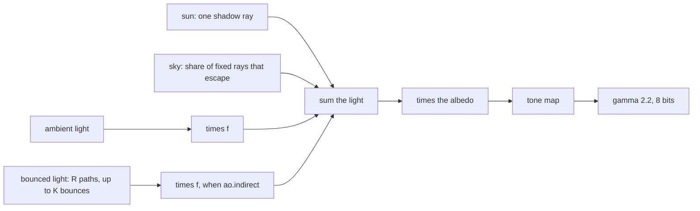
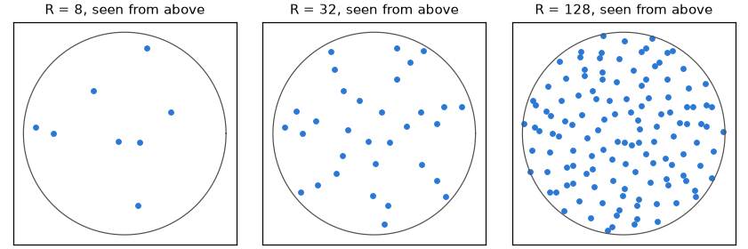
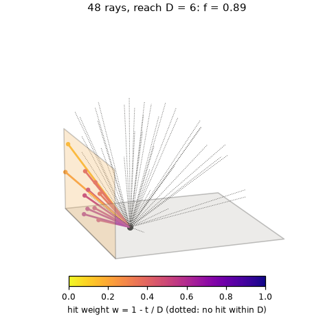
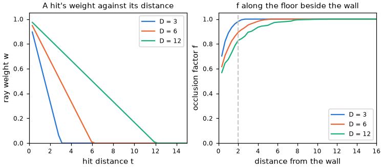
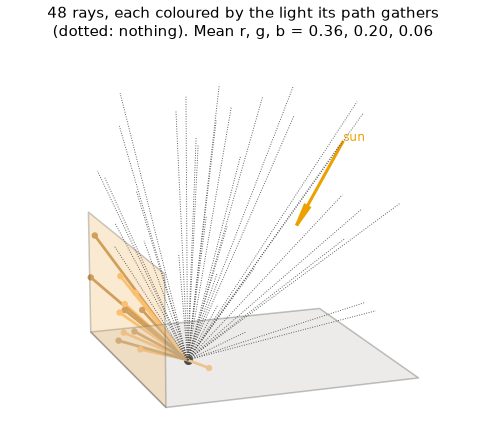
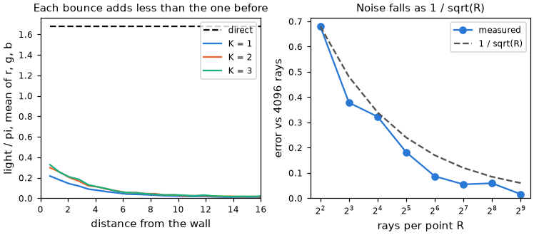
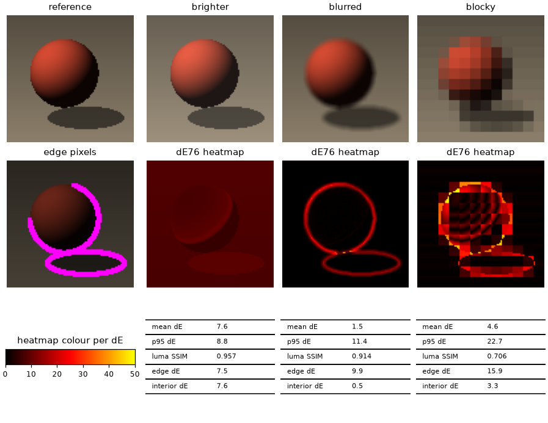

# Bake Method

How a bake's light is computed and how a bake is scored against its source:
local occlusion, bounced light, and the fidelity numbers. Measured results are
[Bake-Quality.md](Bake-Quality.md); the settings are in [Scene-Files.md](../scene/Scene-Files.md).

Every baked point, a smooth vertex or a flat face sample, gets its colour the
same way:



The sun is a point source, so it casts hard shadows. The sky, occlusion and
bounce rays each take the first $R$ of one fixed list of directions, $R$ their
own setting, laid out in each point's tangent frame. The list is
cosine-weighted, so it is even on the disc seen from above, for any $R$.



## Local-occlusion implementation

The [`ao` setting](../scene/Scene-Files.md#bake-ao) darkens a point that has geometry
close around it: a distance-limited obscurance<sup>[[14]](../../Citations.md#zhukov-1998)</sup>.
The point casts $R$ rays. A ray that hits a surface at distance $`t_i`$ within
the reach $D$ counts $`w_i = 1 - t_i/D`$; any other ray counts nothing.



With strength $s$ the factor is

```math
f(x) = 1 - \frac{s}{R} \sum_{i=1}^{R} w_i
```



A point farther than $D$ from everything keeps $f = 1$. A double-sided surface
has no side it is meant to be seen from, so it takes the larger $f$ of its two
sides. In the demo scene the factor darkens the foot of every wall and column:


## Bounced-light implementation

The [bake recipe](../scene/Scene-Files.md#bake-indirect) adds diffuse bounce light to
the same vertex or face colours as direct light. The renderer reads one colour,
so frame cost and mesh size do not change; only the bake takes longer.

The bake exports the full-detail source mesh, its textures at full resolution,
and the scene's sun and sky to Mitsuba<sup>[[15]](../../Citations.md#mitsuba3)</sup> once.

Each ray from a point is a path<sup>[[16]](../../Citations.md#kajiya-1986)</sup>: Mitsuba
follows it for up to $K$ bounces, with a shadow ray toward the lights at every
hit. What comes back holds the hit's own shadow, albedo and further bounces.



The mean of the $R$ rays is the bounced light (irradiance over $\pi$). It adds
to the direct light before the albedo, as in the diagram above:

```math
E_{\mathrm{ind}}(x) = \frac{1}{R} \sum_{i=1}^{R} L_i(x),
\qquad
L(x) = a(x)\,\bigl(E_{\mathrm{direct}}(x) + E_{\mathrm{ind}}(x)\bigr)
```

A ray that escapes adds nothing, because the sky light already counts the sky.
Each bounce adds less than the one before, since every albedo is below 1: pick
$K$ where the next bounce is negligible beside the direct light.

The paths' noise falls as $1/\sqrt{R}$.



| Rule | Why |
|---|---|
| Same first directions per point, fixed path seed | The same tree and the same partition of points give the same bytes |
| One gather for the vertex copies a crease splits | Bounced light changes slowly; copies that differ only in it would stop merging |
| A double-sided surface is lit on both sides and keeps the brighter | A card in the sun takes its sunlit side, a curtain in shade its open side |
| A ray reaching a one-sided triangle from behind finds no light | Light does not pass through shells |

The [indirect look](../scene/Scene-Files.md#indirect) controls bounced intensity and
bounce reflectance. The cost is $R$ paths of up to $K+1$ segments per baked point.

The light's resolution is the baked mesh's vertex or face spacing: bounce detail
smaller than a triangle is lost, and a coloured surface tints only the triangles
it reaches.


## Fidelity against a reference

How close is a bake to the ground truth, and where is it off? The reference
renderer lights the full source mesh per pixel, with the scene's own lights,
shadows and tone map, at the device render size and supersampled, for the
poses of the scene's camera path. A host render of any variant, smooth, lite
or flat, is scored against it. Flat and full beside their fitted variants at
two poses, each with its ΔE heatmap on one colour scale:


Each number catches a different kind of error. A test picture under three
changes, scored by the same code:



| Number | Meaning | Catches |
|---|---|---|
| Mean ΔE76 | CIE76 colour difference per pixel, averaged per frame, then over the frames; about 2 is just visible, 20 a clearly different colour | An overall shift, such as a brighter bake |
| p95 ΔE76 | The 95th percentile of the pixels' ΔE in each frame, averaged over the frames: how bad the worst places are | Errors packed into few pixels, such as a blurred shadow |
| Luma SSIM | Structural similarity of luma, 1 for identical | Lost shape and contrast, such as blocky colour |
| Edge and interior ΔE76 | ΔE on the pixels at a sharp luma step of the reference (silhouettes, shadow boundaries), and on the rest | Whether the error is at edges or across surfaces |

Heatmaps go from black (a match) through red (about 20) to yellow (50 or
more). The commands that make the sheets are in
[`launcher/tools/r3d/README.md`](../../../launcher/tools/r3d/README.md#fidelity-reference);
a scene's scores live beside its own tools.

The ceiling for a flat bake is the smooth bake's own error. Smooth, one colour
per vertex, is not exact either, and flat adds the colour gradient across each
triangle, which no face sampling brings back.

### The scores, exactly

ΔE76 is the straight-line distance between a render pixel and the reference
pixel in CIELAB<sup>[[4]](../../Citations.md#iso-11664-4)</sup>. The steps from an 8-bit pixel,
with their constants in `colour_maths.py`, which both the scoring and the fit's
loss read:

| Step | This tree | Standard |
|---|---|---|
| Decode | $(c/255)^{2.2}$ | The piecewise sRGB curve<sup>[[10]](../../Citations.md#iec-61966-2-1)</sup> |
| To XYZ | Linear sRGB primaries<sup>[[10]](../../Citations.md#iec-61966-2-1)</sup> | Same |
| To CIELAB | Relative to the D65 white $(0.95047, 1, 1.08883)$ | Same |
| Distance | $`\Delta E_{76} = \lVert \mathrm{Lab}(R_p) - \mathrm{Lab}(T_p) \rVert`$ for render $R$, reference $T$ | Same |

Each frame's mean and p95 of it are averaged over the frames. Luma
SSIM<sup>[[9]](../../Citations.md#wang-2004)</sup> is the paper's formula with these
choices:

| Choice | This tree | Paper |
|---|---|---|
| Signal | Gamma-encoded luma $y = 0.2126 r + 0.7152 g + 0.0722 b$, channels 0 to 1 | Greyscale |
| Window | Every 8 by 8 window, unweighted | 11 by 11, Gaussian-weighted |
| Constants | $`C_1 = 0.01^2`$, $`C_2 = 0.03^2`$ | Same |
| Result | Mean over all windows | Same |

The edge pixels, magenta in the score figure, are those within one pixel of a
step in the reference's luma steeper than 0.06 a pixel. Edge ΔE averages over
them and interior ΔE over the rest.

Appearance fitting, its objective, and its budget and cost choices are
in [Appearance-Fit.md](Appearance-Fit.md).
