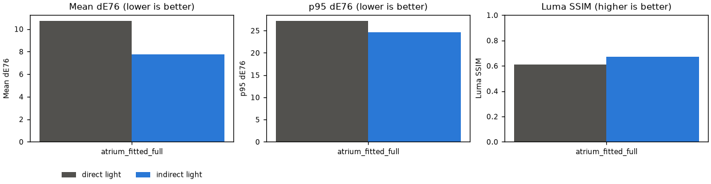
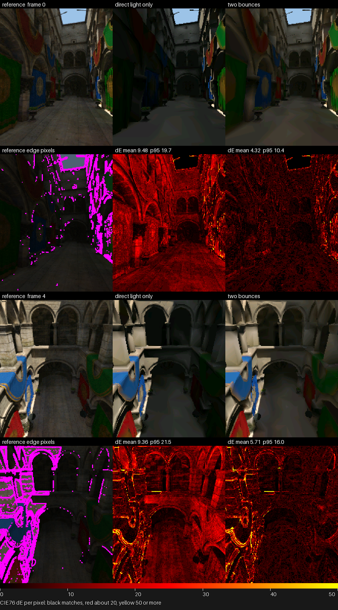
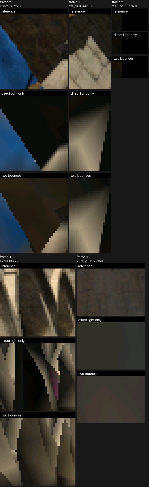
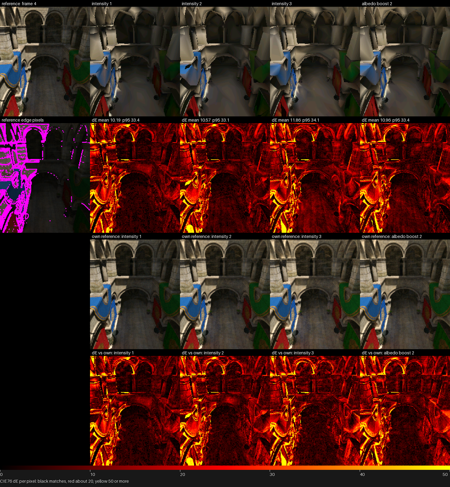
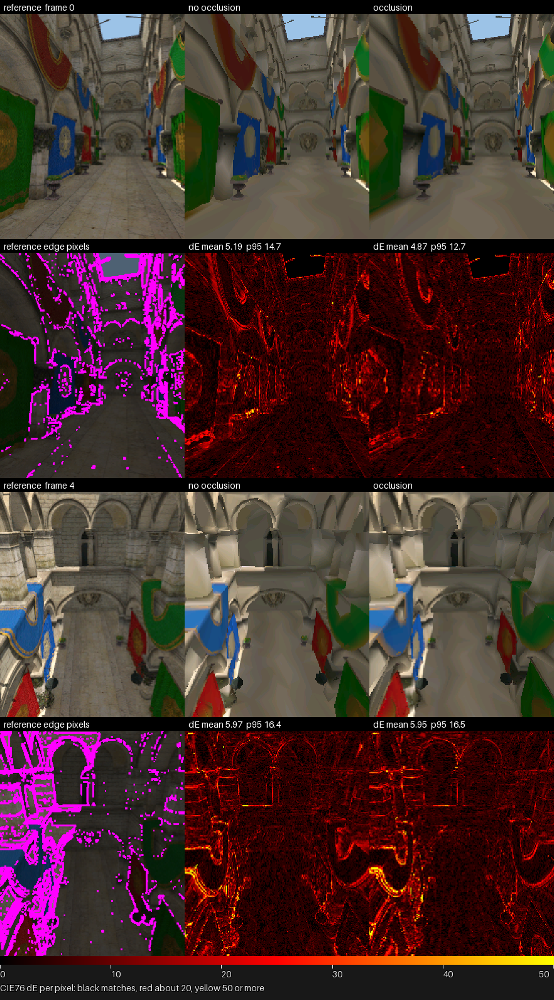
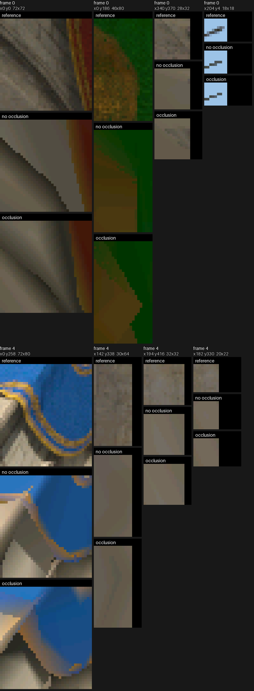

# Bake Quality

What each bake option buys, measured on the Sponza atrium along its flythrough
against the source model lit per pixel. How a bake is made and scored is
[Bake-Method.md](Bake-Method.md); the settings are in [Scene-Files.md](../scene/Scene-Files.md).
Every image, chart and table here is regenerated from the source
([Render-Harness.md](../../tools/Render-Harness.md#images-in-these-docs)).

## Fidelity against the source

The scene's fitted bake scored against the source lit per pixel at the
camera-path poses; the scores are defined in
[Bake-Method.md](Bake-Method.md#fidelity-against-a-reference).

Fidelity scores

<!-- generated: sponza-fidelity sha256=3100630fd693d0f88f9158e41875070d65cf9dab0b803ee197959e850232bce9 -->
| Variant | Mean dE76 | p95 dE76 | Luma SSIM | Edge dE76 | Interior dE76 |
|---|---:|---:|---:|---:|---:|
| atrium_fitted_full | 6.781 | 20.984 | 0.6994 | 12.855 | 5.494 |
<!-- /generated: sponza-fidelity -->

What the fit buys over the simplifier at the same budget: the reference, the
fit's start (the import simplified to the fit's budget), the fit, then each
one's ΔE heatmap on one colour scale.

### Appearance fit

The fit is appearance-driven simplification[[1]](../../Citations.md#hasselgren-2021);
[Against the paper](Appearance-Fit.md#against-the-paper) lists what it changes.
The GPU stage rebuilds the fit's start, its path cull and the fit from the
scene's recipe and scores them against held-out poses. These are scratch
outputs; the board table measures the committed asset.

<!-- generated: sponza-gpu sha256=004310de23d1d3ede4be5737fea3df96589330524e3c9e8b073803d2c099c13d -->
Run the documented stage to populate this comparison from current inputs.
<!-- /generated: sponza-gpu -->

### Budget and normal sweeps

The budget sweep varies the recipe's pruning budget and cost weight: held-out
error against predicted time. The predictions use the board's cost weights, as
fresh as its last board stage.

<!-- generated: sponza-budget sha256=004310de23d1d3ede4be5737fea3df96589330524e3c9e8b073803d2c099c13d -->
Run the documented stage to populate this comparison from current inputs.
<!-- /generated: sponza-budget -->

The normal sweep varies only the recipe's normal term; the heatmaps show where
the geometry's normals leave the source's.

<!-- generated: sponza-normal sha256=004310de23d1d3ede4be5737fea3df96589330524e3c9e8b073803d2c099c13d -->
Run the documented stage to populate this comparison from current inputs.
<!-- /generated: sponza-normal -->

### Board measurements

The bake's frame cost along the flythrough, timed on the board by the perf
suite: the median of its mean over captures of one firmware commit. Its
per-pose timings fit the cost weights the predicted times above use.

<!-- generated: sponza-board sha256=004310de23d1d3ede4be5737fea3df96589330524e3c9e8b073803d2c099c13d -->
Run the documented stage to populate this comparison from current inputs.
<!-- /generated: sponza-board -->

<!-- generated: sponza-board-model sha256=004310de23d1d3ede4be5737fea3df96589330524e3c9e8b073803d2c099c13d -->
Run the documented stage to populate this comparison from current inputs.
<!-- /generated: sponza-board-model -->

## Indirect light

The scene's [bake-indirect settings](../scene/Scene-Files.md#bake-indirect) lift the
shadowed arcade ceilings and the column sides the sun misses, and tint a column
beside a banner with its colour. The renderer draws the precomputed colours.

Direct against indirect bakes of the scene's mesh, scored against the source
lit per pixel with physical bounced light. Both are bakes of the physical look,
the scene without its `[indirect]` table and occlusion.

Indirect light scores

<!-- generated: sponza-indirect sha256=4ca2e05cfa2b9ed627c883b6d4104faf973299196e1e5ff1c971e7184a1f3fd2 -->
| Variant | Mean dE76 | p95 dE76 | Luma SSIM | Edge dE76 | Interior dE76 |
|---|---:|---:|---:|---:|---:|
| atrium_fitted_full, direct light | 10.697 | 27.113 | 0.6112 | 18.059 | 9.343 |
| atrium_fitted_full, indirect light | 7.780 | 24.605 | 0.6730 | 16.619 | 6.152 |
<!-- /generated: sponza-indirect -->

The reference beside the scene's standard mesh fitted with direct and with
indirect light, each with its ΔE heatmap against the reference.

The places the two fits differ most, the reference above them.

| Where | Why bounce barely shows |
|---|---|
| Sunlit floor under a curtain | Direct light dominates; the small coloured term vanishes in the tone map and RGB565 |
| Shaded column | Bounce can exceed direct light, but both stay near black |
| Below a triangle | The reference resolves bounce detail finer than the mesh's vertex or face spacing |

The bounce itself is checked in linear light by a floor beside a sunlit wall
in [`test_r3d_path_bake.py`](../../../launcher/tools/tests/test_r3d_path_bake.py).
A Sponza bounce measurement needs the alpha-masked source and linear radiance,
not encoded vertex colours.

### Indirect look

The scene's [`[indirect]` table](../scene/Scene-Files.md#indirect) sets `intensity`, a
multiplier on bounced light, and `albedo_boost`, a multiplier on the
reflectance bounces use. The reference reads it too, so each look is scored
twice: against the physical reference (look and bake error together) and
against its own (bake error alone). The sheet shows the physical reference
above the bakes and each look's own reference below.
The sheet fits the standard mesh in each look, at the last held-out pose.

Look scores

<!-- generated: sponza-indirect-look sha256=76f4b4fb79d3d50832a6b8592bc159045886c4542c016487b5740da058cfa1d2 -->
| Look | Mean dE76, physical | Mean dE76, own | p95, physical | SSIM, physical |
|---|---:|---:|---:|---:|
| Direct light only | 10.697 | | 27.113 | 0.6112 |
| intensity 1 | 7.780 | 7.780 | 24.605 | 0.6730 |
| intensity 2 | 8.614 | 8.838 | 24.901 | 0.6570 |
| intensity 3 | 10.517 | 9.759 | 27.177 | 0.6235 |
| albedo boost 2 | 9.214 | 9.104 | 25.929 | 0.6465 |
<!-- /generated: sponza-indirect-look -->

## Local occlusion

The scene's [`[bake].ao`](../scene/Scene-Files.md#bake-ao) scales the ambient light,
and with `indirect = true` the bounced light, by how closed in a point is.
These images start from the physical look with a brighter ambient light, so
the occlusion has something to scale. The reference applies it per pixel and
the bake per vertex.

The sheet is the reference and the standard mesh fitted without and with
occlusion, at two held-out poses, each with its error heatmap.

The places the two fits differ most, the reference above them.

The factor alone, beside the reference:
[Bake-Method.md](Bake-Method.md#local-occlusion-implementation).
